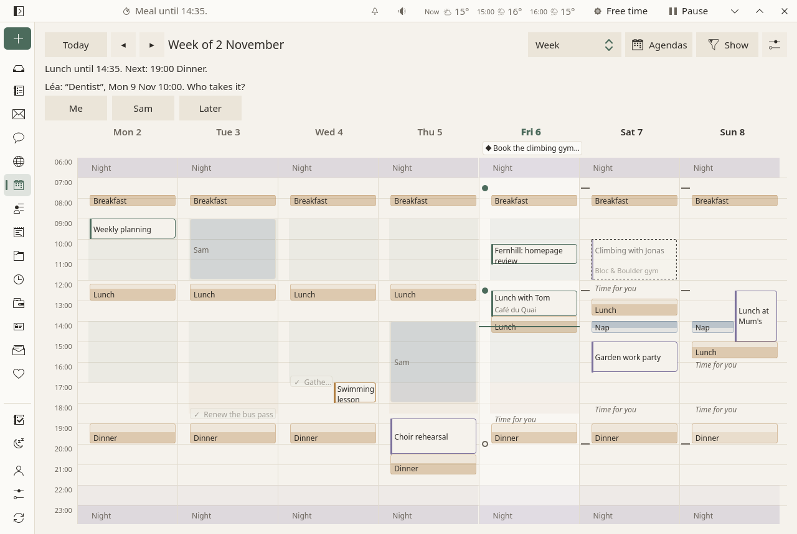

# Agenda

## In short {#in-short}

The agenda shows what comes, from today, as a calm list of days, with the day, the week and the month one switch away. Each event can keep time before it, to get ready and get there, and after it, to come back: your plan keeps that time free, lays your tasks around your events, and moves a meal that falls in one. Your agendas, your children's and those others share with you show together, filtered by your hours; Sioul shows where you would be in two places, and reminds you once, quietly, before you need to leave. Your events stay on your own calendar server, at Google or on this device, and nothing from an invitation enters your calendar until you answer it.

<figure markdown="span">
  [{ loading=lazy }](../assets/screens/agenda-week.png "Open the picture at full size")
  <figcaption>The week, one switch away from the list.</figcaption>
</figure>

## Protected by default {#what-is-protected}

- Your events stay on your calendar server, at Google, or on this device. Sioul has no server of its own: your plan, your reminders and the check for two events at once are worked out on your device.
- Sioul reaches your calendars only over an encrypted connection, and your password stays in your system's keyring.
- Nothing from an invitation enters your calendar until you answer it. Mail forged outright is set aside, invitation and all, and mail that fails the checks of the address it shows counts as a stranger's, whatever name it shows. Some servers add invitations to your calendar themselves; Sioul then shows what the server holds.
- Your answer to an invitation goes from your own mail account to the organiser, and carries only what the organiser needs: the event, its time and your answer, never the other guests.
- An event's notes are drawn from their Markdown, safely, whoever wrote them: HTML in them shows as words and no picture is drawn, so nothing loads from the network, and nothing runs. A link opens in your browser, never in Sioul, and says first where it leads.

## Four ways to look

A choice at the top of the page:

- **What comes**: today in full, then everything that comes, as a list, however far: it goes on as you scroll, a month at a time and on to the next thing beyond, never cut at two weeks; the days with nothing are left out. Today shows what remains of its appointments and pinned tasks, its meals and nap, its dates, tonight's night as its last row, and the plan's next step and the one after ("The plan: Call the CAF, then Sort the receipts"). Its doses are listed as the Porch lists them, one row a minute ("20:00 · Two doses"), never by name and with nothing to press: a tap opens them in Health. Every other day shows only what differs from your usual days: its appointments, its dates, a meal moved or added that day, a night without its alarm, a medicine taken every few days, and the plan's first step. A tap on the plan's line opens that day. ◂ and ▸ move it fifteen days back or on. This is where the page opens.
- **Day**, **Week**.
- **Search**: events and tasks found by words and filters, whatever the hour, and several changed at once ([Tasks](tasks.md#search)).
- **Month**: six weeks of days. On a computer, each day shows its dates first, then its appointments, three lines at most (fewer under the bars of events over several days), then "…"; a tap on a line opens it, a tap on the day's number opens that day. Days off are shaded. On a small screen, each day shows its number and at most two marks, a diamond for a date asked and a dot for appointments, and under the month "Dates and appointments this month" lists them day by day from today on; a tap on a day brings it to the top of that list. The Month shows no step, meal or dose.

The arrows ◂ and ▸ go earlier and later; **Today** comes back to today. Nothing is late or overdue: the past shows only when you go back to it.

The page follows the clock: the line at the current hour moves with it, and today becomes tomorrow at midnight. The page reads your calendars again every five minutes and whenever you come back to Sioul; your calendar server is asked every quarter of an hour, and at once after a change you make.

## Events over several days {#over-several-days}

A trip, a holiday, a residency, an event typed with a wrong end date: an event over several days is drawn once, never again under each day.

- **In the lists** (What comes, and the Week and Month lists of a small screen), it is one row on its first day, its whole span under its title: "Mon 2 Nov 10:00 → Mon 30 Nov 10:15"; an evening past midnight, "22:00 → 02:00 (Tue)". A thin line in its calendar's colour then runs down the list's left edge through every day it covers, and ends on its last day with a small mark and a row "until 10:15", even on a day with nothing else. A tap on the line opens the event. A list that starts after it began says "Ongoing since Mon 2 Nov, until Mon 30 Nov" at the top of its first day. Three lines run side by side at most; beyond them, the day's title says how many more ("+2").
- **In the Week and the Month**, an event of 24 hours or more, and one of several whole days, is one bar across its days: at the top of the week, its start time at one end and its end time at the other; in the month, once on each week's row, its title once on each. Its hours are not filled on the timeline, so what else happens on those days stays readable. In the Day, it is one line at the head: "Ongoing: Residency, until Mon 30 Nov 10:15", every one of them, however many. Three bars at most run side by side; beyond them "+2" under a day opens that day.
- **An evening past midnight**, shorter than 24 hours, keeps its hours in the Day and the Week, as other calendars draw it (a bar would hide them), and its line on both its days in the month.
- **Time off over several days** ([Settings ▸ Hours](settings.md#hours), **Time off**) is drawn the same way: one row on its first day, "All day", "Wed 4 Nov → Fri 6 Nov" under its word, a grey line through its days to "last day", one grey bar in the Week and the Month, whose cells stay shaded. A single day off stays at the head of its day, as before.
- **On the home card**, from the day after its first, it is one line under today: "Ongoing: Residency, until Mon 30 Nov 10:15".
- `sioul agenda` and the agents' agenda list it once, with its span; asked from a later day, "Ongoing since".

Only the drawing changes. The plan still keeps its hours busy and plans nothing on your days off, the warning for two events at once and the reminders read it as before, and your other calendar apps see the same event.

## Events

**New ▾ ▸ An event**, at the top of the places, or a double tap on a day or an hour (in a window too narrow for the places, a phone's or a tablet's in split screen, **New event** at the top of the page too): a title, when it starts and ends, where. **All day** is one tick. **Time zone**, under the times, is **Local time** at first (the zone your agenda shows, named); **UTC**, or **Another time zone…**, found by typing part of its name ("new y", "tokyo"), sets the clock the event keeps: a call set in UTC stays at its UTC time, summer or winter; an appointment in New York at its time there. On another clock, a line under the times says them here too: "15:00 – 16:00 UTC · 16:00 – 17:00 here". Editing an event keeps its clock. Folded under **More**: its notes; **Repeats**, every day, week, month or year, and **Every** so many of them from its first day (every 2 days: every other day); **Calendar**, which one it goes in, when you have several; and, if you want them:

- **Before** and **After**: the time to get ready and get there, and to come back ([below](#time-around-an-event)).
- **Remind**: when Sioul reminds you of it: as usual (a quarter of an hour before it and its time to get there, unless you change it in [Settings](settings.md#reminders)), not this one, or 5 minutes to 2 hours before. See [Reminders](#reminders).
- How much the event asks of you, and what it gives back: the same tiles as [a task's](tasks.md#what-it-costs-and-what-it-gives-back), **Thinking**, **Feelings**, **Worry**, **Body and senses** and **Gives back**, each from 0 to 10, with a word beside the number and a question in small print. A tap on a cell gives its value, the same tap clears it; each tile stays **unsaid** until you tap it. Your plan counts them ([below](#your-day-around-your-events)).

An event opens in its card: beside the page on a computer (over its right part when the page needs its room), the whole page on a small screen. It says its day, its time, its place, its calendar, and whether it repeats; **Edit** opens its form, and where it cannot change (a calendar you can only read, a meeting with others) the card says why instead. Its people follow: who organised it, then each guest with their answer (accepted, maybe, declined, no answer yet), "optional" when they are, by their contact's name when one of your contacts has their address; a tap on a contact's name opens their card. Its notes are folded under **More**. **Add steps and a list** makes a task that prepares it ([An appointment and its steps](tasks.md#the-plan)); once there, the details name it, with its next step. A list to tick in its notes ("Bring: - [ ] Carte Vitale") ticks there, unless the event is a meeting with others: its list is then its organiser's ([A list to tick](tasks.md#a-list-to-tick)). It opens the same way from a link (a task's tie, the day on the Tasks page), its days shown; its menu (right click, or a long press on a touch screen) offers **Details** first, then **Edit**.

- **To change it**: **Edit**.
- **To delete it**: **Delete**. It waits ten seconds, with **Undo**. A repeating event asks first: **Only this time**, or **Every time**.
- **A meeting someone else organises**, an event with guests that another person invited you to: its time, title, place, notes and calendar are its organiser's, since its server tells every guest of a change. Sioul neither drags nor deletes it, and its form changes only what is yours: the time kept before and after it, its costs and what it gives back, your reminder. An event that names only an organiser, as Google writes into your own events, stays yours to change.
- **A meeting you organise**, one you invited people to: every field is yours, and its guests too ([Inviting people](#inviting-people)).

### A day and an hour {#a-day-and-an-hour}

Every form that asks for a time takes it with the keyboard alone or with the pointer alone.

- **With the pointer**: the clock button at the end of an hour opens a panel, as the calendar button beside a day opens its month. The panel shows the 24 hours and the minutes by fives, with **−1** and **+1** for those between. Each click applies at once, and an hour clicked with no minutes yet gives :00. A click outside keeps the time, Escape gives back the one before, and nothing asks for OK. A day picked moves on to the hour beside it, with its panel open.
- **With the keyboard**: Tab goes from the day to the hour, past the buttons. Type `1430`, `14:30` or `14h30`, `930` for 09:30, or `14` then Tab for 14:00. Up and Down change the time by five minutes, Page Up and Page Down by an hour, and Alt+Down opens the panel beside what you type.
- **On Android** (a touch screen): the buttons open a sheet at the foot of the screen, with cells a fingertip wide. The keyboard comes only when you tap the field itself.
- **Moving the start** moves the end with it, and the event stays as long as it was. Changing the end changes how long it lasts.

### Its status, its map and the way there {#status-map-directions}

- **Its status**: on an event of your own, a button under its place says it, **Confirmed**, **To be confirmed** or **Cancelled**, and changes it, with **Undo**. On the timeline, an event to be confirmed has a dashed outline, and a cancelled one is struck through; a cancelled one keeps no time from your plan. A meeting with others says its status when it is not confirmed, never changed here, and your own answer to its invitation ("You have not answered yet."); you answer with **Answer…**, as before.
- **Map**: on an event with a place, **Map** draws a small map of it, with a pin. Nothing is asked of a server before you press it. The event's own point comes first, when it has one; then a place you looked up before on this device; else the place is looked up once on OpenStreetMap, which the card says the first time. The map's tiles come from OpenStreetMap's tile server, only those in view, and stay on this device.
- **Directions**: opens the way there in your maps app, by a `geo:` link, when your system has an app for such links (Sioul checks each time); otherwise in a page: Apple's maps on a Mac, OpenStreetMap's directions elsewhere.

### Addresses as you type {#addresses-as-you-type}

In the event form, a place you type suggests addresses after a short pause: first the places you used before (your events' and your contacts'), from this device alone; then, from three characters, addresses from the Base Adresse Nationale when your region is France, else from Photon, five at most. Only what you type in the place is sent, never the event's title, and nothing is sent without the network. The first time, a line under the field says where it goes. Choose one, and its point is kept, so that its map needs no search; on an event of your own, the point is also written into the event, which your other apps can read. Type the place again, and the point goes. **Suggest addresses as you type**, in the [Agenda settings](#the-agenda-settings), turns the service off: the places used before stay.

### Inviting people {#inviting-people}

In the form of an event of your own, **Invite…** takes your guests' addresses. Type part of a name or an address, and Sioul suggests from your address books and from Your people, on this device alone; Enter, or a comma, adds the one typed or chosen, and the button beside a guest takes them off. Before it saves, Sioul says who hears of it, and how, and saves on **Save**:

- **A meeting you make in Sioul**: Sioul drafts every message to its guests, the invitation, each change and the cancellation, with its calendar file, and they leave when you send them from Mail: "Sioul drafts the messages to Anne, Bob; you send them from Mail." Each guest is marked as yours to tell, those you add later too, so that no server sends them anything.
- **A meeting made elsewhere** (in Nextcloud's web page, in Thunderbird): its guests stay with whoever told them. Your calendar's server tells them when it schedules meetings itself, as Nextcloud does, and knows you by the address you invite from: "Your server tells Bob."; a guest you add in Sioul is told the same way. Such a server sends a new time by itself, not a new place, title or notes: Sioul asks it to send those too, and that ask stays in the meeting until your server has it, through any save you make before your next sync. On a server that sends nothing, Sioul drafts for those guests too. Until Sioul has heard from your server what it does (on a new device, before its first sync), when your server does not say whose the calendar is, in a calendar someone shares with you (whether its server tells your guests there depends on its version: Nextcloud does from version 30), and in a Google calendar (Google does not say), such a meeting is not changed here, and Sioul says so; a meeting made in Sioul is drafted for there as anywhere.
- **A calendar of this device's own**, carried to your other devices by the sharing or not, has no server: Sioul drafts for every guest.

Never both. Your guests' answers come back into the event, through your server, or when you open an answer in Mail and Sioul can prove it comes from them; the card's people say them. Change the meeting later, take a guest off, drag it on the timeline or delete it: Sioul says first that it tells every guest ("Moving it tells every guest"), then your server or a draft tells them, and **Undo** puts it back, with the draft not sent yet. Its **status** in its card, and **Only this time** when you delete one time of a repeating meeting, go the same way. So far, inviting was tested against stand-ins of calendar servers only, never against Nextcloud or Google themselves.

What your drafts send your guests is what they need of it: its title, times, place, notes, its status and who else is invited. Your time around it, its costs and your reminder stay in your own file, as for a meeting someone else organises; what ties it to your messages, notes and projects stays among your own ties; and Sioul's other lines (who takes a child's event, its kind) stay in a file of Sioul's, carried sealed among your own devices: none of it is in the meeting your server keeps, which it sends whole to the guests it tells, nor any of Sioul's own addresses. What other apps wrote into the meeting stays as they wrote it: an alarm you set in Nextcloud, an attachment, its categories, a video link. A few cases are said as they come:

- **An event that names someone else as its organiser**, with nobody invited yet, becomes yours once you invite someone, and Sioul says so first: "You become its organizer, in place of Sam."
- **Undo of a deletion** whose cancellation you already sent puts an invitation for every guest in your drafts; when your server told them, it invites them again.
- **A change made on both sides**: when the meeting changed on its server before your change reached it, its server's version is kept, and yours among the earlier versions, as for any event. Sioul works out from the server's version what each guest still needs to hear: a message in your drafts that still says it stays, those that said your change are taken out, and a guest who still needs the server's version gets an invitation of it in your drafts; the guests your server tells are named, since it never had your change. Putting the earlier version back brings back your own lines of it alone, never the meeting's change: make it again from its form. Sioul sees the drafts your other devices made once the sharing brought them, and never makes a second message of the same version for the same guest; a message sent from another device before this sync is not seen here.
- **Undo** before your next sync sent the change asks nothing of your server, which still holds what your guests know. Once a guest heard of it, Undo tells them the change back, as a later version than the one they received. Once your server sent it, Undo says so: "Your server has told the guests; change it again to tell them otherwise."
- **Notes another app wrote** with no-break spaces or line ends the form gives back otherwise: a save that changes nothing else of them tells nobody, and the notes stay as they were written. A narrow no-break space you type (before a colon, in French) is a change, written as you typed it.
- **A deletion your server refused**, because the meeting changed there first (a guest answered there): the meeting comes back, said once, and its cancellation waiting in your drafts is taken out, since the meeting still stands. A guest you had already sent the cancellation to gets an invitation of it in your drafts, as when you undo a deletion.
- **A child's event whose guests were invited from another device**: who takes it and its kind travel between your devices with the time part of the sharing, once all your devices run a Sioul that carries them. Until they reach this device, its card says "Who takes it is not known on this device.", nothing asks of it, the event that follows it in your own agenda stays as it is, and its last guest stays: take it off where its card says who takes it.
- **A status on a meeting you organise**: **To be confirmed** and **Confirmed** tell its guests a new version of it; **Cancelled** tells them it is cancelled. Sioul says first who hears of it, and **Undo** works as for the other changes. If its cancellation is still unsent when you choose another status, it leaves your drafts, and nobody hears of either unless the status differs from what they last heard. A cancelled meeting stays as its guests heard it: to change it or its guests, give it another status first, which tells them it is on again. Deleting it afterwards tells nobody you already told.
- **One time of a repeating meeting you organise**: Delete asks which times. **Only this time** leaves that time out, and takes out what another app changed about that time; only the guests of that time hear of it, by a cancellation naming it in your drafts, or from your server. A guest excused from that time gets no draft; a server that schedules may send them an update of the series all the same, and Sioul names them first. **Undo** puts it back; those who already heard get it back as a later version.
- **A guest asked to one time alone** of a repeating meeting (by another app) is told of a change to that time, with that time alone, and of its deletion, whether the whole meeting or that time goes.
- **A cancellation you already sent**, when the meeting changed on its server first and its server's version is kept: the guests it reached get an invitation of that version in your drafts, since the meeting still stands.
- **A guest marked both ways** (yours to tell on some times, the server's on others: another app copied a time of it) is never told twice: a change that would tell them is refused where your server schedules meetings, and Sioul names them; change it in the app that made it.
- **Deleting it** deletes its legs to come with it, under the same **Undo**, as for any appointment.
- **A guest from Your people** is invited by their full name, or their card's, never by the short name you know them by.
- **A guest's answer for one time** of a repeating meeting is kept on that time when Sioul drafts for the meeting; when your server tells the guests, it keeps their answers, and Sioul only says it.

An event can also be made from a message, from a task, or from a paper letter's appointment, and stays tied to it. From an event, you can make a note (dated, with its guests listed, and **Send to the guests** once written) or a task to prepare it.

## Time to get ready, get there and come back {#time-around-an-event}

**Before** is the time to get ready and get there; **After**, the time to come back; from 5 minutes to 2 hours each. Your plan keeps that time free and never counts it as a pause, and the day shows it around the event ("Around: …"). Sioul's reminder comes before it, and two events whose journeys overlap are said to overlap.

With a time kept before it, an appointment says when to leave, under its title in the day and in its card: "Leave at 13:05 · Next: check the bus schedule". When steps prepare it ([An appointment and its steps](tasks.md#the-plan)), its card says them under **Before** (the next one, then the one after, the rest folded) and lists what to bring under **Bring**, which you can tick there. On the appointment's day, its steps are laid one after the other so that the last ends when you leave, when nothing else is kept then. Nothing asks you to tick anything, and a step left open costs nothing.

**A ride or a walk** around it (a bus, the walk from the stop): **Add a ride or a walk…** in its card opens the event form for it, before or after the appointment, with **From a timetable** when its time comes from one. It is an event of its own, in the appointment's calendar, and it moves with the appointment: drag the appointment, or change its time, and its legs move by as much, under the same **Undo**; a bus moved that way is said "timetable not checked" until you set its time yourself. Drag the leg itself and it stays where you put it. Deleting the appointment deletes its legs to come, under the same **Undo**. "Leave at" is then the first leg's start, the reminder before it comes once for the whole outing, counted from it, and the card says **Getting there** (the legs before it) and **Coming back** (the legs after it, then the steps that come after it). In the day and the week a leg is a quiet line in the appointment's lead; **Show ▸ Each ride or walk as an event of its own** draws each as an event. Your other calendar apps show it as the ordinary event it is; moved there, it is set right the next time Sioul reads it. × in a leg's card unties it from its appointment. A ride can also be a step's time (**Its step** in its form: "Take the bus", a step of the task preparing the appointment), once every device of yours runs a Sioul that keeps such a ride; until then the form says so. An appointment that repeats, or lasts the whole day, takes no leg. A leg more than three hours from its appointment (a train the evening before) still moves with it, but counts as an event of its own for the rest: the hours between stay free for meals and pauses, and it has its own reminder.

**A meeting someone else organises** keeps its own lines as its organizer set them: Sioul never changes its time, title, place, notes or guests, since its server would tell every guest of any change. Its card's **Edit** opens **Your time around it**: the time kept before and after, what it costs and gives back, your reminder. These are kept in a file of your own, beside your other data, and travel to your other devices with your time, once each of them runs this version of Sioul (Settings ▸ Your folder and sharing names a device that keeps them here; one you no longer use can be forgotten there); your plan, your reminders and "Leave at" read them there. While its invitation is still in your mail, its card offers **Answer…**: yes, maybe or no, sent to its organizer from the account the invitation came to.

## Dates asked of you {#dates}

The dates something is asked of you show on their own day, from today on: a task's date asked (at its hour when it has one), a letter's date asked and its appointment, the last day to give notice for a contract that renews each year, a paper's last valid day, a planned payment, an invoice you issued and that is not paid; and, on your screen only, the day a prescription ends and the day a medicine runs out, named by what they are. Each is a small diamond at the head of its day (with its words in the Day: "CAF form · Date asked · four days left"), filled within seven days, outlined beyond; an invoice, money owed to you, is never filled. Nothing is red, nothing is counted, and once its day has passed a date leaves the agenda: its card and its page keep it. A date shows once: a task's date that its appointment wrote gives way to the appointment, a letter's to its task or to the event that stands for its appointment, a paper's to its renewal task. In work and admin time, the line above today names the nearest date of the week: "Date asked: CAF form, Friday 30 October: four days left." In the evening, it speaks of tomorrow.

A tap on a date opens its card where you are, in its page's own words, with its own actions: a letter's **See the scan**, **A task for that date**, **Into the agenda**, **Done, filed**; a paper's **Plan the renewal**; an invoice's **Paid**; a prescription's **Fetched today**. **Edit** opens that thing's own form. A letter's dates are read from its scan: until it has its task or its event, its **Edit** opens a small form where you put them right. "Into the agenda" writes the letter's address into the event it makes, so that the event stands for the letter's appointment on every device; an appointment of yours that day within an hour of the letter's time counts too, and the letter's card says which one ("In the agenda: Doctor, 14:00").

## Day and Week: everything at its time {#day-and-week}

**Day** and **Week** show everything that has a time, on one timeline: your appointments, with their calendar's colour; your tasks' times; the steps your plan lays, outlined, the next one filled; what you finished, ticked and dimmed; your meals, naps and night as [Health](health.md#meals-rest-and-sleep) has them, each by the name you gave it in [Settings ▸ Hours](settings.md#hours), else "Breakfast", "Lunch", "Nap", "Night"; and your doses. The time kept around a thing (getting ready, getting there, coming back, winding down) shows lighter around it.

A card says what it is, and its place when it fits; never its times, which the timeline itself shows. Click it (tap it on a touch screen) and its times show over it, "14:00 – 15:30", with the time kept around it under them ("leave 13:35 · back 16:00"); a click elsewhere or Escape hides them. Double-click it (double-tap) to open it. While you drag something, its times show the same way. On days to come, during your quiet hours, the steps the Tasks page keeps out of view show as one band per stretch of hours; a tap on a band, or **Show ▸ Steps kept out of view for now**, draws them.

The hours shown start half an hour before you wake and end half an hour after you go to bed, the same for every day, so that the hour lines stay in place. An appointment outside them widens them. Anything else that falls in the night, a dose at 05:00 say, sits at the top or the bottom edge with its time.

While today shows, a line under the header says what now is for and what comes next ("Work until 17:00. Next: 19:00 Dinner."), with the time to leave for an appointment.

**Doses** show as small marks beside each day, never with the medicine's name: an empty ring before its time, a ring once it is due, filled once you took it, dotted while Sioul reads what your devices know, a warm ring when you should check before taking it. Sioul never shows a dose as "not taken": what a device cannot know, it shows as a doubt. Days to come show small ticks, and days gone by show none. Tap a mark to open that day in [Health](health.md), where the medicine is named.

A double click opens what you clicked in its card, where you are: an appointment's; a step, a task's time or a task done, its task's, with where the plan puts it or the time it is pinned to; a meal's, a nap's or the night's, with what changes it that day, as in [Health](health.md). A dose opens its day in Health, where its medicine is named. From a card, an appointment or a task tied to it opens in its own card, and **Back** (or Escape) goes to the card you came from, then closes it; a message, a note or a contact opens where it lives (on a small screen, the card closes first). A form you close without saving keeps what you typed until you open it again, and says so; what you did not type follows the appointment as it is then (a time moved since stays moved). **Cancel** forgets it. **Show**, at the top, chooses what every view shows on this device (the day, the week, What comes and the month): the plan's steps, meals, naps and the night, doses, each calendar (two calendars with the same name are kept apart).

With a keyboard, once you clicked the timeline: Up and Down go from thing to thing and show its times, Enter opens it, Ctrl+E opens its form, and Page Up and Page Down go to the day or the week before and after. Left and Right show the **+** of a new event there; the arrows then move it by a quarter of an hour or a day, Enter makes it, and Escape hides it.

### A new event from the timeline {#new-from-the-timeline}

Click an empty stretch of the day (tap it on a touch screen): a **+** shows there, from the quarter of an hour you clicked, as long as a new event lasts (30 minutes until you change it in the [Agenda settings](#the-agenda-settings)). Click it again, and the form of a new event opens on that time, in the calendar for new events, ready for its title. A double click on an empty stretch does both at once. A click elsewhere, or Escape, hides the **+**.

### What comes before one time of it {#to-do-before}

An event's card lists **To do before**: the tasks tied to this time of it ([A task before an event](tasks.md#a-task-before-an-event)). On a repeating event that is this time alone, a time moved or changed too. **Add steps and a list** on its card makes a task for the time you opened.

## Moving things by hand {#moving-an-event-by-hand}

In **Day** and **Week**, drag an event, a meal, a nap or the night to another time: it keeps its length. In **Week**, drag an event to another day too. Drag its top edge to change when it starts, its bottom edge to change when it ends: by five minutes, and fifteen minutes long at least. The time kept around an event (Before and After) moves with it; you change those in its card. While you drag, its new place shows with its times ("Tue 6, 11:15 – 12:15").

Let go, and it is saved; an event is sent to your calendar server. Your plan lays your tasks around the new time at once, and the status line says what moved: "Lunch moved to 13:30 today. 2 tasks moved around it." **Undo** waits ten seconds there, and puts back both the thing and your plan. Let go where it was, and nothing changes.

- **A meal, a nap or the night** moves for that day only, as on the [Health](health.md#meals-rest-and-sleep) page; your usual hours stay as they are. **Every day**, beside **Undo**, makes that time the usual one in [Settings ▸ Hours](settings.md#hours). The night's top edge is tonight's bedtime (its winding down with it), its bottom edge this morning's waking.
- **A repeating event** asks first: **Only this time**, or **Every time**. Every time moves all its days by as much; a weekly event moved to another day comes on that day each week. An event that repeats on set days of the month ("the first Monday") moves only this time: change how it repeats in its form.
- **A step of your plan**, dragged, is pinned to its new time, as [Tasks](tasks.md#pinned-to-a-time) pins it; never before now. The steps the plan lays move only that way.
- **A meeting you organise** moves too, once you answer **Move** to "Moving it tells every guest"; your server or a draft tells them ([Inviting people](#inviting-people)).
- **A calendar you can only read**, a meeting someone else organises (its organiser's server would tell every guest), whole-day events and doses do not move. Dragged, they say why in the status line.
- **With a mouse**: press and drag; the wheel scrolls. **On a touch screen**: hold the thing until it lifts, then slide it; a plain swipe scrolls. Held and let go without moving, it opens its menu, and its two grips show at its edges: slide a grip to change its start or its end.
- **With a keyboard**: choose it (Up and Down, or a click), then Alt+Up and Alt+Down move it by five minutes, Alt+Shift+Up and Alt+Shift+Down its end; it is saved once you stop pressing, and each step is said to your screen reader. Its card's times do the same.
- Only within the hours shown; further, use **Edit**.
- If you would now be in two places, it stands beside the other, a thin bracket joining them, and its card says so ([Two events at once](#two-events-at-once)).

### Had it already {#had-it}

A meal or a nap of today that has not begun yet has **Had it, just now** and **Had it at…** in its menu (a right click, or a long press on a touch screen), and **Had it…** in its card. Its block moves to when it was: ending now, or from the time you pick, its hour then its minute. No notice comes for it any more, and your plan has the time it kept free. Nothing is counted, and nothing is said of the meals you did not mark: Sioul keeps only its time that day, as a move does.

## Tasks pinned to a time

A task you pin to a time ([Tasks](tasks.md#pinned-to-a-time)) has its block in your calendar, "Planned tasks" unless you chose another: an event with the task's title, which follows the task's. Move it like any event, here or in another program, and the task moves with it; delete it, and the plan places the task again. Your plan counts it once, as the task.

In the agenda it shows as the task it is, never as an event: the task mark where an event has its calendar's colour, and "Task · " with its list's name where an event says its place; its details offer **Open the task**. Whether something is a task or an appointment is yours to say: a task can have a time and still be a task.

- **Make it an appointment**, in a task's details or its menu: the event form opens with the task's title, place and notes, at its time, in the calendar for new events (or another you choose). Saved, the event replaces the task and its time: never both, never neither, even when Sioul stops in between. A task with steps of its own stays a task.
- **Make it a task**, on an event of your own: a task in your usual list, on its day, its length as its estimate, its time kept as the task's time when it is still to come. An invitation stays an event: others expect you there.

## Several agendas {#several-agendas}

Your agendas show together: yours for work and for yourself, one for each child, and those others share with you, another parent's or a partner's when they are busy. Each says what it is, on its line in the Agenda settings, **Your agendas**: open one to change it.

- **Whose it is**: yours, a child's, another parent's, a partner's, or shared with you; and whose: one of your people, chosen in the list or made there with **New person…** ([Your people](contacts.md#household)), whose name names its group in the filter. Two agendas of one child are one group.
- **For**: work, your admin, leisure. A work agenda follows your working hours: outside them, its events are not shown unless you say, and their reminders do not come. A personal one reaches you all day, or only outside work hours if you say so.
- **You may**: read and write; read only; or see only when it is busy, without its titles, places or notes, whatever its server sends; **Show what its events say** shows their titles, if you wish. What another shares of their time stays with you: never written, never shared again, never given to an AI agent; it only says "Sam is busy then" when you choose who takes a child's event. Read and write is never offered where the server lets you read only. An agenda you only read, or only see busy, is never written by Sioul, its tasks neither.

Sioul says each until you do: an agenda of an account for work alone is for work; one shared with you that you can only read is someone else's, for when they are busy only if its events carry nothing more; every other one is yours, for your admin and leisure, all day. What you say travels with your settings to your other devices.

An agenda that is someone else's shows, and holds none of your time: your plan lays your tasks around your own events only. In **Day** and **Week**, what overlaps stands side by side, each agenda in its own lane and colour, yours first; an agenda you only see busy draws quiet blocks named after it.

**Agendas**, at the top of the page, chooses which agendas every view shows: the agendas grouped by whose they are, a box for each and one for each group, each group folded or open. At first it shows what your hours admit: no work agenda in the evening. What you tick holds until your working hours change, then your hours decide again; **As the hours say** gives them back at once. A calendar you hid with an older Sioul's **Show** stays hidden on this device: the list names it "kept hidden", unticked, and ticking it shows it until your hours change; **Show again**, on its line in **Agenda ⚙ ▸ Your agendas**, ends that, and **Keep hidden on this device** hides another for good. **Keep these as a set…** names the agendas shown ("Tom and Léa", "My week"), and may tie them to your times: in leisure, say, the set is what shows unless you say. A set's button shows it at once, until your hours change; × forgets it. The same choice follows you from **Day** to **Week**, to the Month and to What comes, and to the Tasks page, where **Agendas** lists your task lists: a list left out keeps its tasks out of every view there, your plan whole. On a small screen the list opens from the bottom of the screen.

## Your agendas on their servers {#agendas-on-their-servers}

Agenda ⚙ ▸ **Your agendas** makes, renames, recolours, removes and shares your agendas on the server that holds them: Nextcloud and other CalDAV servers, Google, or this computer. So far, making and sharing were tested against stand-ins of these servers only, never against the real ones.

- **New agenda…** asks for the account, a name, a colour, and whether it holds events, tasks or both; in the same form, whose it is, what it is for and when it reaches you, so the new agenda arrives with its role. A child, a partner or another parent named there who is not among your people yet becomes one of them, with that relation; one already there is linked ([Your people](contacts.md#household)). A Google calendar holds events only. It is on its server after the next sync.
- **Its name**, typed on its line, and **Colour**, on each agenda of yours, change it here at once and on its server at the next sync, with Undo.
- **Remove…** says first what goes, in one sentence: "Remove “Swimming”, 42 events, from cloud.example.org?", and what the server keeps: Nextcloud keeps a removed calendar in its trash bin for 30 days by default; Google keeps nothing, so it is final. Before anything goes, Sioul keeps a copy of the whole agenda as a dated `.ics` file in its state folder, and says where. There is no Undo: that copy is the way back. A Google account's main calendar cannot be removed.
- **Stop showing…** takes the place of Remove on an agenda that is someone else's, or that you can only read: it stays its owner's. Whose an agenda is comes from its server, never from what you call it: a child's agenda on your own server is yours to remove. When the server says it is someone else's, on Nextcloud your share of it ends, and on Google it leaves your calendar list; when it does not say, the agenda is only hidden on this device, and **Show again** brings it back.
- **Who sees it**, on each line of an agenda on a server: "Only you", "Sam can read it", "Sam can change it", "Anyone with the link can read it"; on a child's or another parent's agenda, the other parent is named so. Add a person, or **A group** on Nextcloud, who **Can read** or **Can change**; × stops sharing with them, with Undo. **A read-only link** turns a link on or off; on, the link shows under it, to select, with **Copy**, which says "Copied." once it is on the clipboard. It is the address an agenda app subscribes to. Turned on, it says once what anyone with it sees. On Nextcloud, you share with people of the same server; someone elsewhere is reached by the link. Those you share with never see a private event, and those who only read it see a confidential one as "Busy", its time alone; on Google, readers see a private event without its details. A server that does not share says "This server does not share from Sioul." Nothing is shared unless you ask.
- **Your availability** has its own place below Your agendas: [Your availability](#your-availability).

An AI agent never makes, removes or shares an agenda: these are your own presses.

## Your availability {#your-availability}

Agenda ⚙ ▸ **Your availability** holds what you give of your time, and to whom: your busy times, never what fills them. Nothing is shared until you press **Share**. So far, this was tested against stand-ins of the servers only, never against the real ones.

- **An availability** is the agendas of yours that count as busy, and a name for you alone ("For Sam"). **New availability…** starts with no agenda ticked. Each agenda may say a word instead of "Busy" ("Work"). Its blocks include the time you keep before and after your events, since getting there is your time too. Anything about health always says "Busy".
- **Share with…** asks only who: **A person** (a user name, `user@server` or an address), **A group**, **Anyone with a link**, or **A booking tool**. Sioul then says which way it will use and why, in one sentence; **Another way** shows the next one. **Share** makes it.
- **Your server's own way comes first**, because it needs no Sioul running and never goes out of date: on Google, your calendars shared busy only, or their public free/busy for a link; Fastmail's own link of busy times; a booking page on your own server, Nextcloud's Appointments or Google's appointment schedules, which Sioul opens for you and whose link you paste back. Google then shows the events' exact times, without the time you keep around them, and the line says so.
- **Elsewhere, a calendar of busy blocks**, kept by Sioul in one of your accounts and named after you ("Alex, busy times"): shared with someone on your Nextcloud, with a group, with someone on another Nextcloud, or by its link. It says only the day it was last brought up to date, never the time. In Your agendas it shows as kept for its availability, and pressing it opens Your availability.
- **The wider the audience, the coarser the view**: a person or a group sees your exact busy times for the next two months; a link sees them rounded to the quarter hour, for the next two weeks; a booking tool sees two months, and then nothing it could offer.
- **Each share's line** says who sees what, its link with **Copy**, **Open** for a booking page, and who keeps it up to date: your server, or your devices, the phone in the background and a computer while Sioul runs. When a calendar of blocks has not been brought up to date for a day, Sioul says so once, at your next admin time. **Stop** takes that share back, with Undo.
- **Each Nextcloud** you use shows your busy times to its users when they invite you; Agenda ⚙ says so, with **Send my working hours to cloud.example.org**, off at first, so that they also see when you work.

An AI agent never shares your availability: these are your own presses.

## Children's events {#childrens-events}

A child's agenda says who may take its events: you, and the other parent, a person chosen in the list, with the address their invitations go to, in the Agenda settings, **Your agendas**, on its line. A custody day titled with either of their names counts. There too: how they answer (by an invitation in their mail, or in their own Sioul, which reads the child's agenda), and who usually takes each kind ("Sam takes Tom's dentist"). So far, the copy in your own agenda and the invitations to the other parent were tested against stand-ins only, not against Google, Outlook or Nextcloud.

- **Who takes it**: a child's event's card says it, "Sam takes it, since 3 November.", or "Nobody takes it yet.", with what you may answer: **Me**, the other parent, **Not this time**, **Ask Sam to take it**. Its **Kind** (health, dentist, school, activity, clothes, other) is chosen there too, and, when one parent drops the child off and the other picks them up, **Who brings Tom back**.
- **Asked once**: an event or a task that comes into a child's agenda without anyone to take it is asked about once, under the Agenda's head line: "Tom: “Dentist”, Tuesday 10 November at 10:00. Who takes it?" Sioul proposes who usually takes that kind, else who has the child that day (whole days titled "With Sam" in the child's agenda), the proposal shown first. **Later** asks once more at your next admin time, then never.
- **You take it**: it comes into your own agenda, as an event of its own that follows the child's (moved, renamed, cancelled), with your time around it, your reminder and your rides; its description says "Details: Tom’s agenda". In an agenda for work, a health, dentist or school event says only "Away". The child's event reminds nobody: whoever takes it is reminded through their own.
- **The other parent takes it**: with Sioul, theirs asks them, "Alex proposes that you take Tom to “Dentist”, Tuesday 10 November at 10:00.", **Take it** or **Not this time**, and it enters their agenda only if they take it. Without Sioul, an invitation waits in your Drafts until you send it; their calendar's answer, opened in your mail, says whether they take it. If they cannot, it is open again, said to you once.
- **What is kept**: only acts, "Sam took it on 3 November", never when something was read; no count of who did what.
- **Tasks** in a child's list (a winter coat) work the same: one is in your plan when you take it, never when someone else does.
- **Who does what**: beside each child's agenda in **Agendas**, a button opens its week: each event and task with who takes it, "Nobody yet" when nobody does; **What I take** keeps yours, across children. It shows no count of who did more.
- **After the dentist's or a check-up** you took, a task comes in the child's list: "Book Tom’s next dentist appointment", due a month before the six months are up (a year for a check-up). One switch in the Agenda settings turns these off; how many months for each kind is there too.

## Two events at once

What matters is you in two places. Your agendas' events need you, the work agenda's too at any hour, as do the invitations you accepted, wherever they are, and the children's events you take. Two of them at the same time are a conflict; one closer to the other than the time you keep around them is tight, never at the same time. A child's event nobody takes yet is nobody's conflict, and an agenda you only see busy conflicts with nothing.

- **Where you look**: in **Day** and **Week** the two stand side by side, a thin bracket joining them; their cards say it in a sentence, "At the same time as Léa’s “Swimming”.", or "Tight with “Dentist”: 10 min between them, less than the 30 min kept after the first (its After)." No list, no count, no colour.
- **Said once**, when someone else's change made it (another parent moved an event you take, an organiser moved an invitation you accepted): as a notice on the [Porch](porch.md), at your next admin time, and never in the evening for a work matter, with **Keep both** (never said again), a button to move yours, or, for a child's event you take, **Ask Sam to take it**. A conflict you come upon, or make yourself, is never notified.
- **The exceptions**, in the Agenda settings, **Conflicts**: a box for each pair of agendas, each with itself, the rule said once above them. Ticked at first: your own agendas among themselves. Tick two children's agendas whose events share one car, and their events are compared before anyone takes them; untick two of yours, and they never are.

No time is ever put between two events unless you set it: an event's own **Before** and **After** (in its form, and said in its details), or **Time kept between two events** in the Agenda settings, 0 at first; the longest counts, never added. A whole day takes no time unless its event says busy; one marked free never does, nor a calendar its server marks as taking none. Two calendars holding the same event (the same UID at the same start) are not two events. An event of 24 hours or more makes one notice, whatever it overlaps, named by its span; **Keep both** sets it aside whole, its conflicts to come too.

## Your day around your events {#your-day-around-your-events}

Your plan ([Tasks](tasks.md#the-plan)) goes around your events: each holds its time, its Before and After, and five minutes before and after it; an event shorter than a quarter of an hour holds a quarter of an hour. Your tasks go into what is left of your hours. A meal that falls in an event moves after it, for that day only (see [Health](health.md#meals-rest-and-sleep)).

What an event asks of you counts too: a day's events take their share of what that day can hold, and the days before and after a heavy event (a cost of 7 or more) hold less ([Tasks](tasks.md#what-it-costs-and-what-it-gives-back)).

## Invitations

An invitation that comes by mail shows in the message: **Accept**, **Maybe**, **Decline**. Accepted, or maybe, the event goes into your calendar, and your answer goes to the organiser from the address the invitation came to; declined, only your answer goes. Nothing enters your calendar before you answer. An event sent for information shows **Add to my calendar**; a cancelled one, **Take it out of my calendar**. An invitation that names you as its organiser, one you sent from another program, is added only when Sioul can prove that you sent it, as the Porch asks of mail from yourself; its guests heard of it from your message, so no server invites them again, and no answer goes to yourself. To invite people yourself, see [Inviting people](#inviting-people); to offer a child's event to its other parent, [Children's events](#childrens-events). See [Mail](mail.md#invitations).

## A calendar file {#a-calendar-file}

A calendar file (`.ics`: a booking, a ticket, an event a site lets you download) opens in Sioul, on a computer and on Android, once Sioul is chosen to open such files (or picked in **Open with**). One window shows each of its events, its time (both times when it is on another time zone than yours), its place and who organises it; choose the **Agenda** it goes into, give it a **Category or tags** if you like, then **Add to the agenda**. An event already in that agenda (the same file opened twice, or an updated one) is replaced, never doubled, and the window says so before; a booking or someone else's meeting there is replaced only by a newer version from its own organiser, your answer kept, and an older one changes nothing. Nothing in the file is opened or followed, and no answer goes to its organiser: answering an invitation stays in the message that brought it. A file that names you as the organiser of guests is not added, since your server would invite them: invite them from the event's form instead.

## Reminders

A quiet reminder before each event, a quarter of an hour before it and its time to get ready and get there: "14:00 · Town hall, in 45 minutes", then "Getting ready, getting there: from 13:30." and where, with **Open**. How long before is yours (Settings ▸ Reminders ▸ **Before an event**), and each event can say its own: **Remind**, in its form and in its details, which also say when it reminds; for every time a repeating event comes. An outing, an appointment with a ride before it or a task preparing it with things to bring, is reminded once, in that reminder's place, as **leaving**: "Leave in 15 minutes for Doctor (14:00)", then "Bus 24 at 13:10." and "Bring: Health card, Glasses, Keys, and 1 more.", the unticked things to bring of its list (its Bring list, or a list with no group; never what is to check), three at most; it opens the appointment's card. On a phone or a tablet whose lock screen hides private content, it says only "Sioul has a reminder for you." Not for whole days, nor for an event cancelled or declined. Calendars you can only read (holidays, subscriptions) get no reminder from Sioul, unless an event in them asks for one; their own alarms still come. A work agenda's reminders wait for your working hours, and one too late by then is not told; an agenda you only see busy reminds of nothing.

Another, half an hour before work ends, on the last working day before an event: "Mon 12 Oct 09:00 · Town hall", and where. The alarms an event carries (set by you, your phone, or whoever invited you) come at their time too; one within five minutes of Sioul's reminder is told once. While you sleep, a reminder waits for your waking, unless the event itself is in the night: you chose it. No sound, never repeated; on Android too, Sioul open or not. See [Settings](settings.md#reminders).

## On Android {#on-a-phone}

On a small screen, **Day** shows one day with taller hours; swipe across it to go to the next day or the one before. **Week** is a list of days: each thing on its line in time order, today's doses on one line.

On Android, Sioul syncs your calendars itself and keeps its own copy of them: the device's own calendar app shows the same events only through its own sync (DAVx⁵, say). Reminders come while Sioul is closed: Sioul hands the coming ones to Android ahead of time, and Android wakes it at each one's time, so that Sioul checks the event still stands. Sioul's agenda card on the home screen ("Sioul — Agenda") lists your coming events, and the dates asked of you at the head of their days (a form asked for, a last day for notice, a paper's last valid day, a payment), with the time left; with **Details on the home screen** off, it shows the events' times without their titles, and each date by its kind alone ("A date asked") ([Settings](settings.md#display)). The card follows your hours, not what you ticked in **Agendas**: a work agenda's events are not on it outside your working hours, and a calendar kept hidden on the device never is. If the device's own calendar app also rings an event's own alarms, turn one of the two off, so that you hear them once; Sioul's own reminder before an event never rings there.

## The Agenda settings

The ⚙ at the top of the page:

- **Time zone**: **Follow this device** at first (its zone named): the agenda, the plan, the reminders, the home screen's card and today itself follow the zone the device is in, and follow it when it changes (a phone landing elsewhere, a computer's zone changed) within a minute, without restarting. Or **Another time zone…**, found by typing part of its name: for a computer whose clock stays at home while you travel, or to see your days where you are going. An event never moves: only how its time reads changes. This setting stays on this device. Health keeps the system's clock, as its dose alarms do.

- **Calendars**: renamed here and on the server at the next sync. An empty calendar can be deleted; one holding events stays (**Remove** in **Your agendas** removes it whole, a copy kept). One you can only read says so, and is never offered for a new event.
- **New events go into**: the calendar a new event is put in; until you choose, the first one that takes events.
- **Time kept between two events**: 0 at first. Closer than this, two events are tight, never at the same time.
- **Your agendas**: what each agenda is: whose, what for, when it reaches you, what you may do with it ([Several agendas](#several-agendas)); new agendas, their names, colours, removal and who sees them ([Your agendas on their servers](#agendas-on-their-servers)).
- **Conflicts**: which agendas are compared beyond the rule, a box for each pair ([Two events at once](#two-events-at-once)).
- **What a calendar takes**: events, tasks or both, as your server says. The agenda shows the calendars that take events, the Tasks page the lists that take tasks; one that takes both shows in both, and says "events and tasks" wherever it is offered.
- **The day starts at**: the hour the day and week views start on when neither your nights (set in [Health](health.md)) nor your hours say otherwise.
- **A new event lasts**: 30 minutes at first; how long a new event is, made from the timeline's **+** or with **New event**.
- **Suggest addresses as you type**: on at first; what you type in a place is then also sent to the Base Adresse Nationale (your region France) or to Photon, to suggest addresses ([Addresses as you type](#addresses-as-you-type)).

**An event's calendar**: its editor says which calendar it is in, and **Calendar** moves it to another you can write to, of any account, on Android too: written there first, then taken out of the first, never twice and never lost, even when Sioul stops in between; your server gets both at the next sync. If the event changed in its old calendar before your move reached the server, the move holds, and what changed there is among the earlier versions, said once. An event filed by mistake in a calendar of this device's own reaches your other devices once moved to your server's. A calendar of this device's own that your sharing does not carry stays here: its events' editor says "Only on this computer" (or phone), which is why such an event shows on one device and not the other. A server's calendar is on every device that has its account.

## Where events live

On your calendar server, as standard CalDAV events: your phone and other programs see them. Times keep their time zone and show in yours. An event on another clock than yours says both its times in the lists, in its card and on the home screen's card ("16:00 – 17:00 here · 15:00 – 16:00 UTC"); the Day and the Week draw it at its time here. Editing in Sioul changes only what you changed: a guest list, an alarm or another program's fields stay as they were. What you set in Sioul (Before and After, **Remind**, what the event asks of you) is written into the event itself, so it follows the event to your other devices; your server and your other apps can read it, as they read the event.

Google calendars are made, renamed, recoloured, removed and shared from Sioul through Google's Calendar API; a key of your own needs that API turned on ([Accounts](accounts.md)), and Sioul says so when it is not.

**How far back mail and the agenda reach** is set at the top of [Accounts](accounts.md#your-accounts).

Health's own day and week drawn in time, and Tasks' **The day**, are this agenda now: Health keeps its day as a list, and its **The week, in the agenda** opens the agenda's Week; Tasks' **The day** is the agenda's Day itself, in its own tab (its cards, its drags and its "+" as here, without the switch to the other ways), and its **Now** has a link to it.

## Not there yet

Changing one occurrence's title or place (its time moves by hand) is planned. Not built either: sharing an agenda from a server other than Nextcloud and Google; exporting `.ics` files, and subscribing to a calendar by its address; more than one reminder of Sioul's for an event.

## Going further {#going-further}

- **Repeating events made elsewhere** keep their rule, however rich ("every other Monday and Wednesday", "the first Monday of the month"): changing their title in Sioul leaves the rule whole. Sioul's own form makes every so many days, weeks, months or years.
- **Time zones**: an event written in another time zone keeps it and shows in yours, its time there beside; Sioul writes new events in the zone your agenda shows, unless its form's **Time zone** says another clock.
- **An event made after its reminder's time** is not reminded: you have just seen it.
- **The working day before** is read from your working hours ([Settings](settings.md#hours)).
- **A calendar file in a message**: an `.ics` that a message carries goes into your calendar with **Add to my calendar**.
- **Two calendars, one event**: the same event in two of your calendars (the same UID at the same start) is not taken for two events at once.

## Why it works this way {#why-it-works-this-way}

People keep several calendars, one for each part of their life or each person they share it with, so as to show each one what concerns them (Thayer et al. 2012). So each agenda says whose it is and what it is for, and one choice, **Agendas**, decides what every view shows.

What matters about two events at once is you, needed in two places. Couples argued over clashes that neither had looked for ("You didn't look at my calendar", Thayer et al. 2012), and family plans break when something changes (Davidoff, Zimmerman & Dey 2010). So Sioul compares what needs you, shows a conflict where you look, and says it once when someone else's change made it.

The heaviest part of running a family is noticing, planning and reminding, more than doing. In the studies, mothers did most of the anticipating and the checking, while deciding was shared more evenly (Daminger 2019); mothers counted explaining things to others as work in itself (Robertson et al. 2019); and in 41 of 44 families the mother kept the family calendar and reminded the others (Neustaedter, Brush & Greenberg 2009). Carrying it all in one's head costs (Offer 2014), and so does feeling solely responsible (Ciciolla & Luthar 2019). So when a parent takes a child's event, its reminders, its time to get there and its follow-up go with it, and the details stay in one place, the child's agenda.

Eve Rodsky's *Fair Play* (2019) gives each recurring task one holder, from noticing it is due to doing it, since handing over only the doing leaves the other person managing it. So a parent can keep a kind of thing, such as a child's dentist, and the next appointment to book comes back to them.

Most separated parents run their days side by side rather than together (Maccoby & Mnookin 1992; Amato, Kane & James 2011), and in conflict, messages can be used to withhold and to control (Ganong et al. 2012). So nothing enters another parent's agenda until they accept it; Sioul keeps who took what and when, never when something was read; and a parent who uses another calendar receives a standard invitation, which you send yourself.

The page of who does what shows no totals per parent. Co-parenting apps' records "may encourage petty account-keeping" (Relationships Australia Victoria 2024), and keeping a tally of each one's part is how people behave in an exchange, and what they avoid with those close to them (Clark 1984). Each item says who takes it, and since when: that is the tracking.

An agenda shared with you to show when someone is busy stays yours to read. "A shared calendar may set the expectation that co-parents have the right to monitor each other's movements" (Relationships Australia Victoria 2024), and people keep separate calendars so as not to open their whole lives to scrutiny (Thayer et al. 2012). So its busy times show only to you, as plain bands without titles, and Sioul never shares them again, exports them or gives them to an agent.

When you share your own, a bare "busy" can read as secrecy between partners: 26 of 30 people in one study found it suspect (Thayer et al. 2012). So your blocks say "Busy" at first, and you may add a word to them for a partner.

Servers already know when you are busy, and keep it up to date without anyone's app running: Google, Nextcloud, Fastmail and booking pages each show it to one kind of audience. A copy kept by an app is only as fresh as the last device that ran it. So Sioul uses your server's own way first, keeps a copy only where none fits, and lets each of your devices keep it only from the freshest view, so that a phone back after a day away never writes older blocks over newer ones.

Busy times say more than they seem to. A block every week at the same hour can say therapy without a title, and data that reveal health by deduction count as health data in EU law (CJEU, C-184/20, 2022); a week away on a public link says the home is empty (Cohen & Felson 1979). So the wider the audience, the coarser the view, anything about health says "Busy", and the reader sees a day at most, never when your devices last ran.

An address leaves your device only when you ask for something only a server can give. A map's place is looked up once you press **Map**, and kept, because OpenStreetMap's geocoder asks applications to send only what a person asked for, one request a second at most, and forbids searching as you type (its [usage policy](https://operations.osmfoundation.org/policies/nominatim/)). When it finds nothing, as with a venue's name before its street, the address is asked once of the Base Adresse Nationale (in France), then of Photon, which tolerate words they don't know, as a map app's own search does: the map then shows the street; the map's tiles are those in view only, never fetched ahead, as its [tile policy](https://operations.osmfoundation.org/policies/tiles/) asks. Suggestions as you type go to services made for it, the Base Adresse Nationale and Photon, with what you typed alone, and can be turned off. The way there opens in the app you chose for maps: Sioul hands it the place, and keeps nothing of the trip.

An invitation is sent by your calendar's server or by you, never by both. A server that schedules meetings itself (RFC 6638) emails your guests when it receives the meeting, but only for the addresses it knows you by, which Sioul counts as yours too; in a calendar someone shared with you it depends on the server's version (Nextcloud from version 30 schedules for you there, its sources show; 29 does not), so Sioul leaves such a meeting made elsewhere as it is there; another server sends nothing. Who tells a guest is a property of the meeting, kept in its file beside each guest: a guest marked as yours to tell (RFC 6638's `SCHEDULE-AGENT=CLIENT`) hears from your drafts, and no server sends them anything; one not so marked hears from the server. Sioul never changes that mark on a guest already invited: marked afterwards, a server cancels the meeting for them; unmarked, nobody tells them again. Sioul asks your server once a day whether it sends invitations, and keeps its last clear answer: a passing error changes nothing. Only your own act in Sioul's window writes a meeting you organise: AI agents, the command line and the sync never can, since every change to it reaches your guests. Your server sends the whole meeting it keeps to every guest it tells, so the meeting holds none of Sioul's own lines nor addresses, and what is yours about it stays in your own files; what other apps wrote there stays theirs. Your drafts carry only what an invitation needs (RFC 5546), by a list of what may go rather than of what may not. A guest whose message never left hears nothing of a change taken back, and one who heard it hears the change back as a later version (RFC 5546's SEQUENCE).

A meal or a nap had early moves, and that is all Sioul keeps of it. Recording whether a meal was eaten helps within a treatment that a clinician guides, but is linked to harm as general tracking, and counts or "missed" messages feed the shame and the all-or-nothing thinking that keep eating difficulties going (the [meal and sleep prompts research](../dev/research/meal-prompts.md), criteria 17, 18 and 20). So **Had it** keeps a time, never a tick, and no day says what it lacked.

A day picked with the pointer no longer leaves an hour to type, and a day typed needs no pointer for its hour. The field stays for whoever types, and one click away the hours and the minutes by fives are all in view, with nothing to drag or scroll on a computer. No study compares ways of setting a time, so this arrangement is an inference: it rests on WCAG 2.2, which asks that nothing need dragging (2.5.7) and that targets measure 24 pixels at least (2.5.8), and which is a floor, not a measure of speed. No evidence supports an analog clock face for time blindness either: the one trial near the question tested training and devices together, in children, and never set analog against digital (Wennberg et al. 2018).

A task tied to one time of a repeating event writes nothing into the event: a server tells every guest of any change to a meeting (RFC 6638), and a calendar you only read could not take it. No standard names one time in a tie (RFC 5545, RFC 9253), so the task carries it ([A task before an event](tasks.md#a-task-before-an-event)).

More in [what the research says](../dev/research.md), findings 46 to 54, 66, 71 and 72.

## Compared with other apps {#compared-with-other-apps}

**A task before an event.** Sioul ties a task to one time of a repeating event, and the event is never written; how others do it, from their own pages, is [with the tasks](tasks.md#compared-with-other-apps).

**Time around events, and a plan around them.** Sioul keeps time before and after each event, set by you, and counts it everywhere at once: in your plan, in the warning for two events at once, and in its reminder. Apple Calendar and Fantastical keep a travel time before an event only, and tell you when to leave from live traffic, which Sioul does not. Morgen computes travel time both ways with Google Maps, and Reclaim adds a fixed travel time both ways, each for Google and Outlook calendars (Morgen also for iCloud and Fastmail), with an account at them. Morgen's AI Planner and Reclaim's Habits also lay work and routines, such as lunch, around your events; Sioul does it on your device, from your own hours, meals and nights, with any CalDAV server and no account elsewhere. Sioul cannot export `.ics` files or subscribe to a calendar by its address, or show birthdays by itself, where most others can, and its invitations to the meetings you organise were tried against stand-ins of servers only; among these apps, only Proton encrypts what an event says end to end, its times aside.

**A child's events, each taken by one parent.** Sioul gives each child an agenda, and each of its events and tasks one parent, who gets its reminders, its time to get there and the next appointment to book, while the details stay in the child's agenda; nothing enters another parent's agenda until they accept. OurFamilyWizard marks who drives, in a calendar of its own beside each parent's; AppClose adds a shared event to a calendar once it is accepted. None of the apps read warns when one person is needed in two places across agendas, or moves the reminders to whoever takes an event.

As of November 2026, from each app's own documentation.

✓ documented; **partly**, with a note; ✗ not found in the app's own documentation (for Sioul: not built); ? not confirmed; — not applicable. Sioul's column was checked against its code.

=== "Everyday"

    | | Sioul | Google | Apple | Outlook | Thunderbird | Morgen |
    |---|---|---|---|---|---|---|
    | Keeps time to get there before an event, and to come back after | ✓¹ | ✗² | partly³ | partly⁴ | ✗⁵ | ✓⁶ |
    | Says when to leave, from the traffic | ✗⁷ | ✗⁸ | ✓⁹ | ✗¹⁰ | ✗ | partly¹¹ |
    | Warns when two events overlap | ✓¹² | ? | ? | partly¹³ | ✗ | partly¹⁴ |
    | Places your tasks around your events, meals and rest kept | ✓¹⁵ | ?¹⁶ | ✗ | partly¹⁷ | ✗ | ✓¹⁸ |
    | Several reminders for one event | partly¹⁹ | ✓ | ✓ | ?²⁰ | ✓²¹ | ✓ |
    | Repeats on rules like "the first Monday" | partly²² | ✓ | ✓ | ✓ | ✓ | ✓ |
    | Answers invitations that come by mail | ✓ | ✓ | ✓ | ✓ | ✓ | partly²³ |
    | Sends invitations | ✓²⁴ | ✓ | ✓²⁵ | ✓ | ✓ | ✓ |
    | Moves an event by dragging, with undo | ✓ | ✓ | partly²⁶ | ?²⁷ | ✓ | partly²⁸ |
    | Moves an event to another calendar | ✓ | ✓ | ✓ | ✓ | ✓ | ? |
    | Shows your contacts' birthdays | ✗²⁹ | ✓ | ✓ | ✓ | ✗ | ? |

    1. **Before** and **After**, 5 minutes to 2 hours each, kept free by your plan and counted by the overlap check and the reminder.
    2. Neither the event form nor the complete settings on Android have a travel or preparation time.
    3. A Travel Time before the event, added to its length; nothing after it.
    4. No time per event; one setting shortens all your meetings ("end early" or "start late") to leave gaps.
    5. Requested in 2009, and declined.
    6. Morgen Assist computes travel time with Google Maps, before events with an address and, if you wish, after them; for Google, Outlook, iCloud and Fastmail calendars; every plan is paid.
    7. Sioul's reminder comes before your **Before**, at a time you choose; it does not read the traffic.
    8. Not in Google Calendar; Google's Waze app gives such alerts from the phone's calendar.
    9. From the event's place, your likely location and the traffic or transit, for trips under three hours.
    10. Not on a computer or the web; the phone app's "Time to Leave" came from Cortana, retired in 2023.
    11. The travel block shows when to leave; an alert for it is not described.
    12. Two events that need you at once, side by side with a thin bracket, each one's time to get there and back counted; said once on the Porch when someone else's change made it.
    13. For invitations: a conflict notice, a view of where the invitation falls, and a choice to decline conflicting invitations.
    14. The AI Planner warns when a meeting lands on a planned task; two overlapping events are not described.
    15. Your plan lays your tasks in your hours around your events, their Before and After and five minutes around each; a meal that falls in an event moves after it; the days around a heavy event hold less.
    16. Not described in Google's help; Gemini's "Suggested times", on paid Workspace plans, proposes meeting slots.
    17. Work accounts with Viva Insights book focus time, breaks and a lunch; To Do tasks are placed by dragging them.
    18. The AI Planner proposes up to 8 days of tasks, breaks adjustable, written once you approve; "Routines" hold fixed blocks such as lunch.
    19. One reminder of Sioul's before each event (its time chosen per event, or none), and the alarms the event carries.
    20. Microsoft describes one reminder choice per event, and one default per account.
    21. Several per event; one default for all calendars; reminders come only while Thunderbird runs.
    22. Sioul keeps any rule made elsewhere, and makes every so many days, weeks, months or years.
    23. Morgen answers on events with guests, through the calendar's provider; it reads no mail.
    24. For a meeting you organise: drafts you send from Mail, or your calendar's server when it schedules meetings itself, never both; also to offer a child's event to another parent. Tried against stand-ins of servers only, not against Google, Outlook or Nextcloud.
    25. With iCloud, Exchange and some CalDAV servers.
    26. Drag to move on the Mac and the iPhone; an undo is not described in Apple's guides.
    27. Dragging an event to another calendar is described; moving it in the grid, and undoing that, are not described in the pages read.
    28. Drag and drop is described; an undo is not.
    29. Sioul makes no birthday calendar; one your server keeps (Nextcloud keeps one) shows as any other calendar you can only read.

=== "Technical"

    | | Sioul | Google | Apple | Thunderbird | DAVx⁵ + Fossify or Etar | Proton |
    |---|---|---|---|---|---|---|
    | Any CalDAV server, read and write | ✓ | partly¹ | ✓ | ✓ | ✓ | ✗² |
    | Google calendars, read and write | ✓ | — | ✓ | ✓ | ✓ | partly³ |
    | Answers invitations from any system by mail (iMIP) | ✓ | ?⁴ | ✓ | ✓ | ✗⁵ | ✓⁶ |
    | Opens and imports `.ics` files | ✓⁷ | ✓⁸ | ✓ | ✓ | ✓⁹ | ✓ |
    | Exports `.ics` files, subscribes to a calendar by its address | ✗⁷ | ✓⁸ | ✓ | ✓ | partly⁹ | ✓ |
    | Chooses an event's time zone | ✓¹⁰ | ✓ | ✓ | ✓ | ✓ | ✓ |
    | Events encrypted end to end | ✗¹¹ | ✗¹² | ✗¹³ | ✗ | ✗ | partly¹⁴ |
    | Free software | ✓ GPL-3.0+ | ✗ | ✗ | ✓ MPL-2.0 | ✓ GPL-3.0 | ✓ GPL-3.0¹⁵ |

    1. Other apps reach Google Calendar by CalDAV; its phone apps show the calendars of accounts the phone already syncs, and its web app adds only Google calendars and public links.
    2. "Proton Calendar doesn't support CalDAV, so you can't set up a direct two-way sync with an external calendar."
    3. A one-time import, or a read-only subscription to Google's secret iCal address.
    4. You answer in Calendar or Gmail; invitations from other systems are not described.
    5. The apps set your answer on events already in a synced calendar; an invitation in a mail cannot be answered from it.
    6. From Proton Mail; invitations from other providers are added to your calendar as they arrive, where Sioul adds nothing until you answer.
    7. A calendar file opened in Sioul, on a computer, a phone or a tablet, goes into the agenda you choose, with its categories, its time zone and its alarms kept, and is never doubled; one that a message carries goes in with **Add to my calendar**. No export, no subscription by address.
    8. On a computer only.
    9. Both apps import and export `.ics` files; subscribing by address needs ICSx⁵.
    10. Local time, UTC or any zone, chosen in the event's form; an event made elsewhere keeps its time zone; both times show where they differ.
    11. Events on a server can be read by that server, as with every CalDAV app; calendars kept on a device only travel sealed between your devices.
    12. Client-side encryption on some paid Workspace plans only, for the description, attachments and Meet data, not the title, the time or the guests.
    13. Not with Advanced Data Protection either: Apple says CalDAV has no end-to-end encryption built in.
    14. The title, description, place and guests are encrypted on your device; the start and end, time zone, repetition and alarms are only signed, and Proton's servers read them.
    15. The web client's code is under GPL-3.0; Proton says all its apps are open source.

=== "Setting a time"

    | | How a time is set | By pointer alone | By keyboard alone |
    |---|---|---|---|
    | Sioul | A typed field, and a panel of 24 hours and the minutes by fives, both in view | ✓ no dragging: two clicks for a whole hour, five at most for any minute | ✓ typed, nothing to open |
    | iOS date picker | A label that opens an editor, an editor in place, or wheels, as the app chooses | ✓ | ? |
    | Apple Calendar (Mac) | An event's edges dragged; Control-Option-Up or Down moves it by 15 minutes | ✓ by dragging | partly: 15-minute moves; the event's form not confirmed |
    | Outlook (Android, iOS) | The handles of a time block dragged; **More Options** opens a second screen | ✓ by dragging | ? |

    Only apps whose own pages say how a time is set are listed.

=== "Shared agendas"

    | | Sioul | OurFamilyWizard | AppClose | TalkingParents | TimeTree | Google | Fantastical |
    |---|---|---|---|---|---|---|---|
    | Says who takes a child's event | ✓¹ | partly² | ? | ✗ | partly³ | partly⁴ | ✗ |
    | Sends its reminders, and the next one to book, to whoever takes it | ✓⁵ | ✗⁶ | ? | ✗ | ? | ? | ✗ |
    | Puts the event taken in the taker's own calendar, tied to the child's | ✓⁷ | partly⁸ | partly⁹ | partly¹⁰ | ? | partly¹¹ | partly¹² |
    | Enters someone's calendar only once they accept | ✓ | ✗¹³ | ✓ | ✗ | ✗¹⁴ | ? | ? |
    | Warns when one person is needed in two places, across agendas | ✓¹⁵ | ✗ | ? | ✗ | ✗ | ? | partly¹⁶ |
    | Shares your availability as busy times only | ✓¹⁷ | ✗ | ? | ✗ | ✗ | ✓¹⁸ | partly¹⁹ |
    | Several shares, each to its own audience, in one place | ✓²⁵ | ✗ | ✗ | ✗ | ✗ | partly²⁶ | ✗ |
    | A dated record of who took what | ✓²⁰ | ✓²¹ | partly²² | ✓²³ | ? | partly²⁴ | ✗ |

    1. One holder per event or task of a child's agenda, two when one parent takes the child there and the other brings them back; a kind of thing, such as the dentist, can keep its holder.
    2. A "Pick-Up and Drop-Off Parent", one for both ways, shown by the colour of the event's start and end.
    3. Participants, children among them, without an account of their own.
    4. Guests only.
    5. Its reminders, its time to get there and back, and, after an appointment that comes back (the dentist), a task to book the next one.
    6. A reminder "for yourself".
    7. A copy in the holder's own agenda that follows the child's event, or an invitation where Sioul cannot write that agenda.
    8. An `.ics` export.
    9. A shared event, once accepted, goes into one of the receiver's calendars.
    10. Shared events can be copied to a personal Google calendar.
    11. An invitation puts a copy of the event in each guest's calendar.
    12. Mirroring copies a calendar's events into another, as "Blocked Time" or with their titles.
    13. Events are shared by default; a "Private" box keeps one to its author.
    14. Each calendar's members see its events.
    15. Your agendas' events, the child events you take and the invitations you accepted; the pairs of agendas compared are in the Agenda settings.
    16. Mirroring blocks the time in another calendar, which prevents a double booking rather than warning of it.
    17. Your server's own way first (Google's busy-only share and public free/busy, Fastmail's link, a booking page on your own server); elsewhere a calendar of busy blocks, kept by your devices from the freshest view.
    18. "See only free/busy (hide details)", person by person.
    19. Mirrors as "Blocked Time".
    20. Who took what, and when; never when something was read.
    21. A past event can no longer be changed, even by its author; changes to the parenting schedule keep a record.
    22. Requests stay pending until approved or declined.
    23. When each event was created, edited and viewed.
    24. Each guest's answer.
    25. Agenda ⚙ ▸ Your availability: each availability with its shares (a person, a group, a link, a booking tool), who keeps each one up to date, Stop on each.
    26. Shared calendar by calendar, in each calendar's settings; appointment schedules elsewhere.

**Other calendars.** Fantastical (Mac, iPhone, iPad, Apple Watch, Vision Pro, Windows) adds, with its Premium plan, a travel time before an event, from home, work or the previous event, and "time to leave" alerts from your location and the traffic; it reads any CalDAV account, places no tasks by itself, and does not describe a warning for overlapping events. Reclaim.ai, a web app over Google Calendar or Outlook only, adds travel time before and after events with an address, and time to prepare or unwind around meetings; it places habits such as lunch in a window and moves them when a meeting lands on them, and keeps your primary calendar's events in its own databases. On Android, Fossify Calendar adds your contacts' birthdays and moves events by dragging, by whole hours; Etar does neither.

**Families and shared agendas.** Cozi and FamCal give each family member a colour, and Cozi sends an event's reminders to the members you choose; 2houses keeps the custody days and the requests to change them. Apple's shared reminder lists assign a reminder to one person. Outlook ("Can view when I'm busy") and Proton ("Limited view", by link) also share a calendar as busy times only, Nextcloud event by event, and iCloud not at all.

??? info "Sources"
    - Microsoft: Outlook's time picker, <https://support.microsoft.com/en-us/outlook/how-does-the-new-time-picker-work>, read 6 November 2026.
    - Apple: UIDatePicker's styles, <https://developer.apple.com/documentation/uikit/uidatepickerstyle.md>, a search summary of the page, 6 November 2026.
    - Calendar for Mac: events, <https://support.apple.com/en-sa/guide/calendar/icalwr13-events/mac>, and keyboard shortcuts, <https://support.apple.com/en-gb/guide/calendar/ical002/mac>, search summaries of the pages, 6 November 2026.
    - W3C: Understanding WCAG 2.2, Dragging Movements, <https://www.w3.org/WAI/WCAG22/Understanding/dragging-movements.html>, read 6 November 2026.
    - Google Calendar: settings on Android, <https://support.google.com/calendar/answer/6084644?co=GENIE.Platform%3DAndroid>, read 8 October 2026.
    - Waze: calendar events and when to leave, <https://support.google.com/waze/answer/6341187>, read 8 October 2026.
    - Google Workspace Updates: meeting suggestions with Gemini in Calendar (January 2026), <https://workspaceupdates.googleblog.com/2026/01/improved-meeting-suggestions-gemini-calendar.html>, read 8 October 2026.
    - Google Calendar: notifications and reminders, <https://support.google.com/calendar/answer/37161>, read 8 October 2026.
    - Google Calendar: answering invitations, <https://support.google.com/calendar/answer/37135>, read 8 October 2026.
    - Google Calendar: importing and exporting events, <https://support.google.com/calendar/answer/37118>, read 8 October 2026.
    - Google Calendar: other calendars on Android, <https://support.google.com/calendar/answer/13322290?co=GENIE.Platform%3DAndroid>, read 8 October 2026.
    - Google Calendar: birthdays, <https://support.google.com/calendar/answer/6084659>, read 8 October 2026.
    - Google for Developers: CalDAV API guide, <https://developers.google.com/workspace/calendar/caldav/v2/guide>, read 8 October 2026.
    - Google Workspace Updates: client-side encryption in Calendar (February 2023), <https://workspaceupdates.googleblog.com/2023/02/client-side-encryption-google-calendar.html>, read 8 October 2026.
    - Calendar for Mac: events, travel time and calendars, <https://support.apple.com/guide/calendar/icalwr13-events/27.0/mac/27>, read 8 October 2026.
    - Calendar for Mac: time to leave, <https://support.apple.com/guide/calendar/icl40727/27.0/mac/27>, read 8 October 2026.
    - Calendar for Mac: alerts, <https://support.apple.com/guide/calendar/icl624fd1912/27.0/mac/27>, read 8 October 2026.
    - Calendar for Mac: holidays and birthdays, <https://support.apple.com/guide/calendar/show-holidays-and-birthdays-iclead4e0ec3/mac>, read 8 October 2026.
    - iPhone User Guide: inviting others in Calendar, <https://support.apple.com/guide/iphone/iph82c5721ca/ios>, read 8 October 2026.
    - Apple: iCloud data security overview, <https://support.apple.com/en-us/102651>, read 8 October 2026.
    - Outlook: ending meetings early or starting them late, <https://support.microsoft.com/en-us/outlook/calendar/end-meetings-early-or-start-late>, read 8 October 2026.
    - Microsoft: the end of support for Cortana, <https://support.microsoft.com/en-us/cortana/end-of-support-for-cortana>, read 8 October 2026.
    - Outlook: introduction to the calendar, <https://support.microsoft.com/en-us/outlook/calendar/introduction-to-the-outlook-calendar>, read 8 October 2026.
    - Viva Insights: time management, <https://support.microsoft.com/en-us/viva/insights/time-management-features-in-viva-insights>, read 8 October 2026.
    - Outlook: notifications and reminders, <https://support.microsoft.com/en-us/outlook/calendar/add-or-delete-notifications-or-reminders-in-outlook>, read 8 October 2026.
    - Outlook: a birthday calendar, <https://support.microsoft.com/en-us/outlook/calendar/add-a-birthday-calendar-and-reminder-in-outlook>, read 8 October 2026.
    - Thunderbird: bug 478376, travel time (won't fix), <https://bugzilla.mozilla.org/show_bug.cgi?id=478376>, read 8 October 2026.
    - Thunderbird: the calendar's settings, its strings, <https://github.com/thunderbird/thunderbird-desktop/blob/main/calendar/locales/en-US/calendar/preferences.ftl>, read 8 October 2026.
    - Thunderbird: bug 285200, a warning for overlapping events (open), <https://bugzilla.mozilla.org/show_bug.cgi?id=285200>, read 8 October 2026.
    - Thunderbird: bug 353492, several reminders for one event, <https://bugzilla.mozilla.org/show_bug.cgi?id=353492>, read 8 October 2026.
    - Thunderbird: bug 134969, reminders while Thunderbird is closed (open), <https://bugzilla.mozilla.org/show_bug.cgi?id=134969>, read 8 October 2026.
    - Thunderbird: bug 151994, a birthday calendar from the address book, <https://bugzilla.mozilla.org/show_bug.cgi?id=151994>, read 8 October 2026.
    - Morgen: travel time, <https://www.morgen.so/guides/auto-schedule-travel-time>, read 8 October 2026.
    - Morgen: questions and answers, <https://www.morgen.so/faq?84acd400_page=3>, read 8 October 2026.
    - Morgen: planning your day with the AI Planner, <https://www.morgen.so/guides/plan-your-day-using-the-ai-planner>, read 8 October 2026.
    - Morgen: Routines, <https://www.morgen.so/guides/morgen-routines-guide>, read 8 October 2026.
    - Morgen: several alerts for an event, <https://www.morgen.so/guides/how-to-add-multiple-alerts-to-calendar-events>, read 8 October 2026.
    - Morgen: prices, <https://www.morgen.so/pricing>, read 8 October 2026.
    - Proton: external calendars, and no CalDAV, <https://proton.me/support/subscribe-to-external-calendar>, read 8 October 2026.
    - Proton: moving calendars from Google, <https://proton.me/support/easy-switch-calendars>, read 8 October 2026.
    - Proton: adding an event from your inbox, <https://proton.me/support/add-event-from-inbox>, read 8 October 2026.
    - Proton: Proton Calendar's security model, <https://proton.me/blog/protoncalendar-security-model>, read 8 October 2026.
    - Proton: the web clients' licence, <https://github.com/ProtonMail/WebClients/blob/main/LICENSE>, read 8 October 2026.
    - Proton: open source, <https://proton.me/community/open-source>, read 8 October 2026.
    - DAVx⁵ manual: technical information, <https://manual.davx5.com/technical_information.html>, read 8 October 2026.
    - DAVx⁵ manual: accounts and collections, <https://manual.davx5.com/accounts_collections.html>, read 8 October 2026.
    - Fossify Calendar: its repository, <https://github.com/FossifyOrg/Calendar>, read 8 October 2026.
    - Fossify Calendar: issue 207, answering an invitation from a mail, <https://github.com/FossifyOrg/Calendar/issues/207>, read 8 October 2026.
    - Etar: issue 97, deleting one occurrence, <https://github.com/Etar-Group/Etar-Calendar/issues/97>, read 8 October 2026.
    - Etar: issue 234, birthdays, <https://github.com/Etar-Group/Etar-Calendar/issues/234>, read 8 October 2026.
    - Fantastical: travel time, <https://flexibits.com/fantastical/help/travel-time>, read 8 October 2026.
    - Fantastical: getting started, <https://flexibits.com/fantastical/help/getting-started>, read 8 October 2026.
    - Flexibits: prices, <https://flexibits.com/pricing>, read 8 October 2026.
    - Reclaim.ai: buffer time, travel and decompression, <https://help.reclaim.ai/en/articles/4281992-buffer-time-overview-travel-decompression-and-tasks-habit-breaks>, read 8 October 2026.
    - Reclaim.ai: Habits, <https://help.reclaim.ai/en/articles/17124978-habits-agents-overview-automate-your-recurring-routines>, read 8 October 2026.
    - Reclaim.ai: security, <https://reclaim.ai/security>, read 8 October 2026.
    - Reclaim.ai: prices, <https://reclaim.ai/pricing>, read 8 October 2026.
    - OurFamilyWizard: adding an event to the calendar, <https://support.ourfamilywizard.com/hc/en-us/articles/42667018503437-How-do-I-add-an-event-to-the-calendar>, read 4 November 2026.
    - OurFamilyWizard: what a co-parent can see, <https://www.ourfamilywizard.com/blog/sharing-calendars-what-can-my-co-parent-see>, read 4 November 2026.
    - AppClose: creating an event, through a search summary, <https://support.appclose.com/hc/en-us/articles/30836914343451-How-do-I-create-an-event>, read 4 November 2026.
    - AppClose: a swap days request, through a search summary, <https://support.appclose.com/hc/en-us/articles/27579820894491-How-do-I-create-a-swap-days-request>, read 4 November 2026.
    - TalkingParents: the shared calendar, <https://talkingparents.com/features/shared-calendar>, read 4 November 2026.
    - TimeTree: who sees a calendar's events, <https://support.timetreeapp.com/hc/en-us/articles/900002172746-Can-other-calendar-members-see-my-events>, read 4 November 2026.
    - TimeTree: virtual members, <https://timetreeapp.com/intl/en/newsroom/2024-07-16/veirtual-member-released>, read 4 November 2026.
    - Google Calendar: sharing a calendar, <https://support.google.com/calendar/answer/37082>, read 4 November 2026.
    - Google for Developers: the Events resource, <https://developers.google.com/workspace/calendar/api/v3/reference/events>, read 4 November 2026.
    - Fantastical: calendar mirroring, <https://flexibits.com/fantastical/help/calendar-mirroring>, read 4 November 2026.
    - Cozi: getting started with the calendar, <https://www.cozi.com/?p=4725>, read 4 November 2026.
    - FamCal: its description in Apple's App Store, <https://apps.apple.com/us/app/id1098999871>, read 4 November 2026.
    - 2houses: first steps, <https://www.2houses.com/en/blog/first-steps-on-2houses>, read 4 November 2026.
    - Apple: sharing and assigning reminders, <https://support.apple.com/en-us/105124>, read 4 November 2026.
    - Calendar for Mac: sharing iCloud calendars, <https://support.apple.com/guide/calendar/icl32362>, read 4 November 2026.
    - Outlook: sharing your calendar on the web, <https://support.microsoft.com/en-us/outlook/share-your-calendar-in-outlook-on-the-web>, read 4 November 2026.
    - Proton: sharing a calendar by link, <https://proton.me/support/share-calendar-via-link>, read 4 November 2026.
    - Nextcloud: what its server shows of a confidential event to a calendar's readers, <https://github.com/nextcloud/server/blob/master/apps/dav/lib/CalDAV/CalendarObject.php>, read 4 November 2026.

## For technical readers {#for-technical-readers}

- **iCalendar** (RFC 5545): one event and its exceptions per file, as CalDAV stores them (RFC 4791, section 4.1). Repeating events are expanded with calcard (`RRULE`, `RDATE`, `EXDATE`, `RECURRENCE-ID` overrides), each in its own time zone, shown in yours; a changed occurrence is matched by its `RECURRENCE-ID` alone, as RFC 5545 says, even when the series' `SEQUENCE` moved on. Events written from the form, one-off or repeating, are on your local clock with your zone (`DTSTART;TZID=Europe/Paris:…`), with a `VTIMEZONE` Sioul writes, so that 09:00 stays 09:00 in winter and in summer; an event moved or answered keeps the form it was written in, UTC included, and no file is rewritten for it. An edit rewrites only the lines that changed and raises `SEQUENCE`; alarms, guests and other programs' properties are kept.
- **Time zones**: the zone shown is this device's own (`TZ`, else `/etc/localtime`, else the zone Android said at its change for six minutes, else the system's), looked at again each second, or the one chosen in `agenda.time_zone`, kept on this device. An event's own clock is its `DTSTART`'s: on the zone shown, `TZID=<zone>` with its `VTIMEZONE`; on UTC or another zone, `TZID=<that zone>` with its `VTIMEZONE`. A one-off event at its instant in UTC (`…Z`, as many programs write an instant) names no clock and shows in your zone alone; a series in UTC repeats in UTC. Never a floating time. The dose path keeps the system's clock.
- **Sioul's own properties** travel inside the event: `X-SIOUL-BEFORE` and `X-SIOUL-AFTER` (minutes, a day at most), `X-SIOUL-COST`, `X-SIOUL-GAIN`, `X-SIOUL-REMIND` and `X-SIOUL-TASK` for a task's time block. `X-SIOUL-REMIND` is deliberately not a `VALARM`, so that your other calendar apps do not ring it twice, and so that "not this one" can be said. Ties are RFC 9253's links and relations, written under Sioul's own names (`X-SIOUL-LINK`, `X-SIOUL-RELATED-TO` for a wait; a step's `RELATED-TO` as it is), which Android's account managers can send back; the standard lines are read too. Apple's travel time (`X-APPLE-TRAVEL-DURATION`) is not read.
- **CalDAV** (RFC 4791, over WebDAV): the same client as for contacts. Discovery by RFC 6764 and the current user's principal (RFC 5397), sync tokens (RFC 6578), `calendar-multiget`, writes with `If-Match` and the item's ETag; when both sides changed an event, the server's version wins and yours is kept among this device's earlier versions (Settings ▸ Your folder and sharing ▸ Show earlier versions), to put back from the window, said in the status line. HTTPS only, TLS by rustls with the system's root certificates. Each account syncs every fifteen minutes and at once after a change here; the page reads its files again every five minutes, when it comes back into view, and at midnight.
- **Google calendars** go through Google's CalDAV, with OAuth 2.0 for native apps (RFC 8252) and PKCE (RFC 7636); the refresh token in the keyring, the access token in memory only. Calendars are made, renamed, recoloured, deleted and shared through Google's Calendar API v3 (`calendars`, `calendarList`, `acl`), and Google adds your default reminders to every event ([Works with](compatibility.md#google)).
- **Invitations**: the `text/calendar` part of a message (iMIP, RFC 6047) is read as iTIP (RFC 5546): `REQUEST`, `CANCEL`, `PUBLISH`, parsed by Sioul itself; no other program opens it. The answer is an iTIP `REPLY` with your `PARTSTAT` (`ACCEPTED`, `TENTATIVE`, `DECLINED`), sent as a two-part message from the account the invitation came to, through that account's own SMTP server. It carries `UID`, `SEQUENCE`, `DTSTART`, `DTEND` or `DURATION`, `SUMMARY`, `ORGANIZER`, `RECURRENCE-ID`, the time zones they name, `DTSTAMP` and your own `ATTENDEE` line: no other guest, no description, no place. The event is stored as the organiser sent it, without `METHOD` (RFC 4791, section 4.1). An invitation reaches a calendar only by **Accept**, **Maybe** or **Add to my calendar**.
- **Forged mail**: a message whose DMARC fails under a `quarantine` or `reject` policy (outside mailing lists that a seal or their own signature answers for) is judged forged and set aside, never deleted; its invitation is not among your messages unless you open what was set aside.
- **Overlaps**: timed events of positive length that are not cancelled, each widened by its Before and After; the same UID at the same start in two calendars is not a double booking. The pairs you set aside are kept in `$XDG_STATE_HOME/sioul/overlaps-set-aside.toml`, on this device.
- **Reminders on Android**: the next eight days' reminders, a hundred at most, are handed ahead to Android's alarm manager (`setExactAndAllowWhileIdle` when "Alarms & reminders" is allowed, else up to an hour late); at its time, a receiver asks Rust whether the event still stands. Sioul's reminders use a quiet "Events" channel; an event's own alarms use another. Sioul syncs calendars itself and does not use Android's calendar provider. **On a computer**, reminders come from the window, or with the window closed from `sioul remind --watch`, started with your session when you ask for it.
- **Showing an event**: its notes are Markdown (CommonMark, with tables, strikethrough and GFM task lists), drawn as HTML made in Rust (`description::description_html`). HTML written in them shows as text; no picture is drawn (a picture of the web becomes a link to it); only `http`, `https`, `mailto` and `tel` links are kept, and web addresses written plainly become links. A link opens in the browser, or in a new message for an address, once its address is shown (under the pointer, or after a first tap on a touch screen); Sioul never fetches it. An invitation's title is shown as plain text (`Text.PlainText`); HTML descriptions (`X-ALT-DESC`) are not read.
- **Storage**: one `.ics` file per event in vdir folders (`~/.local/share/sioul/calendars`), which khal and vdirsyncer read too, in folders of mode 0700 on Linux and macOS, or in the app's private storage on Android. Sioul does not encrypt them on the disk: your disk encryption does. Events on a CalDAV server can be read by that server. Calendars kept on a device only travel between your devices sealed, in the part **Lists kept here** (XChaCha20-Poly1305, under a key made from your passphrase by Argon2id).
