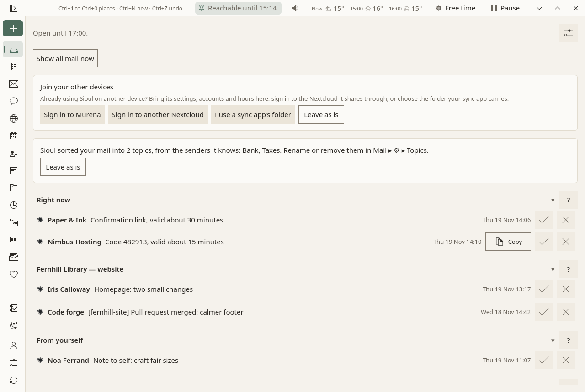

# Hours: work, your admin, leisure, meals, sleep

Two questions decide what Sioul brings forward, and they are kept apart:

- **Who may reach you, and when**: six circles of people (Always through, Safe, Your contacts, Restricted, Everyone else, Blocked), and what each does at each time, for mail and for messages; calls are set for each phone, in Settings ▸ Devices ([What reaches you, and when](notifications.md#by-person)).
- **What a thing is for, and whether now is for it**: this page.

They meet in one place, mail: everyone's mail comes when their row lets it, and a notification tells it only while the address it came to is for what now is for. Your safe senders' mail to an address for another time shows on the Porch meanwhile, and is told when that address's hours begin; the others' (your contacts, restricted, everyone else) waits until then. Your Always through people's mail is told to any address, and everyone's while you are Reachable. An address with nothing ticked keeps your safe senders' times: only the others' mail waits for work's hours. Calls and other apps' messages follow their own rows alone. Mail you send yourself shows at once, and the codes and links you just asked a site for come at once.

This is a matter of health before it is a filter. Work that reaches the evening keeps people from recovering, and the risk is highest for those who work from home or for themselves, for whom nothing else marks the end of the day. Admin spread over every evening weighs too, even when nobody is working.

## What each thing is for

A source or a task is for **work**, for **your admin** (bills, letters, offices, health errands), or for **leisure** (friends, family, chats, what you enjoy). These are switches, not a single choice: an address for everything personal is for admin and leisure; a freelancer's bank account, used for both, is for work and admin; a chat used with colleagues and with friends is for both.

| Thing | Where you say what it is for | When you have not said |
|---|---|---|
| A mail address | on its card in [Accounts](accounts.md#a-mail-address): **What this address is for** | work: an address you did not classify never reaches your evenings |
| A budget | its form: **For**, its boxes Work, Your admin, Leisure | your admin |
| An agenda | Agenda ⚙ ▸ **Your agendas**: **For** | work, on an account you said is only for work; else your admin and leisure |
| A site | its menu: **For** | by its type: secure mailboxes and client areas are admin; chats, social networks and dating are leisure; video calls and other sites are admin and leisure |
| A task | its panel: **For** | by its tags and project: work's (a client's project, GitHub, the categories you call work), leisure's (joy, family, friends…), both admin and leisure for personal ones (health), else admin |

Mail addresses are the one place nothing is guessed for you: saying what each address is for is what separates a business address from a personal one.

## Five times

Now is always one of five times:

| Time | What it is | Where it is set |
|---|---|---|
| **Work** | your working hours, and the work you ask for outside them (**Work half an hour more** and the like, **Work until tonight**) | [Settings ▸ Hours](settings.md#hours) |
| **Admin** | your hours for your admin | [Settings ▸ Hours](settings.md#hours) |
| **Meals** | each meal, from getting it ready to its end | [Settings ▸ Hours](settings.md#hours), [Meals, rest and sleep](health.md#meals-rest-and-sleep) |
| **Sleep** | the night, from winding down to waking; each nap, with its minutes to come back | [Settings ▸ Hours](settings.md#hours), [Meals, rest and sleep](health.md#meals-rest-and-sleep) |
| **Leisure** | every other time: evenings, days without hours, time off, the rest of a day closed with **Work done for today** | nothing to set |

**When they overlap**, sleep comes first, then meals, then the hours: lunch inside your working hours is a meal while it lasts; **Work four hours more** running into the night leaves the night to sleep. Working and admin hours may overlap: then what each brings comes, all together.

The hour before bed is sleep's: Health keeps it free, and nothing should keep the mind going then. The night's own notice still comes at its start, to say the night begins.

## The hours

In [Settings ▸ Hours](settings.md#hours), two weeks: **Working hours** and **Hours for your admin**. Each day of each is on or off, with one range of hours or several (09:00–12:00 and 14:00–17:00, a lunch between). **Vacations and holidays**, below them, takes your vacations and sick leave, and the calendars of public or school holidays you subscribe to ([below](#vacations-and-holidays)). There is no leisure to set: it is every other time. Between the two, **Meals, rest and sleep** sets your usual meals, naps and night ([Health](health.md#meals-rest-and-sleep) says what they do).

## Vacations and holidays {#vacations-and-holidays}

[Settings ▸ Hours](settings.md#hours) ▸ **Vacations and holidays**:

- **Your vacations**: from a day to another, each typed as 2026-12-24, with a word on them and a kind: a vacation, sick leave, or something else. **Add** keeps the period; **×** on its line takes it away. What you typed before stays as it was.
- **Calendars of holidays**: each calendar of public or school holidays you subscribed to ([Calendars by their address](agenda.md#calendars-by-their-address)), with one box to tick, **its days count as my days off**. Public holidays count unless you untick it; school holidays do not, unless you tick it (a parent who stays home with the children, a teacher).
- **Subscribe to a calendar of holidays…** opens the Agenda's settings at the form, with the official calendars of holidays ready, your country's first: for France, public holidays by territory and school holidays by zone; for the United Kingdom, the bank holidays of each nation.

A day that counts as a day off is one everywhere: leisure all day, nothing planned in it, "two working days before" skips it, work's reminders wait until work comes back, and the agenda shades it. Each device knows the holidays from its own copy of the calendar: one that has not read it yet does not know them, and its line says so.

Leisure set as hours by an earlier Sioul (its "free time") is left in your settings, untouched, and no longer counts. **Free time** is now a pause you take, whatever the hour: see [Pauses](pauses.md).

| Now | What comes forward | What waits |
|---|---|---|
| Work | work; your admin too, until admin has hours of its own; a call to an office, always | leisure |
| Admin | your admin; work too, while work has no hours | leisure |
| Leisure | leisure, and nothing else | work and admin |
| A meal | leisure: a meal is a break | work and admin |
| Sleep | nothing notifies but doses, the codes you asked for and your Always through people; leisure, if you open Sioul | everything else |
| No working or admin hours set at all | everything, as before any were set (meals and sleep keep their time) | nothing |

The status line (the window's title bar on a computer, the line at the bottom on a phone) says what now is, and until when: "Admin time until 19:00: offices, bills, letters.", "Meal until 13:00.", "Leisure until 22:00: what you enjoy.", "Winding down: nothing disturbs until 07:00."

## What follows the time

- **Mail**: when the sender's row lets it ([What reaches you, and when](notifications.md#by-person)), and only while the address it came to is for what now is for: a safe colleague's mail to your work address in the evening shows on the Porch, and its notification comes when work begins ("The Porch opens"). The others' mail to such an address waits off the Porch until then. Your Always through people's mail is told to any address, and so is everyone's while you are Reachable; to an address with nothing ticked, your safe senders' mail is told at their times. When a row and an address never meet in your week, the row's times alone decide, so that nothing waits for good.
- **Sites**: the sites for now are listed first; the others fold under "Other hours". Their notifications wait for their hours, real time and calls included, and none comes while you sleep.
- **Tasks**: Tasks ▸ **Now** keeps what fits, its other tabs show every task, and the plan places each task in the hours meant for it: work in working hours, your admin in admin hours. Leisure has no hours: what is only for leisure takes no room in the plan and waits for none. The next step is never a call to an office that is closed now.
- **Budgets**: by what each one is for.
- **What a page shows**: Mail's [All addresses](mail.md#all-addresses), [Budgets](budgets.md#at-a-glance), [Projects and Time](projects.md#in-quiet-time), and the [agenda's **Agendas**](agenda.md#several-agendas) in **What comes**, show at first what now is for. Tick others and they show at once, until your hours change; **As the hours say** gives the hours' ticks back. The Agenda's **Day**, **Week** and **Month** show every agenda at any hour, and **Day** and **Week** the plan's steps of every area, until you untick some.

## What each device is for {#what-each-device-is-for}

A computer for work, a phone for your admin and your friends, a tablet on the sofa: in **Settings ▸ Devices**, three switches on each device's line (its card, on a narrow screen) say what it is **For**: **Work**, **Your admin**, **Leisure**, any of them together. You can say it of any device, from the one in your hand. Each device then brings forward only what it is for, at the hours for it. With nothing ticked, everything comes there, as before: nothing changes on any device until you say what one is for.

Under the devices, a grid says **what comes forward, and when**: for each device, what comes at each time your week has (no admin column while admin has no hours of its own, no meals column while none is set).

| | Work | Admin | Leisure, meals | Sleep |
|---|---|---|---|---|
| A computer for work | Work | Nothing | Nothing | Nothing |
| A phone for admin and leisure | Admin, while admin has no hours of its own | Admin | Leisure | Leisure, if you open Sioul |
| A device with nothing ticked | as your hours say | as your hours say | as your hours say | as your hours say |

- **Change a cell** to let something else through on one device at one time: press it, tick what should come. Friends on your phone during work: tick **Leisure** in the phone's Work cell. Nothing at all during meals: untick everything there. A cell you changed is framed, and **As its areas say** puts it back.
- **Now**: one sentence says what this device brings at this moment: "Now, leisure until 22:00: leisure comes here."
- On a phone, each device's card says its cells in words, one line per time.
- `sioul devices` prints the same grid in a terminal; `sioul devices for <device> <areas>` and `sioul devices at <device> <time> <areas>` set what a device is for and one cell (`sioul devices at phone work work+leisure`; `none` for nothing, `usual` to put a cell back).

**What it changes on a device.** What is not for a device at this moment folds there exactly as what is not for this hour folds, and the same gestures open it:

- **Mail**: [All addresses](mail.md#all-addresses) ticks only the areas that come forward here; tick the others to see them.
- **Sites**: the others fold under "Other hours".
- **Tasks**: **Now** keeps what comes forward here; the list, the board and the other views show every task, as always.
- **The Porch**: mail to an address this device is not for waits; your safe senders' is shown, without a notification. **Show all mail now** shows everything.
- **Budgets**: as Mail's filter.
- **Another app's notifications**, on a phone, when you said what the app is **For**: its automatic notifications wait while the phone is not for it; people's messages come as your hours say, since no other device can tell them for the phone.
- **Reminders of your tasks**: on the computers and tablets for the task's own area (a phone does not tell them): an admin task's date comes on the laptop for admin, not on the work computer.

When the device is the reason, and not the hour, Sioul says so: in the status line ("This device is for work: leisure waits on your other devices."), and in the "?" of Mail's and Budgets' filters.

Nothing is removed from a device: what is folded is still there, and still fetched. Opening it there settles nothing elsewhere: a message you open on a device that is not for its address (an address you never said anything of counts as work's here, as in the filter) is **read there only**, and stays new on the device it is for; the reader says so, and **Mark as read** marks it read everywhere. **Done for now** closes the Porch on what this device is for. What you do to something otherwise is done everywhere, as always.

**Which device tells you.** The device you used last tells you, as before: what comes forward on it now. What does not waits, in view where it belongs, and is told ("The Porch opens") when you pick up a device it is for. A device waits for another only while that one says it is for the thing and has heard what the first one is for; otherwise it tells it itself. Your other devices stay quiet about what the one you used last tells; when one of them cannot be sure it was told, it keeps it and tells it when you pick it up: a message may then come twice, never not at all. That can happen on a device whose settings do not travel (its grid says so), and when a message arrives just as a time changes.

**What always comes, whatever a device is for**:

- doses and everything of Health;
- the codes you just asked for;
- alarms, an event's own reminders and the time to leave for it;
- mail and messages from your Always through people;
- everything while you are Reachable, sites, dates and other apps' notifications included;
- your safe senders' mail to an address you never said anything of;
- calls and texts, which keep their own table ([Calls](calls.md)), and a call in a site.

**A device lost, forgotten or silent for a week** stops counting: what only that device was for comes on the others again, as your hours say. The grid says it in one sentence: "No device is for leisure: until one is, that comes on every device, as the hours say." For the same reason, a device you use alone folds nothing.

**A device on an older Sioul** does not follow this yet. Its line says "Its Sioul is older: everything still comes there." While it is the device you used last, it tells everything, as before, and the others stay silent. Nothing ever waits for it: until it is updated, what only that device would be for still comes on your other devices, as your hours say, and what was already waiting when you opened it stays on the device it is for.

**Your plan does not change with the device**: a task's place in your week is the same wherever you look at it.

### Compared with other ways to keep work apart {#devices-compared}

As of 17 November 2026, from Google's and Slack's own help pages. Other tools were not looked at: their absence here says nothing about them. Apple's pages on Focus could not be read, so nothing is said of it.

✓ documented; **partly**, with a note; ✗ not found on the page read. Sioul's column was checked against its code.

| | Sioul | Android's work profile | Slack |
|---|---|---|---|
| Work kept apart from the rest, and silent outside set hours | ✓¹ | partly² | partly³ |
| You say what each of your devices is for, and each brings only that | ✓ | ✗⁴ | ✗ |
| A notice goes to the device you are using | ✓⁵ | ✗ | ✓⁶ |

1. Sioul: three areas, work, your admin and leisure, for each address, site, task, agenda and budget, and for each device; by hours, and by a grid of device and time.
2. Android: work apps live in a part of the phone that can be paused, by hand or on a schedule of hours and days: "When your Work Profile is paused, work apps won't run, generate notifications, or consume data and battery life." It is one phone in two parts, set up through an employer's management, and its schedule cannot pause work over consecutive days, such as a weekend (Google, Android Enterprise Help, "Pause or turn on your Work Profile").
3. Slack: a notification schedule by hours and days, and separate preferences for its mobile app; for Slack's own notifications (Slack Help Center, "Configure your Slack notifications").
4. One device with a work part, not a word on each of your devices.
5. Sioul: the device you used last, for what comes forward on it; what does not waits for the first device it is for that you pick up.
6. Slack: "By default, you'll receive mobile notifications one minute after locking your desktop screen or 10 minutes after Slack stops detecting cursor activity."

## Quiet time

Quiet time is whenever it is not work's time: leisure (the evening, days without working hours, time off, the rest of a day you closed with **Work done for today**), admin hours, a meal, sleep. Work rests until it comes back:

- the Porch shows codes, and the mail your lists let through now;
- work addresses fold on the Mail page, without their dots, and **All addresses** ticks only what the hours bring ([Mail](mail.md#all-addresses));
- work sites keep their notifications for later;
- Projects and Time show the projects for what the hours bring, everything one tick away ([Projects](projects.md#in-quiet-time));
- Tasks ▸ Now shows only what fits now, and the Agenda's What comes only the plan's steps for now; their other tabs show everything.

One sentence in the status line says until when: "Work comes back tomorrow at 09:00."

**Closing is offered, never pressed.** Once your last hours of the day are over, the status line offers **Work done for today** ([Tasks](tasks.md#the-end-of-the-day)); in the evening, **Day done, before sleep** ([Health](health.md#before-sleep)). On a small screen, the offer takes the place of the sentence while it stands. Nothing during sleep.

**The way back is never suggested.** It is there if you need it: the sentence in the status line opens a menu, with **Work half an hour more**, an hour, two hours, four hours; **Back to the usual hours**; or, the day you closed it, **Back to today's plan**. During a meal or sleep, the sentence opens no menu: they come first.

## Sleep

From winding down to waking, and during a nap, nothing disturbs:

- **almost no notification**, unless you change it ([What reaches you, and when](notifications.md#by-time)): no site, no reminder before a date, no pause to move, no meal or nap notice, no message, no call but your Always through people's. What still makes sense when you wake comes then;
- **codes you just asked for come at once**, as at every hour: you asked for one, and it lasts minutes ([The Porch](porch.md#codes-and-links-come-at-once));
- **doses come all the same**: you set their times, and a dose at 05:00 is meant to wake you. To keep them silent while you sleep, choose **Doses at waking** under **What you set or asked for**, in Settings ▸ What reaches you ▸ [Sioul's own notices](notifications.md#doses): they come when you wake. Sioul never silences a dose without that choice;
- if you open Sioul, the Porch shows what your lists let through now, nothing about money or paper letters; a message about a project comes among the people you know;
- every address folds on the Mail page; only the sites for leisure are listed;
- Tasks ▸ Now waits behind one sentence and **Show anyway**; a thought can still be noted for later in the line under the tabs; the other tabs show everything. Projects and Time show leisure's, everything one tick away.

Without a night set in Settings ▸ Hours, nights are leisure and nothing keeps notifications away: the Porch asks for it in a card, **Set my night** or **Leave as is**.

## Reachable, and work until tonight {#work-now}

**Work now** is gone since version 0.0.7, and its two jobs part ways.

<figure markdown="span">
  [{ loading=lazy }](../assets/screens/reachable.png "Open the picture at full size")
  <figcaption>Reachable for a while: the button says until when.</figcaption>
</figure>

- **To see and hear everything for a while**, choose **Reachable** in the card What reaches you now, behind the status line's button ([What reaches you](notifications.md#reachable)), or in that button's menu (a right click, or a long press): for half an hour, an hour or two hours, until the hours you are in end, until tonight, or until you turn it off; whichever you choose, at the latest at the night's start (pressed at night, until you wake), and the menu says so when a length meets it. While it lasts, on each of your devices that has this version of Sioul, everyone not blocked who writes and the people you know who call reach you at once (a conversation you set to never stays held); the Porch opens with every lane and address, tells new mail and looks for mail every minute; what your phone holds comes back at the press. Neither a busy time, nor the night, nor Free time turns do-not-disturb on meanwhile. Numbers nobody knows stay with the call screening ([Calls](calls.md#the-call-screening)). **As usual**, in the card or the menu, ends it, and so does a pause; it is not offered during one.
- **To show work outside your hours**, the status line's menu keeps **Work half an hour more** to **Work four hours more**, and adds **Work until tonight**.

Nothing ends when Sioul starts or closes any more: each has its own end. A "Work now" set by an older Sioul on another device is read as work until its end.

## When no hours are set

The Porch asks, in a card, for the hours not set yet, with **Set my hours**, which opens Settings at them, and **Leave as is**, which stops asking. Nothing changes until you set some. The same for the night, with **Set my night**.

## What is not decided for you

- **A bank account used for both work and admin** comes in working hours and in admin hours, not in leisure. Sioul does not split its movements between business and personal: that is for you, or your accountant. Keeping the business account apart keeps its alerts out of your evenings.
- **Admin hours in the evening** leave calls to offices for working hours, when offices answer. If you would rather keep working hours for work, give admin a slot during the day, such as Tuesday from 14:00 to 16:00.
- **Setting only admin hours** keeps work in them: work comes in admin hours while it has none of its own. Outside them, leisure.

## Why it works this way

- Detaching from work outside working hours goes with less exhaustion (r = −.38 across 91 samples: Wendsche & Lohmann-Haislah 2017), and the most exhausted detach least (Sonnentag et al. 2014).
- Work messages in the evening cost the evening through their tone (Butts, Becker & Boswell 2015), and merely expecting to check them does harm, read or not (Becker et al. 2021).
- Unfinished tasks feed rumination and poor sleep (Syrek et al. 2017); planning where, when and how they will be done raised evening detachment (Smit 2016). So closing the day gives everything a place, and names the first step.
- The hour before bed, kept free of what keeps the mind going, is part of the sleep programmes Health follows (Harvey et al. 2021).
- The hours shape the calm tabs alone (Tasks ▸ Now, the Agenda's What comes); a full view is for managing, so it hides nothing, and a list's filter (Mail, Budgets, Projects, Time) shows everything one tick away. A design rule of Sioul's, not a finding: fighting a page for the whole picture weighs more than seeing it.
- People already give their devices a role: among 259 UK workers, those who keep work and home apart dedicated their devices more than those who mix them, with as many devices (Fleck, Cox & Robison 2015). That survey did not measure whether it helps, and no study found tests a device for work against one for everything. What goes with less distress is feeling in control of the line, whether one separates or mixes (Kossek et al. 2012, 591 managers); for people who prefer to mix, work on the phone in the evening even went with less conflict at home (Derks et al. 2016). So what a device is for is yours to say, nothing is narrowed until you say it, every cell can be changed and put back, and what is folded says why and opens in one gesture.
- A dedicated device does not hold the line alone: 13 of 14 people who wanted "work is work, home is home" worked on the home computer too (Dearman & Pierce 2008), and mail read on a phone in the evening was forgotten at the office (Cecchinato, Cox & Bird 2015). So a fold opens, and opening it settles nothing: a message opened on a device that is not for it stays new on the device that is.
- Asked through the day, 16 people wanted a notification on the device near them and in use: the phone nearly all day, a computer only while used (Weber et al. 2016, read in its first author's thesis). So the device you used last tells what is for it, and what is not waits in view and is told on the device it is for once you pick it up; a device waits for another only while that one has said it is for the thing, so that a message may come twice but never not at all.
- A public holiday is a day off for most people, and a school holiday is one for few: the parent who stays home, the teacher. So public holidays count by default and school holidays one switch away; a vacation you type counts always. This is a default of Sioul's, not a finding.
- No study separates personal admin from leisure: every one found knows two sides, work and the rest. Keeping admin off a device for leisure is Sioul's own inference, from admin being work nobody pays for.

More in [what the research says](../dev/research.md), findings 21 to 23 and 83 to 85.
