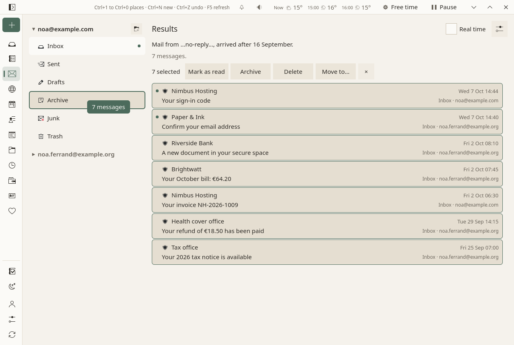

# Mail

## In short {#in-short}

The Mail page keeps all your mail, from every address, for when you choose to look; what is new waits on [the Porch](porch.md) first. Sioul checks each message itself as it arrives, and tells you before you read it whether it really comes from the address it shows. Nothing in a message loads or runs, and an attachment goes through your system's antivirus, when it has one, before it opens. You write in plain text, in Markdown if you like, and whatever you send, move or delete can be undone for ten seconds. Sioul shows no unread counts, no badges and no red.

<figure markdown="span">
  [{ loading=lazy }](../assets/screens/mail.png "Open the picture at full size")
  <figcaption>Folders on the left, the newest mail in the middle, no counts.</figcaption>
</figure>

## Protected by default {#what-is-protected}

Without any setting:

- **Every message is checked as it arrives.** You see whether it is *verified*, *not verified* or *forged* before you read it. Forged mail, and mail borrowing a bank's or a public service's name, wait apart on the Porch with the reason ([Reading](#reading)).
- **Nothing in a message loads or runs**, so nobody learns that you opened it, and every link shows where it goes before it opens ([Reading](#reading)).
- **Attachments go through your computer's antivirus** before they open, and a program attached is never started. Without an antivirus Sioul asks first; on a phone, which has none Sioul can call, it says the file is not checked ([Attachments](#attachments)).
- **Your mail travels encrypted.** Sioul has no setting to talk to a mail server in clear.
- **Nothing leaves without you**, and you have ten seconds to change your mind. No read receipt is ever sent. There is no Sioul server: your mail goes between your device and your provider, and nowhere else unless you choose to send it somewhere ([Privacy and security](privacy-security.md)).

Once you set them up:

- **Your own spam filter**, trained on each of your devices from your mail; your mail goes to no filtering service ([Your own spam filter](#your-own-spam-filter)).
- **Signed and encrypted mail** with OpenPGP, your key in your system's keyring or on a security key ([Signing and encrypting](#signing-and-encrypting)).

## All addresses {#all-addresses}

- **One list of all your mail**, newest first: what came to every address and what you sent, in the order it was written. **All addresses** sits at the top of the left column, and Mail opens on it, on a computer and on a phone.
- **Each message once**: a message that reached two of your addresses, or that you sent to yourself, is one row. With more than one address, a small square in the address's colour, with its first letter, says which holds it; you choose each address's colour in Accounts (**Its colour**), and your other devices draw the same.
- **One line a message** on a computer, two on a phone (who and the time, then the subject): who wrote ("To Jane" for what you sent), the subject, the time; a small dot for what you have not read; the days as headers ("Today", "Yesterday", "Monday 26 October"). No preview, and nothing counted.
- **Chips above the list**: **All**, **Unread**, **Sent**, **Spam**, one at a time. **All** is what you received; what you sent is under **Sent**, and in each address's Sent folder. What you chose stays on this device. Spam waits under its own chip, with its quiet word ("probably spam", "your provider: spam"); what you said is not spam stays in the list.
- **What shows, by area and by address**: beside the chips, a button says what the list shows, "Admin · Leisure". It opens three boxes, **Work**, **Admin** and **Leisure**, ticked as your hours say: work's addresses in working hours, your admin's in admin hours, leisure's the rest of the time, and none while you sleep ([Hours](hours.md)). Tick another, and it shows at once; your ticks hold until the hours change (a day at most), and **As the hours say** sets them back. After them, each address's square switches it off or on; switched off, only its outline shows. The list holds the mail of the addresses switched on whose area is ticked (an address whose use you did not say counts as work: Accounts, "What this address is for"). On a phone, the filter is in the folders button's sheet, each address there by its whole name. The **?** in the filter says the same in short.
- **Calm**: mail whose time has not come yet (your lists say later) shows without its dot. Mail from blocked senders never shows; a shielded address's hostile mail shows as "Someone at example.org", its words hidden.
- **An address switched off** in this list is said at the head of the list, with **Switch it on**: it only hides it here, its mail staying in its inbox. What the areas show, the filter's button says.
- **Everything this device keeps**, newest first: scroll down until you are done, and older mail comes as you scroll. Nothing at the end of the list says more exists; how far back mail is kept is a setting of each address (Accounts). The search above it looks through every address; **More…** opens the search by conditions.
- **A click opens a message** beside the list; Back closes it, the list where it was. Ctrl and Shift choose several, across addresses, to mark them read, archive, delete or move them at once, or drag them onto a folder. A right click offers what a folder's row offers. A message that reached two of your addresses is one row: marking it read or deleting it does so in both.
- **Each address has its own letter** on its colour, never the same letter twice, so two addresses that start alike still read apart.
- **On a phone**, a tap opens a message over the list, and Back brings the list back where it was. A long press on a row opens its menu; **Select** there begins a selection, a tap then adds the next. The folders button shows your addresses and their folders. When the list shows, Sioul brings the other folders at once, as **Fetch mail now** would, so that what you sent from your computer is there too.
- New mail's notification of several messages opens it at its top, on a computer and on a phone.

## Folders {#folders}

- **On the left**, each address with its main folders: Inbox, Sent, Drafts, Archive, Junk, Trash. The others are folded under **More folders**.
- **A small dot** marks a folder with something new. How many is said in words when you open it.
- **A folder shows everything this device keeps**, newest first; older mail comes as you scroll.
- **Search**, at the top of a folder: by sender, recipient and subject. **More…**, beside it, searches everywhere, by conditions ([below](#searching)).
- **By conversation**, in the Mail page's ⚙: a message and its answers together, under the newest one; your own answers come from Sent.
- **Quick to open**: each folder keeps a small index of what its messages say (who, to whom, the subject, the date), read from each message once, ever, and kept on this device alone, readable by you alone. A folder's list reads that index, never every message again; only the message you open is read whole.

A right click on a folder offers **Keep a copy here** or **Stop keeping a copy** (the server keeps every message either way), **New folder…**, and **Delete this empty folder**, for an empty folder of yours.

## Reading {#reading}

A message opens on the right; the folders fold away while you read.

<figure markdown="span">
  [{ loading=lazy }](../assets/screens/mail-reader.png "Open the picture at full size")
  <figcaption>A message: who sent it and how far that is verified, then its text, made safe.</figcaption>
</figure>

**First, who sent it, and how far that is proven.** Sioul checks every message itself as it arrives, by asking the sender's domain whether the message is really its own:

- **verified**: the domain vouches for it;
- **not verified**: nothing proves it either way, and the reason is said;
- **forged**: the domain says it did not send it, and asks that such mail be kept apart. Forged mail is set aside on the Porch, with the reason, and never deleted.

A message that borrows the name of a bank, a public service or your own domain, even written with lookalike letters, is set aside as well. Hovering over the shield beside the sender shows each check ([how a sender is checked](#how-a-sender-is-checked)).

**Then its text, shown safely.** HTML mail keeps its paragraphs, lists, bold text and links, and nothing else: no pictures, no styles, no scripts. Nothing loads from the network and nothing runs, so no tracking picture learns that you opened the message. Earlier messages that a reply quotes are folded under **Show the earlier messages**; a signature is dimmed.

**Every link says where it goes before it opens**: its site in bold and its full address, under the message, while the pointer is on it. On a touch screen, the first tap shows the address and the second opens it. Only web and mail links open; a mail link opens a new message in Sioul, to that address alone.

Above the message, always in the same place:

- **Reply**, **Reply to all** (only when there are others to answer), **Forward**;
- **Add ▾** (a task, an event, a note, a reply, the sender to your contacts) and **Link to…** (anything else: a task, a note, a project);
- **Archive**, **Delete**, **Junk**;
- **Unsubscribe**, on a newsletter or a list's message that says how to leave it ([below](#unsubscribing)).

Archiving, deleting and junking happen at once, with **Undo** in the status line for ten seconds; the server is told only after that. There is no "are you sure?". In the trash, **Delete for good** deletes it for good, with the same ten seconds.

A message you archive, junk, put in the trash or move **stays on this device**: its copy goes into the other folder at once, where the server put it, so a link, a task or the phone's home card still opens it, and a message you opened from elsewhere stays open. Where a server does not say where it put a message, its copy comes with that folder's next sync, within minutes; meanwhile, opened from elsewhere, it says "On its way to Archive · work@example.org. It opens as soon as its copy is here." and opens when it comes.

What you mark **Junk**, or **Not junk** in the junk folder, teaches your own spam filter at its next training ([below](#your-own-spam-filter)).

**Spam** and **Not spam** settle a message your filter flagged (probably spam, maybe spam, probably not spam), one your provider called spam, and any message in a junk folder: beside its quiet word on a computer, in its menu (a long press on a phone), and in the reader. **Spam** puts it in the junk folder, or keeps it there; **Not spam** takes it out of the junk folder, or leaves it where it is without its mark. Its row changes at once, with **Undo** for ten seconds, and what you said teaches your filter, as on the Porch.

A right click on a message (or its ⋮, or the Menu key) gives the rest: mark as read or unread, flag, **Move to…**, **Show the source**, block the sender, **How they reach you…** (their list, Always through, what reaches you from them: [A person's sheet](notifications.md#a-persons-sheet)), **Keep as a contract…**.

Opening a message marks it read, as any mail program does. Sioul never sends a read receipt.

**A message opened from elsewhere** (new mail's notification of one message, what a task, an event, a note or a project is tied to, a task's source, a link to a message written in a note, the message a money line in Budgets comes from, **Open the message** on a code's notification or its card on the Porch, a message or a code on the phone's home card, **Its invitation** on an event's card) opens in Mail's reader, the first time too, with the first inbox beside it: never a folder in its place. The reader says "Opening the message…" at once, while Sioul looks for it on this device; where it is not in an inbox, its head says where ("In Archive · work@example.org"). A link to a message is the same however it is written (`mid:<…>`, bare or encoded), and opens the copy that ranks first: the inbox before the archive, Sent, the junk, the trash and Gmail's "All Mail". With no copy here, Sioul asks your servers, read only, as a search does ("Looking for it on your servers…"), brings the copy here, unread as it was, and opens it; when none holds it: "This message is no longer in your mail. It was deleted, here or on another device."; when a server cannot be reached: "Sioul cannot reach your mail server now. It looks again when it can." A message Sioul moved whose copy has not come yet says where it is on its way to, and opens when it comes ([above](#reading)). A message Sioul cannot look for on the servers (one without a Message-ID) says "This message is not on this device now. It may have moved." **Back** (or Escape) returns to the page you opened it from, with the card you were on; a message you then open from Mail's own list is Mail's, and Back stays in Mail. New mail's notification of several messages opens the Porch, as before. A message without a Message-ID (rare, mostly spam) can be tied too: Sioul names it by a digest of its sender, recipients, date and subject, the same on every device. 

### Several at once {#several-at-once}

- ++ctrl++ + click adds a message to the selection or takes it out; ++shift++ + click takes everything since the last one clicked; ++ctrl+a++ takes all; ++escape++ none. On a touch screen, a long press opens a message's menu: **Select**, then a tap chooses more, or leaves one.
- A bar then marks them read, archives, deletes or moves them, under one **Undo**, however many there are.
- **Drag** them onto any folder of any address, with a mouse or a touchpad: the folder under the pointer is outlined. From a search's results too, which is how a busy inbox is sorted: the folders come back in the search's place while you drag. Into another address, a message is taken off the first one only once the second server has it.
- **Move to…**, in the bar or in a message's menu (right click, ⋮, or the Menu key), does the same from the keyboard, and on a phone.

<figure markdown="span">
  [{ loading=lazy }](../assets/screens/mail-search-drag.png "Open the picture at full size")
  <figcaption>Sorting from a search: the messages chosen, dragged onto a folder.</figcaption>
</figure>

### Topics {#topics}

A topic is a quiet word on a message, such as Health, Tax or Choir: a way to look at your mail, never a folder. Nothing moves, and nothing asks you to tag anything.

- **Topic…**, under the sender's line in the reader, in a message's menu, or in the bar above a selection, gives a topic to one message or to several at once, changes it or takes it off, in **All addresses** and in each address's folders alike. Choose several with Ctrl and Shift, or on a phone with **Select** in a row's menu (a long press), then a tap on each. The topic they share is ticked. **New topic…** makes it and gives it in one act.
- **Rename or remove…**, at the end of the same menu, turns each topic's name into a field: change it and press Enter, or **Remove** it (its word leaves every message, with **Undo**). **Done** goes back.
- **Always <topic> for this sender**, or **Never…**, in the same menu: the sender's mail takes it, or never does. A reply takes the topic you gave its conversation.
- **The Topic filter**, beside the filter by area, shows one topic's mail alone. The topic shows quietly after the subject, in **All addresses** and in each folder, and in the reader with why it has it.
- Each act says what it did, with **Undo**. In the Mail page's ⚙, **Topics** lists them, renames and removes them, and on a computer **Groups Sioul noticed** gathers mail no topic names yet, by its words: **Name it** gives the whole group a topic, once a thousand messages are kept here, named when a topic preset or a kind of site holds most of it, and **Always a topic…** files all the mail of a sender who writes to you a lot under the topic you name.

**To start**, Sioul knows some topics (Bank, Taxes, Health, Phone and internet…) by their senders, those it can prove: once enough mail is here, those that find five messages or more start by themselves, said once on the Porch; the others wait in **Topics**, one tap each. Started, a topic is yours: renamed or removed like any other.

Topics and projects are independent: a project is something to complete, a topic a standing part of life.

### Unsubscribing {#unsubscribing}

A newsletter or a list's message that says how to leave it has **Unsubscribe** above it. One click, and ten seconds later Sioul does what the list asks:

- it **tells the list's server**, when the list offers this and its signature proves the request is the list's own: the "one click" most newsletters offer;
- else it **sends the list the message it asks for**, from the address the newsletter came to; the message goes to Sent like any other;
- else, when only a web page can do it, it **opens that page** in your browser, at once: you finish there.

**Undo** stays in the status line for those ten seconds. Then the line says "Unsubscribed from Type & Pixels.", or why not. The message itself stays where it is.

Leaving follows proof, not the verdict. From a sender Sioul verified (its domain signed the message), **Unsubscribe** works whatever the spam verdict, yours or a filter's, and in the junk folder too, the message staying there: some spam comes through real mailing services because someone gave them your address without asking, and those services let you leave. The button rests, dimmed, on mail that is forged, borrowing a name, hostile or from a sender you blocked; on spam, a doubt of your filter's or the junk folder's mail from a sender nothing verifies; and when nothing proves that the address it names belongs to the list: answering such mail would tell its sender that your address is read, or reach someone else. Its tip, or a tap on a phone, says why. On a message your filter only doubts, **Not spam** brings the button back.

A list you left shows **Unsubscribed**, and when. If its mail keeps coming, block the sender: ⋮ ▸ **How they reach you…** ▸ **Blocked**. The lists you left are in the Mail page's ⚙, under **Lists you left**, on this device.

**Leaving the lists of the mail you called spam.** When you say **Spam** on a message whose list offers one click, Sioul leaves that list too, with the same ten seconds and **Undo**; saying **Not spam** in those ten seconds cancels it. To stop this, switch off "When you say Spam, also leave its list if it offers one click" in the Mail page's ⚙. For the mail you called spam before, the same ⚙ has a row under **Lists you left**, "Leave the lists of the mail you called spam", when there are some: it names them, and **Leave these lists** does them one after another, with **Undo** for ten seconds, then one line for the end ("Left 2 lists; 1 did not answer."). A list that did not answer stays there for another try.

Sioul only tells a server this for a proven sender: mail you yourself said is spam (a junk folder or a filter's verdict is not your word), a sender it verified, one click and no other way, a list you have not left already and have not said **Not spam** to. A request to anyone else would only tell whoever forged the message that your address is read. On a computer, `sioul mail leave-spam` lists them and contacts nobody; `sioul mail leave-spam --go` leaves them.

### Invitations {#invitations}

A message that brings an invitation shows it above the text: **Accept**, **Maybe**, **Decline**. The event goes into your calendar and your answer goes to the organiser. A published event has **Add to my calendar**; a cancelled one, **Take it out of my calendar**.

### Attachments {#attachments}

Attachments are folded under the message, one line each with their kind, name and size.

- **Your system's antivirus checks each one before it opens or is saved**: Microsoft Defender on Windows, ClamAV on Linux and macOS when it is installed. When it finds a threat, nothing opens and the copy is deleted.
- **A program, a script, a shortcut or an installer is never started from a mail**, checked or not: save it if you trust it, and run it yourself.
- **Without an antivirus**, Sioul does not refuse: it says the file will not be checked, asks before opening it (**Open it unchecked**), and says how to get one.
- **A file larger than the antivirus scans** is never called clean: Sioul says it was not scanned because it is too big, and asks the same way.
- **On a phone**, which has no antivirus Sioul can call, attachments are not checked, and Sioul says so in the message and after each opening, rather than asking each time. An attachment opens in the app you choose (Android asks which, when none is set for its kind of file), which can read that one file and nothing else of Sioul's; Android's installers (`.apk`) never open, as programs never do. **Save…** asks Android where to put the file.
- **On Windows and macOS, files you open or save carry the system's mark that they came from the Internet**, so that the system treats them with its usual care: Office opens them in Protected View, macOS checks them before they run.
- **The attachments of mail set aside do not open.**
- **Keep in papers** files one in your [papers](papers.md): checked, then kept, and you say what it is.

## Writing {#writing}

**Write** is always in the same place. You write in Markdown, and line breaks are kept as you type them, as in a chat: a blank line starts a paragraph. **Preview** shows the message as it will look.

- **Cc, Bcc** are folded until you need them. When you have several addresses, **From** chooses which one sends; an answer goes from the address it answers.
- **Attach**, or drop files on the window. **A paper**, beside it, attaches one of your [papers](papers.md); one that has ended, or is older than usually asked, says so in the list.
- **Your signature** is put below the text when the draft starts, after the usual "-- " line, so that you see what goes out. Your name and signature are set per address in Accounts (**Name and signature…**).
- **Answering**, the window says "Below your text: Camille's message of …, quoted". The quote is added when the message leaves.
- **Drafts are saved as you type.** Closing the window loses nothing: the draft waits under Drafts, on the left. Drafts stay on your devices: they reach your other devices sealed when you [share between them](sharing.md), and never go to your server's Drafts folder.

**Send** (or ++ctrl+enter++) waits ten seconds, with **Undo**, before the message leaves. Then a copy goes to Sent. Nothing is ever sent without you.

The message leaves as HTML for those who read HTML, and as plain text, the Markdown itself, for the others.

### From other apps {#from-other-apps}

- **On a phone**, Sioul is in Android's share sheet: share a photo, a PDF, a link or some text to **Sioul**, and a new message opens with it, from your usual address. Your addresses are there too, each on its own (Android 10 and later): choose one, and the message goes from it. A long press on Sioul's icon shows them as well, **Write from …**.
- **Files** are copied into Sioul as they come. The window says "Attaching 2 files…" until they are there, and **Send** waits for them. The copies go once the message is sent or deleted.
- **Mail links** (`mailto:`), in a browser or another app, open a new message in Sioul, with its address, subject and text, when Sioul is your mail app. On a phone, Android asks which app opens them the first time. On Linux, choose Sioul as your mail program: KDE, **System Settings ▸ Default Applications**; GNOME, **Settings ▸ Apps ▸ Default Apps**. A link clicked while Sioul is open opens there. Not yet on Windows and macOS.
- **Nothing is sent** until you press **Send**. Other apps see nothing of your accounts but the addresses in the share sheet.

### Signing and encrypting {#signing-and-encrypting}

Encryption is not there for its own sake: it is what lets the letters that offices now keep behind their portals come back to your mail, readable by you alone ([why](privacy-security.md#why-sioul-encrypts-mail)).

When you have an OpenPGP key (made or imported in [Accounts ▸ Encryption](accounts.md#encryption)), the writing window has two small switches, **Sign** and **Encrypt**.

- **Sign** lets the people you write to check that the message is yours and was not changed on the way.
- **Encrypt** makes the message readable only by them and by you. It works when Sioul knows every recipient's key; otherwise it says whose key is missing, and **Look for their keys** asks for them. Sioul looks only when you press it, since looking tells a server to whom you write.
- **The subject is not encrypted**: anyone who carries the message can read it. Keep it plain.
- Your messages carry your public key, so that people who write back can encrypt.
- **Answering an encrypted message** keeps it encrypted: Sioul switches **Encrypt** on when it can, and opens the message you answer only when you press **Send**, with the same PIN as the signature. Unencrypted, your answer goes without the quote, and a forward does not go. What you type in your answer is kept as any draft is: in clear on each of your devices, and sealed between them.

An encrypted message is decrypted when you open it; a signature is checked and said under the sender: "Encrypted · Signed by …", or "The signature does not match the text", in warm colours, never red.

Your key can live on a security key, such as a YubiKey, which never gives it out, on a computer and on a phone ([below](#your-key-on-a-security-key)).

## In quiet time {#in-quiet-time}

Outside working hours, work addresses fold in the column, without their dots, and **All addresses** ticks what the hours bring: leisure's addresses in the evening, nothing while you sleep ([above](#all-addresses)); tick an area to see its mail. Folders opened by hand: "Work mail rests until work comes back. It is all here if you look for it." While you sleep: "While you sleep, mail rests: nothing notifies, and the Porch shows only what your lists let through now. The rest is all here if you look for it." See [Hours](hours.md).

## Not there yet {#not-there-yet}

Emptying the trash or the junk in one go, copying a message to a folder, saving it as a file, drafts kept on the server, sending later, an encrypted subject, revoking an OpenPGP key or extending one kept on this device, lookalike domain names. They are planned. Sioul has no S/MIME.

## Going further {#going-further}

### Searching {#searching}

The field at the top of a folder finds a sender, a recipient or a subject in that folder. When you need more, **More…**, beside it, opens the search by conditions in the folders' place. Nothing of it shows until then.

<figure markdown="span">
  [{ loading=lazy }](../assets/screens/mail-search.png "Open the picture at full size")
  <figcaption>The search in the folders' place; the results in the usual list, each saying where it is.</figcaption>
</figure>

- **One condition at first**, Anywhere, with what you had typed in the folder's search. **Add a condition** for another: the sender, the recipients, the subject, the text, an attachment (there is one, none, one with a name), the kind of attachment (a PDF, a picture…), the day it arrived, its size, who the sender is to you, a newsletter or a list, the address, the folder, and whether it is read, flagged or answered. Case and accents do not matter.
- With two conditions or more, choose **Mail that meets all of them** or **any of them**.
- **The results** take the list's place, the newest first, each saying where it is. A message opens beside them as in a folder, so you go back and forth between the results and the messages. Above them, a sentence says what is searched: "Mail from …@bank.example…, arrived after 3 June, with an attachment."
- **Everywhere**: every folder of every address, but the junk and the trash, unless you name them in a Folder condition.
- **On the servers too**: Sioul keeps your recent mail here, and brings older mail as the disk has room; folders you keep on the server only are not here at all. A moment after you stop typing (at once with ++enter++), Sioul asks your servers for the rest, and says so: "Looking on the servers…", then "3 more on the servers.", or why a server could not be searched. Those messages say "on the server"; opening one brings it here first. Asking a server marks nothing read. A server minds accents more than Sioul does: write them as the messages do.
- **Clear** goes back to the folder.
- **Make it a filter…**, beside it, turns the search into a mail filter: its editor opens in the Mail page's ⚙, to choose what it does with such mail as it arrives.

The conditions are the ones [mail filters](#filters) use, in the same words.

### Filters {#filters}

Filters act on new mail as it arrives, on its server: into a folder, archived, to spam, flagged, marked read, to the trash, or with a keyword. They are in the Mail page's ⚙, under **Filters**: one list for all your addresses, each filter in a sentence.

<figure markdown="span">
  [![The Mail page with its settings open on the right, under Filters: a short paragraph on what filters do, “Show the filters of: Every address”, then four filters, each a switch and a sentence: Bank, “From contains “@riversidebank.example.org” → into “Archive”, marked read, and no other filter”; “Sent by a newsletter or a list and arrived on a Saturday or Sunday → marked read”; “From contains “@deals-today.example.com” → into the junk, as spam”, only for noa.ferrand@example.org; Invoices, switched off and dimmed; then Add a filter, and Run them on the inboxes….](../assets/screens/mail-filters.png){ loading=lazy }](../assets/screens/mail-filters.png "Open the picture at full size")
  <figcaption>Each filter in one sentence, with its switch; switched off, it is kept and does nothing.</figcaption>
</figure>

- **Add a filter** opens it in place, with one condition and one action. Choose what the condition reads (From, To, Cc, Reply-To, Subject, Text, Anywhere, an attachment, its kind, who the sender is to you, a newsletter or a list, the day or the time it arrived, its size), how it compares (contains, does not contain, is, is not; before, after, between; larger, smaller), and what it looks for. **Add a condition** for another; with two or more, choose whether **every condition holds** or **one of them holds**. Case and accents do not matter, as in the search.
- **Then**: move it to a folder, archive it, mark it as spam, flag it, mark it as read, move it to the trash, or add a keyword. **Add an action** for another. Filters do not forward or answer mail.
- **A sentence** says the filter as you build it, and what is missing if anything is: "Choose the folder it moves messages into." Every change is kept at once.
- Folded under one line: **On which addresses** it acts (every address, or some), and **Once it acts, the filters below are not asked**.
- **Try it on the inboxes** counts what it takes in your inboxes now, read or not, and names a few.

<figure markdown="span">
  [{ loading=lazy }](../assets/screens/mail-filter-editor.png "Open the picture at full size")
  <figcaption>A filter open: its condition, its actions, and what it takes in your inboxes now.</figcaption>
</figure>

- **Each filter** in the list has its switch (off, it is kept and does nothing), its sentence, ▴ and ▾ to ask it earlier or later, and the pencil to change it. **The order** matters: the first filter that moves a message decides where it goes. With several addresses, **Show the filters of** shows those of one address.
- **When they act**: on new mail that arrives unread in an inbox, once, on whichever of your devices fetches it first (this computer, your phone in the background, `sioul watch`); your other devices then leave it alone. If that device stops half-way (closed, out of battery), another one finishes the work ten minutes later. Your filters travel to your other devices with your settings.
- **What they never touch**: mail the Porch sets aside, a code you asked for, what your own spam filter caught. Nothing is deleted for good: the trash keeps it.
- **Not told**: a message a filter moves out of the inbox, or marks read, is not notified, and does not wait on the Porch. When a filter cannot act on a message (a folder missing, the server refusing), the message is notified as any new mail, and the status line says why.
- **Run them on the inboxes…** applies them to everything in your inboxes now, read mail too. Sioul first says what would change; **Run them now** does it after ten seconds, with **Undo**.

<figure markdown="span">
  [{ loading=lazy }](../assets/screens/mail-filters-run.png "Open the picture at full size")
  <figcaption>Running them on the inboxes: what would change is said first.</figcaption>
</figure>

- **From a search**: **Make it a filter…**, beside the search's Clear, makes a filter of its conditions and opens it at the end of the list, for you to choose what it does.

### Your key on a security key {#your-key-on-a-security-key}

Your OpenPGP key can stay on a security key (a YubiKey, a Nitrokey), which signs and decrypts by itself and never gives the key out. Set it up in [Accounts ▸ Security key](accounts.md#security-key).

A message your security key signs is signed when you press **Send**, before the ten seconds of **Undo**: a band at the bottom of the writing window asks for the key's PIN, and says how many tries are left when some were lost; then, when the key asks for a touch, it says to touch it now and hold the finger on it a second or two, as the key waits about fifteen seconds and a brief tap is often not taken. Not plugged in, it says so, and goes on as soon as the key comes. **Send unsigned** and **Not now** are there all along, and **Undo** throws the signed message away and opens the draft again. On a computer, the PIN stays in memory fifteen minutes after its last use, never written or logged anywhere; it is forgotten when you pull the key out, close Sioul, or choose **Forget the PIN now** in Accounts.

A message encrypted to your security key is never opened just because it is shown: the line under the sender says "Encrypted for your security key", with **Open with your security key**. Once opened, it opens again without the key, its attachments too, until Sioul closes.

On a phone, the band asks the PIN first, typed for each use and never kept, then the key: held flat against the back of the phone (NFC) or plugged into its USB-C port, until Sioul says it is done ([Accounts](accounts.md#security-key)). There it is tested against a stand-in card only.

### Settings {#settings}

The ⚙ at the top of the Mail page:

- **By conversation**: messages grouped with their answers.
- **Fetch every**: how often the folders other than the inbox are fetched. The inbox comes as soon as the server says something arrived.
- **Font**, **Size**, **Line spacing**: how messages read. The same three are in the Porch's ⚙, and behind **Aa** in Notes.
- **Lists you left**: each list you left from a message, when and how, once there is one; and the row that leaves the lists of the mail you called spam, when there are some ([above](#unsubscribing)).
- **When you say Spam, also leave its list if it offers one click**: on unless you switch it off ([above](#unsubscribing)).
- **Filters**: what is done to new mail on its server, by conditions ([above](#filters)).
- **Your own spam filter**: below.

Each address's own settings (what it is for, how far back, how often, its protection) are on its card in [Accounts](accounts.md#your-accounts).

**Real time**, at the top of the page, fetches every folder of every address each minute, for a code or a password you are waiting for.

#### Your own spam filter {#your-own-spam-filter}

Under **Your own spam filter**, in the Mail page's ⚙. It judges strangers' mail only, never that of someone you know, a code you asked for, a project's mail or your own. What it does on the Porch: [Spam, and your own filter](porch.md#spam-and-your-own-filter).

<figure markdown="span">
  [{ loading=lazy }](../assets/screens/settings-spam.png "Open the picture at full size")
  <figcaption>What it does with each verdict, its two thresholds, and its training.</figcaption>
</figure>

- **What it does with each verdict**: for what it finds **probably spam**, **maybe spam** and **probably not spam**, one of three:
    - **Move to spam**: as it arrives, the message goes into its address's Junk folder, **on the server**, where your other mail apps see it too; it waits on the Porch, in **Caught by your own spam filter**, where **Not spam** brings it back to the inbox. Only mail as it arrives: what is in the inbox already stays there, flagged;
    - **Flag only**: it stays where it is, marked, and waits there too. Its mark shows in Mail as well: beside its subject in its folder, and in All addresses, where probably spam and maybe spam are under **Spam** and probably not spam stays in the list, marked;
    - **Do nothing**: it goes to its lane, as any message.

    Until you choose: probable spam and doubts flagged, nothing done with the rest. Nothing it flags or moves is ever notified, on any device.
- **What it does with proven mail**: mail whose sender Sioul proved, from a domain you deal with (you wrote to it; it is in your address books, your Sites or your contracts; you kept its mail, or said **Not spam** to it; at a mailbox provider millions use, such as Gmail, the very address you dealt with), is never set aside on your provider's word alone: on the Porch it takes its own lane, marked "Your provider marked it as spam.", and no filter moves it into a junk folder by itself (yours flags it, at most). Proof alone says little, since most unwanted mail passes the checks too: it takes the dealing as well. For **Proven mail your provider called spam**, lying in your provider's junk folder, one of three:
    - **Bring back** (until you choose another): as it arrives, it goes back into the inbox, with **Undo** for ten seconds; **Undo** leaves it in the junk folder for good, on every device. While something you did waits for its own **Undo**, it is brought back at once instead, without taking that **Undo**. Only mail that came in the last two weeks, and never one you put back in the junk folder yourself or said is spam;
    - **Mark only**: it stays in the junk folder, and shows in All addresses among your mail, marked "Your provider put it in Spam.";
    - **Do nothing**: it stays where your provider put it.

    **Not spam** on proven mail makes its domain one you deal with: with **Bring back**, the other proven mail from there waiting in a junk folder comes back too, under the same **Undo**, and one line says how many. Your newest word wins: say **Spam** to a domain's mail, and it is no longer one you deal with until you say **Not spam** again. Your filter does not learn proven mail in a junk folder as spam until you say so.
- **Spam from**: how sure it must be to call a stranger's message probably spam, 95% unless you change it. Higher: fewer of your messages taken for spam, more spam let through.
- **Maybe spam from**: from here up to the other, a stranger's message is maybe spam; below, probably not; 50% unless you change it. Each slider stops short of the other: "maybe" stays below "spam".
- **Its training**, on each of your devices, your phone too: by hand with **Train now**, and by itself once a week (below). Each device learns from its own download of your mail, and keeps its table to itself. **Train now** names the addresses it learns from, and pressing it is your consent to it, for each (Microsoft's terms ask it for a Microsoft address): Sioul keeps the list of the addresses named at your last press, and training again by itself, or for an AI agent, learns from a Microsoft address only when it is on that list. It never learns from a work or school Microsoft address, which the sentence names apart. It downloads what training needs from every folder of every address but the trash, drafts and sent mail (the headers, the names of attachments and the start of each text, never the attachments themselves), without changing anything on the server, then learns from your mail: your junk folders teach it most; what it caught itself counts as it is (what it moved or found probably spam, as spam; a maybe spam, only once you say); and what you said is spam or not, on any of your devices, always wins. The first time takes long. While it runs, it says where it is ("Messages fetched: 1,200 of about 15,000", then each step), and Sioul stays usable; **Stop** keeps what came, and the next time goes on from there. Its new table replaces the one in use only if it takes no more of your messages for spam. Below, the last training: when, whether its table replaced the one in use and why, from how many messages, and on your newest mail how much of it was taken for spam and how much spam was caught, each with its margin; then what it learns from, the room left on the disk, and the outside material you imported, if any, with what the filter measured on it.
- **Train here, once a week, while this device charges and is idle**: on unless you switch it off, on each device, your phone too; this device's own switch, which never travels. Once a week at most after the last training, by hand or by itself; never on battery nor while saving power, only when nobody is at it (a computer: 15 minutes without anyone, or its session locked; a phone: its screen off), never during a focus session, never while the battery is above 40 °C. It runs at the lowest priority, on half the processor, and learns the spam filter, then your topics. Unplugged, saving power or warmer than 40 °C while it runs, it stops and tries again at the next chance, without a word for the heat. A training that runs past 30 minutes stops, and that device then uses the tables of your devices that learn; the switch stays on, and it tries again once your mail has changed a lot, or when you ask: the Porch says so once, with **Try again**. Switching it off, or **Stop**, stops a training under way, a phone's in the background too. The first training on a device that has no table says once on the Porch that it is learning, then how long it took. Otherwise it never tells you: one line under the switch says when it last trained by itself, and whether its table replaced the one in use. On a computer it took about a minute on a real mailbox; on a slow phone, four and a half. On a phone it runs in Sioul's background service: **Keep this phone in step in the background** ([Settings, This phone](settings.md#this-phone)) must be on.
- **Download its mail on any network**, or **Only on Wi-Fi or another unmetered network**: this device's own choice, any network unless you change it. Kept to unmetered networks, training by itself waits on a metered one (mobile data, a phone's hotspot), and **Train now** there learns from what it has. Where the system does not say whether a network is metered (Windows, macOS), it counts as unmetered.
- **Outside material**: mail labelled elsewhere (an older filter's archive), imported once on that computer with `sioul spam import <file>`, gives the filter more words to learn and a baseline to measure it against; it stays on that computer, apart from your mail, and `sioul spam import --remove <name>` takes it away. Its format: [the developers' notes, "Outside material"](../dev/spam-filter.md#outside-material).

What it does with each verdict and the thresholds travel to your other devices with your settings; **Train here** and its networks stay each device's own. What training reads, and what it keeps: [Privacy and security](privacy-security.md#your-own-spam-filter).

## Why it works this way {#why-it-works-this-way}

**Topics are words on your mail, never places it goes.** Filing by hand costs and fails: in personal Gmail accounts, about half the labels people make end with fewer than three conversations (Grevet et al. 2014), and finding a message through folders took longer than searching for it, without heavy filers finding more (Whittaker et al. 2011). So a topic is a filter over the one mailbox, a word on the row and a search condition: a wrong word costs nothing while the message stays where it was, and a conversation stays whole.

**They start from what you already have.** Your folders and your contacts' categories are the best record of the topics you keep, and the senders Sioul can prove carry most of a topic: a sorter of web mail placed most messages by their sender alone (Grbovic et al. 2014). So the first topics come from your folders, your categories and the senders of a bank, a tax office or a health insurer that Sioul knows; your word on a message or a sender comes first, and nothing asks you to review anything.

**The model waits for mail, and never moves what you see.** A topic is learned once it has 20 messages from 3 senders, or 50 from one office; below that, your words and its rules sort it. Each week a new table replaces the one in use only when it does no worse on the newest mail, topic by topic, and changes fewer than 2 % of the topics already shown, so that nothing moves under your eyes. A doubt is shown only under its topic's filter, as "Perhaps", and never counts as a label; Sioul's own sure guesses count at half weight, never more than a topic's other examples, as its spam filter's own verdicts count until you correct them.

**Mail waits for its hours, and nothing is counted.** Checking mail at a few set times lowered daily stress in a randomised trial (Kushlev & Dunn 2015), and the mere expectation of checking work mail in the evening harms, read or not (Becker et al. 2021). So **All addresses** shows what your hours bring, work's addresses rest outside working hours, and no count or preview pulls at you.

**Your own filter.** Filters learning inside one mailbox did about a hundred times better than filters trained on other people's mail (Cormack 2008; Sculley & Wachman 2007), and 89 % of unwanted mail passes SPF, DKIM or DMARC (Cloudflare 2023). So your filter learns on each of your devices, from your mail and your word, moves nothing until you choose, and a proven sender alone never brings mail back from the junk folder: it takes your dealing with that domain as well.

**Each device learns on its own.** A week's training took 67.5 seconds on a computer and 4.5 minutes on a slow phone (Sioul's own measure, 7 November 2026), so no device has to wait for another to learn, and your phone learns when it is the only device you use. Only your words travel, so every device learns from the same truth; your topics are learned the same way everywhere, so two devices with the same mail guess the same topics. A guard rather than a test beforehand: a training past 30 minutes stops, and that device uses the tables of the devices that learn, as a new device does until its first training; a phone of 2025 trains about 12,000 messages in that time. Your topics learn only from your words and rules, never from their own guesses, so they stay alike on every device. While one of your devices does not learn (switched off, new, an older Sioul), the newest table goes to it; it never loses the table it has.

**Encryption, so that letters come back.** Portals moved the work of following official mail onto people, and their stores were breached (Défenseur des droits 2022; CNIL 2025). Mail encrypted to your key, kept in your keyring or on a security key, is what lets those letters come back to your mailbox ([why](privacy-security.md#why-sioul-encrypts-mail)).

More in [what the research says](../dev/research.md), findings 1, 21, 35, 37, 61 and 74.

## Compared with other apps {#compared-with-other-apps}

As of October 2026, from each app's own documentation; the two rows on one list of all your addresses, as of November.

✓ documented · partly, with a note · ✗ not found in the app's own documentation (for Sioul: not built) · ? not confirmed · — not applicable.

Thunderbird is the free-software mail program for computers, with an Android app; Gmail, Outlook and Apple Mail are the most used; Proton Mail is the reference for encrypted mail; FairEmail, a free-software Android app that shows each message's checks, joins the technical table.

=== "Everyday"

    | | Sioul | Thunderbird | Gmail | Outlook | Apple Mail | Proton Mail |
    |---|---|---|---|---|---|---|
    | Says on each message whether it really comes from its sender | ✓ | ✗¹ | partly² | partly³ | ✗⁴ | partly⁵ |
    | Sets aside a sender borrowing a bank's or a brand's name | ✓⁶ | ✗⁷ | partly⁸ | partly⁹ | ✗ | partly¹⁰ |
    | Pictures and other remote content not loaded until you ask | ✓¹¹ | ✓ | partly¹² | partly¹³ | partly¹⁴ | partly¹⁵ |
    | Attachments checked for viruses | ✓¹⁶ | partly¹⁷ | ✓¹⁸ | ✓¹⁸ | ✗¹⁹ | partly²⁰ |
    | A spam filter that learns from your mail, on your device | ✓²¹ | ✓ | ✗¹⁸ | ✗¹⁸ | partly²² | ✗¹⁸ |
    | Mail filters | ✓²³ | ✓ | ✓²⁴ | partly²⁵ | partly²⁶ | ✓²⁷ |
    | Searches every folder, and the server for mail not on the device | ✓ | ✓ | ✓ | ✓ | partly²⁸ | partly²⁹ |
    | Unsubscribe in one click | ✓³⁰ | partly³¹ | ✓ | partly³² | partly³³ | ✓ |
    | Undo send | ✓³⁴ | ✗ | ✓³⁵ | ✓³⁶ | ✓³⁷ | ✓³⁸ |
    | Send later, snooze | ✗³⁹ | partly⁴⁰ | ✓ | ✓⁴¹ | ✓ | ✓⁴² |
    | Signed and encrypted mail | ✓⁴³ | ✓⁴⁴ | partly⁴⁵ | partly⁴⁶ | partly⁴⁷ | ✓⁴⁸ |
    | Outlook.com, Hotmail and Microsoft 365 addresses | partly⁴⁹ | ✓ | partly⁵⁰ | ✓ | ✓ | ✗⁵¹ |
    | Topics you name, as quiet words on your mail, never a folder | ✓⁵² | partly⁵³ | partly⁵⁴ | partly⁵⁵ | partly⁵⁶ | ? |
    | Learns them from your mail, on your devices | ✓⁵⁷ | ✗ | ✗⁵⁴ | ✗⁵⁵ | partly⁵⁶ | ? |
    | One list of all your addresses' mail, on a computer | ✓⁵⁸ | ✓⁵⁹ | partly⁶⁰ | partly⁶¹ | ✓⁶² | ✗⁶³ |
    | The same list on a phone | ✓⁵⁸ | partly⁶⁴ | ✓⁶⁵ | ✓⁶⁶ | ?⁶⁷ | ✗⁶³ |

    1. Thunderbird: only through an add-on (DKIM Verifier); nothing on Android.
    2. Gmail: a question mark on a message that is not authenticated, and "Mailed by" and "Signed by" in its details, on a computer and on Android; not on an iPhone or iPad.
    3. Outlook: a "?" in the sender's picture when it cannot verify the sender, and "via" when the real sender differs.
    4. Apple Mail shows nothing; iCloud Mail checks SPF and DKIM, and applies DMARC, on Apple's servers.
    5. Proton Mail: a warning when a message fails its domain's checks; nothing is said when it passes.
    6. Sioul: about fifty brands and public services, most of them French, and your own domains, compared through their lookalike letters; lookalike domain names are not checked yet.
    7. Thunderbird's scam detection checks links (a text naming another site than the link's), not names.
    8. Gmail: an address "very similar to the email address of a known sender" is one reason for spam; a banner warns of a scam sent from one of your contacts.
    9. Outlook: only with Defender for Office 365, for businesses.
    10. Proton Mail: PhishGuard flags "potentially spoofed email addresses"; link confirmation warns of lookalike letters in links.
    11. Sioul never shows a picture inside a message, even when you ask.
    12. Gmail shows pictures at once, through Google's servers, which hide your device and location; a setting makes it ask first.
    13. Outlook: Outlook.com loads them through Microsoft's proxy; classic Outlook and the phone apps can block them.
    14. Apple Mail loads them privately, through two relays (Mail Privacy Protection), or, on a Mac, blocks them if you choose.
    15. Proton Mail loads them through its proxy and removes known trackers.
    16. Sioul: your computer's own antivirus (Microsoft Defender on Windows; ClamAV on Linux and macOS, when installed); a phone has none, and Sioul says the file was not checked.
    17. Thunderbird leaves this to the computer's antivirus, which it lets quarantine a single message.
    18. On the provider's servers.
    19. macOS checks a program when it is first opened.
    20. Proton Mail: on its servers, for mail that is not end-to-end encrypted.
    21. Sioul trains on each device, the phone too, first when you ask, then once a week by itself while it charges.
    22. Apple Mail on a Mac learns from what you mark as junk or not; on an iPhone, iCloud's servers filter iCloud mail.
    23. Sioul's filters do not forward or answer mail.
    24. Gmail's filters are made on a computer.
    25. New Outlook runs no rules for Gmail, Yahoo or iCloud accounts.
    26. Apple Mail: rules on a Mac; on an iPhone, only iCloud's own rules, for iCloud addresses.
    27. Proton Mail: one active filter on the free plan; Sieve filters too.
    28. Apple Mail searches every mailbox; searching on the server is not in its documentation.
    29. Proton Mail searches the text of messages only after building a local index, in a browser.
    30. Sioul refuses it for forged mail, spam and borrowed names, so that it never confirms your address to a sender who lies.
    31. Thunderbird: a menu entry writes the message the list asks for; no one click.
    32. Outlook: the Subscriptions page of Outlook.com.
    33. Apple Mail: a banner on a Mac; on an iPhone, iCloud Mail Cleanup, for iCloud addresses.
    34. Sioul: ten seconds, not adjustable.
    35. Gmail: 5 to 30 seconds.
    36. Outlook: up to 30 seconds; up to 120 on a Mac.
    37. Apple Mail: 10 seconds by default, up to 30, or off.
    38. Proton Mail: 0 to 20 seconds, 10 by default.
    39. Sioul: planned.
    40. Thunderbird: Send Later keeps the message in the Outbox until you send it; no snooze.
    41. Outlook: scheduled sending does not work for IMAP or POP accounts.
    42. Proton Mail: times of your own on paid plans.
    43. Sioul: OpenPGP, your key in your keyring or on a security key; the subject stays readable.
    44. Thunderbird: OpenPGP and S/MIME.
    45. Gmail: S/MIME and client-side encryption on some Workspace plans; no OpenPGP.
    46. Outlook: S/MIME with a certificate, usually from your organisation, and "Encrypt" for Microsoft 365 Personal and Family subscribers; no OpenPGP.
    47. Apple Mail: S/MIME, on a Mac and on an iPhone or iPad that an organisation manages; no OpenPGP.
    48. Proton Mail: end to end between Proton addresses; OpenPGP or a password with others.
    49. Sioul: signed in on Microsoft's own page; not yet tried with a real Microsoft account. A work or school address may need its organisation's approval.
    50. Gmail: in its phone apps; Gmail on the web stops reading other accounts in January 2027.
    51. Proton Mail: Proton addresses; a Gmail account can be connected.
    52. Sioul: one topic per message, from your folders, your contacts' categories, the senders of a bank, a tax office or a health insurer it knows, and your own word on a message or a sender; a filter, a word on the row and a search condition.
    53. Thunderbird: tags you give by hand, on a computer; they reach your other devices as IMAP keywords only where the server keeps them; none on Android.
    54. Gmail: five fixed tabs (Primary, Promotions, Social, Updates, Forums), sorted on Google's servers ("You can't create custom categories"); labels by hand or by filter.
    55. Outlook: Focused and Other, sorted on Microsoft's servers; categories by hand, for Exchange accounts.
    56. Apple Mail: four fixed categories since iOS 18.2 (Primary, Transactions, Updates, Promotions), sorted on the device and corrected per sender; none you name.
    57. Sioul: learned once a week on each device, from its own download of your mail, for each topic with 20 messages from 3 senders or more; two devices with the same mail make the same table.
    58. Sioul: every address and what you sent, newest first, each message once ([All addresses](#all-addresses)).
    59. Thunderbird: the Unified Folders mode, where the inboxes of all accounts come first, then drafts, sent and trash. The default mode is All Folders, so it has to be chosen.
    60. Gmail: on the web, checking another account by POP takes no new users since the first quarter of 2026, and ends for the others in January 2027. "All inboxes" is documented for its phone apps.
    61. Outlook: on a Mac, Inbox under All Accounts. Outlook on Windows and on the web were not checked.
    62. Apple Mail on a Mac: the All Inboxes mailbox, added to Favorites.
    63. Proton Mail: the apps switch between accounts' inboxes. To gather accounts in one inbox, the others are merged into a paid account and permanently deleted.
    64. Thunderbird: one unified inbox on Android. The iOS app had no release date in the team's report of September 2025.
    65. Gmail: "All inboxes" in the app, on Android, iPhone and iPad.
    66. Outlook: one unified inbox in the apps for Android and iOS.
    67. Apple Mail on an iPhone: not in the Apple page that could be read.

    Spark offers one unified inbox for all accounts, sorted into personal mail, newsletters and notifications, with people at the top. Canary's is optional: one list, or one account at a time. K-9 Mail lists a unified inbox, and its site points to Thunderbird for Android as its future.

=== "Technical"

    | | Sioul | Thunderbird | FairEmail | Proton Mail | Gmail | Outlook |
    |---|---|---|---|---|---|---|
    | SPF, DKIM and DMARC checked by the app itself | ✓¹ | ✗² | partly³ | —⁴ | —⁴ | —⁴ |
    | Each check's result shown on the message | ✓ | ✗² | ✓⁵ | ✗⁶ | partly⁷ | ✗⁸ |
    | Lookalike domain names flagged | ✗⁹ | ✗ | ✗ | partly¹⁰ | partly¹¹ | partly¹² |
    | OpenPGP built in | ✓¹³ | ✓¹⁴ | partly¹⁵ | ✓ | ✗¹⁶ | ✗ |
    | Autocrypt | ✓¹⁷ | partly¹⁸ | partly¹⁹ | ✗ | — | — |
    | Others' keys from their domain (Web Key Directory) | ✓²⁰ | ✓²¹ | ✗²² | ✓²³ | — | — |
    | Your OpenPGP key on a security key | partly²⁴ | partly²⁵ | partly²² | ✗²⁶ | — | — |
    | The subject encrypted too | ✗²⁷ | ✓²⁸ | ✗ | ✗²⁹ | ✗³⁰ | ✗ |
    | S/MIME | ✗ | ✓ | ✓³¹ | ✗ | partly³² | ✓³³ |
    | Google and Microsoft accounts signed in on their own page (OAuth) | partly³⁴ | ✓ | ✓³⁵ | — | — | ✓ |
    | No server of the app's maker between you and your provider | ✓ | ✓³⁶ | ✓³⁷ | —³⁸ | —³⁸ | ✗³⁹ |
    | Free software | ✓⁴⁰ | ✓⁴¹ | ✓⁴² | partly⁴³ | ✗⁴⁴ | ✗⁴⁵ |

    1. Sioul also checks ARC and the sending server's reverse DNS, as each message arrives, through your system's DNS (Stalwart's `mail-auth`).
    2. Thunderbird: only through an add-on (DKIM Verifier).
    3. FairEmail shows what your server recorded; it checks DKIM itself only through a debugging option, and adds MX and block-list checks.
    4. The provider checks on its own servers.
    5. FairEmail: a shield, and a coloured stripe when a check failed.
    6. Proton Mail: a warning only when a message fails.
    7. Gmail: "Mailed by" and "Signed by" in the message's details; the full header under **Show original**.
    8. Outlook: a "?" when the sender cannot be verified.
    9. Sioul: planned; names borrowed with lookalike letters are checked (the other tab).
    10. Proton Mail warns of lookalike letters in links.
    11. Gmail: a lookalike of a known sender's address is one reason for spam; lookalike domains are an administrator's setting on business accounts.
    12. Outlook: in Defender for Office 365, for businesses.
    13. Sioul: Sequoia (RFC 9580), PGP/MIME (RFC 3156).
    14. Thunderbird: built in since version 78.
    15. FairEmail: through the OpenKeychain app.
    16. Google says Gmail cannot read the content of PGP-encrypted mail.
    17. Sioul: sent with each message once you have a key; read only from mail that is not forged.
    18. Thunderbird: sent when your key is attached, or always if you choose; keys can be imported from it; Autocrypt Gossip since 115.7.
    19. FairEmail: sent with signed or encrypted mail; the keys it reads go to OpenKeychain.
    20. Sioul: when you press **Look for their keys**, then keys.openpgp.org.
    21. Thunderbird: and keys.openpgp.org.
    22. FairEmail: left to OpenKeychain.
    23. Proton Mail: its servers look the keys up.
    24. Sioul: an OpenPGP card (YubiKey, Nitrokey), through the system's smart card service on a computer, held against a phone (NFC) or plugged into it (USB-C); tried with a real key, a YubiKey 5, on Linux (8 October 2026), on a phone against a stand-in card only.
    25. Thunderbird: through GnuPG, installed and set up separately; signing and decrypting only.
    26. Proton Mail: its security keys sign you in to the account.
    27. Sioul: planned.
    28. Thunderbird: by default since version 91; it can be turned off.
    29. Proton Mail: "Subject lines in Proton Mail messages are not end-to-end encrypted".
    30. Gmail: client-side encryption leaves the subject, the recipients and the times.
    31. FairEmail: signing and encrypting are paid features.
    32. Gmail: hosted S/MIME, on some Workspace plans.
    33. Outlook: with a certificate, usually from your organisation.
    34. Sioul: Google, with a Google key of your own; Microsoft, with Sioul's application or yours, not yet tried with a real Microsoft account.
    35. FairEmail: not in the F-Droid build.
    36. Thunderbird: mail goes straight to your provider; Mozilla learns your address's domain when you set it up, and receives telemetry unless you turn it off.
    37. FairEmail: a FairEmail page may relay the OAuth sign-in when Android cannot.
    38. It is your provider.
    39. Outlook: your other accounts can be synced through Microsoft's cloud, which keeps a copy of their mail (the phone apps, new Outlook for Mac, and Gmail and Yahoo accounts in new Outlook for Windows).
    40. Sioul: GPL-3.0-or-later.
    41. Thunderbird: MPL 2.0; Apache 2.0 on Android.
    42. FairEmail: GPL-3.0-or-later, some features paid.
    43. Proton Mail: its apps are open source; its servers are not.
    44. Gmail: Google licenses its software for personal use, not to pass on.
    45. Outlook: Microsoft forbids copying or distributing its software.

??? info "Sources"
    Mozilla's help articles were read in the Internet Archive's copies, since support.mozilla.org refused automated reading that day.

    - Thunderbird, remote content in messages: <https://support.mozilla.org/en-US/kb/remote-content-in-messages>, read 8 October 2026.
    - Thunderbird, junk and spam messages: <https://support.mozilla.org/en-US/kb/thunderbird-and-junk-spam-messages>, read 8 October 2026.
    - Thunderbird, scam detection: <https://support.mozilla.org/en-US/kb/thunderbirds-scam-detection>, read 8 October 2026.
    - Thunderbird, privacy panel settings (antivirus): <https://support.mozilla.org/en-US/kb/privacy-panel-settings-in-thunderbird>, read 8 October 2026.
    - Thunderbird, filters: <https://support.mozilla.org/en-US/kb/organize-your-messages-using-filters>, read 8 October 2026.
    - Thunderbird, saved searches: <https://support.mozilla.org/en-US/kb/using-saved-searches>, read 8 October 2026.
    - Thunderbird, OpenPGP how-to and FAQ (OpenPGP, Autocrypt, WKD, encrypted subjects): <https://support.mozilla.org/en-US/kb/openpgp-thunderbird-howto-and-faq>, read 8 October 2026.
    - Thunderbird, smart cards: <https://wiki.mozilla.org/Thunderbird:OpenPGP:Smartcards>, read 8 October 2026.
    - Thunderbird, keyboard shortcuts (Send Later): <https://support.mozilla.org/en-US/kb/keyboard-shortcuts-thunderbird>, read 8 October 2026.
    - Thunderbird, release notes 115.0, 115.7.0, 142.0 and 145.0: <https://www.thunderbird.net/en-US/thunderbird/releases/>, read 8 October 2026.
    - Thunderbird, privacy notice: <https://www.mozilla.org/en-US/privacy/thunderbird/>, read 8 October 2026.
    - Thunderbird, about (licence): <https://www.thunderbird.net/en-US/about/>, read 8 October 2026.
    - Thunderbird, DKIM Verifier add-on: <https://addons.thunderbird.net/en-US/thunderbird/addon/dkim-verifier/>, read 8 October 2026.
    - Thunderbird for Android, OpenPGP: <https://support.mozilla.org/en-US/kb/openpgp-thunderbird-android-howto>, read 8 October 2026.
    - Gmail, authentication: <https://support.google.com/mail/answer/180707>, read 8 October 2026.
    - Gmail, spam and the reasons shown: <https://support.google.com/mail/answer/1366858>, read 8 October 2026.
    - Gmail, "This message could be a scam": <https://support.google.com/mail/answer/1074268>, read 8 October 2026.
    - Gmail, images: <https://support.google.com/mail/answer/145919>, read 8 October 2026.
    - Gmail, antivirus: <https://support.google.com/mail/answer/25760>, read 8 October 2026.
    - Gmail, filters: <https://support.google.com/mail/answer/6579>, read 8 October 2026.
    - Gmail, search: <https://support.google.com/mail/answer/7190> and <https://support.google.com/mail/answer/6593>, read 8 October 2026.
    - Gmail, unsubscribe: <https://support.google.com/mail/answer/15433283>, read 8 October 2026.
    - Gmail, undo send: <https://support.google.com/mail/answer/2819488>, read 8 October 2026.
    - Gmail, scheduled send: <https://support.google.com/mail/answer/9214606>, read 8 October 2026.
    - Gmail, snooze: <https://support.google.com/mail/answer/7622010>, read 8 October 2026.
    - Gmail, S/MIME: <https://support.google.com/mail/answer/6330403>, read 8 October 2026.
    - Gmail, client-side encryption: <https://support.google.com/mail/answer/13317990>, read 8 October 2026.
    - Gmail, PGP: <https://support.google.com/transparencyreport/answer/7381230>, read 8 October 2026.
    - Gmail, other accounts: <https://support.google.com/mail/answer/16604719> and <https://support.google.com/mail/answer/17101213>, read 8 October 2026.
    - Google, Terms of Service (software licence): <https://policies.google.com/terms>, read 8 October 2026.
    - Outlook, phishing and suspicious behaviour: <https://support.microsoft.com/en-us/outlook/mail/phishing-and-suspicious-behavior-in-outlook>, read 8 October 2026.
    - Outlook, anti-phishing policies in Defender for Office 365: <https://learn.microsoft.com/en-us/defender-office-365/anti-phishing-policies-about>, read 8 October 2026.
    - Outlook, external image protection in Outlook.com: <https://support.microsoft.com/en-us/office/external-image-protection-in-outlook-com-43c0c17e-8fd1-41c6-93fe-ffe54638e82b>, read 8 October 2026.
    - Outlook, blocking external images: <https://support.microsoft.com/en-us/outlook/what-is-block-external-images-in-my-settings>, read 8 October 2026.
    - Outlook, picture downloads in classic Outlook: <https://support.microsoft.com/en-us/office/block-or-unblock-automatic-picture-downloads-in-email-messages-15e08854-6808-49b1-9a0a-50b81f2d617a>, read 8 October 2026.
    - Outlook, advanced Outlook.com security (attachments): <https://support.microsoft.com/en-us/office/advanced-outlook-com-security-for-microsoft-365-subscribers-882d2243-eab9-4545-a58a-b36fee4a46e2>, read 8 October 2026.
    - Outlook, junk filter: <https://support.microsoft.com/en-us/outlook/filter-junk-email-and-spam-in-outlook>, read 8 October 2026.
    - Outlook, rules: <https://support.microsoft.com/en-us/outlook/mail/manage-email-messages-by-using-rules-in-outlook>, read 8 October 2026.
    - Outlook, search: <https://support.microsoft.com/en-us/outlook/getstarted/how-to-search-in-outlook>, read 8 October 2026.
    - Outlook, subscriptions: <https://support.microsoft.com/en-us/outlook/how-to-manage-email-subscriptions-in-outlook-com>, read 8 October 2026.
    - Outlook, undo send: <https://support.microsoft.com/en-us/outlook/mail/how-to-recall-an-email-in-outlook-requirements-limitations-steps>, read 8 October 2026.
    - Outlook for Mac, undo send: <https://support.microsoft.com/en-us/outlook/undo-send-in-outlook-for-mac>, read 8 October 2026.
    - Outlook, scheduled send: <https://support.microsoft.com/en-us/outlook/mail/delay-or-schedule-sending-email-messages-in-outlook>, read 8 October 2026.
    - Outlook, snooze: <https://support.microsoft.com/en-us/outlook/officeweb/organize-your-inbox>, read 8 October 2026.
    - Outlook, S/MIME: <https://support.microsoft.com/en-us/outlook/mail/set-up-outlook-to-use-s-mime-encryption>, read 8 October 2026.
    - Outlook, Encrypt for Personal and Family: <https://support.microsoft.com/en-us/outlook/send-encrypted-messages-with-a-microsoft-365-personal-or-family-subscription>, read 8 October 2026.
    - Outlook, adding accounts: <https://support.microsoft.com/en-us/outlook/getstarted/add-an-email-account-to-outlook-for-windows>, read 8 October 2026.
    - Outlook, adding a Gmail account: <https://support.microsoft.com/en-us/outlook/getstarted/add-a-gmail-account-to-outlook-for-windows>, read 8 October 2026.
    - Outlook, syncing other accounts through the Microsoft Cloud: <https://support.microsoft.com/en-us/outlook/getstarted/sync-your-account-in-outlook-to-the-microsoft-cloud>, read 8 October 2026.
    - Microsoft Services Agreement (software licence): <https://www.microsoft.com/en-us/servicesagreement>, read 8 October 2026.
    - Apple Mail, iCloud Mail's checks: <https://support.apple.com/en-us/102322>, read 8 October 2026.
    - Apple Mail, protecting email privacy on a Mac: <https://support.apple.com/guide/mail/protect-email-privacy-mlhlp1205/mac>, read 8 October 2026.
    - Apple, Mail Privacy Protection's relays: <https://www.apple.com/legal/privacy/data/en/mail-privacy-protection/>, read 8 October 2026.
    - Apple, malware protection in macOS: <https://support.apple.com/guide/security/protecting-against-malware-sec469d47bd8/web>, read 8 October 2026.
    - Apple Mail, junk mail on a Mac: <https://support.apple.com/guide/mail/reduce-junk-mail-mlhlp1065/mac>, read 8 October 2026.
    - Apple, junk mail in iCloud: <https://support.apple.com/guide/icloud/manage-junk-mail-mm6b1a2ced/icloud>, read 8 October 2026.
    - Apple Mail, rules and Smart Mailboxes on a Mac: <https://support.apple.com/guide/mail/automatically-sort-incoming-emails-mlhlp1190/mac>, read 8 October 2026.
    - Apple, iCloud Mail rules on an iPhone: <https://support.apple.com/guide/iphone/icloud-mail-rules-automatically-apply-iph02be4f1c8/ios>, read 8 October 2026.
    - Apple Mail, search: <https://support.apple.com/guide/iphone/search-for-email-iphb2eab8035/ios> and <https://support.apple.com/guide/mail/search-for-emails-mlhlp1003/mac>, read 8 October 2026.
    - Apple, iCloud Mail Cleanup: <https://support.apple.com/guide/iphone/automatically-clean-up-icloud-mail-iphb48813489/ios>, read 8 October 2026.
    - Apple Mail, Undo Send: <https://support.apple.com/guide/iphone/unsend-email-with-undo-send-iph0e7288015/ios>, read 8 October 2026.
    - Apple Mail, Send Later: <https://support.apple.com/guide/iphone/send-email-iph742b6abb1/ios>, read 8 October 2026.
    - Apple Mail, Remind Me: <https://support.apple.com/guide/iphone/check-your-email-iph461684497/ios>, read 8 October 2026.
    - Apple, S/MIME on managed devices: <https://support.apple.com/guide/deployment/mail-payload-settings-dep9c14bfc5/web>, read 8 October 2026.
    - Apple, mail accounts on an iPhone: <https://support.apple.com/guide/iphone/set-up-mail-contacts-and-calendar-accounts-ipha0d932e96/ios>, read 8 October 2026.
    - Proton Mail, failed authentication warning: <https://proton.me/support/email-has-failed-its-domains-authentication-requirements-warning>, read 8 October 2026.
    - Proton Mail, security features (PhishGuard): <https://proton.me/mail/security>, read 8 October 2026.
    - Proton Mail, homograph links: <https://proton.me/support/homograph-attacks>, read 8 October 2026.
    - Proton Mail, tracker protection: <https://proton.me/support/email-tracker-protection>, read 8 October 2026.
    - Proton Mail, images: <https://proton.me/support/protonmail-images>, read 8 October 2026.
    - Proton Mail, privacy policy (virus scanning): <https://proton.me/mail/privacy-policy>, read 8 October 2026.
    - Proton Mail, spam filtering: <https://proton.me/support/spam-filtering>, read 8 October 2026.
    - Proton Mail, filters: <https://proton.me/support/email-inbox-filters>, read 8 October 2026.
    - Proton Mail, Sieve filters: <https://proton.me/support/sieve-advanced-custom-filters>, read 8 October 2026.
    - Proton Mail, search: <https://proton.me/support/search> and <https://proton.me/support/search-message-content>, read 8 October 2026.
    - Proton Mail, unsubscribe: <https://proton.me/support/auto-unsubscribe>, read 8 October 2026.
    - Proton Mail, undo send: <https://proton.me/support/undo-send>, read 8 October 2026.
    - Proton Mail, scheduled send: <https://proton.me/support/schedule-email-send>, read 8 October 2026.
    - Proton Mail, snooze: <https://proton.me/support/snooze-emails>, read 8 October 2026.
    - Proton Mail, encryption and subjects: <https://proton.me/support/proton-mail-encryption-explained>, read 8 October 2026.
    - Proton Mail, PGP with others: <https://proton.me/support/how-to-use-pgp>, read 8 October 2026.
    - Proton Mail, WKD: <https://proton.me/blog/security-updates-2019>, read 8 October 2026.
    - Proton Mail, password-protected mail: <https://proton.me/support/password-protected-emails>, read 8 October 2026.
    - Proton, security keys: <https://proton.me/support/2fa-security-key>, read 8 October 2026.
    - Proton Mail, connecting Gmail: <https://proton.me/blog/proton-mail-connect-gmail>, read 8 October 2026.
    - Proton, open source: <https://proton.me/community/open-source>, read 8 October 2026.
    - Proton Mail, apps: <https://proton.me/mail/download>, read 8 October 2026.
    - FairEmail, FAQ (sections 12, 92, 111, 163 and 181), README, PRIVACY and CHANGELOG: <https://github.com/M66B/FairEmail>, read 8 October 2026.
    - Thunderbird, folder modes (its developers' documentation): <https://source-docs.thunderbird.net/en/latest/frontend/mail_display.html>, read 6 November 2026.
    - Thunderbird on a phone: <https://www.thunderbird.net/en-US/mobile/>, read 6 November 2026.
    - Thunderbird, mobile progress report of September 2025: <https://blog.thunderbird.net/2025/09/mobile-progress-report-july-august-2025/>, read 6 November 2026.
    - K-9 Mail: <https://k9mail.app/>, read 6 November 2026.
    - Gmail, all your mail in one place in the app: <https://support.google.com/mail/answer/6078445?hl=en&co=GENIE.Platform%3DAndroid>, read 6 November 2026.
    - Gmail, the end of checking other accounts by POP: <https://support.google.com/mail/answer/16604719?hl=en>, read 6 November 2026.
    - Outlook for Mac, the unified inbox: <https://support.microsoft.com/en-US/Outlook/unified-inbox-in-outlook-for-mac>, read 6 November 2026.
    - Outlook for Android and iOS, the unified inbox (Czech edition): <https://support.microsoft.com/cs-cz/outlook/how-do-i-consolidate-unify-my-email-accounts-in-my-inbox>, read 6 November 2026.
    - Apple Mail on a Mac, All Inboxes: <https://support.apple.com/guide/mail/switch-to-mail-mlhle2e8ce37/mac>, read 6 November 2026.
    - Apple Mail on an iPhone, its categories: <https://support.apple.com/en-us/104971>, read 6 November 2026.
    - Proton Mail, merging accounts: <https://proton.me/support/combine-accounts>, read 6 November 2026.
    - Proton Mail, several accounts on Android (2019): <https://proton.me/blog/android-multi-account-support>, read 6 November 2026.
    - Spark, its Smart Inbox: <https://sparkmailapp.com/features/smart_inbox>, read 6 November 2026.
    - Canary Mail, its blog on several accounts: <https://canarymail.io/blog/best-email-app-multiple-accounts>, read 6 November 2026.

## For technical readers {#for-technical-readers}

### Which addresses work {#which-addresses-work}

Any IMAP and SMTP server that takes a password over an encrypted connection: TLS from the first byte (ports 993 and 465, as RFC 8314 prefers) or STARTTLS (143 and 587), never a plain connection; a server that does not offer STARTTLS is refused. Certificates are checked against your system's (rustls, TLS 1.2 and 1.3). IMAP4rev2 (RFC 9051) and IMAP4rev1, with IDLE (RFC 2177, renewed every five minutes), MOVE, UIDPLUS and SPECIAL-USE; each address is kept as a Maildir, whose files only you can read on Linux and macOS.

Gmail and Google Workspace take an app password, or **Sign in with Google** with a Google key of your own (OAuth 2.0 for native apps, PKCE, SASL XOAUTH2), not yet tried against Google itself ([Gmail and Google Workspace](first-steps.md#gmail-and-google-workspace)). Outlook.com, Hotmail, Live, MSN and Microsoft 365 addresses sign in on Microsoft's page the same way, with no secret at all (Sioul is a public client), not yet tried against Microsoft itself ([Outlook.com, Hotmail and Microsoft 365](first-steps.md#outlook-and-microsoft-365)). JMAP, POP3 and Exchange's own protocols are not supported. More in [Works with](compatibility.md#mail).

### How a sender is checked {#how-a-sender-is-checked}

When a message is fetched, Sioul checks it itself, through your system's DNS (Stalwart's `mail-auth`), within twenty seconds:

- **SPF** (RFC 7208), on the server that handed the message to your provider: the first public address from the top of the `Received` lines, since every line below it could be written by anyone;
- **DKIM** (RFC 6376), each signature against the key its domain publishes, at arrival, since keys change and some signatures expire within days;
- **DMARC** (RFC 7489), with the domain's own policy;
- **ARC** (RFC 8617), for forwarded mail, and the sending server's **reverse DNS**.

The results are written on top of the stored message as an `Authentication-Results` header (RFC 8601), under a name only your copy of Sioul uses, ending in `.invalid`, so that no sender can write results that pass for Sioul's. Sioul trusts them first, then your provider's own header, whose name it learns from your mail. A message too large to fetch whole is checked on its headers: DKIM and ARC are then left unsaid, and DMARC is said only when it passes.

- **Verified**: DMARC passes for the domain shown in From, or a valid DKIM signature of that same domain. A signature of another domain proves nothing about the sender.
- **Forged**: DMARC fails, and the domain asks receivers to act on it (`p=quarantine` or `p=reject`). With `p=none`, or through a mailing list, which rewrites what it relays, the sender is only not verified; a list counts only when someone answers for it: a seal of your provider's or of one of your own domains, put on the way before your provider received it (your provider's own seal on arrival answers for nothing), or the list's own signature, since anyone can write list headers. The reason line says who answered: "lists.example.org signed it". No list relays your codes: a code that fails DMARC under a policy is forged, list headers or not.
- **Not authenticated**: SPF and DKIM both failed, and neither DMARC nor an ARC chain sealed by your provider or one of your domains vouches for it. Nothing proves it comes from the address it shows, so its sender counts as a stranger for every rule of the Porch: screened, judged by spam filters, no project lane by address.

Hovering over the shield shows each check, its result, the domain it was for, and who made it: Sioul at arrival, or your provider. Your provider's spam verdict (SpamAssassin's or rspamd's headers) is read only from the lines it wrote itself, above the one where the message came in.

**Your provider's mark in the subject**: a provider's spam filter that writes its mark at the start of the subject ("\*\*\*SPAM\*\*\*", "[SPAM]") breaks the sender's signature. When a filter of your provider's marked a message and its signature fails, Sioul takes the mark off, found by its shape (between stars, brackets, braces or parentheses, or a word before a colon), and checks again: if the signature then holds, the sender is verified, DMARC is judged again from it, and you see the subject as the sender wrote it, with one quiet mark, "Your provider marked it as spam." Otherwise the check fails, as it should. When your provider attaches the original to its own report, Sioul checks the original. Mail stored before this was checked again once, in the background.

### Borrowed names {#borrowed-names}

A signature proves a domain, not the name written before the address. Sioul compares the name shown with about fifty brands and public services, most of them French (the tax office, health insurance, family benefits, fines, employment, the post and parcel services, energy suppliers, telephone operators, banks) beside large platforms (Amazon, PayPal, Netflix, Apple, Google, Microsoft), and with your own domains, after reducing both to a skeleton of lookalike letters (Unicode's confusable detection, UTS #39: l for I, 0 for O, rn for m, Cyrillic letters). A name claiming one of them from an address outside its domains is set aside; a sender you know, or let in, keeps the name they use. Large shared providers, such as gmail.com, are nobody's own domain. Lookalike domain names themselves are not checked yet.

### Mail shown safely {#mail-shown-safely}

HTML is cleaned with an allowlist (`ammonia`): text structure and links only; styles, scripts and the page's head removed with their content, comments too; no attribute but a link's address; only `http`, `https` and `mailto` links; relative links refused, since they would name a file or a share of your computer. Pictures are never loaded, and there is no setting to load them. A link's site is read after any `name@` put before it to mislead (`https://bank.example@other.example` shows other.example), and a `mailto:` link opens a draft to its address alone, without the subject or text it would fill in.

### The antivirus {#the-antivirus}

On Windows, the Antimalware Scan Interface (AMSI) hands the file to the antivirus Windows runs, Microsoft Defender by default; this path follows Microsoft's documented sequence and is built by the project's automatic builds, but has not yet run on a Windows computer. On Linux and macOS, ClamAV when the system has it: its daemon (`clamdscan --fdpass`), else its scanner with the system's signatures, else with signatures Sioul keeps current once a day with the system's `freshclam`. Nothing of ClamAV ships with Sioul. A Flatpak cannot reach the system's ClamAV, and asks. Programs (`.exe`, `.js`, `.lnk`, `.desktop`, `.iso`…) are only ever saved. An attachment's name is cleaned before it is written: no folder in it, and on Windows no device name or hidden stream. Files opened or saved carry Windows' Mark of the Web (`Zone.Identifier`, zone 3) or macOS's quarantine flag (`com.apple.quarantine`). On Android nothing is scanned: Android offers no way to have another app scan a file, and ClamAV does not run there. The attachment goes to the app you choose by a `content://` address lent to read only, for that one file; its type comes from its name, never from the message, and is never Android's installer.

### OpenPGP {#openpgp}

Sioul uses Sequoia (OpenPGP, RFC 9580) with its pure-Rust cryptography and standard policy, the same on every system. Messages go out as PGP/MIME (RFC 3156): signed alone as `multipart/signed`, otherwise `multipart/encrypted` with the signature inside, encrypted to each recipient and to you, so that you can read it again in Sent. Inline PGP is read too. A decrypted message lives only in memory. A key made in Sioul is Curve25519 (EdDSA to sign, ECDH to encrypt), valid three years, its passphrase made at random and kept in your keyring. Its revocation certificate, which declares the key no longer to be used if it is ever lost or stolen, is kept beside it, in `pgp/own/` of Sioul's data folder (`~/.local/share/sioul/` on Linux), readable by you alone; **Save the revocation certificate**, beside the key in Accounts, puts a copy in your downloads, to keep somewhere safe, apart from your device. Anyone who has it can revoke your key. Sioul cannot revoke a key yet: the certificate waits for that day. Others' keys come from their messages (Autocrypt, never from forged mail, so that a forged message cannot slip in a key for someone you write to), from a file, or, when you ask, from their domain's Web Key Directory, then keys.openpgp.org, over HTTPS. Your own keys stay on the device they were made or imported on; others' public keys travel to your other devices, sealed. Not yet: protected headers (the subject stays readable), revoking or extending a key, S/MIME.

### Security keys {#security-keys}

An OpenPGP card (specification 3.4: a YubiKey, a Nitrokey), reached through the system's smart card service (PC/SC: pcscd on Linux, the Smart Card service on Windows, CryptoTokenKit on macOS). The card signs a digest or opens a session key itself; its private keys never leave it, and each signature it makes is checked against your certificate before use. The PIN is typed in Sioul, held encrypted in memory, forgotten fifteen minutes after its last use, when the key is pulled out or Sioul closes, and never written or logged: Sioul installs no logger, and caps logging as it starts, since the card library's traces would include the PIN. The card is reset after each operation, so that no other program finds it unlocked. Sioul never asks for the Admin PIN and never makes or loads keys on the card. Tested against a software card, and with a real YubiKey 5 on Linux on 8 October 2026: set up, renewed through GnuPG, signing and encrypting at Send, opening encrypted mail; not yet with a real key on Windows or macOS. On a phone, the same card, held against it (NFC, Android's IsoDep) or plugged into its USB-C port (CCID over Android's USB host API, its smart card interface alone): the PIN first, typed for each use and never kept, then one visit that reads the key, checks it, gives the PIN, signs or opens, and locks it again (VERIFY reset, OpenPGP card 3.4.1 §7.2.2); tested against a stand-in card, not yet with a real key. A key with one PIN try left is given the PIN only once you typed it again, told. The limit: Sioul gives the PIN only to a key that shows the identity and fingerprints of yours, but these are public, so a counterfeit card made to copy them, within reach of the phone or plugged in, would receive the PIN (never a private key).

### The spam filter {#the-spam-filter}

A fastText classifier, trained on each of your devices on your own mail: the words, and facts from the headers, among them Sioul's own SPF, DKIM, DMARC, ARC and reverse-DNS results. It is calibrated (Platt), then folded into a small table of hashed words, with no word in plain text, which stays on the device that made it. A new table replaces the one in use only when it takes no more good mail for spam on your newest mail. Its training reads your mail without changing anything on the server, and keeps what it read on that device. More: [Privacy and security](privacy-security.md#your-own-spam-filter) and [the developers' notes](../dev/spam-filter.md).

### Unsubscribing in one click {#unsubscribing-in-one-click}

One click (RFC 8058) is used only when a DKIM signature that passed covers both `List-Unsubscribe` and `List-Unsubscribe-Post`, and belongs to the domain in From or to the address's own; it posts the form alone over HTTPS, to a name on the Internet, without cookies or anything of yours, follows redirects only within the same site, and gives up after fifteen seconds. Otherwise Sioul sends the message the list asks for (RFC 2369), from your address, or opens the list's page. Two `List-Unsubscribe` headers, or an address it cannot use, and it does nothing.

Leaving the lists of the mail you called spam uses that one click alone, never the message or the page, and sends it only when every device's label log has Spam as your newest word on the message, every copy here gets one click from a sender with `Trust::Verified`, and the list is neither left already nor has a message you said is not spam. One POST goes to each list, at its newest such message's address; only a 2xx answer writes the list as left.

### Search and filters on the server {#search-and-filters-on-the-server}

A search asks the servers with `UID SEARCH` for the folders and days this device does not hold, checks what they find on its headers here, and never marks anything read (`BODY.PEEK`). On Gmail, attachments are found with Gmail's own search. Before a filter acts, the device marks the message with the keyword `$SioulFiltered`, with CONDSTORE (RFC 7162) when the server offers it, so that two of your devices never act on the same message. Servers without keywords (Exchange, Outlook.com) cannot carry the mark; there, what a filter does twice leaves the message as once.

### What Sioul writes, and what it sends {#what-sioul-writes-and-what-it-sends}

Fetching changes nothing on the server (`EXAMINE`, `BODY.PEEK`). Sioul writes there only when you act, or when your filters and your spam filter do what you set them to do: a read mark when you open a message, a move ten seconds after you asked, a copy in Sent, a keyword (`$Junk`, `$NotJunk`, `$SioulFiltered`). When it sends, it introduces itself as `[127.0.0.1]`, so that your computer's name does not enter the message's `Received` lines; it writes no `X-Mailer`, and makes the Message-ID under your own address's domain. It never sends a read receipt.
