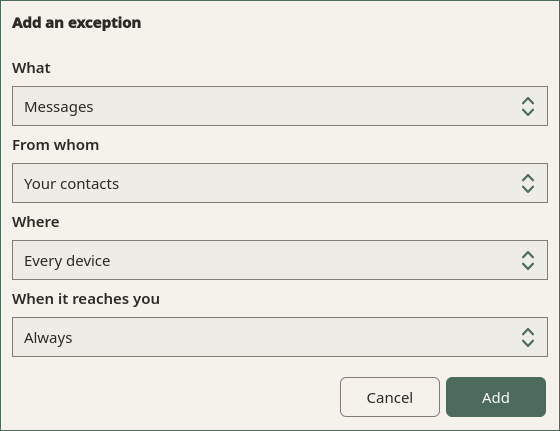
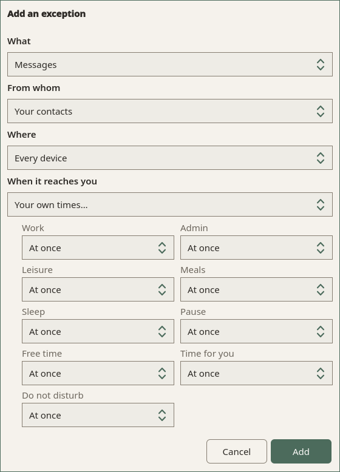
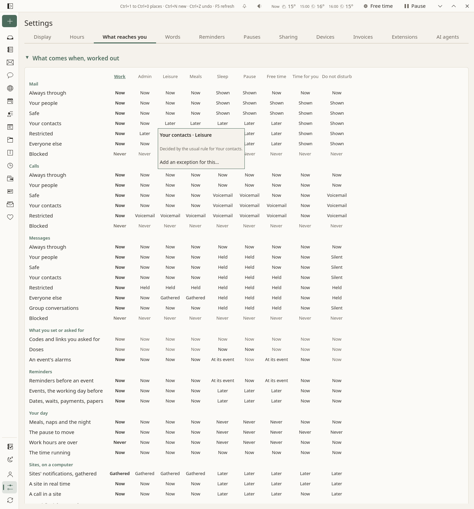
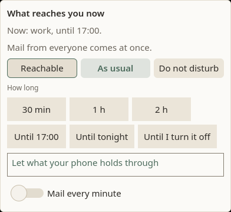

# What reaches you, and when {#what-reaches-you-and-when}

Sioul decides in one place when each thing reaches you: mail, calls and other apps' messages by who writes them, Sioul's own notifications by what they are, at each time of your day. **Settings ▸ What reaches you** says the usual rule once, in a sentence per circle of people, and lists only what you changed: your exceptions. What may come now comes; the rest waits for its time, never lost.

**Sioul decides what gets through, and when. Android's do-not-disturb only decides whether what got through makes a sound.**

<figure markdown="span">
  [{ loading=lazy }](../assets/screens/settings-attention.png "Open the picture at full size")
  <figcaption>What reaches you: the usual rule once, then your exceptions.</figcaption>
</figure>

## One page {#one-place}

From top to bottom, on a computer as on a phone:

- **Now**, in a sentence: "Now: leisure, until 22:00. Mail from your safe senders comes at once."
- **The three states**, As usual, Do not disturb and Reachable, the one on selected; **Change…** (on a phone, a tap on them) opens the card of the status line's button, where each is pressed for a length ([below](#the-button-and-its-card)).
- **The usual rule**: a sentence per circle, and **Start from** ([below](#by-person)).
- **Your exceptions**: what differs from the usual rule, a sentence each, and **Add an exception…** ([below](#your-exceptions)).
- **Do not disturb comes on by itself**: while you sleep, during a pause, while busy ([below](#what-turns-it-on-by-itself)).
- **Other apps on this phone** on a phone, **Notifications on this computer** on a computer: what Sioul holds of other apps there, and the gathered times ([below](#the-gathered-times)).
- Folded, one press away: **Who is in which circle** ([below](#who-is-on-which-list)) and **What comes when, worked out** ([below](#by-time)).

What you set travels with your settings to your other devices ([Sharing](sharing.md)).

## The usual rule {#by-person}

One sentence for each circle of people, for their mail, their calls and their messages (texts and chats from other apps, on a phone), as Sioul does it unless you change it:

- **Always through**: always, even through do-not-disturb; their mail shown without a word at night and in a pause.
- **Your people**: when you are awake; their calls always.
- **Safe**: when you are awake.
- **Your contacts**: when you are awake; their mail in your work and admin hours.
- **Restricted**: in your work hours.
- **Everyone else**: in your work and admin hours, gathered outside them; their mail in your work and admin hours. Their calls are the call screening's, said in the same line where a phone of yours screens calls ([Calls](calls.md)).
- **Blocked**: never.

Under each sentence, how many it holds: "3 people", "2 groups and 5 people", "312 cards". Nothing to set there: who is in a circle is said by your lists and your address books ([below](#who-is-on-which-list)).

The words, the same everywhere on the page:

- **Always**: at every time, the night, a pause and do-not-disturb included. Mail is shown on the Porch without a sound at night and in a pause.
- **When you are awake**: in work, admin, leisure and meals; held while you sleep or pause; under do-not-disturb, mail is shown without a sound and a text comes in the shade, silent, a call goes to voicemail. In Free time, your safe people's messages and calls still come.
- **Gathered outside your work and admin hours** (messages): at once in work and admin hours; in leisure and meals, at the next gathered time (09:00, 13:00 and 18:00 unless you set others), with other apps' automatic notifications; held while you sleep, pause or take Free time, and under do-not-disturb. A stranger's text on a Saturday morning comes at 13:00, not on Monday.
- **In your work and admin hours**, **in your work hours**.
- **Shown, never told** (mail): it stays on the Porch without a word.
- **At the gathered times** (mail, in work, admin, leisure and meals): shown on the Porch as it comes, and told in one notification at the next gathered time ([below](#the-gathered-times)).
- **Never**: mail kept in its lane, never told; a message held at every time, in its own app, the card What reaches you now counting what the phone holds; a call to voicemail.

Outside a circle's times, your safe senders' mail waits on the Porch, shown; everyone else's waits out of sight. A message is told only while what it was written to, an address or an app, is for now ([Hours](hours.md)).

**Your people** has a sentence only once you have added someone in Contacts ▸ [Your people](contacts.md#household): everyone you added there, a child, someone you help, a partner, family, whoever they are to you, but a child's other parent and someone whose relation has ended. Nothing to fill in: who they are to you puts them on the line, on every device, as soon as you add them or link a card to them. Their mail and messages come as your safe senders' until you change them; their **calls ring at every time**, at night, in a pause and under do-not-disturb too: someone of your home who calls usually cannot wait, while a text can wait for the morning.

The **?** beside the heading says how the rule is read: the times and the layers, the three states, what a phone holds.

### Where you start from {#presets}

**Start from**, the rule's one drop-down:

- **As Sioul does now**: the rule above.
- **Quieter**: your safe senders' mail shown, not told, in leisure and meals; your contacts' and groups' messages at the gathered times in leisure and meals; your safe senders' messages held in Free time; under do-not-disturb, every text held; reminders of dates, and sites in real time, wait in leisure and meals.
- **More reachable**: your contacts' mail at once in leisure and meals; everyone else's mail shown in leisure; other apps' automatic notifications at once in work and admin.

The start you choose is kept: an exception taken out goes back to it, and it never changes by itself under your exceptions. The sentences then say the rule of that start. Your exceptions stay, exceptions over the new start; one the start sets differently gives way, and the page asks first, naming them: "Starting from Quieter replaces one of your exceptions: Mail from your safe people: always." A start never changes calls set for one phone.

## Your exceptions {#your-exceptions}

What differs from the usual rule, a sentence each, read from where each thing is kept:

- "Mail from your contacts: when you are awake."
- "Messages from your people: always."
- "People of the group Family: as Safe."
- "Calls and messages from Léa Martin: at once during sleep; as usual otherwise." (a person's own times)
- "Calls, on the work phone: as a work phone: they ring in your work hours."
- "Signal ▸ Sam, on this phone: always."
- "New mail: never told; it waits on the Porch." and "Newsletters and mailing lists: told as other mail is."

**Edit** opens the exception in its card; **✕** takes it out, said in the status line with **Undo**, which puts back exactly what was there. Taking out a phone's table of calls asks first, under its line: it takes the whole table set on that phone with it, its groups' rows and its switches. What the card cannot say, such as a table set cell by cell on the phone, stays its own choice in the card: saved as it was, nothing changes. With none, the page says that everything comes as the usual rule says.

While your people's mail or messages go as Safe's (you have not changed theirs), an exception on Safe's says so: "Mail from your safe people and your people: in your work hours."

**Where a rule does nothing, the page says so there**, in the rule and under an exception: on a phone that does not hold people's messages, "People's messages are not held on this phone: they come at once, whatever the rules for messages say."; where Sioul does not screen calls, that the rules for calls do nothing there; on a computer, as far as your phones' news says, that no phone gives Sioul notification access yet, or none screens calls.

### Add an exception {#add-an-exception}

<figure markdown="span">
  [{ loading=lazy }](../assets/screens/attention-exception.png "Open the picture at full size")
  <figcaption>One card, four choices.</figcaption>
</figure>

**Add an exception…** opens one card with four choices, each a drop-down under its heading:

- **What**: mail, calls and messages; mail; calls; messages; an app, or a conversation of an app, that Sioul knows here; one of Sioul's own notices (a reminder before an event, doses, the pause to move, new mail, newsletters, your sites' news…).
- **From whom**: anyone; a circle; a group of your contacts; **a person…**, found by their name in your address books.
- **Where**: every device, or one of them.
- **When it reaches you**: the words above that fit what you chose; **Your own times…** opens the nine moments, each with its drop-down.

When nothing can be chosen, the card says why: mail, calls and messages from a circle are the same on every device; an app's or a conversation's own choice for one device is kept on this phone; a table of calls is a phone's. An exception that says what the usual rule already says is not added, and the card says so. **Enter** adds or saves.

<figure markdown="span">
  [{ loading=lazy }](../assets/screens/attention-own-times.png "Open the picture at full size")
  <figcaption>Your own times: a drop-down per moment.</figcaption>
</figure>

Changing a circle's rule is an exception too ("Safe: always"): there is no second table. A group of your contacts takes a list (as Safe, as your contacts, as Restricted, blocked); calls on one phone take a way of that phone (a work phone, a phone of your own, both, as Android does).

**The most precise wins**: a conversation before a person, a person before an app, an app before a group, a group before a circle; one device before every device. Your own times decide only the moments you set; at the others, the next line decides.

### Who is in which circle {#who-is-on-which-list}

<figure markdown="span">
  [{ loading=lazy }](../assets/screens/attention-circles.png "Open the picture at full size")
  <figcaption>Who is in which circle, folded under the exceptions.</figcaption>
</figure>

- **Your contacts** is everyone in your address books, and anyone you let in from the screener: nothing to set.
- **Always through**: the people who must always reach you ([below](#always-through)).
- **Your people**, once someone is there: their names, read from Contacts ▸ Your people, where you add or change them. Sioul recognises their mail, calls and messages by the cards linked to them. Under a name, the page says what keeps that person off their line: no card linked, or none on this device, with **Link a card…**, which opens their page; a card in an address book someone else can write, which counts once that book's groups decide who may reach you; their card, an address or a number on Restricted or Blocked, with **How this contact reaches you**, where it is changed.
- **Safe**, **Restricted** and **Blocked**: three lists. Each line is an address, a phone number (`+33 1 99 00 12 34`, written as you like), or a pattern with `*`: `*@example.org` for everyone there, `+33899*` for every number that starts so. Nobody is blocked for sharing a server or a domain with someone else.
- **A person's own list** is chosen on their sheet ([below](#a-persons-sheet)), and **a group's** is one of your exceptions.
- **Addresses, numbers and domains you named as contacts**: one line, shown only when there are some, for what an older version, a sheet or unblocking named as your contacts outside your address books. Press it to read them; remove one to have it judged as everyone else.

**From the person to the list**: a person's own choice comes first (their address or number, then their card), then their groups, then a domain or the start of a number; then your contacts; everyone else is a stranger. **Your people** come over all of that but what restricts: someone you put on Safe or Your contacts by hand is on their line once you add them to Your people, while Restricted or Blocked, on their card, an address or a number, still holds them; a group or a domain you blocked still blocks them. One of your people counts as safe everywhere else in Sioul (the Porch, the spam filter); only this page gives them a line of their own. **Proof comes first**: mail that fails its checks is weighed as a stranger's, and forged mail is set aside, even when it claims a safe sender's address. A call your network says it could not verify is never taken for one of your people's: it is screened as a stranger's.

## What comes when, worked out {#by-time}

<figure markdown="span">
  [{ loading=lazy }](../assets/screens/attention-table.png "Open the picture at full size")
  <figcaption>What comes when, worked out: every row at every time, read-only.</figcaption>
</figure>

The whole table, folded under the rest: down, each row (mail's, calls' and messages' circles, then Sioul's own kinds that act on this device); across, the seven times and the two layers, the ones now in bold. Each cell is a word, and nothing here is set: a press on a cell says which line decides it, "Decided by the usual rule for Safe." or "Decided by your exception: Mail from your contacts: when you are awake.", and offers **Add an exception for this…**, which opens the card filled with that row. A dot marks the cells an exception decides. On a phone, a line per row with its word for now; a press opens its nine moments, each saying the same. One line under the table says what each word means.

<figure markdown="span">
  [{ loading=lazy }](../assets/screens/attention-decided.png "Open the picture at full size")
  <figcaption>Which line decides a cell.</figcaption>
</figure>

## Sioul's own notices {#sioul-s-own}

Sioul's own notices have no section of their own: what each does, as Sioul does it, is below, and their rows are in What comes when, worked out. To change one, add an exception: **What**, one of Sioul's own notices; **When it reaches you**, the words that fit it, or your own times. "Reminders before an event: never." "Doses: at once during work, admin, leisure, meals and a pause; later during sleep." "New mail: never told; it waits on the Porch." (one quiet notification for each batch of mail that comes now, a click opening its message, unless you say never); "Newsletters and mailing lists: told as other mail is." (not told unless you say so).

Each notification comes once, never repeated. What each kind does, unless you change its row:

- **Codes and links you just asked a site for**: at once, at any time, sleep and a pause included, even from a site's automatic address: the code, with **Copy the code** on Linux, and how long it stays valid; it stays until the code is copied, expires or its message is read. On Android, the card shows on the Porch and on the home screen, and a notification to act on comes with it ([below](#to-know-or-to-do)). A code or an approval in another app is never held either, a text's from a short number included, but for a code texted into a conversation whose notification Sioul already holds, which comes with it; when one of Sioul's own do-not-disturb modes keeps that app silent, Sioul rings once with its own notification of the code (under your phone's own do-not-disturb alone, nothing of Sioul's sounds), and your computers say a code came to your phone. See [The Porch](porch.md#codes-and-links-come-at-once).
- **Doses**: one notification per dose, within half an hour of its time, with **Taken**, at any time, sleep included, unless you hold them in sleep or a pause ([below](#doses)). See [Health](health.md#reminders).
- **The alarm at waking**, on Android: always ([Health](health.md#meals-rest-and-sleep)).
- **An event's alarms**, at their time: at once, and in the night or in Free time when the event itself falls then. On a computer, and on a phone where Sioul rings them. Where your phone's calendar app rings them, Sioul's modes let them through only where this row says **At once** (a pause, as usual): where it says later, or when the event falls then, Android keeps them silent in the shade, and they never ring after. Under do-not-disturb outside work time they stay silent too: Android cannot tell a work agenda's alarm, which waits then, from another.
- **Reminders before an event**: a quarter of an hour before an event that takes your time and its time to get ready and get there, unless you change it ([Agenda](agenda.md#reminders)); none by itself for an event that leaves you free, nor for another person's agenda; an outing, with a ride before it or a list still to tick, is reminded once in its place: "Leave in 15 minutes for Doctor (14:00)". Each device tells its own. The evening before an event, nothing: the Porch and the agenda show tomorrow.
- **Dates asked, waits over, payments, papers and contracts to renew**: once each, on a computer, in waking times ([Settings](settings.md#reminders)).
- **Your turnover and its thresholds**, as dates are told, on the computer you use: once when your turnover reaches 80 % of the VAT franchise's threshold or of the micro regime's ceiling ("Your turnover nears the VAT franchise's threshold"), once when it passes one ("VAT applies from 1 January 2027"; "Your turnover passed the micro regime's ceiling"), and once when it passes the franchise's higher threshold ("VAT applies from today, 14 October 2026"), which is something to do ([below](#to-know-or-to-do)); one payment that passes both thresholds says the higher one alone. On the first start of a new year, what takes effect on 1 January: "From today, VAT applies" when last year passed the franchise's threshold, "From today, the micro regime ends" after two years above its ceiling, both something to do. Each is said on one device only, and never as new on another; something to do stays until it is done, and comes again each time Sioul starts until then. A click opens your budgets ([The declaration](budgets.md#the-declaration)); the tax scheme changes in Settings ▸ Invoices, under **More**, **VAT scheme, from a day on** ([Settings ▸ Invoices](settings.md#invoices)).
- **Meals, naps and the night**: two notices at most for each, each once; none during a meeting, none in sleep, a pause or Free time ([Health](health.md#meals-rest-and-sleep)).
- **The pause to move**, every 45 minutes unless you change it, in waking times, while you are at the computer ([Health](health.md#moving)); **"Work hours are over"**, once, at the end of your hours, not in work time itself ([Tasks](tasks.md#the-end-of-the-day)).
- **The time running**: while a focus session runs, on Linux and on Android, with **Pause** and **Stop** ([Time](time.md#where-time-comes-from)).
- **Your sites**, on a computer: what they notify waits, then comes in one notification at the gathered times, for the sites of those hours. A site in **Real time**, and a call in a site, come at once ([Sites](sites.md#notifications-at-your-pace)).
- **Other apps**, on Android: their automatons come back at the gathered times; the apps you set to **At once** come at once in waking times ([below](#other-apps-on-a-phone)).

**Fixed**, greyed, for your safety; press one to read why:

- **Doses**: at once, but in sleep and a pause, where you may hold them until you wake or come back. Never "not at all".
- **The codes you asked for**: at once, at every hour, by mail or by text; no setting holds them. You just asked, and a code lasts minutes.
- **An event's alarms**: at once during a pause and do-not-disturb, as both promise.
- **The alarm at waking**: always.

### To know, or to do {#to-know-or-to-do}

On a computer, each of Sioul's notifications is about one thing, and a click on it opens that thing: the message, the code's message, the event at its time, the task, the meal's question, Where I stopped, the site and its conversation. The window comes forward, even from behind the others. On Windows, a notification with something to open comes from Sioul's icon in the tray, and a click on it opens that thing; on macOS a notification has no button, and a click brings Sioul forward.

- **To know**: the pause to move, a meal, the night, "Work hours are over", a date, a wait, a payment, a paper, your turnover nearing or passing a threshold, the time to leave for an event, your sites' news and a site's message, new mail. Each leaves after **5 minutes** (**Informative notices last**, under Notifications on this computer, from 1 to 60 minutes) and leaves no trace among your desktop's notifications; the time to leave stays until the event starts. One at a time: a new "Time to move" takes the last one's place, a meal's notice at its time takes its heads-up's, a conversation's next message the last one's. They come only while you are at the computer (a key or the mouse in the last ten minutes, the session unlocked), and never during a pause or do-not-disturb. Then they wait, and come when you are back or the do-not-disturb ends, while they still make sense: a date, a payment, a paper or new mail until the end of its day (a threshold's comes again the next time Sioul looks, until it is told), the end of work until your evening is over, the time to leave until the event starts; the pause to move, a meal's heads-up and a site's message go (the Porch keeps your sites' messages).
- **To do**: a code or a temporary password, a dose, an event's own alarm, a call in a site. Each stays until it is done: the code copied, expired or its message read, on any device; the dose marked; the call over. A click on it opens its thing and, on Plasma and GNOME, leaves it and its buttons in place; once it went into your desktop's list of notifications, a click there still opens it. Only these pass do-not-disturb, when their row says so: Sioul decides it alone, nothing to tick in your desktop's settings. Your turnover past the VAT franchise's higher threshold is to do too: it stays until your tax scheme says VAT from that day ([Settings ▸ Invoices](settings.md#invoices)), but it comes as a date does, and waits through a pause or do-not-disturb.

After Sioul restarts (an update), its notifications of before are taken away, and a code still valid comes again.

On a phone, Sioul's notifications are the same two kinds, each in its own channel in Android's settings: **Notices** (to know: no sound, no banner) and **To act on** (to do: with its sound; **To act on during a pause** passes Sioul's modes when its row says so).

- **Something to know lasts 5 minutes from when you could see it**: at once if you are using the phone, else from the next time you unlock it; never longer than it makes sense (the time to leave until the event starts, a meal while it lasts).
- **A tap on a notification, or one of its buttons, opens its thing in Sioul**, even when Sioul was not running. A tap Sioul could not open within five minutes opens nothing later.
- **New mail** has a button for each message it names, three at most; a tap opens the first.
- **A code** comes as a notification to act on, with **Copy the code** and **Open the message**; on the lock screen its title alone, never the code, whatever the phone's own setting, and its buttons only once the phone is unlocked. It rings each time a code comes. It goes once copied, expired, or its message read on any device.
- **The end of work, the night and your meals** come on the phone only while you are not at one of your computers; there they come on the computer. **The pause to move** never comes on a phone.
- **An event's own alarm** rings in your phone's calendar app, not in Sioul, when a calendar app there syncs agendas (an app that is a calendar, and an account that syncs agendas into it: DAVx⁵, a Google or a Murena account…). Otherwise Sioul rings it, as before. Sioul says once which of the two it found; if you once silenced your calendar app's notifications because Sioul rang them too, its notice has a button to turn them back on.
- **Sioul's background notification** only says "Sioul keeps your devices in step", and holds none of the others: each notification of Sioul's stands on its own in the shade.

### Doses {#doses}

From winding down to waking, and during a nap, doses come unless you change it: you set their times, and a dose at 05:00 is meant to wake you.

- **During sleep or a pause**: an exception, **What** Doses, **When it reaches you** your own times, **Later** at Sleep or Pause. Later, each dose's reminder comes when you wake or come back, once, and so does the question on doses due while Sioul was closed. Every other moment is fixed at once: Sioul never holds a dose without that choice.
- **Without a night set** in Settings ▸ Hours, nothing keeps notifications away at night: the Porch asks for it in a card ([Hours](hours.md#sleep)).

### The gathered times {#the-gathered-times}

What reaches you ▸ **Other apps on this phone** (on a computer, **Notifications on this computer**) ▸ **Gathered at**: 09:00, 13:00 and 18:00, unless you set others. Three a day helped most in a field trial (Fitz et al. 2019).

- **On a computer**, one notification then says which of your sites have news, for the sites of those hours, on the computer you are at, with **Open the Porch**. With an exception that makes your sites' gathered notifications come when you are awake, nothing is gathered: each site's news comes as it arrives, in work, admin, leisure and meals; with one that says never, no gathered notification is made at all.
- **On Android**, other apps' notifications from automatons come back then.
- **Mail**, on every device, for the people whose row says **At the gathered times** then (a circle's, a person's own times, an exception): it is on the Porch as soon as it comes, and one notification names it at the next gathered time, on the device you use. Mail that comes within two minutes after a gathered time comes with it, and so does mail that reached your server before it but was fetched later; what waited is told at your device's first look after it, however late (a computer that slept through it, a phone's late check), never skipped to the next one. Under do-not-disturb or in a slot of time for you, where the row shows mail without telling it, nothing is told; it comes at the next gathered time after. Meals' own notices keep theirs.
- **A gathered time** that falls while their row says later is skipped: what waits comes at the next one.

## Each person's and each source's own {#exceptions}

Some people and some sources have choices of their own, beside your circles: your Always through people, a person's own times, each other app and conversation on a phone, a site's Real time, an event's reminder, a meal's day. A person's, an app's and a conversation's own times are exceptions, listed with the others; a site's Real time, an event's reminder and a meal's day keep their place on the thing itself ([below](#sites-events-health)).

### Always through {#always-through}

The people who must always reach you: a carer, your doctor's office, your child's school. One list for all your devices, kept sealed in your sharing folder: your address books may differ from one device to another; the list does not.

It sits under What reaches you ▸ **Who is in which circle**, beside your three lists; its sentence of the usual rule says always. As Sioul does now: their calls ring and their messages come at any time, sleep and pauses included; their mail comes at once, but is shown without a notification while you sleep or pause; do-not-disturb does not hold them. You can make them less with an exception on Always through, for mail, calls or messages; at your own times, **As their list** gives them their own list's times at a moment.

- **Add your safe senders**: everyone on your Safe list, with their card's name and numbers when a card has them. A pattern such as `*@example.org` names nobody: it is left out, and said so.
- **Add a contact…**: from your address books, by a name, a number or an address.
- **Add someone by hand**: a name, numbers and addresses, one per line.
- **Change**, **Take off the list**.

Someone added again by one of their addresses, numbers or their card stays one person. Under each name, Sioul says what is missing: "No number: their calls and messages cannot ring through."; "No address: their mail is not notified during do-not-disturb." **Blocked beats Always through**: blocking someone takes them off the list, and putting someone blocked on it takes them off the blocked list; the status line says so. A person's sheet does both in one place ([below](#a-persons-sheet)).

On Android, its own do-not-disturb names no list: Sioul's modes let through, as far as Android can say it, what the matrix lets through then ([What each system does](#what-each-system-does)). In Settings ▸ Devices, this phone's card, **Do not disturb on this phone** ▸ **Starred on this phone** says who on your list is not starred there, with **Open their contact**, to star it, or **Add to contacts**.

**Starred contacts are Always through, both ways** (a switch above the list, off until you turn it on): a contact starred on a phone, or marked favourite on a server that keeps favourites (Nextcloud does), joins the list on every device, and everyone on the list is starred where their contact is. Sioul writes the star and nothing else of a contact; on a phone, Android asks first whether Sioul may modify your contacts (**Modify contacts**, in What Android must allow). Under each name, the list says where they are starred, and where they cannot be. Nothing changes until you change it, and Sioul never guesses:

- Someone leaves the list only when you unstar a star Sioul set, while no other of their contacts there is still starred. A star you set yourself and take off takes nobody off; take them off the list in Sioul.
- Stars that go two or more at once (an account synced again, a phone restored) take nobody off: a notice names them, and the list is yours to change.
- A contact Sioul could not read this time, a number two contacts or two people share, a contact whose number changed: nothing changes, and the list says how many contacts it could not match to one person. An address book whose server has shown no favourite yet is named too: mark one contact as a favourite there, and Sioul keeps its favourites in step from then on.
- Turned off, the switch forgets what each place held; turned on again, it adds and stars, and takes nobody off.

**Your people are not starred.** Where Sioul screens calls on a phone, their calls ring as their row says, under do-not-disturb too: Sioul's modes let your contacts through and the screening decides. Where it does not, Android's do-not-disturb holds their calls as any contact's, and that phone's card in Settings ▸ Devices says so, with the two ways out: turn the call screening on there, or put that person on Always through. A star would let their texts sound at night too, which their line holds until the morning.

### Other apps' notifications, on Android {#other-apps-on-a-phone}

On Android, Sioul can hold other apps' notifications until their time, as it holds your mail. This phone's card in Settings ▸ **Devices** sets it up: **What Android must allow** asks Android for notification access, and **Android's restricted settings** helps when Android greys that switch for a Sioul installed from a file; **Other apps' notifications** lists the apps that began to ring before Sioul held them ([A phone's card](settings.md#this-phone)); holding itself is switched in What reaches you ▸ **Other apps on this phone**.

- **Messages between people** (texts, chats, mail apps, a missed call) come when the person who wrote may reach you now: their **Messages** row; **Mail**'s for a mail app, **Calls**' for a missed call.
- **Who wrote**: someone you do not know is a number or an address Sioul can read and no address book knows. When Sioul cannot tell who wrote (a chat app that gives a name only, as Signal does, or a phone where Sioul may not read your contacts), the message comes as one of your contacts' would: at once when you are awake, never held as a stranger's. A restricted or blocked contact's name still holds as theirs. Let Sioul read your contacts, so that it knows who writes.
- **Notifications from automatons** (shops, news, social networks, your browser's sites, a text from a short number) come back at the gathered times.
- **People's messages are held only if you say so**: in What reaches you ▸ Other apps on this phone, under **Hold other apps' notifications until their time**, **Hold people's messages too, by who writes and when**. Off, the page says so beside the rules for messages. Off, a person's message comes at once, but from someone you blocked, a conversation you set to gathered or never, and the people, conversations and apps you gave times of their own. A new phone starts with it off; a phone where you had already chosen something for other apps keeps holding them as before. On, let Sioul read your contacts: it is how Sioul knows who writes.
- **Always come**: calls and alarms; what runs (music, a call in progress, navigation, a download); the reminders and events you set in other apps; codes, and sign-ins or payments to approve; Sioul's own.
- **A held notification comes back whole**, with its own tap and actions. Sioul deletes none and never touches typing; it answers, or marks as read, only what you ask from a computer, through the notification's own Reply or Mark as read ([below](#messages-on-your-computers)).
- **On the Porch**, one line says what waits: "Notifications held until 13:00: Discord, Le Monde and two other apps."
- **In the phone's notifications too**: while Sioul holds something that will come, one line without a sound among Android's notifications says it, as the Porch does: "Notifications held until 13:00: Signal and Shop." Apps' names only, never who wrote. **Show now** lets it all through at once, but what you blocked and the conversations set to **Never**; it is not offered during a pause. A tap opens this phone's card in Sioul. In What reaches you ▸ Other apps on this phone, **Say in the phone's notifications what Sioul holds** turns it off.
- **A person's message that waited comes back without a sound of its own, and Sioul says it once**, with a sound, on every version of Android: "Four messages waited: Signal and WhatsApp." Only the messages that would have rung count. It goes after ten minutes, or at a tap, which opens the app when they all came from one. What you let through yourself (**Show now**, Reachable, **Let what your phone holds through**) comes back without it: you are looking.
- **After a restart of the phone**, Android forgets what it held. A minute after the phone started, Sioul says what was lost, without a sound: "Before the restart, Sioul was holding two notifications from Signal: open it to read them." The messages are still in their app.
- **What Sioul gathers comes back without a sound.** From Android 13 QPR1 (December 2022) on, and on Android 10, a held notification rings again when it comes back. So at each gathered time Sioul brings the automatons' notifications back itself, under Android's own hint that silences notifications, for a few seconds at most, and never at the time of one of its own reminders or doses, read again just before. On Android 11, 12 and the first release of 13, a return makes no sound anyway, and nothing changes there. The same for what you let through yourself (Reachable, **Let what your phone holds through**). A person's message comes back at their time the same way, and Sioul says it once (above). If Sioul's alarm never comes, Android brings them back a few minutes later, with their sound: nothing is lost.
- **The first sound**: Android starts a notification's sound before Sioul sees it, and stops it as soon as Sioul holds it, a moment later. To spare even that instant: linked to your computer, Sioul makes the apps it gathers silent itself: Settings ▸ Devices ▸ this phone's card ▸ **Other apps' notifications** ▸ **Let Sioul make them silent**, then choose in Android's list of devices the computer, paired by Bluetooth, to which Sioul relays your phone's notifications. Only the channels that rang while Sioul held an automaton's notification, and those you name with **Make it silent**; chats, texts and mail keep their sound, so that the people let through still ring, and a channel that ever carried a code, a payment or sign-in to approve or a reminder keeps it too. Android ties two more things to the link: Sioul may open its window from the background, and, from Android 15, Android stops hiding one-time codes from Sioul; Sioul reads them on your phone only, to let them through at once, and never sends their words to your computers. Each change shows in Android's settings as yours. **Give its sound back** beside an app returns its channels as they were; **Stop, and give every sound back** returns them all and lets the link go. Without the link (a phone that does not offer it, or you prefer not), **Make it silent** opens each channel's page in Android, for you to set it silent there.
- **Before you uninstall Sioul**, press **Stop**, then wait until that section says every sound is given back (Sioul needs Notification access for it): Android tells no app that it is being uninstalled, so the channels Sioul made silent would stay silent. To undo it by hand: Android's settings ▸ Apps ▸ the app ▸ Notifications, then each channel's sound.

In this phone's card in Settings ▸ Devices, under **Each app, conversation and site, by time**, as each app, conversation and site shows up:

- **Each app**: **Notification by notification** (the usual: messages by who wrote them, the rest gathered), **Messages between people**, **An automaton: gathered**, or **At once**, at the times the row **Apps set to At once** says, in What comes when, worked out. An app whose notifications cannot wait (a ride, a delivery at your door, a doctor's or a pharmacy's app): **At once**. **For**: work, your admin or leisure, as for an address; any time unless you choose.
- **Each conversation**: **By who writes**; **Always through**, at any time, sleep, pauses and do-not-disturb included (the school's group, say); **Gathered with the automatons**; or **Never**, held for good. A group is judged by its own row until you choose. Sioul lets a conversation through, never a name: in chats, anyone can choose their name.
- **A conversation Always through, during Sioul's modes**: Sioul holds nothing of it, but the phone's own do-not-disturb, which Sioul turns on for a pause, Free time and do-not-disturb, lets a conversation ring only when it is marked **Priority** in Android (Android 11 and later). **Mark it Priority in Android**, beside the conversation, opens its page there: choose **Priority**. A conversation Android has not seen changed yet has no page of its own: the button opens Android's list of conversations, where it shows among the recent ones; or long-press its next notification and choose **Priority**. Mark as priority only the conversations you let through always: Android rings every priority conversation through Sioul's modes, before Sioul can hold it. On Android 10, which has no priority conversations, it rings only from a starred contact.
- **Each site** of your browser: **Gathered** or **At once**.

#### Other apps, by time {#other-apps-by-time}

**Other apps, by time**, first in that section of this phone's card, is a table: down, each app seen in the last month, then the conversations you chose for and the ten seen last; across, the seven times and the two layers, as in [What comes when](#by-time). Each cell says **As usual** (=), **At once** (●), **At the gathered times** (◎) or **Held** (○); a press opens its choices in words. To let Discord through during work and hold it otherwise: **At once** under Work, **Held** under every other time. On a computer, each phone's card in Settings ▸ Devices lists the apps and conversations given times of their own, read and changed there as on the phone.

- **As usual** follows what the notification is: a message by who wrote it, an automaton at the gathered times, an app set to **At once** at once. Nothing changes for an app until you set one of its cells.
- **A conversation's** cell, where set, wins over its app's; where it says **As usual**, the app's counts.
- **Under a layer**: **At once** under Do not disturb lets the app through while do-not-disturb holds, at the times its row lets it through; **As usual** holds it as do-not-disturb holds everyone else's messages.
- **As before**: your Always through people still come; the blocked never do; codes and approvals, calls, alarms and what runs are never held.
- **Each app's line** says its row in one sentence: "At once: Work; held: Admin, Leisure, Meals, Sleep, Pause, Free time, Time for you and Do not disturb."
- **What Android allows**: a notification's sound starts before Sioul sees it and stops as Sioul holds it; to spare even that instant, make an app you hold at some times silent (Settings ▸ Devices, this phone's card, **Other apps' notifications** ▸ **Make it silent**), or let Sioul do it for the apps it gathers. During a pause, Free time or do-not-disturb, Sioul's own mode decides what rings: what a cell lets through then shows without a sound, unless it is a priority conversation or from a starred contact.
- **On a computer**, the apps' rows set on your phone or tablet travel with your settings; each phone's card in Settings ▸ Devices lists them, read and changed there as on the phone.

**What Sioul keeps**, on that device only, never shared with your other devices: your choices of each app's kind, each conversation's way through and each site's, the names of the apps, conversations and sites it saw, and when what it held comes back. Never what a notification says, unless you send an app's messages to your computers ([below](#messages-on-your-computers)). The rows by time travel with your settings: an app's with its name, a conversation's by a number made from it, never its title.

#### Compared with other ways to hold notifications {#other-apps-compared}

As of November 2026, from Apple's and Google's own pages, and for Android itself from its source code (AOSP, read at each release from Android 10 to 16).

✓ documented; **partly**, with a note; ✗ not found; ? the pages read do not say. Sioul's column was checked against its code.

| | Sioul, on Android | iOS, Scheduled Summary | Android, Focus mode | Android, snoozed from the shade |
|---|---|---|---|---|
| Holds an app's notifications until set times | ✓¹ | ✓² | partly³ | partly⁴ |
| A person's message comes when they may reach you | ✓ | partly⁵ | ✗ | ✗ |
| What was held comes back without a sound | ✓⁶ | ? | ? | ✗⁷ |
| No sound when a held app's notification arrives | partly⁸ | ✓² | ✓³ | ✗ |

1. Sioul: three gathered times a day unless you set others, and each app's or conversation's own times.
2. iOS: the notifications of the apps you put in the summary are delivered at the times you set, instead of as they arrive (Apple's support pages, read through a search's summary). iOS holds them itself, so their arrival makes no sound; Sioul, an app, cannot do as much.
3. Focus mode (Digital Wellbeing): "When Focus mode is on, you can't use these apps and won't get notifications from them", until you end it; whether they come later is not said.
4. One notification at a time, for a time you choose.
5. iOS: an app's direct messages and time-sensitive notifications may be set to come at once, past the summary (third-party guides; Apple's pages read do not say it); who wrote is not looked at.
6. Sioul: in its quiet window, for the automatons' notifications and what you let through; a person's comes back ringing, on purpose.
7. From Android 13 QPR1 on, and on Android 10, a snoozed notification rings again when it comes back; on 11 to 13.0 it comes back silent.
8. Sioul: linked to your computer, the apps it gathers make no sound at all; a held chat's sound starts as it arrives and is cut as Sioul holds it, since its channel keeps its sound for the people let through.

#### On your computers {#messages-on-your-computers}

Your phone can show your computers the messages its notifications bring, texts first, on their Porch under **From your phone**: "While you slept, Dr Martin's office wrote: 09:41 Your appointment is moved to Thursday 10:30." It is off until you turn it on, on the phone and on each computer that should show them: Settings ▸ Devices ▸ this phone's card ▸ **Messages on your computers** on the phone, the part **Messages from your phone** under Settings ▸ Sharing on a computer ([Sharing](sharing.md#what-travels-from-this-device)).

- **Which apps**: the phone's SMS app sends its words unless you say otherwise; every other app (Signal, WhatsApp, Discord…) sends nothing until you choose it. For each: **Not on your computers**, **Who and when**, or **Who, when and the words**.
- **When they show**: once the phone let the notification through, and while the person who wrote may reach you, as on the phone; a text from a service (a short number, "AMELI") at the automatons' times. Never as a notification on the computer, never counted.
- **Reply**, first on a line whose notification on the phone offers one: write in the box under it, "Reply to Alice on Signal…", then **Send** (Ctrl+Enter). Your phone sends it through that notification's own Reply, as if you had typed it under the notification, and your reply shows under their messages with what became of it, from "Waiting for your phone." to "Signal shows it in the conversation."; while it waits, **Take back** stops it, unless your phone has taken it already: the line then says that Take back came too late. Once the notification has gone from the phone, the line says "Reply on your phone." Replying marks the conversation read in Signal, Telegram and the SMS app, as replying from the phone's notification does: your first reply in each says so.
- **A text from a number**, when this computer reads that phone's texts: **Reply** sends one of Sioul's own texts from the phone it came to ([Texts](texts.md)), "Sent at 14:03.", even once the notification has gone; never to a short number or a sender named in letters, which may cost money.
- **What else you can do**: **Call back** for a text, through your computer's app for such links (KDE Connect hands them to your phone), else **Copy the number**; **Text back** where no Reply is offered; **Mark read** and **Dismiss** take the row away on every device, with ten seconds to undo. Neither touches the phone's notification; Mark read on a text marks it read on the Texts page too. In the line's menu (**⋮**), **Mark as read in Signal**, where the notification offers it, asks first: "Signal may tell them that you read it."
- **Their answer to your answer** comes at once for 20 minutes, on the phone and on the computer you answered from, unless you are in a pause.
- **Who may ask your phone**: a reply travels sealed with your passphrase and names the computer that wrote it, and your phone takes it only from a device your sharing counts. That rests on the passphrase: any device that knows it can ask, and a device you forgot counts again as soon as it shares anything new. Only a new passphrase cuts a device off ([Sharing](sharing.md)).
- **On the phone**, under each app in Settings ▸ Devices ▸ this phone's card ▸ Messages on your computers, **Answer from your computers** is on unless you switch it off.
- **Never sent**: codes and approvals ("A code came from your bank at 09:12. It stays on your phone.": each computer says it at once with a notification that does not carry the code; when your texts go to your computers, the text itself reaches the Texts page later, three hours later from Android 16), pictures ("a picture"), a blocked sender's messages, a conversation set to **Never**, notifications an app keeps secret, ongoing ones, Sioul's own.
- **Kept** a week. The words travel encrypted with your passphrase and sit in Sioul's files on each computer that shows them: choose the apps with that in mind.

### Sites, events, Health's days {#sites-events-health}

Each changed in its own place, on the thing itself:

- **Your sites**, on a computer: each site's **Real time** or **Silenced**, in its menu on the [Sites](sites.md) page.
- **An event's own reminder**: **Remind**, in its form and its details, as usual, not this one, or minutes before ([Agenda](agenda.md#reminders)).
- **A meal, a nap, the night, one day**: each can go without its notices for one day, on the [Health](health.md#meals-rest-and-sleep) page, or for good, in Settings ▸ Hours.
- **A person's own times**: on their sheet ([below](#their-own-times)), and among your exceptions.

## The button and its card {#the-button-and-its-card}

<figure markdown="span">
  [{ loading=lazy }](../assets/screens/reach-card.png "Open the picture at full size")
  <figcaption>What reaches you now: the state, and how to change it.</figcaption>
</figure>

One button in the status line says what reaches you now: at the bottom on Android, in the title bar on a computer. Its bell is plain **As usual**, crossed out under **Do not disturb**, with waves while **Reachable**; any state but As usual is in the accent, and where there is room it says until when ("Reachable until 18:00."). Screen readers hear the state and its end. A click, or a tap, opens the card **What reaches you now**:

1. **Now**, in two sentences: what the time is for and until when, and what comes at once.
2. **Reachable**, **As usual** and **Do not disturb**, side by side. **As usual** applies at once. Reachable or Do not disturb shows its lengths first: **30 min**, **1 h**, **2 h**, **Until 17:00** (the hours you are in), **Until tonight** (at night, **Until I wake**), **Until I turn it off**; Do not disturb also **Until 17:00** when the time you are in has an end.
3. **What your phone holds**, on Android, by app: "Notifications held until 12:00: Signal and Messages.", with **Let them through now**; then the conversations it holds, by their titles, each with **Let it through now** and **Let them through then** ([A person's own times](#their-own-times)). Their titles never leave the phone. On a computer, **Let what your phone holds through**, without saying what it holds.
4. **Mail every minute**: every folder of every address, each minute, and the Porch open, for a code or a password you are waiting for; it switches itself off when the hours you ticked it in end, never later than the night's start (midnight if no night is set), and after an hour when ticked at night.
5. **Call screening**, apart, while a phone of yours screens calls: its rule in a sentence ("Numbers nobody knows go to your voicemail, at all hours."), **Expecting a call, 1 h** (or **Screen calls again**), and on the phone **Call screening settings…**. Its on/off switch stays in Settings ▸ Devices, this phone's card, under **The call screening on this phone**, so that a card you open often never turns spam protection off.

A right click, or a long press, on the button opens a short menu: **Reachable for an hour**, **Do not disturb for an hour**, **As usual**. On a computer, the tray's menu has the same three, the state now ticked.

### Reachable {#reachable}

<figure markdown="span">
  [{ loading=lazy }](../assets/screens/reach-card-lengths.png "Open the picture at full size")
  <figcaption>Reachable, and how long.</figcaption>
</figure>

While it lasts, on each of your devices that has this version of Sioul, everyone not blocked who writes, and the people you know who call, reach you at once, their own times included ([below](#their-own-times)); a conversation you set to never stays held. The Porch opens with every lane and address, tells new mail and looks for mail every minute; what your phone holds comes back at the press. Neither a busy time, nor the night, nor Free time turns do-not-disturb on meanwhile. Numbers nobody knows stay with the call screening ([Calls](calls.md#the-call-screening)). Whichever length you choose ends at the latest at the night's start (pressed at night, when you wake), and the card says so when a length meets it. **As usual** ends it, and so does a pause; it is not offered during one. Two devices pressed within a minute, neither knowing of the other: the quieter wins (Do not disturb, then As usual, then Reachable).

## Do not disturb on every device {#do-not-disturb-on-every-device}

<figure markdown="span">
  [{ loading=lazy }](../assets/screens/attention-dnd.png "Open the picture at full size")
  <figcaption>Do not disturb comes on by itself, and the gathered times.</figcaption>
</figure>

Do-not-disturb is one switch for all your devices: turned on or off on one, it holds on all, as soon as each one hears of it through your [sharing folder](sharing.md). While it holds, its column of the matrix applies on top of the time, and each device silences its system as far as the system lets an application do it.

### The switch {#the-switch}

Do not disturb is one of the button's three states ([above](#the-button-and-its-card)): in its card, **Do not disturb**, then **30 min**, **1 h**, **2 h**, **Until 17:00** (until the time you are in ends) or **Until I turn it off**; or **Do not disturb for an hour** in the button's menu. **As usual** turns it off, on every device, whatever turned it on; while it holds for a busy time or a night, that one stays off until it ends. The card says why it holds ("While you are busy."), and **Silence this device again** when you turned this device's own do-not-disturb off while Sioul could not hear it.

### What turns it on {#what-turns-it-on-by-itself}

In What reaches you ▸ **Do not disturb comes on by itself**:

- **The switch in the status line** (on): kept from the switch before version 0.0.7; the button of what reaches you shows whatever it says.
- **While busy** (off): during an event marked **Busy**, and while a task marked **Busy while I work on it** has its timer running ([below](#busy)). A timer left running lets go half an hour past the time you chose, three hours for a timer without one. The first time a busy time turns do-not-disturb on, on a computer, one notice says why, once, and a click on it opens that section. A timer on a task not marked busy no longer turns it on, as **While I focus on a task** did before 18 November 2026: mark the tasks you want to be left alone for. An invitation counts there only once you accepted it, or accepted it as tentative: nobody holds your messages and calls by sending you one. In the availability you share, an invitation you have not answered is busy, as Google reads it.
- **During the pauses** (on): Free time and the pause silence your devices too ([Pauses](pauses.md)). Unticked, they hold Sioul's own notifications only.
- **While I sleep** (off): from winding down to waking, and during naps ([Health](health.md#meals-rest-and-sleep)).

**The latest change wins.** Turned off while you are busy, it stays off until that busy time ends, and the next one turns it on again; the same for a night. Turned off during a pause, only your devices' own do-not-disturb is lifted: the pause still holds Sioul's own notifications. Turning it on never holds a reason off. Two devices pressed within a minute, neither knowing of the other: on wins, the quieter choice; one more press settles it.

**While it holds**, as Sioul does now: your Always through people's mail, calls and messages come at once; everyone else's mail is shown, not told; their calls go to voicemail; messages from your safe people, your contacts and group conversations come in the shade without a sound, and the others' wait; doses, codes and an event's alarms still come, and on a phone reminders and Health's notices too (on a computer they wait on the Porch, Health and the agenda: [To know, or to do](#to-know-or-to-do)); your sites, other apps' automatons and the pause to move wait. The column **Do not disturb** of What comes when, worked out, says it row by row.

### Busy {#busy}

An event's card and form, and a task's panel, have a switch **Busy** (« Indisponible »; on a task, **Busy while I work on it**). While it lasts:

- it counts in the availability you share ([Agenda](agenda.md#your-availability));
- each phone's table of calls reads it in its column **While busy** ([Each phone its own calls](calls.md#calls-per-phone));
- with **While busy** ticked, do-not-disturb holds, on every device.

An event with a time is busy unless you say otherwise, a whole-day event free unless you say busy, as Google and every calendar app keep it: the mark is the event's own, so it travels to your server and back. Ticking **All day** in the form moves the mark to the new kind's own (a time busy, a whole day free) only while nobody set it: once you pressed the switch, or when the event's file says busy or free, it stays as said; an agent that changes an event's times without saying Busy sets no mark either. A meeting with others keeps its organizer's mark: shown, never written. A task is never busy unless you say so, or unless it was made from an event that was busy, which the sentence saying the change says too; on a list Google keeps, the switch is greyed, as Google keeps no such mark. On one time of a repeating event that you moved or changed on its own, the card's switch marks that time alone. On a calendar free as a whole, the switch is greyed, with a line saying why.

### What each system does {#what-each-system-does}

Each device turns on a do-not-disturb of its own for Sioul's three modes: the pause, Free time, and do-not-disturb from its switch, a busy time or your sleep. It does so as far as its system lets an application do it. On a computer, What reaches you ▸ Do not disturb comes on by itself says what its system lets Sioul do, with the page it needs when something is missing; a phone says it in its card in Settings ▸ Devices, under **Do not disturb on this phone**. Turned off from Sioul, a device's own do-not-disturb goes off too, where Sioul can ([Both ways](#both-ways)).

- **Android** (10 and later): a mode of Sioul's own for each, "Pause", "Free time" and "Do not disturb (Sioul)", among Android's do-not-disturb schedules (its modes, from Android 15). Each lets through what the matrix lets through then, as far as Android can say it:
    - **Calls**: while this phone screens calls ([Calls](calls.md)), your contacts' calls ring through the mode, Sioul having sent the others to your voicemail already; anyone's, when the call screening lets numbers nobody knows ring then and your contacts may ring then, or while you expect a call. Without the screening, your starred contacts' only. Nobody, when the matrix lets no one call then (Free time's **Nothing at all**, say), but Always through.
    - **Messages**: your starred contacts', when the matrix lets someone write then. Never more: Android plays a message's sound before Sioul can hold it, and the mode is what keeps a held message silent.
    - **A second call** from the same number within 15 minutes, whenever calls get through.
    - **Conversations marked Priority** in Android (Android 11 and later), whenever Always through's messages get through: the conversations you let through always ([above](#other-apps-on-a-phone)).
    - **Alarms**, always. **Dose reminders** and **Sioul's notifications to act on** (a code), each in a channel of its own made to pass the mode ("Doses during a pause", "To act on during a pause"), when the matrix lets them come then; their usual channels never pass, so that your own do-not-disturb holds them as before. **An event's alarms**, rung by your calendar app, where the matrix says they come at once then; else Sioul's own, in their channel. **New mail from someone Always through**, in its own channel too ("New mail from people always let through"), with a sound.
    - The rest waits in the notification shade, silent.

    Sioul needs Android's "Do Not Disturb access" for this ("Modes access" from Android 15): **Open Android's page**, in Settings ▸ Devices, this phone's card, under **Do not disturb on this phone**; **What Android must allow**, in the same card, says whether it is given. From Android 15, what you change in a mode in Android's settings wins. Turned off in the quick settings or in Android's settings, a mode of Sioul's turns Sioul's switch off on every device ([Both ways](#both-ways)). Android 10 has no priority conversations: a conversation Always through rings there from a starred contact only, and the line says so.
    - Emergency services may call back from a number you do not know (in France, 0 800 112 112): a second call within 15 minutes gets through, and you can star that number, or add it to your contacts while the phone screens calls.
- **Plasma**: Plasma's own do-not-disturb, shown among its notifications as "While Sioul is active", with the mode's name ("While Sioul is active (Pause)"). Sioul's doses, codes and an event's alarms still show, at critical urgency, unless Plasma is set to hide even critical notifications in do-not-disturb: Sioul then says so, and **Plasma's notification settings** opens the page where Sioul may "Show in do not disturb mode". Sioul's other notifications are not sent meanwhile: the Porch keeps them. Quitting Sioul ends it. Turned on or off in Plasma's notifications, Plasma's do-not-disturb turns Sioul's switch on or off ([Both ways](#both-ways)).
- **GNOME** keeps its Do Not Disturb for you, under the clock in the top bar. Tick **Switch GNOME's Do Not Disturb on with Sioul's, and off after**, in What reaches you ▸ Do not disturb comes on by itself, and Sioul does just that; turned off from Sioul, it goes off even when you turned it on yourself. Turned on or off in the top bar, it turns Sioul's switch on or off ([Both ways](#both-ways)). Sioul's doses, codes and an event's alarms still show; the rest waits on the Porch. Not from a Flatpak.
- **Mac**: make two shortcuts in the Shortcuts app, "Sioul pause on", which turns on a Focus (Do Not Disturb, say), and "Sioul pause off", which turns it off. Sioul runs the first as one of its modes starts, and the second as the last one ends.
- **Windows** does not let Sioul do it: its switch is in the notification centre (Windows key + N).
- **Other desktops** (dunst, mako, Xfce…) give applications no way to do it: the line names the notification server.

### Both ways {#both-ways}

Do-not-disturb is yours, not a device's: each device's own do-not-disturb and Sioul's switch follow each other.

- **Turned on or off in a device's own settings**, Sioul's switch follows, on every device, whatever did it: Android's quick settings, a schedule, Bedtime, a driving mode or another app; Plasma's notifications, its keyboard shortcut, or a full-screen window and mirrored screens when Plasma is set so (its default); GNOME's top bar. On Android within seconds, Sioul closed or not; on a computer while Sioul runs.
- **Turned off from Sioul**, on any device, each device's own do-not-disturb goes off too, where Sioul can: up to Android 14, Android's, and with it every other mode on at that moment (Bedtime, a schedule) until it ends by itself; Plasma's own; GNOME's, once you ticked **Switch GNOME's Do Not Disturb on with Sioul's, and off after**. From Android 15, Android lets Sioul turn off only its own modes: the phone's own do-not-disturb stays on until you turn it off in its quick settings. On Plasma, what another application or a full-screen window holds back ends with them.
- **A schedule** that turns your phone's do-not-disturb on each night and off each morning turns Sioul's switch on and off on every device with it. While only your phone's own do-not-disturb holds it, Sioul adds no mode of its own there: "This phone is silenced by its own do-not-disturb, as set in Android's settings, which turned Sioul's on."; its dose reminders and an event's alarms still come on their channels that pass.
- **Sioul's own changes** never count as yours: when Sioul turns a device's do-not-disturb on or off, it never takes that for a press.
- **When Sioul could not hear it** (closed on a computer, a phone still starting), a change is only shown on that device, never sent to the others: "Do not disturb on your other devices; you turned it off here.", with **Silence this device again** in the card What reaches you now.
- **Do not disturb (Sioul)**, among Android's quick settings: Sioul's switch, pressed without opening Sioul. Add it from the quick settings' editing page.

### How fast your other devices follow {#how-fast-your-other-devices-follow}

- **The device you press it on** applies it at once, and sends it to the sharing folder at once.
- **Your other devices** apply it at their next look at the folder, each minute while Sioul is open, once your sync app has brought the change: about a minute with a Nextcloud server. A sync app on Android may take half an hour or more. When the folder lives on a Nextcloud that one of your accounts reaches, Sioul also reads the other devices' files from the server, and a phone or a tablet follows within about a minute ([When the sync app is late](sharing.md#when-the-sync-app-is-late)).
- **With Sioul closed on Android**, Sioul keeps your devices in step in the background, with one quiet notification, "Sioul keeps your devices in step", which never says the time of day; while your calls are screened, it says so, with its buttons, within a second or two of each change. Do-not-disturb turned on at your computer follows within a few minutes: the phone looks every two minutes while another of your devices runs Sioul (while you sleep, only a computer someone is at counts, unless a dose is due and not marked), every five otherwise, every fifteen while you sleep, and as soon as the sync app writes another device's file. While you sleep, turned on at a computer nobody was at, it comes at the phone's next look, within fifteen minutes. **Keep this phone in step in the background**, in Settings ▸ Devices, this phone's card, under **Do not disturb on this phone**: off, changes come when you open Sioul. There too, **Allow in the background**, or Android may stop Sioul to save the battery.
- **Without sharing**, it holds on this device only.

### What the status line says {#what-the-status-line-says}

While do-not-disturb holds, the button says where, and until when once every reason that holds has an end (a busy time's end is never said):

- "Do not disturb, on every device, until 15:00.": every other device heard from in the last week holds it, its system silenced, and this one too.
- "Do not disturb here; your other devices' news is on its way.": the others have not been heard from since it began.
- "Do not disturb, here only.": no other device, or none that can follow.
- "Do not disturb, not on every device.": some follow, some cannot.
- "Do not disturb: this device keeps only Sioul's own notifications back.": this device's system cannot be silenced (Windows, a desktop without a way, Android without the access). With "on your other devices" when others are silenced.
- "Do not disturb on your other devices; you turned it off here.": you turned this device's own do-not-disturb off while Sioul could not hear it, or turned Sioul's mode off in Android's settings. **Silence this device again**, in its card, silences it again.

Its card says why ("Turned on from your phone.", "While you are busy."). A computer where Sioul quit is closed until Sioul starts there again; one not heard from for half an hour (Sioul stopped without a word) is waiting for its news. A device with an older Sioul does not follow; its own pauses still silence it. On Android, the card on the home screen shows the line too, while do-not-disturb is on from its switch or a busy time.

## A person's sheet {#a-persons-sheet}

<figure markdown="span">
  [![How Dr Elena Varga reaches you: "Safe: their own choice."; Their list, Safe; Always through, ticked, with what it does; then What reaches you from them: "Their mail comes at once during work, admin, leisure, meals and free time. It is shown in Sioul without a notification during sleep and a pause. No address of theirs is known.", "Their calls ring at any time. This holds once a phone of yours screens calls.", "Their messages come at once at any time."; then Their own times: "On your Always through list, they have no times of their own: take them off it to set some."; Texts with them…; then Close.](../assets/screens/attention-sheet.png){ loading=lazy }](../assets/screens/attention-sheet.png "Open the picture at full size")
  <figcaption>How someone reaches you, from their card.</figcaption>
</figure>

From a contact's card in [Contacts](contacts.md), **How … reaches you**; from a message, in its menu (⋮), **How they reach you…**:

- **Who they are to you, and why**: "Safe, as the group Friends says.", "Your contacts: in your address book, on no list.", "On Your people, because Léa is one of your people."
- **Their list**: **As their groups say** (for one of your people, **As one of your people**), **Safe**, **Your contacts**, **Restricted** or **Blocked**, for all their addresses and numbers. A list chosen here wins over Your people. An address or a number of theirs with a list of its own is said under it: it comes first.
- **Always through**: on or off. Blocked and Always through exclude each other: choosing one takes them off the other, and the sheet says so.
- **What reaches you from them**: a sentence per channel, from their row, at each time: "Their calls ring during work, admin, leisure, meals and free time. They go to voicemail during sleep and a pause. Under do-not-disturb, their calls go to voicemail." What is missing is said too: "No number of theirs is known: their calls cannot be told apart."

### Their own times {#their-own-times}

Under **Their own times**, a cell for each time and each layer, for their calls and their texts on every device: **At once**, **Held**, or **As their list** (the default); under do-not-disturb, **In the shade, without a sound** too, for their texts (a call then goes to voicemail). A cell set here wins over their list, after a conversation's own choice and before an app's; the blocked never come, and their mail follows their list. Someone on Always through has no times of their own: the sheet says so. No name is written in your settings: their card gives it (`person.contact:<its UID>`, else their number or their address). Under them, when there are some, the sheet lists **Their calls in the last month** and **Their messages this week**, from the phones that share them, and **Texts with them…** opens their conversation on the [Texts](texts.md) page.

On Android, in the card What reaches you now, **Let them through then** on a held conversation sets the cell of what holds it now: under do-not-disturb, that layer; during work, work and admin together; else the time you are in. It sets their own times when a card or a number knows them, else the conversation's own row (a group, someone nobody knows). **Let it through now** lets that conversation's held notifications come at once, this time only.

## What never notifies {#what-never-notifies}

- Mail in **Set aside** or **Hostile, set aside**: forged, borrowing a name, spam, from a sender you blocked, insults.
- What your own spam filter flagged or moved, waiting in **Caught by your own spam filter** ([The Porch](porch.md#spam-and-your-own-filter)), on any device, nor on the home screen on Android.
- Mail to your less important accounts; newsletters and mailing lists, unless an exception says they are told; what you send yourself; mail already read elsewhere; the two weeks of mail an address brings when you add it.
- A code's message, as new mail: the code has its own notification.
- The evening before an event: the Porch and the agenda show tomorrow's events; the time to leave and the event's own alarms come on the day.
- On a computer, what is to know when nobody is at it, during a pause or do-not-disturb ([To know, or to do](#to-know-or-to-do)).
- Two events at once that someone else's change made, and an account that would not hold a payment: the [Porch](porch.md#the-sections) says each once, a clash at a time its agenda may reach you, a shortfall whatever the hour. A reminder before a shortfall's day is another matter ([Settings](settings.md#reminders)).
- On a phone, the reminders of dates, waits, payments, papers and contracts, which come on a computer or a tablet.
- Your declarations of turnover and your DES: the [Porch](porch.md#the-sections) shows each, quietly, in your work hours, from the day it can be made, with **Open the declaration**, until you say it **Declared** there. On Android, the words on your thresholds: they come on a computer.

## What comes through anyway {#what-comes-through-anyway}

- **Doses**, unless you chose to hold them while you sleep or pause.
- **Alarms**, on Android: the alarm at waking ([Health](health.md#meals-rest-and-sleep)) and your clock's; Android's do-not-disturb lets alarms through. **An event's alarms**, rung by your calendar app, while Sioul's modes let them through (a pause and do-not-disturb always do).
- **On Android**, the calls that always ring ([Calls](calls.md#what-always-rings)), and what Sioul never holds of other apps' notifications ([above](#other-apps-on-a-phone)).
- **Your Always through people**, as their row says, and a conversation you let through always: on Android, Sioul's modes let it ring once it is marked **Priority** in Android ([above](#other-apps-on-a-phone)).

## Calls {#calls}

On an Android phone, call screening is apart from do-not-disturb ([Calls](calls.md)). Each phone has its own table for it, in its card in Settings ▸ Devices, under **Calls**: who rings in work hours, the rest of the day, the night and while busy, with a row for a group of your contacts when you give it one. Until you change it, the table shows what the phone does today: the usual rule for calls, and your exceptions, for the people you know, the call screening for numbers nobody knows ([Each phone its own calls](calls.md#calls-per-phone)). Android asks Sioul first: a call from someone you know whose Calls row says later goes to your voicemail, and a call from a number nobody knows as the call screening says, never where your contacts wait but while you expect a call ([Calls](calls.md#the-call-screening)); your Always through people ring as their row says, never when blocked. Android's do-not-disturb comes after: while one of Sioul's modes is on (a pause, Free time, Sioul's own do-not-disturb), your contacts' calls ring through it, the screening having sent the others to voicemail already, and a second call within 15 minutes; without the screening, starred contacts only ([What each system does](#what-each-system-does)). A do-not-disturb of your own, in Android's settings, lets through what you set there; turning it on or off turns Sioul's on or off too ([Both ways](#both-ways)).

## Where to change each thing {#where-to-change-each-thing}

- **Settings ▸ What reaches you**: the usual rule (**Start from**), your exceptions (a circle, a group, a person, an app, a conversation, calls on one phone, one of Sioul's own notices: new mail and newsletters among them), what turns do-not-disturb on (**While busy** among them, Free time's **Nothing at all**), other apps on this phone (holding, people's messages, the line in the shade) and **Gathered at**, on a computer **Informative notices last**; folded, who is in which circle (Always through, your lists) and What comes when, worked out, read-only.
- **Settings ▸ Reminders**: **Dates asked: working days before**, **With Sioul's window closed** ([Settings](settings.md#reminders)); **Before an event** in the Agenda's ⚙, **A wait over** in the Tasks' ⚙, **Payments planned: working days before** in the Budgets page's ⚙.
- **Settings ▸ Devices**, each phone's card, under its **Details**: **Calls**, its own table of who rings, set from any device. On the phone itself, the card also has **What Android must allow** (each access, notification access, Do Not Disturb access and exact alarms among them), **Android's restricted settings**, **Other apps' notifications**, **Each app, conversation and site, by time**, **Messages on your computers**, **The call screening on this phone** and **Do not disturb on this phone** (who is starred, keeping in step in the background) ([Settings](settings.md#this-phone)).
- **A person's sheet**, from their card or a message: their list, Always through ([above](#a-persons-sheet)).
- **An event**: **Remind** and **Busy**, in its form and its details ([Agenda](agenda.md#reminders)); **a task**: **Busy while I work on it**, on its panel ([Tasks](tasks.md)).
- **A site**: **Real time**, and its menu ([Sites](sites.md)).
- **Settings ▸ Hours**: the notices of meals, naps and the night ([Meals, rest and sleep](health.md#meals-rest-and-sleep)); **Health ⚙**: the pause to move ([Health](health.md#moving)).
- **Tasks ⚙**: **Time for you** ([Tasks](tasks.md#the-tasks-settings)).
- **Android's settings**: each of Sioul's channels, its sound included: "Doses" and "Doses during a pause", "Notices" (what is to know), "To act on" and "To act on during a pause" (a code), "New mail from people always let through", "Waking", "Focus timer", "Devices in step". The channels of an older Sioul ("Events", "An event's alarms", "New mail", "End of the day") are gone. A channel "during a pause" passes Sioul's modes while you have not changed it there; the conversations you let through always, **Priority** in each one's page.

## Why it works this way {#why-it-works-this-way}

- **The rule once, then only the exceptions.** Measured on a computer and a phone in daily use, the page showed a table of 12 drop-downs of which 10 said the same in both columns, a drop-down per group of contacts (more than twenty, each on "No list"), and behind it a grid of more than 180 cells of which about ten differed from what Sioul does; on the phone, about 415 controls, 7 taps from the Porch to change one thing, and the rules for messages shown where they did nothing. The settings themselves held four lines. So the page now says the rule in a sentence per circle and lists what differs, one way to add a difference, and the whole grid stays folded, read-only, saying which line decides each cell. Nothing moved underneath: your settings read as they were.
- **Your contacts set themselves.** Your address books already say who your contacts are: a list of them, and a choice of them on every group, only confused. A contact's category is called a group, the word your address book uses.
- **Sioul decides, Android sounds.** Both hold things on a phone, by different means: Sioul declines a call or holds a notification; Android's do-not-disturb decides whether what got through makes a sound. The page says each part in those words.
- **Busy is the standard mark.** Google's "Busy / Free" writes it, and every server and calendar app keeps it, so an event marked busy on your phone is busy everywhere. What you share follows that mark from the update on: a whole-day event that another program wrote as busy now counts, and a task's time block counts only once its task is marked busy. A task has no such mark: Sioul keeps its own, and counts a busy task only where its time is known, since a task with neither a date nor a time could be anywhere.

- Batching notifications three times a day improved attention, mood and stress, while people given none at all felt more anxious than controls (Fitz et al. 2019). So what can wait comes gathered, at times you can read in advance, and it does not vanish.
- A notification left unanswered still costs attention (Stothart, Mitchum & Yehnert 2015). So each comes once, mail without a sound, and no badge counts them.
- Work messages in the evening cost the evening, and the mere expectation of checking harms, read or not (Butts, Becker & Boswell 2015; Becker et al. 2021). So work waits for its hours, and only those you let through reach you in the rest of your day.
- On Android, a held notification rings again when it comes back, from Android 13 QPR1 on: holding would double the noise it is meant to calm. For an automaton, both sounds are unwanted; for a person, the sound at arrival is the unwanted one, and the sound when they may reach you is the right one. So what Sioul gathers comes back in silence, and a person's comes back ringing (from Android's source code, not a study: [the research](../dev/research.md), finding 75).
- Past the VAT franchise's higher threshold, VAT applies from that very day, and invoices to businesses since then are corrected; past its base threshold, from 1 January next year; the micro regime ends only after two years above its ceiling (BOFiP, BOI-TVA-DECLA-40-10-20 §160 and §170, BOI-TVA-DECLA-40-10-10 §130; service-public.gouv.fr, F32353). So the higher threshold is something to do, which stays until your tax scheme says VAT from that day; so are VAT from 1 January and the end of the micro regime, told on the day they take effect. A notification does not outlive the window, so each comes again when Sioul starts, until it is done. The other steps are said once, in plain words, with what changes and from when.

More in [what the research says](../dev/research.md), findings 1, 2, 21, 75, 79 and 81, and in [the attention model](../dev/attention.md). How other mail apps notify is in [the Porch's tables](porch.md#compared-with-other-apps).
