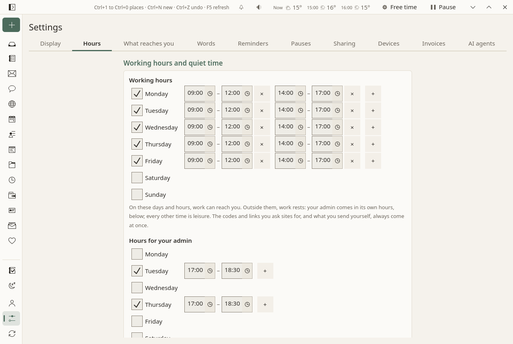

# Settings

## In short {#in-short}

**Settings** is the sliders icon at the bottom of the left column. It holds what belongs to Sioul as a whole; what belongs to one page is on that page, behind its ⚙ ([below](#each-pages-own-settings)). Each setting says in one sentence what it changes, and is saved as soon as you change it: nothing to confirm, nothing to apply. Your settings follow you to your other devices when you share between them; your passwords never do.

The Settings page has a tab for each of the sections below, from **Display** to **Invoices**, across the top of the page. What sets a phone up is on its card in **Devices**. **Words**, after **What reaches you**, holds the words Sioul recognises things by ([further down](#words)). The arrow keys move from one tab to the next once the row of tabs has the focus. In a window too narrow for every name, the row scrolls sideways: its cut end fades, and the arrow at that end brings the next tab into view.

On a phone, Settings opens on the list of its sections instead, each with one line saying what it holds. Tap one to open it; Back, or the arrow at the top left, brings you back to the list. A link to a setting, from a notice or another page, opens its section directly, and Back then returns where you were. Settings opens on the list again at your next visit.

## Protected by default {#what-is-protected}

- Your settings hold no password, no key and no token: those go to your system's keyring, even when you type them in a settings panel.
- Your settings travel to your other devices only if you share between them, and then sealed, with the rest of the sharing.
- A settings file found empty, after a crash or with a full disk, is not emptied on your other devices at once: the status line says so, and nothing of it is taken out elsewhere for ten minutes.
- **Show passwords as you type** stays on the device where you chose it, and a phone or a tablet whose screen others see can keep its home screen discreet (**Details on the home screen**, below).

## Display

- **Language**: the system's, English or French. Every sentence Sioul says follows it.
- **Colours**: light, dark, or as the system has them. As the system's, Sioul turns dark or light with it, at once, its icons too (Windows 10's dark mode included); with high contrast on, by the lightness of the system's own colours.
- **Show the places' names beside their icons**: the places on the left of the window show their names beside their icons, in a wider column, for whoever reads words more easily than icons. Without it, their icons alone; each one's name shows when the pointer rests on it, when the keyboard reaches it, or at a long press on a touch screen. It travels with your settings to your other devices, when you [share them](sharing.md). The button at the left end of the title bar, over the places, or ++f9++, changes it too.
- **Show passwords as you type**: every password, passphrase and key field shows what you type from the start, on this device. Without it, the eye at the end of each field shows or hides what you typed, at any time.
- The sites' colours, **Colours for this screen** and **Calmer colours on sites**, are the Sites page's own, behind its ⚙: only the sites follow them ([Sites](sites.md#colours)).
- **What this device is**: a phone, a tablet or a computer, as the system says unless you choose. A phone is carried: your other devices call it "the phone", and only the events' reminders come there. A tablet, like a computer, also reminds you of dates, waits, payments, papers and contracts, and your other devices call it "the tablet". The window's layout follows its size whatever you choose: a tablet held sideways gets a computer's layout, and narrowed in split screen, a phone's. Unless you choose, Android under 600 dp wide is a phone, Android from 600 dp a tablet, and any other system a computer. This device only.
- **Details on the home screen** (on Android): Sioul's cards on the home screen name what they show: a dose due, a code you just asked a site for, your reminders, a call declined, the next step's title; the latest messages on the Porch, with their sender, subject and first line; the coming events of your calendars, with their titles, and the dates asked of you ([First steps](first-steps.md#on-a-phone)). Turned off, they name nothing: the date, the weather and what now is for, then that a code, a reminder or mail waits, the events' times without their titles, each date by its kind alone, and that a next step waits: for a device whose home screen others see. This device only.

## Hours

<figure markdown="span">
  [{ loading=lazy }](../assets/screens/settings-hours.png "Open the picture at full size")
  <figcaption>Two weeks: work, your admin.</figcaption>
</figure>

- **Working hours**: on these days and hours, work can reach you. Outside them, work rests.
- **Hours for your admin**: your own admin comes forward then: offices, bills, letters, health errands.
- **Meals, rest and sleep**, under their own heading: your usual meals, naps and night, the alarm at waking, the notice before each and how far **Later** moves one ([Meals, rest and sleep](health.md#meals-rest-and-sleep)). Every page follows them: what now is for, the plan, what reaches you. A day that differs is changed on the Health page, that day only. Leisure is every other time, neither work nor admin: there is nothing to set for it.
- **Vacations and holidays**: your vacations, sick leave and other days off, quiet from the first day to the last, each with a word and its kind; then each calendar of public or school holidays you subscribed to, with its switch **its days count as my days off** (on for public holidays, off for school holidays), and **Subscribe to a calendar of holidays…** ([Vacations and holidays](hours.md#vacations-and-holidays)).

Each day of each week is on or off, with one range of hours or several: **+** adds a range, **×** takes one away. What each kind of hours brings, and what waits: [Hours](hours.md).

## What reaches you {#what-reaches-you}

One page for when each thing reaches you: Sioul decides what gets through, and when; Android's do-not-disturb only decides whether it makes a sound. On top, what holds now in a sentence, the three states (As usual, Do not disturb, Reachable) and **Start from**: **As Sioul does now**, **Quieter** or **More reachable**. Then two tabs:

- **Your rules**: **People**, a choice per circle (Always through, Safe, Your contacts, Restricted, Everyone else) for mail and for messages, with **Tell me of new mail** and **Include newsletters**; **Who is in which circle**, Always through beside the lists Safe, Restricted and Blocked, the people placed on them and your groups; **Sioul's own notices**, in four groups; **Moments**, what turns do-not-disturb on (**While busy** among them) and who holds what on a phone. One line counts what is set elsewhere, with a button to each place; calls are set for each phone, in **Devices**.
- **What comes when**: every row at every time, a word in each cell, a press to change it.

See [What reaches you, and when](notifications.md).

## Reminders {#reminders}

Each reminder comes once, as a quiet notification, without sound, never repeated. Remembering "on the 30th" is what fails most, with autism and with ADHD (Landsiedel, Williams & Abbot-Smith 2017; Altgassen, Kretschmer & Kliegel 2014), and reminders help where memory is the bottleneck (Jamieson et al. 2014).

Three reminders are set with the things they remind you of: **Before an event** in the [Agenda's ⚙](agenda.md#the-agenda-settings), **A wait over** in the [Tasks' ⚙](tasks.md#the-tasks-settings), **Payments planned: working days before** in the [Budgets page's ⚙](budgets.md#the-bank-watch) ([below](#each-pages-own-settings)). Here, the others:

- **Dates asked: working days before**: when work starts, so many working days before a task's date asked (2 unless you change it); 0 for none.
- **With Sioul's window closed**: your session starts a small watcher that tells reminders when the window is closed; nothing else runs, no mail is fetched. It needs the `sioul` command installed next to Sioul ([Install](install.md#into-your-application-menu)). It goes on after an update, and starts again if it was stopped otherwise than by this setting (on Linux and macOS, and each time the window starts). Not on Windows yet.
- **Gathered at**: what your sites notify waits, then comes in one notification at these times: 09:00, 13:00 and 18:00 unless you set others. On Android, other apps' notifications from automatons come back then. See [The gathered times](notifications.md#the-gathered-times).

When each reminder may come, and new mail, is in [What reaches you](#what-reaches-you). Doses of medicine are reminded from the [Health](health.md) page, and papers to renew from [Papers](papers.md). On a phone, the doses, the events and new mail are told; the other reminders come on a computer or a tablet ([On a phone or a tablet](first-steps.md#on-a-phone)).

## Pauses

Free time and the pause, set up on a calm day: how far the end of work may move, whether movement is offered; for the pause, what helps you, your line, the breathing guide, what the rest of the day holds after it, whose numbers show; **What comes during a pause**, its card in What reaches you; **Try the pause screen**. Free time's **Nothing at all** is on its card in [What reaches you](#what-reaches-you). See [Pauses](pauses.md).

## A phone's card {#this-phone}

What sets a phone up is on its own card in [Devices](#devices), under its name.

- **Calls**, on every phone's card, set from any of your devices: a profile to start from, **Professional**, **Personal**, **Both** or **As Android does**, each with what it does in a line; one small table of who rings in your work hours, the rest of the day, the night and while you are busy, each cell **Rings** or **Voicemail**, while busy also **As usual** (on a phone, a list of rows, each opening its four choices); **Give a group its row…**; the switches, each one setting: commercial and automated callers never ring, a second call within 15 minutes rings, numbers you called in the last 14 days ring as your contacts do, and under **More** numbers that cannot be a caller's or that your network could not verify. Until you change it, the table shows what the phone does today, a cell that differs between moments of the day saying **Varies**; calls are set there alone, and What reaches you's presets leave them. Android does not tell Sioul which SIM a call comes on: the card says so, and on the phone opens Android's SIM page. See [Each phone its own calls](calls.md#calls-per-phone).
- On the phone itself, its card also holds:
    - **What Android must allow**: the role for calls, contacts, the call log, notification access, the texts' permissions, Do Not Disturb access, exact alarms and no battery restriction, each with what it is for, whether it is given, and one button; then Sioul's own notifications.
    - **Android's restricted settings**, for Sioul installed from a file: three steps, each a button, each ticked once Sioul sees it worked ([Install](install.md#on-android)).
    - **Other apps' notifications**: Android's **Notification access**, **Hold other apps' notifications until their time**, the apps that rang before Sioul held them, with **Make it silent**; **Let Sioul make them silent**, linked to your computer. See [Other apps' notifications, on Android](notifications.md#other-apps-on-a-phone).
    - **Messages on your computers**: the part **Messages from your phone**, and for each app whether its messages go to your computers' Porch; **Answer from your computers**. See [On your computers](notifications.md#messages-on-your-computers).
    - **Texts**: what Sioul does with your texts once you allow it, the part **Texts**, what your phone holds and what has gone to your computers, what its carrier takes for a multimedia message. See [Texts](texts.md).
    - **The call screening on this phone**: the screening a phone keeps while its Calls say nothing, where a declined call goes, and Android's own blocked numbers ([The call screening](calls.md#the-call-screening)).
    - **Do not disturb on this phone**: Android's Do Not Disturb access and what each mode lets through; who of your Always through people is starred there; **Keep this phone in step in the background**. See [What each system does](notifications.md#what-each-system-does).
- Another phone's card says that what Android allows is set on that phone.

## Sharing {#your-folder-and-sharing}

The notes folder is the Notes page's, in its ⚙ ([Your notes folder](notes.md#your-notes-folder)); one line here says which it is, since your notes travel from it, with a button to it. Below it, one line says where Sioul keeps its own lists on this device (still in your notes folder, or in its own folder, with the papers' and the letters' folders), and **Where Sioul keeps its lists** opens the window of their move ([Where Sioul keeps its lists](sharing.md#where-sioul-keeps-its-lists)).

- **Between your devices**: sharing with your other devices what Sioul keeps on this one, part by part, sealed with a passphrase; your notes and papers too, if you switch them on. See [Sharing between your devices](sharing.md).
- **Show earlier versions**: what another device's change replaced here, kept on this device, with **Put back** ([Putting back an older version](sharing.md#putting-back-an-older-version)).

## Devices {#devices}

Every device you share with, this one first, each on a card; in a wide window, the cards' fields line up as a table.

- **Rename…**: a name of your own for the device, which travels with your settings. Left empty, the name its system gives it comes back.
- **What it is**, how it is **now**, when it was **last opened** and when it **last shared**, and its **Sioul**: as each device says them.
- **For**: **Work**, **Your admin**, **Leisure**, any of them together; nothing ticked, everything comes there. You can say it of any device, from any device. It travels with your settings, to each device that shares **Settings and accounts**. Each device then brings forward only what it is for, at the hours for it.
- **What comes forward, and when**, under the devices: for each device, what comes at each time your week has (work, admin time, leisure, meals, sleep). Press a cell to change it; **As its areas say** puts it back. One sentence says what this device brings now ([What each device is for](hours.md#what-each-device-is-for)).
- **Shares**: the parts the device shares. A part is switched on the device itself; this device's own are in [Sharing](#your-folder-and-sharing).
- **Count it again**, **Forget this device**, **Forget it now** and **Forget it and remove its files…**, for another device.
- A phone's own sections: its **Calls**, and on the phone itself what Android must allow and what sets it up ([A phone's card](#this-phone)).

While this device does not share, it is the only one listed. See [Your devices](sharing.md#your-devices).

## Invoices

What your invoices print and how your books count, as your country asks. Your country comes first, then what it requires; the rest is folded under **More** and **The books**. Each value is saved when you leave its field, a choice at once, as everywhere in Settings.

<figure markdown="span">
  [{ loading=lazy }](../assets/screens/settings-invoices.png "Open the picture at full size")
  <figcaption>Your country first, then what it asks.</figcaption>
</figure>

- **At the top, once**, when your invoice settings were made before November 2026: your legal form, with a button for each. An entrepreneur individuel (micro-entrepreneur included) prints « EI » after the name; a company does not.
- **Your country's rules**: France, Germany, Belgium, the United Kingdom, Switzerland, or **Elsewhere** for any other country, where every identifier and line is your own. Spain and Italy are listed as not supported, and Sioul says why ([Your country's rules](time.md#your-countrys-rules)).
- **Legal form**, when your country's rules name forms: in France, *Sole trader (entrepreneur individuel, micro-entrepreneur included)*, EURL, SASU, SARL, SAS or SA; in Germany, Belgium, the United Kingdom and Switzerland, a sole trader or a company. *Not said yet* comes first: settings made before November 2026 say none, and your next invoice waits until you choose, so that a company under the VAT franchise never reads « EI ».
- **Your name or business name**. French law asks an entrepreneur individuel's name to carry « EI »: Sioul prints it right after the name for you (« Camille Exemple EI ») when your legal form says you are one, and a name that says it already keeps it once.
- **Before an invoice is issued, your country asks:** what it requires of you, in sentences.
- **Your identifiers**: each with its kind (a SIREN or a SIRET, a VAT number, your trade register's city, another your country names), its number, and **printed** (an identifier not printed does not count for what your country requires). In France, a number that fails its check (a digit wrong) holds the invoice back until it is right. While your SIRET is being given, write « en cours d'attribution » as your SIRET: your invoices print « SIRET en cours d'attribution », the wording service-public.gouv.fr gives for it. A SIRET written in your settings before November 2026 is printed until you say an identifier here.
- **VAT today**, in a sentence: "VAT today: Small-business exemption (franchise)."

**More**, folded:

- **Income regime for the books**: in France, micro or réel.
- **VAT scheme, from a day on**: not registered, the small-business exemption (franchise), or liable for VAT, each from its day, which you pick or type in a date field (2027-01-01); the first scheme needs no day, and holds until the next one's. Under the franchise, write its line in your own words when you want another than your country's (« TVA non applicable, article 293 B du CGI » in France). **From another day** adds the next scheme, with today as its day until you pick another: when your turnover passes a threshold, add the day VAT applies from ([What reaches you](notifications.md#sioul-s-own)). A day typed with slashes is read day first, whatever language the window speaks: 01/02/2027 is 1 February 2027, and the field then shows 2027-02-01. A day written by hand in the configuration file is read the same way (2027-01-01, or 01/01/2027 with the day first); one that does not read is said at the top of this block, and your invoices wait until it reads: it is never ignored.
- **Trade name**, **Your address**, **Postcode**, **City**, **Country**, and the **Email printed on invoices**. **Write the mail** sends from that address when it is one of your accounts.
- **Bank accounts**: holder, IBAN and BIC, printed on your invoices; an IBAN that does not pass its check is said. **The payment QR code on euro invoices**: on an invoice in euros, the first IBAN whose key holds goes into a QR code to pay by transfer, with the holder's name.
- **Payment details**: printed at the bottom. In France, Sioul prints the late-payment lines itself for business clients (no discount for early payment, the penalties, the €40 fee): leave them out of these details. Details that speak of late fees hold an invoice to a business back until you keep yours or Sioul's, so that an invoice never states two rates: take them out of the details (and give your own rate below, when it differs), or turn Sioul's lines off under **Lines printed**.
- **Payable within, in days**, and **at the end of that month**: when payment is due, unless a client's profile says otherwise.
- **Late-payment rate, in percent**: yours, when it is not your country's default (in France, the ECB's rate plus 10 points).
- The invoices' language (Sioul's language, English or French) and currency (three letters, such as EUR, USD, CHF), unless a client's profile gives others.
- **Numbering**: `{YYYY}-{N:3}` gives 2026-001, 2026-002… (the year `{YYYY}` or `{YY}`, the month `{MM}`, and one counter, `{N}`, or `{N:4}` for four digits at least), **from 1 each year** or **never from 1 again**, shown as your numbering follows it: with no numbering written, your choice applies to the usual one, and a prefix of your own without the year, from settings made before November 2026, cannot start from 1 each year, which Sioul says in words; **Credit notes' own numbering**, when credit notes have a series of their own. With the year in the numbering, **never from 1 again** goes on from the last number you issued: chosen after 2025-041 and 2026-016, it gives 2026-017 next (2027-017 if that invoice is issued the year after), never 2026-042. "The next number: 2026-002" shows what comes, so a change of this choice shows its effect at once; a numbering that does not read says why, and is not kept. Settings made before November 2026 keep their prefix until you write a numbering here.
- **Lines printed**: each of your country's lines with its switch and, when you want, its text in your own words; then your own lines, with **A line of your own**. France's are the no-discount line, the penalties, the €40 fee, a company's capital and VAT on debits.
- **Professional insurance, as printed** (insurer, contact, coverage), and a company's **Share capital, as printed**.

**The books**, folded, in France ([The declaration](budgets.md#the-declaration)):

- **Your activities**: what you sell, one or two: sales of goods (BIC), commercial or craft services (BIC), other services, liberal (BNC), or a regulated liberal profession (CIPAV). Your declarations have a line for each; a payment's goods go to your goods activity, its services to your services one. With none ticked, your turnover is counted with no contribution estimated, and the declaration says so.
- **Declare**: each quarter or each month, as you chose with URSSAF; not said, as your work budget says, else each quarter.
- **Versement libératoire, paid with each declaration**: when you chose it, income tax paid with each declaration, 1 %, 1.7 % or 2.2 % of your turnover.
- **Training contribution, as a trade of**: commerce, craft or a liberal profession, for the training contribution (CFP: 0.1 %, 0.3 % or 0.2 %); **As your activity tells** takes it from your activity where it tells (sales of goods: commerce; BNC or CIPAV: liberal), and otherwise the CFP is said not counted.
- **The day you started** (2026-06-12): your first year's thresholds are prorated to your days of activity, your first declaration gathers your first months as URSSAF asks (declaring each month, the month you started and the three after; each quarter, the quarter you started and the next), and your books begin that day. Without it, they begin with the first invoice or receipt Sioul knows of. A day Sioul cannot read is said at the top, and left aside.
- **The VAT summary**: each month, or each quarter, when you are liable for VAT.
- **VAT on debits (an option taken with the tax office)**.
- **Rates of your own (ACRE, a rate URSSAF gave you)**: social contributions, the versement libératoire or the training contribution; the activity (for the training contribution, your trade: `commerce`, `craft` or `liberal`); the rate in percent; from a day, until a day. ACRE is one: Sioul cannot know it was granted to you, so write its rate, until the end of the third quarter after your start.

**Your e-invoicing platform**: the name of the approved platform (a PA) you use. From 1 September 2027, your invoices to French businesses go through such a platform, and your sales to private clients are reported there instead (e-reporting); until Sioul sends through yours, upload those invoices' PDFs there. Under the VAT franchise without a VAT number, the PDF carries no Factur-X data yet ([Write the mail](time.md#write-the-mail)).

Under the block, two more:

- **Invoices go into**: the folder where a copy of each invoice's file goes when it is issued or printed again, `Documents/Invoices` in your home folder when empty; the file itself is kept beside the invoice, and travels with it;
- **An hour costs**: the rate when a project does not set its own.

Since November 2026, an invoice is checked before it is issued against what your country's rules ask: a missing SIREN, a business client's address (a client without a profile is billed as a business), a client's country when their address leaves it unknown, or, for settings made before, your legal form, holds it back, with a sentence saying what to add. So do a line that charges VAT while your VAT scheme on the day of issue is the franchise, or none, since VAT shown on an invoice is owed; a line "VAT at a rate" without its rate; and a VAT scheme's day that does not read. The editor shows them before you press **Issue** ([The editor](time.md#the-editor)).

**Still in the configuration file** ([Where settings are kept](#where-settings-are-kept), under `[invoice]`), one setting of your books:

- `[[invoice.threshold]]`: a threshold of your own over Sioul's of the same `id`, from a day: `amount`, in euros, and `from`. The `id`s are `franchise-services`, `franchise-services-higher`, `franchise-goods`, `franchise-goods-higher`, `micro-services` and `micro-goods`. Lawyers and authors, whose franchise thresholds differ, are not in Sioul's rules: write yours.

```toml
[invoice]
trade = "liberal"

[[invoice.threshold]]
id = "franchise-services"
amount = 50000
from = "2026-01-01"
```

Everything Settings ▸ Invoices shows is kept in that same table, `[invoice]`, which you can still read and change by hand: [the developers' notes](../dev/projects.md#invoices) list every key. The rates and thresholds are France's for 2026, as URSSAF and the tax administration publish them, each with its day: an update of Sioul brings the next ones, and yours stay over them.

## Extensions {#extensions}

An extension brings data from a service Sioul does not speak to itself, such as a pupil's timetable on a school platform. Settings ▸ Extensions lists what the extensions' signed list offers, and says for each, before you enable anything, what it brings, the sites it talks to and whether it keeps a sign-in.

- **Enable** downloads its file and checks it against the signed list; **Sign in…** opens the site's own page in a window of Sioul's (on a phone, a screen of Sioul's), its name always shown above it: you type your password there, never in Sioul. The sign-in stays in this device's keyring.
- It then refreshes by itself every three hours, and brings each agenda **read only**. The agendas reach your other devices through the sharing; a device that does not run the extension shows them all the same.
- Its line says when it last ran, what it brought, and its last problem in one sentence. **Disable** stops it on this device; **Remove** forgets its sign-in and asks whether to keep its agendas.
- An extension runs apart from Sioul and is given only what its list says: the sites it names, its own entry in the keyring. An update that asks for more waits for your yes; one that asks for less applies at once. An extension taken out of the list stops, and its line says so.

The extensions are unofficial: a service can change and stop one. [The developers' notes](../dev/extensions.md) describe the interface and every check.

## Each page's own settings

One setting, one place. What belongs to a page is behind the ⚙ at the end of that page's first row:

| Page | Behind its ⚙ |
|---|---|
| [Porch](porch.md#the-porchs-settings) | the projects shown there, the calls your phones declined, how a message reads, how mail is sorted |
| [Mail](mail.md#settings) | by conversation, how often folders are fetched, your filters, your own spam filter, whether saying Spam also leaves a list, how a message reads, the lists you left |
| [Tasks](tasks.md#the-tasks-settings) | office hours, kinds, categories, task lists, where new tasks go, the reminder when a wait is over, what is work and what is yours, GitHub |
| [Agenda](agenda.md#the-agenda-settings) | calendars, the hour the day opens on, the reminder before an event, the time zone shown |
| [Budgets](budgets.md#the-bank-watch) | the reminder before a planned payment |
| [Contacts](contacts.md#the-contacts-settings) | address books, the map |
| [Notes](notes.md#new-notes) | where new notes go |
| [Papers](papers.md#where-papers-live) | the papers' folder |
| [Letters](papers.md#setting-it-up) | the letters' folder, where scans arrive |
| [Texts](texts.md#pictures-and-files) | the multimedia messages sent from here, on a device without telephony |
| [Sites](sites.md#colours) | the sites' colours: this screen's own, calmer colours; a button to your Bitwarden account, in [Accounts](accounts.md#your-password-manager) |
| [Health](health.md#prescriptions) | where the errands go, the pause to move, the limit on chats; a button to the usual meals, naps and night, in [Hours](#hours) |

The ⚙ opens them on the page's right, the page staying beside them: two fifths of the window and a little more, from 520 to 760 pixels; in a window under 720 pixels wide (a phone's, a tablet's in split screen), over the whole window. Escape or a click outside closes them.

Each address's own settings are on its card in [Accounts](accounts.md#a-mail-address). How long text reads (the font, its size and the space between lines) is in the ⚙ of the pages where messages are read, Mail and the Porch, and behind **Aa** in Notes: one setting, shown where it is used.

### Your filters

In the Mail page's ⚙, under **Filters**: what is done to new mail on its server, by conditions (into a folder, archived, to spam, flagged, marked read, to the trash, a keyword), one list for all your addresses, each filter in a sentence. **Run them on the inboxes…** says first what would change. Your filters travel with your settings. How to make one, and when they act: [Mail, Filters](mail.md#filters).

### Your own spam filter

In the Mail page's ⚙, under **Your own spam filter**: what it does with each of its verdicts on a stranger's mail (**Move to spam**, **Flag only** or **Do nothing**), how sure it must be (**Spam from**, 95% unless you change it; **Maybe spam from**, 50%), and its training, on each device, your phone too: by hand with **Train now**, then by itself once a week while that device charges and is idle (**Train here**, this device's own switch), its download on any network or only on Wi-Fi and other unmetered ones, as you choose on each device. Its settings: [Mail, Your own spam filter](mail.md#your-own-spam-filter); what it does on the Porch: [Spam, and your own filter](porch.md#spam-and-your-own-filter); what training reads and keeps: [Privacy and security](privacy-security.md#your-own-spam-filter).

## What travels with you {#what-travels-with-you}

When you [share between your devices](sharing.md), your settings go with the part **Settings and accounts**, sealed like everything there. A setting changed on two devices keeps the later change, setting by setting. What you say of each device in [Devices](#devices), its name and what it is for, travels with them, so that you can say it once, from the device in your hand.

What stays on each device: where its folders are (the notes folder, the papers' and the letters' folders, where scans arrive), whether Sioul's lists have moved out of its notes folder, how text reads on its screen (**Aa**), the time zone it shows (**Agenda ▸ Time zone**), **Show passwords as you type**, the **Details on the home screen** on Android, **What this device is**, and how its pages were left. Passwords, keys and tokens never travel: each device keeps its own in its keyring.

## Where settings are kept

In one plain text file, `config.toml`, in your configuration folder (`~/.config/sioul/` on Linux). You can read it and change it by hand: when Sioul writes it, your comments and your order stay. It holds no secret: the keys and tokens you type in a settings panel (the AI shield's key, GitHub's token) go to your system's keyring, like passwords.

## Going further {#going-further}

- **Back to the default**: clearing a setting takes its line out of `config.toml`, and its default comes back.
- **Lists travel whole**: your pinned sites, your hours, your days off and your mail filters each travel as one list, so that when two devices change the same list before they exchange, the later list is kept. Change such a list on one device at a time.
- **Not emptied everywhere at once**: a settings file found empty or gone, after a crash or with a full disk, counts as taken out only if it stays so for ten minutes; meanwhile the status line says so, and nothing of it is taken out on your other devices.

### Words Sioul looks for {#words}

Sioul recognises things by their words: a code in a message, a bill, a letter from the tax office, the folder that is your Junk, a call ringing in a chat, a sender borrowing a bank's name. Those words come in language packs (French and English; German, Spanish and Italian for codes, approvals, folders, replies and dates) and country packs (France), and **Settings ▸ Words** shows them: add your own, take away those that misfire.

- **Languages read and countries**, at the top: a tick for each language Sioul has words for, and for each country it has names for (its public bodies, its banks' approval services, its brands). A ticked language adds its words to every list. Once, when you start with Sioul, it ticks your interface's language, English and the languages your mail is written in (at least one message in twenty, and twenty messages, of the newest 500), and says so. After that it never ticks one by itself: when a good share of your mail comes in a language you do not read, a quiet notice asks once, during your working or admin hours, "Some of your mail is in German. Read German too?", with **Not now** and **Read German too**.
- **One line for each thing recognised**, in four groups (mail; money and papers; the phone; tasks and a public address), with how many words it holds and, once you changed it, how many you added and took away. Open a line: a sentence says what its words do, then each list, one word to a chip: **×** takes a word away, the field adds one. Whole words; capitals and accents do not matter. **Back to the defaults** takes that line's changes out.
- **Your changes are kept as differences**: the words you added and those you took away, never a copy of a list, so the words a newer Sioul brings still reach you. A word you take away and add again is there. Your changes travel with your other settings.
- **Your provider's spam marks** ("[SPAM]" at the start of a subject) are taken off before your own spam filter reads a message. A change counts from the filter's next training, on every device at once.
- **Voicemail by mail** is read only from the operators you name, by the domain their mail comes from; none is named at first ([Calls](calls.md#afterwards-on-the-porch)).
- **A public address**: the words that make a message to it hostile or rude, and those of each topic. Add the words of your own field to the support topic.

## Compared with other apps {#compared-with-other-apps}

Every app has settings, and a table would compare nothing you choose an app for, so there is none here. What Sioul does its own way is said above: one place for each setting, a sentence for each, saved at once, the same settings on each of your devices, and no secret among them.

## For technical readers {#for-technical-readers}

- **The file**: `config.toml` in `~/.config/sioul/` on Linux (or `$XDG_CONFIG_HOME/sioul/`), `%APPDATA%\sioul\` on Windows, `~/Library/Application Support/sioul/` on macOS. Sioul writes it in place (`toml_edit`), one key at a time, keeping comments and order; an empty value removes the key, so its default comes back.
- **Secrets**: account passwords, the AI shield's key and the GitHub token go to the system's keyring (the Secret Service, the macOS Keychain, the Windows Credential Manager, Android's KeyStore), never to `config.toml`.
- **Shared entry by entry**: each setting is one entry, and each account one entry, keyed by its `id`; a list such as your pinned sites (`[[site]]`), your hours (`[[window]]`), your days off or your filters (`[[mail.filter]]`) travels whole, as one entry. The later change wins by a hybrid logical clock, so that a change made after seeing another always comes after it. Each entry is a sealed record (XChaCha20-Poly1305, under a key made from your passphrase by Argon2id), as for the rest of the [sharing](sharing.md#what-it-protects-and-what-it-cannot-hide).
- **What you said of each device** (`[device."<id>"]`, `<id>` being the device's id in the sharing, as `sioul devices` prints it): `name`, and `area` (`work`, `admin`, `leisure`, joined by `+`); each one entry, so a name given on one device and an area set on another both stay. Under it, `[device."<id>".at]` holds the cells you changed, a key per time (`work`, `admin`, `leisure`, `meals`, `sleep`): areas joined by `+`, or `none` for nothing; each cell one entry too. A device without a table is for everything, under its system's name.
- **Kept on each device**: `case_store` (the notes folder), `papers.folder` and `letters.folder` (the papers' and the letters' folders, read once Sioul's lists have moved), `reading`, `history_weeks`, `letters.inbox` (where scans arrive), `dnd.background`, `agenda.time_zone`, and each account's `maildir` and `history_weeks`. The senders' lists travel in their own part, **Senders**. Per-device view choices (passwords shown, the home screen's details, how pages were left) are kept in the window's state, outside `config.toml`. Whether this device's lists have moved is never a setting: it is `storage.toml` in Sioul's state folder (`~/.local/state/sioul/` on Linux), which nothing that travels can change.
- **The panels**: a page's ⚙ opens on its right, 42% of the window, between 520 and 760 pixels and leaving the page 240; under 720 pixels (a phone, a narrow window: the window's size decides, never the system), the whole width. Settings' tabs span the page; each section reads 720 pixels wide at most, centred, while What reaches you's cards and Devices take the whole width, the devices' fields lining up as a table from 900 pixels.
- **The words** (`[words]`): `languages` and `countries`, then a table for each list you changed, such as `[words.folders.trash]`, with `add` (your words) and `remove` (the shipped ones you took away); for a list of names, such as the brands, `add` gives each name its words and `remove` lists names. A configuration from before October 2026 gets `languages = ["fr", "en"]` and `countries = ["FR"]` at its first start, so that nothing changes until you change it. The packs are in `crates/sioul-core/data/words/`; one installed in `$XDG_DATA_HOME/sioul/words/` or `$XDG_DATA_DIRS/sioul/words/` replaces Sioul's own when its `checked` date is later. The spam filter's table keeps the words it was trained with, so that every device reads alike. How the lists are made: [the words Sioul looks for](../dev/words.md).
