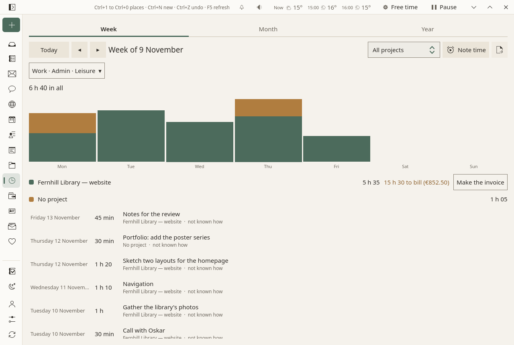

# Time and invoices

## In short {#in-short}

Sioul notes the time you spend, while you work or afterwards by hand, and keeps it for two uses. For clients, it becomes invoices: what is left to bill stays in view, each hour is billed once, and invoice numbers follow each other without a gap. For you, set beside your guesses, it shows how long things really take, and the plan of your days takes that into account ([How long things take](#how-long-things-take)). Your time and your invoices stay in plain files on your own devices.

<figure markdown="span">
  [{ loading=lazy }](../assets/screens/time.png "Open the picture at full size")
  <figcaption>A week of time, by project, and what is left to bill.</figcaption>
</figure>

## Protected by default {#what-is-protected}

- Your time, your clients and your invoices stay in plain files on your devices. There is no account to open, no subscription, and no server of Sioul's.
- An invoice number is never given twice, even with several devices: one device numbers the invoices, and Sioul waits rather than risk a number twice. Sioul writes down the last number it gave, so a number stays given even if its file is deleted.
- An issued invoice is never changed: a credit note that cites it corrects it.
- Time already billed cannot be changed, nor billed again.
- The spreadsheets for your accountant cannot carry a hidden formula: a task title or a client's name that came from someone's mail is written as plain text.
- A payment counts once, whatever your devices did: Paid ticked on two devices, the same bank export taken in on two, or the same payment typed on two counts once; and when your bank shows the transfer for an invoice you already marked paid, the transfer counts in place of your Paid, rather than adding to it.
- When your devices share, your time and your invoices travel sealed, through a folder your own sync carries: the folder and its server see that something changed, never what ([Sharing](sharing.md)).

## The Time page {#the-time-page}

**Week**, **Month** or **Year**, for **All projects** or one; **Today** and the arrows ◂ ▸ move through time:

- a bar per day (per month, over a year), stacked by project;
- each project's hours, and what is left to bill, in hours and in money at its rate;
- then each stretch of time, newest first.

## Where time comes from {#where-time-comes-from}

- **The focus timer**: the minutes of a [focus session](tasks.md#starting-and-stopping) count for its task, and for the task's project.
- **Note time**, on this page, on a project's page, or with **New ▾ ▸ Time spent**: a meeting, a call, work done away from the timer. **For** (a project, or a task), **How long** (`1h30`, `45m`, `90`), **When**, **What it was**, and **Not to bill** when it should not be.

While a focus session runs, on Linux and on Android, a notification shows it: its task, since when, and **Pause** (**Go on** once paused) and **Stop**, which do what the focus window's buttons do. On a Linux desktop it stays among the desktop's notifications while Sioul is open (in KDE Plasma, under the bell once its popup goes), and goes when Sioul quits. On Android, a chronometer counts in it, and its buttons work with Sioul in the background or closed. Paused or stopped elsewhere, in the focus window or on another device, it follows. On Windows and macOS, the focus window alone shows the time running, for now.

Click any stretch of time, timed or noted by hand, to change it: its task, its project, its day, from when to when, and what it was; the time the timer kept after a pause you missed comes back that way. A right click also offers **Take this time out**. Time already on an invoice stays as it was billed.

A timer you forgot is cut when you stop it: past twice the time you chose (or that time and half an hour more, whichever is longer), only the time you chose counts; a session without an end counts three hours at most.

Each stretch says quietly how its minutes were known:

- *timed*;
- *noted by hand*;
- *timed, then corrected*, once you changed a timed stretch's length, or Sioul cut a timer left running;
- *not known how*, for time noted before Sioul kept this.

### Billed or not {#billed-or-not}

Work for a client is billed. A task can say otherwise, under **Billed** in its panel: *As its project says*, *Its time is billed*, or *Not billed*.

## How long things take {#how-long-things-take}

A task's **Takes about** is a guess. The time noted for it is what it took. Sioul sets the two side by side, and corrects your guesses in the plan only: each task takes its corrected length in the plan and in the day, while **Takes about** stays as you wrote it, and the focus timer starts from it. Only finished tasks teach it, recent ones most; minutes noted by hand count less than timed ones, because remembered durations are less sure. How it learns, in detail: [below](#how-the-plan-learns-from-your-time).

It never scores you, never shows anything as late, never fills in **Takes about** for you, and never compares you with anyone.

Timing leisure is up to you. Gaps are fine: time not noted is left out, not counted against anything.

## A spreadsheet of billable time {#a-spreadsheet-of-billable-time}

The export button, at the top right of the Time page: **Billable time, as a spreadsheet (CSV)…**, for one project, and a stretch of time (this week, last week, this month, last month, all time, or from one day to another). One line per task, with its hours, the hourly rate and the amount, then the total. In French, the file uses `;` and a decimal comma, as French spreadsheets read them. A task title that came from someone's mail is written as plain text: a spreadsheet never runs it as a formula.

## Invoices {#invoices}

On a project's page, or beside the project on the Time page, **Make the invoice** when billable time waits. Sioul makes the invoice of that time and issues it in the same click. If something your country's rules ask for is missing (your SIREN, a business client's address…), Sioul says what, in plain words, and makes nothing: add it, then make the invoice again. What is advice rather than required (the client's SIREN before September 2027, an invoice that carries no electronic data yet, an IBAN with a digit wrong) is said in the status line as the invoice is issued; the invoice editor to come says it before. Each line's unit is one Sioul knows (an hour, a minute, a day, a unit, a month, a kilometre, a lump sum), no unit price is below zero (less to pay is a credit note), and a country is its two letters or its name; writing from right to left (Hebrew, Arabic) cannot be printed yet: Sioul asks for Latin letters.

- **Numbers.** With the usual pattern, the year then three digits, numbers start again at 001 each January: 2026-001, 2026-002. With a prefix of your own, they go on from the last one, year after year. Sioul writes down the last number given in each series: a number is never given twice, even if its file is deleted by hand, and a number with no invoice on this device is said, never given again. An invoice cannot be deleted from Sioul.
- **Lines**: one per task (or per note of time noted without a task), its time at the project's rate, to the cent.
- **Billed once**: the time an invoice bills is listed in it, and carries its number; the next invoice leaves it out, and that time can no longer be changed. What your issued invoices list is what counts: before each new invoice, Sioul marks your time again from them, so that the same hour is never billed twice, even after a crash.
- **What it prints**, as [your country's rules](#your-countrys-rules) say: your name, with « EI » after it for a French entrepreneur individuel, your address and your identifiers (your SIREN or SIRET in France); the client's name, address and identifiers, and where goods are delivered when that differs; its number; the day it is issued, the date or period of the service (the first and last days of the sessions it bills, or their one day; for an invoice not made from time, the day it is issued, unless a day was given), and the day payment is due; what it sells (services, goods, or both); each line with its quantity, unit, unit price and amount; the VAT per rate when you are liable for it, and the totals; the VAT franchise's line when you are under it (« TVA non applicable, article 293 B du CGI » in France), or, for a business abroad, the words that say where the VAT is due; for a business client, the late-payment lines (in France: no discount for early payment, penalties at the ECB's rate plus 10 points, kept with the invoice, and the €40 recovery fee), none of them for a private person, nor for a public body, whose own rules Sioul's sources did not cover; your payment details and your own lines; on an invoice in euros with your IBAN, a QR code a banking app scans to fill in the transfer.
- **In its own language and currency**: English or French, and the currency of the client's profile, else of your settings, whatever language the window speaks. Its amounts show in that currency everywhere in Sioul.
- **The file.** An issued invoice is a PDF/A-3 (A4), the form of PDF made to be kept, which also carries the invoice as electronic data (Factur-X, in the European standard's profile): the same invoice, read by a program. Sioul makes it once, when the invoice is issued, keeps it beside the invoice with its fingerprint, and puts a copy in `Documents/Invoices` in your home folder, or the folder you chose. **Print again** gives back that very file, never a new one: a file changed or missing since is made again as it was issued, when Sioul can; otherwise nothing is handed out, and Sioul says where the invoice and its file are. If the folder of copies cannot be written (a drive not plugged in), the invoice is issued all the same, and the status line says so. If an issue was stopped halfway (the computer turned off), the next one sets its file aside in the invoices' `leftovers` folder, and says so once. It travels to your other devices with your invoices. Invoices made before November 2026 print as they always did.
- **The QR code**, on invoices in euros with an IBAN: the amount due, your account's holder and IBAN, and the invoice's number as the transfer's reference, the same as printed beside it. `qr = false` in your settings leaves it out ([Settings ▸ Invoices](settings.md#invoices)).
- **Your budget**: the amount due is expected in the project's budget on the day it is due: thirty days later, unless your settings or the client's profile say otherwise. Your budgets count in euros, so an invoice in another currency is not expected there for now.

Your name, address, numbers, currency, payment details and hourly rate are set once, in [Settings ▸ Invoices](settings.md#invoices).

### Paid, and credit notes {#paid-and-credit-notes}

- **Paid**, on a project's page or on the invoice's card in the agenda, says the invoice is paid, by transfer, today: it covers whatever is left to pay, and the money counts in the budget; **Undo** takes it back. Unticked, what you said by hand is taken back; what your bank showed stays.
- **From your bank**: when you take in your bank's export, a transfer that Sioul pairs with your invoices pays them, on the bank's day: one invoice, or several when one transfer pays them together, split among them, the oldest first. An invoice never receives more than it has left to pay, and what came beyond is said. An invoice you already marked **Paid** gains no second payment: the transfer counts, and **Paid** covers only what it leaves. A payment you wrote with its amount takes in the transfer of that very amount, else the nearest in days, and keeps its own day; one you said was paid in cash never does. Through PayPal or Stripe, what the client paid counts, on the day they paid, when the processor's export says it, its fee kept apart; when only what reached your bank is known, an amount short of what the invoice asks by no more than the processor's usual fee still pays it, and the difference is said as that fee. The status line says so ("Paid, as your bank says: invoice 2026-004."), with **Undo**, which takes those payments back and keeps that transfer apart from the invoices from then on; **Not the same payment**, on that movement in [Budgets](budgets.md), does the same later. There is nothing to confirm. Sioul pairs a transfer with an invoice whose money is expected in a budget, the project's **Invoices expected in**, and in the invoice's own currency only: a transfer in euros never pays an invoice in dollars.
- **Partly paid**: payments add up; until they reach the amount due, the invoice is not paid yet, and `sioul invoices` says what is left. A payment is never more than what is left to pay. Sioul never calls an invoice overdue.
- **A wrong invoice** is never changed: a credit note citing it corrects it, with all its lines to cancel it, or some to correct them, each line with the VAT it was billed with. It takes the next number of the same series. Issued, it settles what it credits, and the time of each line it cancels whole can be billed again. It never credits more than the invoice has left to credit: one beyond that, such as a second credit note for an invoice already credited whole, is refused, and the credit notes already issued are named. A credit note is never paid nor unpaid: it says which invoice it credits. When that invoice was paid beyond what it now asks, the credit note also says what you have to pay back ("€120.00 to pay back"), and has a **Paid back** box; `sioul invoices pay <credit note> --amount 50` says a part paid back. The money the invoice was expected to bring into your budget goes down by the credit note's amount, or goes out when the invoice is credited whole, so that the client's next transfer is never paired with it. An invoice credited in part and not paid is not "partly paid": it simply has less left to pay. For now, credit notes are made [from the command line](#from-the-command-line).
- **Deposits**: deposit invoices, and a final invoice that deducts them, come with the invoice editor ([Not there yet](#not-there-yet)); no button, command or AI agent makes them yet.

### Your country's rules {#your-countrys-rules}

What an invoice must say depends on your country, and in France on three things that do not imply one another: your legal form (an entrepreneur individuel, a micro-entrepreneur included, or a company), your income regime (micro or réel), and your VAT scheme (the franchise, or liable for VAT), which can change on a given day. The invoice of a micro-entrepreneur liable for VAT carries « EI » and the VAT per rate; a company's under the franchise carries the franchise's line, its form and its capital.

Sioul knows the rules of France, Germany, Belgium, the United Kingdom and Switzerland, and **Elsewhere**, for any other country: no legal claim, every identifier and line your own. Each country's rules are data that Sioul reads, with their sources:

- **Spain and Italy are not supported**, and Sioul says why rather than offer a template that would be illegal there: Spain asks invoicing software to be certified, its invoices chained and signed (VERI\*FACTU); Italian invoices go through the state's exchange system (SdI), in its own format.
- **Belgium**: between Belgian businesses, invoices are structured electronic invoices sent through Peppol since 2026, and a PDF by mail no longer suffices. Sioul does not reach Peppol: it makes the PDF, and sending the invoice through your access point is yours. Under the franchise, write its line yourself: Sioul does not know the exact wording the law asks for.
- **France, liable for VAT, with private clients**: software that records their payments must have a certificate or an attestation (article 286 I 3° bis of the CGI), and Sioul has neither. Under the franchise, nothing is asked.
- **France, the franchise's line**: VAT law moves into a new code, the CIBS, on 1 January 2027, and the article to cite there is not settled yet (L. 223-3 or L. 233-3). « TVA non applicable, article 293 B du CGI » stays valid until 30 June 2028 and is the default; you can write another.
- **VAT rates**: Sioul ships each country's rates as they were known in mid-2026; check them before you rely on them.
- **Clients in other countries**: where the VAT is due depends on where the client is, whether it is a business, and what you sell, and your country's rules place each line. In France, a service to a business in another EU country carries « Autoliquidation » and both VAT numbers, under the franchise too; liable for VAT, goods sold to such a business carry « Exonération, art. 262 ter I du CGI » and both VAT numbers; a service to a business outside the EU carries « TVA non applicable – article 259-1 du CGI ». Where Sioul's sources give no words (an export of goods; in the other countries, every case but the EU's reverse charge, such as a service to a business outside the EU, in Germany and Belgium under their small-business exemption too), Sioul asks you to write them on the line before the invoice is issued. A VAT number is checked by the rules of its own country.
- **The client's country** comes from their profile, else from the last line of their contact's address when it names a country, in any of the usual languages ("Belgique", "Deutschland", "Maroc"), else from the two letters their VAT number starts with. An address whose last line is a postcode and a town is taken as one in your own country, and Sioul says so before the invoice is issued. When that line names no country Sioul knows, or there is no address at all, Sioul asks for the client's country before the invoice is issued, wherever your country's rules place the VAT by it. A client in Monaco is billed as one in France for VAT, and their address says Monaco. The country prints by its name, in the invoice's language.

Until Settings ▸ Invoices shows them by country, these choices are made in the configuration file ([Settings ▸ Invoices](settings.md#invoices)). Invoice settings made before keep working as they were: a VAT line citing article 293 B means France, the micro regime and the franchise; any other VAT line means Elsewhere, its lines printed as before. With a VAT line citing article 293 B, your legal form is asked once, in Settings ▸ Invoices ▸ **Legal form**, before your next invoice is issued: a company under the franchise must not read « EI », so « EI » is printed only once you choose *Sole trader (entrepreneur individuel, micro-entrepreneur included)*. If your payment details already speak of late fees, as Sioul's earlier help asked, Sioul asks you to keep either your words or its own lines, so that an invoice never states two rates ([Settings ▸ Invoices](settings.md#invoices)).

### Your clients {#your-clients}

A client can have a profile, in `sioul-clients.toml` in your notes folder, tied to their contact: a business, a private person or a public body; the legal name; the billing address and, when it differs, the delivery address; their identifiers (a SIREN, a VAT number); the language, currency and payment terms of their invoices; where invoices are mailed; a purchase order to print. A project whose **For** names that contact, or the profile's name, bills with it. Without a profile, an invoice takes the contact's name and first postal address, as before, and bills the client as a business, whatever the contact holds; only a profile saying `kind = "consumer"` bills a private person, whose address is then advised rather than required, since a private person may ask that it not be printed. `sioul invoices show` says which. Until it is issued, a draft follows its client's profile, or their contact card: a profile changed meanwhile counts. For now, profiles are written in that file by hand (an example in [the developers' notes](../dev/projects.md#clients)); Contacts and Projects show them later.

### On several devices {#on-several-computers}

An invoice number must never be given twice. When you [share between your devices](sharing.md), one device numbers the invoices: another says "Invoices are numbered on …", and **Make invoices on this device** takes them over, after a minute and a half, once your other devices know. If your sharing folder cannot be written, or another device has not been heard from for a few minutes, Sioul waits rather than risk a number twice.

Each device also tells the others the last number it gave in each series, right after each invoice and when Sioul closes, so a device whose invoices have not arrived yet still never gives one of those numbers again. A device that shares, but leaves out **Drafts and invoices**, issues no invoice: it says so, and you issue them on a device that shares them. Nor does a device whose sharing cannot read its key, such as when the keyring is locked: it waits until it can. With sharing on, `sioul invoices issue` numbers an invoice only while Sioul's window runs on that computer and keeps the invoices there, by the same rules as the window, and tells your other devices the new number at once.

A payment counts once, whatever your devices did: **Paid** ticked on two devices, the same bank export taken in on both, or the same payment (its day, amount and means) typed on both before they exchange counts once. Each device writes what happens to your invoices in a file of its own, and an issued invoice itself is never written again. Should two devices still give one number at the same moment, `sioul invoices list` says so, and so does one calm row on the Porch in your working hours: issue a credit note for one of the two invoices, then invoice it again. Client profiles travel with your projects, once each of your devices has a Sioul that knows them.

## In quiet time {#in-quiet-time}

Outside working hours, the Time page waits behind **Show anyway**. See [Hours](hours.md).

## Not there yet {#not-there-yet}

- **Invoices in the window.** One place for every invoice and draft (Money ▸ Invoices); an editor for any line (a fixed price, days, expenses, goods), saying what is missing as you type; Settings ▸ Invoices by country; client profiles in Contacts and Projects; **Write the mail**, with the PDF attached; **Paid…** with the day and the means; **Credit note…** and **Deposit…**. Until then, a draft made from the command line or by an [AI agent](ai-agent.md) is issued from the command line.
- **Sending electronic invoices.** From 1 September 2027, a French micro-enterprise, under the VAT franchise too, must issue its invoices to French businesses electronically, through an approved platform (« plateforme agréée »), in UBL, CII or a mixed format such as Factur-X, with the client's SIREN; from the same date, the data of sales to private individuals and abroad must be reported (e-reporting). Each invoice Sioul issues already carries its Factur-X, which most platforms take as a file; sending through your platform from Sioul is planned before then.
- **Under the VAT franchise without a VAT number**, your invoices' PDF carries no Factur-X data yet: the European standard asks for a VAT or tax number there, and the French rule that says which number to give instead is still to be read. Sioul says so in the status line as it issues the invoice; the PDF is a complete invoice, as the law asks until September 2027.
- **The books.** The receipts book made from your invoices' payments, the URSSAF declarations by category, and a word when you near the VAT franchise's or the micro regime's thresholds.
- Quotes.
- The time running in the notifications of Windows and macOS: the focus window alone shows it there.

## Going further {#going-further}

### How the plan learns from your time {#how-the-plan-learns-from-your-time}

- **Your first guess is kept.** The first time a task gets a length, Sioul keeps it with the task and never changes it, even when you change **Takes about** later. A task given a length before this existed has none kept; its current length is used instead.
- **Only finished tasks teach it**, each one's time spent against its first guess, all its stretches added up.
    - Timed minutes count fully, corrected ones too.
    - Minutes noted by hand count a quarter, because remembered durations are less sure.
    - Dropped tasks never count.
- **Recent tasks count most**: a task's weight halves every four or five days.
- **Few tasks, little correction.** Until about nine tasks stand behind it, the correction leans toward "a little longer than guessed".
- **By what tasks are for**: work, your admin and leisure each have their own correction, pulled toward yours until they have enough tasks of their own.
- **The plan uses it; you see your own.** Each task takes its corrected length in the plan and in the day, while **Takes about** stays as you wrote it, and the focus timer starts from it.
- **The margin is the day's, not each task's.** Each day keeps some time free after its last step for steps running long: about enough to cover a day going worse than usual, never more than a third of the day. Once today's first tasks are done, a day going slower keeps more. The next step always keeps part of today.
- **On request**, in a task's panel, a line such as "Tasks like this usually take about 1.3× the first guess; the plan already allows for it", only once enough tasks stand behind it.

The detail, with what comes from research and what is a guess: [What a day holds](../dev/capacity.md).

### From the command line {#from-the-command-line}

`sioul focus start <task> [--minutes 25]`, `sioul focus status` and `sioul focus stop [--done] [--note "…"]` run the focus timer from a terminal; its minutes count as the window's do.

Your invoices, from a terminal:

```
sioul invoices [list] [--client <words>] [--year 2026] [--status draft|issued|sent|partly-paid|paid|credited|credit-note|to-pay-back]
sioul invoices show <number or draft>
sioul invoices export [--year 2026] | --html <number> | --pdf <number>
sioul invoices draft <project>
sioul invoices issue <draft>
sioul invoices discard <draft>
sioul invoices credit <number> [--line 2]…
sioul invoices pay <number> [--day 2026-11-16] [--amount 120.50] [--means transfer|card|cash|cheque|direct-debit|other]
```

`list` gives your drafts first, then your invoices, newest first, each with where it stands; it also says a number given twice, a file written by a newer Sioul, and a draft that is a copy your sync app made of another. `show` gives an invoice's lines, totals and payments, its client and whether it is billed as a business, a private person or a public body, the day or period of the service, and for a draft what it still lacks before it can be issued. `export` writes every invoice as a spreadsheet (a client's name as plain text, never as a formula), one invoice's page to print (`--html`), or puts its file, as it was issued, where your invoices go and says where (`--pdf`). `draft` makes a draft of a project's time not billed yet: nothing is numbered. `issue` numbers a draft and keeps it with its file, as the window does: only on the device that numbers your invoices, and, with sharing on, only while Sioul's window runs there ([On several devices](#on-several-computers)); a draft is never issued twice, nor is a copy of a draft issued since. `discard` throws a draft away: nothing was numbered. `credit` makes a draft credit note, of all of an invoice's lines or of those given, which `issue` then issues, never for more than is left to credit. `pay` writes a payment received, or, on a credit note, money paid back: what is left, unless you give an amount, and never more than what is left.

## Why it works this way {#why-it-works-this-way}

Your guess of how long a task takes carries information, with a bias: the typical error is 20 to 30 %, short tasks overestimated, long ones underestimated, and a day's total runs over (Halkjelsvik & Jørgensen 2012). People misremember how long past tasks took, and seeing the measured times of similar ones helps (Roy, Christenfeld & McKenzie 2005). So your guess is kept and corrected in the plan, never replaced; timed minutes count more than remembered ones; and the margin is the day's, not each task's.

French law gives each invoice a number from a continuous series when it is issued, and an issued invoice is never changed: a credit note citing its number and date corrects it (CGI, annexe II, art. 242 nonies A; CGI, art. 289; BOFiP, BOI-TVA-DECLA-30-20-20-10 and -20). So a draft has no number, issuing numbers it and freezes it, the last number given is written down apart from the invoices themselves, and a wrong invoice is answered by a credit note. Countries differ in what an invoice must say, not in what it is made of: the European standard for electronic invoices, EN 16931, names every part of one, and France's and Germany's electronic invoices carry exactly those parts (Factur-X 1.09.2). So one record holds an invoice in that standard's terms, each country's rules are data, and Spain and Italy, whose invoices need certified software or the state's own channel, are said to be out of reach rather than given a template that would be illegal there.

A micro-entrepreneur declares what clients paid, when they paid it (URSSAF; CGI, art. 50-0 and 102 ter), and what the law asks on an invoice to a business (penalties, the €40 fee) is not asked of one to a private person (Code de commerce, L441-10). So a payment your bank shows is written on its invoice by itself, with Undo, and nothing waits for you to confirm it; the lines for businesses go to businesses only; and an invoice not paid yet is said so, never "overdue", in no red: numbers shown in red make people expect worse (Bazley, Cronqvist & Mormann 2021), and people look away from their accounts when they go badly (Olafsson & Pagel 2017).

An invoice is kept as it was issued, ten years, and a French business will soon receive it as data (Code de commerce, L123-22; CGI, art. 289). So the file made when it is issued is the one kept and given back, never a new rendering in today's words; it is a PDF/A-3, made to stay readable, carrying the same invoice as Factur-X data, as France and Germany read it; and where the rule a person must read is missing (which number a franchise without a VAT number gives), Sioul leaves the data out and says so rather than guess. The payment QR code carries the transfer's details so that nothing is typed again, and the account holder's own name, so that the payer's bank's check of the payee raises no warning (EPC069-12; Regulation (EU) 2024/886).

More in [what the research says](../dev/research.md), findings 24 and 76 to 80, and in [Time estimation](../dev/research/time-estimation.md) and [Invoices](../dev/research/invoicing.md).

## Compared with other apps {#compared-with-other-apps}

As of October 2026, from each app's own documentation.

✓ documented; **partly**, with a note; ✗ not found in the app's own documentation (for Sioul: not built); ? not confirmed; — not applicable. Sioul's column was checked against its code.

**Time and invoices**

| | Sioul | Toggl Track | Clockify | Harvest | Kimai | Freebe |
|---|---|---|---|---|---|---|
| A timer, and time noted by hand | ✓ | ✓ | ✓ | ✓ | ✓ | ✓ |
| A timer left running is caught | partly¹ | ✓² | ✓² | ? | partly³ | ? |
| Billable or not, with hourly rates | ✓ | ✓⁴ | ✓⁴ | ✓ | ✓ | ✓ |
| What is left to bill, per project | ✓ | ✗⁵ | partly⁶ | ✓ | partly⁷ | ? |
| Invoices made from the time | ✓ | partly⁸ | ✓⁹ | ✓ | ✓ | ✓ |
| Each hour billed once, never twice | ✓ | ✗⁵ | ✓ | ✓ | ✓ | ? |
| Invoice numbers in sequence, by themselves | ✓¹⁰ | ✗¹¹ | ✓¹² | ✓¹² | ✓ | ✓ |
| Quotes, expenses or VAT amounts | partly¹³ | partly¹⁴ | ✓ | ✓ | ✓ | ✓¹⁵ |
| Credit notes and deposit invoices | partly¹⁶ | ? | ? | ? | ? | ✓¹⁵ |
| A spreadsheet for your accountant | ✓ | ✓ | ✓ | ? | ✓ | ? |

1. Cut when you stop it: past twice the time you chose (or that time and half an hour), the time you chose counts; without an end, three hours at most. Nothing watches whether you are at your computer.
2. Idle detection: Toggl Track in its desktop apps and browser extension; Clockify on Mac, Windows and in Chrome.
3. A longest entry, 8 hours unless the administrator changes it.
4. Billable rates from Toggl Track's Starter plan and Clockify's Basic plan.
5. Toggl Track does not mark time as invoiced; its help suggests tagging billed entries by hand.
6. Invoiced entries carry an "Invoiced" mark in the Detailed report; a left-to-bill total is not described.
7. The records not yet exported are what the next invoice takes; a left-to-bill amount is not described.
8. A PDF made from a report, every field editable; the invoice is not kept in Toggl Track.
9. From the Standard plan.
10. Never given twice, also across your devices: one device numbers them, and the last number given is written down. With the usual pattern, the series starts again each year.
11. The invoice ID is typed by hand.
12. Automatic by default; it can be changed.
13. The VAT per rate when you are liable for it; lines other than time (a fixed price, days, expenses) only in an AI agent's draft for now; no quotes.
14. A tax field, typed on the invoice.
15. Quotes, credit notes and deposit invoices.
16. A credit note citing the invoice, made from the command line for now; deposit invoices, and a final invoice that deducts them, come with the editor.

**France, and where your data lives**

| | Sioul | Toggl Track | Clockify | Harvest | Kimai | Freebe |
|---|---|---|---|---|---|---|
| French legal mentions printed for you | ✓¹ | ? | ? | ? | ?² | ✓ |
| Electronic invoices for France (Factur-X, UBL, CII) | partly³ | ? | ? | ? | partly⁴ | ✓ |
| Works without a connection | ✓ | ✓⁵ | ✓⁵ | ? | ? | ? |
| Your time on your own devices, no account | ✓ | ✗ | ✗ | ✗ | partly⁶ | ✗ |
| Free software | ✓ | ✗⁷ | ✗⁷ | ✗⁷ | ✓ | ✗⁷ |

1. From your settings and the client's profile: « EI » after an entrepreneur individuel's name, the SIREN or SIRET, a company's form, capital and register, the VAT franchise's line or the VAT per rate, the client's SIREN and VAT number, the delivery address, the date or period of the service, the nature of the operation; for business clients only, no discount for early payment, the late-payment penalties and the €40 fee. What is missing is said before the invoice is issued.
2. Its invoice templates are yours to edit; no French template was confirmed.
3. Each issued invoice is a PDF/A-3 carrying its Factur-X (EN 16931 profile), kept as issued; under the VAT franchise without a VAT number, the PDF alone for now. From 1 September 2027, a French micro-enterprise must issue invoices to French businesses electronically, through an approved platform: sending there from Sioul comes later.
4. With a paid plugin, 99 € a year: Factur-X, ZUGFeRD, XRechnung, UBL and CII.
5. Toggl Track's desktop apps; Clockify on Mac, Windows, Linux, Android and iOS. Both send the time to their servers once back online.
6. On your own server, or in Kimai's cloud.
7. A hosted service under its own terms; no free-software licence is published for it.

Others do more for invoicing itself: idle detection (Toggl Track, Clockify); quotes, expenses and payment links, with VAT and credit notes made in their window (Clockify, Harvest, Kimai, Freebe); electronic invoices for the French reform (Freebe, and Kimai with a plugin); URSSAF declarations (Freebe); teams, approvals and integrations (the four commercial ones). Sioul keeps what is left to bill, bills each hour once, numbers without a double even across devices, prints what your country asks from rules kept as data, writes on each invoice the payments your bank shows, feeds the same time to the plan of your days, and keeps it all on your own devices.

??? info "Sources"
    All read on 8 October 2026.

    - **Toggl Track**, its help on invoices and on the Windows desktop app, its desktop apps page and its prices: <https://support.toggl.com/creating-invoices-in-toggl-track>, <https://support.toggl.com/en-us/article/toggl-track-desktop-app-for-windows-5w1y5/>, <https://toggl.com/track/toggl-desktop/>, <https://toggl.com/track/pricing/>
    - **Clockify**, its help on invoices and on invoicing tracked time, its invoicing and apps pages, and its prices: <https://clockify.me/help/projects/invoicing>, <https://clockify.me/help/projects/invoicing-tracked-time-expenses>, <https://clockify.me/features/invoicing>, <https://clockify.me/apps>, <https://clockify.me/pricing>
    - **Harvest**, its invoicing page, its API documentation (uninvoiced report, invoices, time entries), its apps and its prices: <https://www.getharvest.com/features/invoicing>, <https://help.getharvest.com/api-v2/reports-api/reports/uninvoiced-report/>, <https://help.getharvest.com/api-v2/invoices-api/invoices/invoices/>, <https://help.getharvest.com/api-v2/timesheets-api/timesheets/time-entries/>, <https://www.getharvest.com/apps>, <https://www.getharvest.com/pricing>
    - **Kimai**, its documentation on invoices, exports and timesheets, its e-invoice plugin and its repository: <https://www.kimai.org/documentation/invoices.html>, <https://www.kimai.org/documentation/export.html>, <https://www.kimai.org/documentation/timesheet.html>, <https://www.kimai.org/store/invoice-bundle.html>, <https://github.com/kimai/kimai>
    - **Freebe**, its home page, its pages on time and on invoices, and its prices: <https://www.freebe.me/>, <https://www.freebe.me/fonctionnalite/gestion-du-temps>, <https://www.freebe.me/fonctionnalite/facture-client>, <https://www.freebe.me/tarifs>
    - **French law**, service-public.gouv.fr's sheet on an invoice's mandatory mentions (updated 11 August 2026), the BOFiP on invoice numbers, impots.gouv.fr on electronic invoicing (modified 26 May 2026), and service-public.gouv.fr's news of 2 September 2026: <https://entreprendre.service-public.gouv.fr/vosdroits/F31808>, <https://bofip.impots.gouv.fr/bofip/140-PGP.html/identifiant=BOI-TVA-DECLA-30-20-20-10-20131018>, <https://www.impots.gouv.fr/professionnel/je-decouvre-la-facturation-electronique>, <https://entreprendre.service-public.gouv.fr/actualites/A18953>

## For technical readers {#for-technical-readers}

- **Time records**: TOML, one file a month (`~/.local/share/sioul/time/2026-10.toml` on Linux), the running session in `time/running.toml`, so closing the window loses nothing. Each record says how its minutes were known (`kind`: measured, typed, corrected).
- **A timer left running**: a session past `max(2 × chosen, chosen + 30)` minutes counts the time chosen; one without an end counts 180 minutes at most; either is then marked corrected.
- **Invoices**: one record each (`invoices/<number>.toml`), in the terms of the European standard EN 16931 (format 2 since November 2026: kinds 380, 381 and 386, money in integer cents, half away from zero), written once and never again, never over another file, holding your details and the client's as they were that day. What happens to it later is kept apart, each device in its own file (`invoices/life/<device>.toml`): its payments, each with an id made of what it says (typed by hand: the invoice, day, amount and means; from the bank: the line's account, day, amount and a digest of its label), "Paid" said on a day, covering what the others leave, the day it was sent, and what was taken back; read as the union of all, each id once, so that two devices never change one file and a payment said on two counts once. Drafts in `invoices/drafts/<id>.toml`, named by when they were made (letters, digits and dashes), never by a number. A record made before November 2026 is read as it is and never written: its own "paid" counts as "Paid", covering what other payments leave; a record that no longer reads still holds its number; a file written by a newer Sioul is read where it can be, never written over. The issued file, `invoices/<number>.pdf`, is a PDF/A-3b written in Rust (krilla), A4 with 18 mm margins, Liberation Sans embedded, its Factur-X XML attached (`factur-x.xml`, relationship Alternative, EN 16931 profile) and, in euros, the EPC QR code drawn as squares; its SHA-256 is on the record, and printing again copies it as it is. Invoices of before November 2026 are printed by Qt's `QPdfWriter` from a `QTextDocument`, as before; sample invoices of each country are checked in CI by Mustang (veraPDF, the EN 16931 rules and France's rules).
- **Numbering**: a pattern (`{YYYY}-{N:3}` by default) and its reset, each year or never; each number is one more than the largest of the series journal (`invoices/series/<device>.toml`, each device's own, each series' last number, read as the largest of all), the records and every device's claim. An empty prefix gives the year and three digits, starting again each year; a prefix of your own simply continues.
- **Issued all or nothing**: the number, the record and its file, the journal, the time marked and the budget line (for a credit note, the credited invoice's, lowered) are written together; a step that fails undoes the ones before it.
- **Countries**: one file of rules per country (`crates/sioul-core/data/invoice-presets/`), read by the same code: identifiers and their checks (a SIREN or SIRET by its Luhn key), what is required, VAT schemes and rates, legal lines with their EN 16931 subject codes, payment terms, dated thresholds.
- **Billed once**: the issued records list the sessions they bill, and a new invoice leaves out every session a record bills; each session also carries its invoice's number, a mark made again from the records before each issue; a credit note frees the sessions of the lines it cancels whole.
- **One numbering device**: a lease in the sharing folder (`leases/invoices/<computer>.lease`, sealed like the records), renewed each minute and alive for five, carrying the last number of each series, brought up to date right after each issue and when Sioul closes; another device acts only after 90 seconds of settling, and only while the other devices were heard from lately; the command line numbers only while its computer's window holds the lease, renewed within the last two minutes and never closed, by the same rules as the window ([Sharing](sharing.md#some-things-one-device-at-a-time)).
- **The spreadsheets** (billable time, and `sioul invoices export`): RFC 4180 quoting; a cell starting with `=`, `+`, `-`, `@`, a tab or a carriage return gets a leading quote, so that a spreadsheet never runs it as a formula (CSV injection); `;` and a decimal comma in French.
- **Sharing**: the **Time** part carries the time records, the running session and the day's reviews; **Drafts and invoices** carries the invoice records, their life files, their drafts and the series journals; **Projects and money** carries the client profiles (`sioul-clients.toml`), once every device's Sioul knows them. Each record is sealed with XChaCha20-Poly1305 under a key made from your passphrase with Argon2id (64 MiB, 3 passes) and kept in each device's keyring ([Sharing](sharing.md#what-it-protects-and-what-it-cannot-hide)).
- **How long things take, in numbers**: y = ln(time spent ÷ first guess) on finished tasks; weights halve every 4.5 days; typed minutes weigh a quarter; pulled toward 1.1× until about nine tasks, and per area toward yours; robust to outliers (three scaled median deviations, held within ×8 and ÷8); each day keeps the 85th percentile of a seeded simulation as free time, at most a third of the day ([What a day holds](../dev/capacity.md)).
