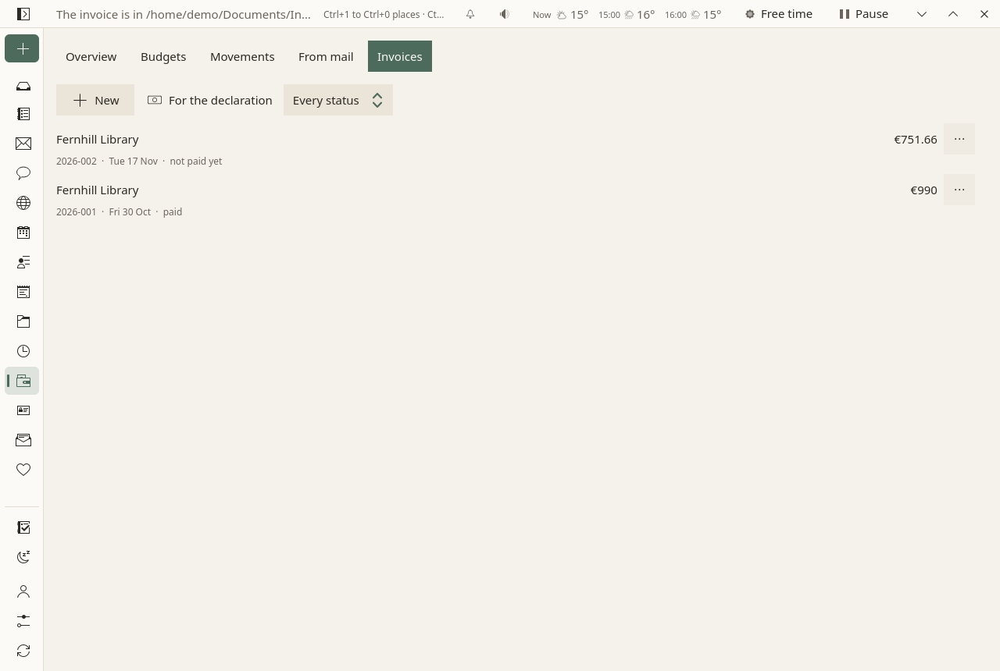
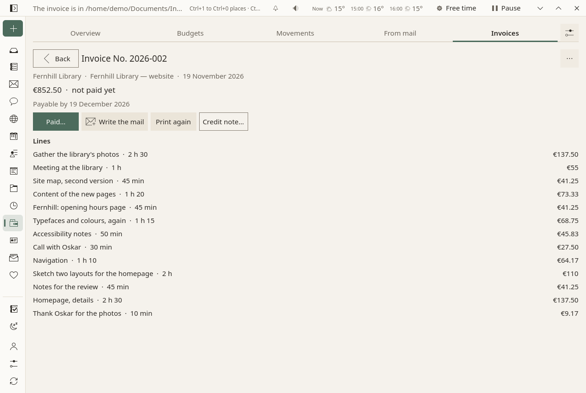
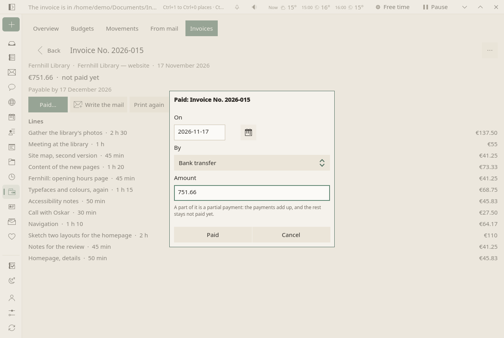
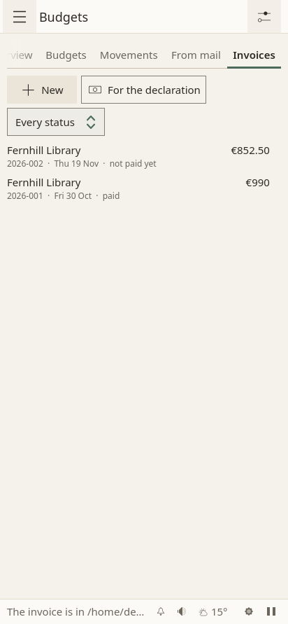
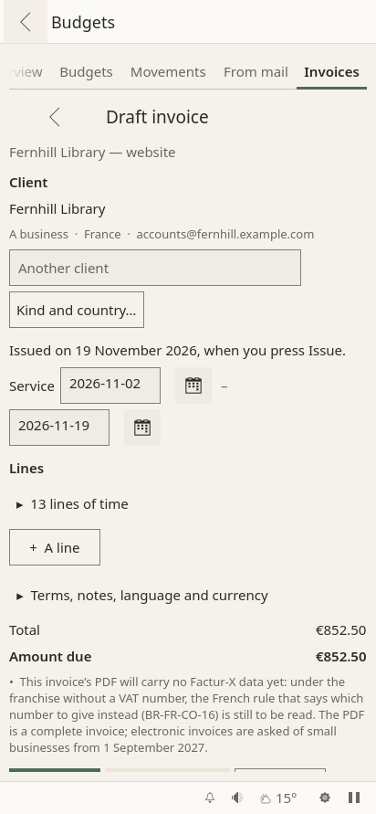
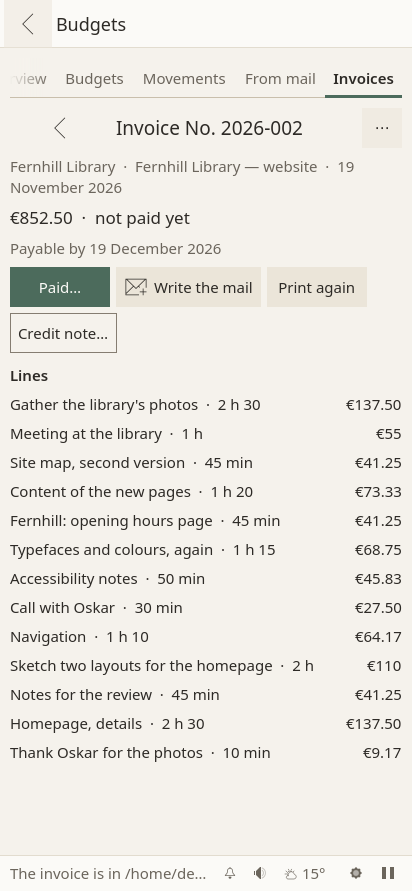
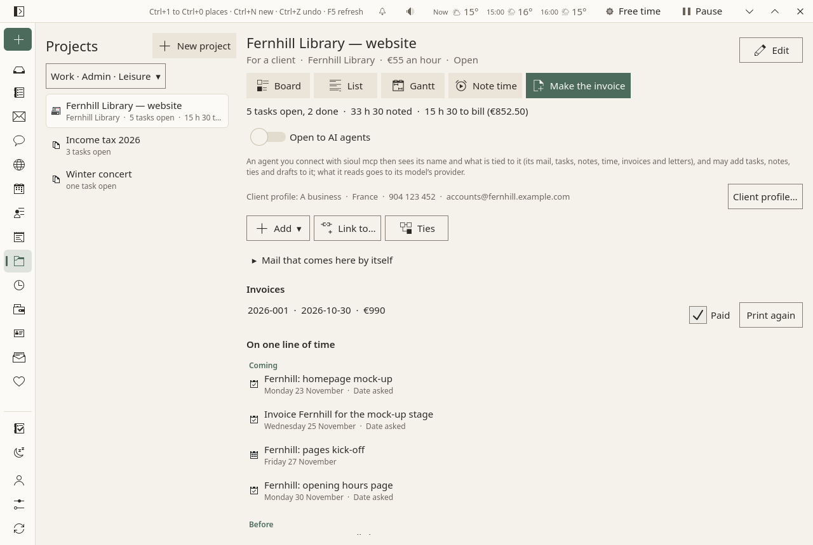

# Time and invoices

## In short {#in-short}

Sioul notes the time you spend, while you work or afterwards by hand, and keeps it for two uses. For clients, it becomes invoices: what is left to bill stays in view, each hour is billed once, and invoice numbers follow each other without a gap. For you, set beside your guesses, it shows how long things really take, and the plan of your days takes that into account ([How long things take](#how-long-things-take)). Your time and your invoices stay in plain files on your own devices.

<figure markdown="span">
  [{ loading=lazy }](../assets/screens/time.png "Open the picture at full size")
  <figcaption>A week of time, by project, and what is left to bill.</figcaption>
</figure>

## Protected by default {#what-is-protected}

- Your time, your clients and your invoices stay in plain files on your devices. There is no account to open, no subscription, and no server of Sioul's.
- An invoice number is never given twice, even with several devices: one device numbers the invoices, and Sioul waits rather than risk a number twice. Sioul writes down the last number it gave, so a number stays given even if its file is deleted.
- An issued invoice is never changed: a credit note that cites it corrects it. If its record or its file is changed outside Sioul, Sioul says so.
- Time already billed cannot be changed, nor billed again.
- The spreadsheets for your accountant cannot carry a hidden formula: a task title or a client's name that came from someone's mail is written as plain text.
- A payment counts once, whatever your devices did: Paid ticked on two devices, the same bank export taken in on two, or the same payment typed on two counts once; and when your bank shows the transfer for an invoice you already marked paid, the transfer counts in place of your Paid, rather than adding to it.
- When your devices share, your time and your invoices travel sealed, through a folder your own sync carries: the folder and its server see that something changed, never what ([Sharing](sharing.md)).

## The Time page {#the-time-page}

**Week**, **Month** or **Year**, the tabs at the top of the page, for **All projects** or one; **Today** and the arrows ◂ ▸ move through time:

- a bar per day (per month, over a year), stacked by project; point at a bar to read its day and its time;
- **Done in this period, by area**: for the tasks done in the period, the time spent on them beside what you first estimated, one line for work, your admin and leisure each, so that you see where your guesses are off (each task counts once: a leisure task in a personal project counts as leisure). The table shows once a task done in the period has an estimate and time noted; an area with no such task has no line;
- each project's hours, and what is left to bill, in hours and in money at its rate, the money counted line by line as its invoice will count it, so that the two agree to the cent;
- then each stretch of time, newest first.

On a narrow screen, such as a phone's, the period's name and the choice of project go under the arrows, **Note time** shows as its icon alone, and each stretch takes two lines.

## Where time comes from {#where-time-comes-from}

- **The focus timer**: the minutes of a [focus session](tasks.md#starting-and-stopping) count for its task, and for the task's project. Any task, whatever it is for and whatever the hour: your admin and leisure count as work does, with or without a project.
- **Note time**, on this page, on a project's page, or with **New ▾ ▸ Time spent**: a meeting, a call, work done away from the timer. **Task** (or *No task*), **For** (a project; *The task's own project* unless you choose one), **When**, **From** and **To** (the form opens on the half hour just gone, and says how long that makes), **What it was**, and **Not to bill**, which shows once **For** names a client's project. Time is noted for a project or a task, one of the two at least. An end before the beginning is read as past midnight.

While a focus session runs, on Linux and on Android, a notification shows it: its task, since when, and **Pause** (**Go on** once paused) and **Stop**, which do what the focus window's buttons do. On a Linux desktop it stays among the desktop's notifications while Sioul is open (in KDE Plasma, under the bell once its popup goes), and goes when Sioul quits. On Android, a chronometer counts in it, and its buttons work with Sioul in the background or closed. Paused or stopped elsewhere, in the focus window or on another device, it follows. On Windows and macOS, the focus window alone shows the time running, for now.

Click any stretch of time, timed or noted by hand, to change it: its task, its project, its day, from when to when, and what it was; the time the timer kept after a pause you missed comes back that way. A right click, or a long press on a touch screen, offers **Change this time** and **Take this time out**. Time already on an invoice stays as it was billed.

A timer you forgot is cut when you stop it: past twice the time you chose (or that time and half an hour more, whichever is longer), only the time you chose counts; a session without an end counts three hours at most.

Each stretch says quietly how its minutes were known:

- *timed*;
- *noted by hand*;
- *timed, then corrected*, once you changed a timed stretch's length, or Sioul cut a timer left running;
- *not known how*, for time noted before Sioul kept this.

### Billed or not {#billed-or-not}

Work for a client is billed. A task can say otherwise, under **Billed** in its panel: *As its project says*, *Its time is billed*, or *Not billed*.

## How long things take {#how-long-things-take}

A task's **Takes about** is a guess. The time noted for it is what it took. Sioul sets the two side by side, and corrects your guesses in the plan only: each task takes its corrected length in the plan and in the day, while **Takes about** stays as you wrote it. The focus timer runs for the length you choose when you press **Start**, whatever the task's **Takes about**. Only finished tasks teach it, recent ones most; minutes noted by hand count less than timed ones, because remembered durations are less sure. How it learns, in detail: [below](#how-the-plan-learns-from-your-time).

It never scores you, never shows anything as late, never fills in **Takes about** for you, and never compares you with anyone.

Timing your admin and leisure is up to you, and it teaches the plan as work's does: each area's tasks learn their own length. Gaps are fine: time not noted is left out, not counted against anything.

## A spreadsheet of billable time {#a-spreadsheet-of-billable-time}

The export button, at the top right of the Time page: **Billable time, as a spreadsheet (CSV)…**, for one project, and a stretch of time (this week, last week, this month, last month, all time, or from one day to another). One line per task, with its hours, the hourly rate and the amount, then the total. In French, the file uses `;` and a decimal comma, as French spreadsheets read them. A task title that came from someone's mail is written as plain text: a spreadsheet never runs it as a formula.

## Invoices {#invoices}

Every invoice and draft waits in **Budgets ▸ Invoices**, the fifth tab of the [Budgets](budgets.md) page. Drafts come first, then your invoices, the newest first. Each row says who it bills and its amount; under them, its number, its day and where it stands: *draft*, *not paid yet*, *partly paid*, *paid*, *credited*, *credit note* or *to pay back*, with what is left ("€120.00 left to pay") and the day it was sent. An invoice past its due day simply reads *not paid yet*. Once you have several clients, years or states, the choices above the list show one of them.

<figure markdown="span">
  [{ loading=lazy }](../assets/screens/invoices.png "Open the picture at full size")
  <figcaption>Every invoice and draft, each saying where it stands.</figcaption>
</figure>

Three ways to start one:

- **Make the invoice**, on a project's page, when billable time waits (on the Time page, the same button beside a project opens its page): a draft of that time, one line per task at the project's rate. If the project already has a draft, Sioul opens the one that holds its time and adds only the time that no draft holds yet, leaving out the time you took out of it; time noted since for a task goes into that task's line, when the draft still has it with the same words and price an hour, and the status line says what was added ("2 lines of time added to the draft (1 h 30)."). So the same hours are never in two drafts, and the draft agrees to the cent with what the project says is left to bill.
- **Bill this client**, on a contact's page: a blank draft for that client ([Your clients](#your-clients)).
- **New**, above the list: a blank draft. You choose its client in it.

Each opens in the editor. A long press, a right click or **⋯** on a row shows what you can do with it: **Open**, **Paid…**, **Write the mail**, **Print again**, **Credit note…**, or **Discard** for a draft. A draft written by a newer version of Sioul is read only here too: its menu has no **Discard**. **For the declaration**, above the list, opens your books ([The declaration](budgets.md#the-declaration)); its **Back** brings you here again.

### The editor {#the-editor}

<figure markdown="span">
  [![The editor of a draft made by a project's Make the invoice: Keep as draft and the draft's title at the top; Client, with the client's name, then whether it is a business, its country and its email, a field to bill another client and Kind and country…; "Issued on …, when you press Issue."; Service, with its first and last days; Lines, the lines of time folded under one row; + A line; Terms, notes, language and currency, folded; the totals and the amount due; Issue, Deposit invoice… and Discard; Preview, folded.](../assets/screens/invoice-editor.png){ loading=lazy }](../assets/screens/invoice-editor.png "Open the picture at full size")
  <figcaption>A draft as it would be issued today, saved as you type.</figcaption>
</figure>

The editor shows the draft as it would be issued today. It saves what you type as you type it, in the lines as in the notes, the purchase order, the terms and the currency: there is no Save button. What you just typed is written before you leave the draft and before Sioul quits (on a phone, also when you put Sioul away), so closing the window loses nothing. If a save fails, the status line says why, and what you typed waits to be written again; **Back** then keeps the editor open once, and says that a second **Back** leaves without those changes. If the draft was discarded or issued elsewhere meanwhile, there is nothing to try again: the status line says so, and **Back** leaves at once.

Each save sends only what you changed. When the draft changed meanwhile on this device, by a change your sharing already brought in or from the command line, those changes are kept with yours, and the status line says so; a line you changed that was taken out elsewhere stays out, and the status line says that too. When the open draft changed elsewhere while nothing you typed was waiting, or while you were on another page, the editor reads it again and says so ("This draft changed elsewhere: it is shown as it is now."). Between your devices, a draft travels as one whole file: when two devices each change the same draft before they exchange, the later version replaces the other whole ([On several devices](#on-several-computers)). A draft written by a newer version of Sioul opens to be read only, and says why: update Sioul on this device to change it.

- **Client**: type a few letters of a client, a contact or an organisation, then choose; or bill a name as you wrote it. Under the name, the editor says whether the client is a business, a person or a public body, its country and its email. **Kind and country…** changes the kind and the country. Sioul writes them in the client's profile, and makes one when there is none, so the next invoice knows them too.
- **The day of issue**: "Issued on 17 November 2026, when you press Issue." You do not choose it: it is the day you press **Issue**.
- **Service**: the day, or the first and last days, of what you bill. Left empty, it is the day of issue, and the editor says so. A deposit invoice has none, since its service is still to come.
- **Lines**: the lines of time wait folded under one row ("2 lines of time"). Unfold it to see each task with its hours and its price an hour. Any other line has what it is, a quantity, a unit (hours, days, units, months, kilometres, a lump sum) and a unit price. Type numbers as your window's language writes them: "1,500.50" in English, « 1 500,50 » in French. What each number reads as shows beside its field as you type: a price or a discount with its currency ("= €1,500.00"), a quantity or a rate without one ("= 2.5"). A number that does not read says so beside its field, and so does a quantity, a price or a rate left empty ("Type a number."): it stays as you typed it, it is not saved, and **Issue** waits, saying why under it ("A number above does not read, so it was not saved: correct it, then issue."). When the window is in French, a dot followed by exactly three digits, such as « 1.500 », is refused rather than guessed, since some hands mean one thousand five hundred by it and others one and a half: write « 1500 » or « 1 500 », or « 1,5 »; « 12.50 » and « 1.5 » stay decimals, and a space groups three digits only (« 12 5 » is refused). **More**, under a line, holds its details (printed under it), a discount, a service or goods, the activity it belongs to when you have two, and its tax. The tax follows your country's rules, and the editor says it in words ("Its tax: VAT 20%"); **Its own tax, not your country's rule** lets you choose another, and say in words why the line bears no VAT: **VAT at a rate** takes your country's standard rate, shown as it is, which you can change; under **Elsewhere**, which has no rates of its own, you type the rate. **+ A line** adds a line; **×** takes one out. A line of time you take out leaves its time for a later invoice: **Make the invoice** does not put it back in this draft. A quiet row under the lines then says how much time was taken out ("1 h 30 of time taken out of this draft, not billed here."), with **Put back**, which gives the draft that time's lines again.
- **Deposits it deducts**, on an invoice: the deposit invoices of the same client and currency that no invoice deducts yet, each for what is left of it after its credit notes; one that deducts less than it billed says why ("of €300.00, its credit notes gave the rest back"). Tick those it deducts ([Deposits](#deposits)). What each deducts is counted again as it is now whenever the draft shows or changes, so that the editor, the preview and the issued invoice agree.
- **Terms, notes, language and currency**, folded: payable within so many days, or at the end of that month, with the day this gives ("Payable by 17 December 2026"); the client's purchase order; the invoice's language and currency; your notes, printed under the lines; and the legal lines your country prints for this client.
- **The totals**: the total or, when the invoice bears VAT, the amount excluding VAT, the VAT on each rate and the amount including VAT; then the deposits deducted, and the amount due.
- **What is missing**, under the totals, each thing in a sentence. What your country's rules require comes first ("The client's address (Code de commerce L441-9)."), and **Issue** waits until none is left. A line's tax must fit your VAT scheme on the day of issue: a line that charges VAT while you are under the franchise, or have no VAT scheme, holds **Issue** back, since VAT shown on an invoice is owed, and so does a line "VAT at a rate" without its rate. Advice comes under it, quieter, and holds nothing back: "The client's SIREN: asked on invoices to French businesses from September 2027.", a PDF that will carry no electronic data, an IBAN with a character wrong, a deposit invoice of this client not deducted yet.
- **Preview**, folded: the invoice as it will print, in its own language.

<figure markdown="span">
  [{ loading=lazy }](../assets/screens/invoice-preview.png "Open the picture at full size")
  <figcaption>The preview, as the invoice will print.</figcaption>
</figure>

Each line's unit is one Sioul knows, no unit price is below zero (less to pay is a discount, or a credit note), and a country is its two letters or its name. Writing from right to left (Hebrew, Arabic) cannot be printed yet: Sioul asks for Latin letters.

When the draft is ready:

- **Keep as draft**, at the top, brings you back to the list. The draft is kept already, with what you just typed; if that could not be saved, the editor stays open once and says why (above). A draft that **New** or **Bill this client** just made, left exactly as it was made, is taken out without a word when you leave it; once you chose or typed anything in it, it stays.
- **Issue** gives the invoice its number, makes its PDF and keeps it, puts a copy where your invoices go, and opens it in your PDF reader. The invoice's pane then opens. If something holds it back, the editor says why beside **Issue** and in the status line, and keeps the draft. **Issue** numbers the draft as the editor shows it: if the draft changed elsewhere since the editor read it, nothing is issued, and the editor reads it again and says so ("This draft changed elsewhere since it was read: it is read again here; look at it, then issue."). If your invoices are numbered on another of your devices, it says so there and offers **Make invoices on this device** ([On several devices](#on-several-computers)).
- **Deposit invoice…** makes a deposit invoice for this draft's client ([Deposits](#deposits)).
- **Discard** throws the draft away, with **Undo** in the status line, which puts its file back exactly as it was.

An issued invoice never opens in the editor again: it is never changed. A credit note answers it ([Paid, and credit notes](#paid-and-credit-notes)).

### What an issued invoice holds {#issued}

- **Numbers.** With the usual numbering, the year then three digits, numbers start again at 001 each January: 2026-001, 2026-002. With a numbering that never starts from 1 again (or a prefix of your own, in settings made before November 2026), they go on from the last number issued, year after year: chosen after 2025-041 and 2026-016, **never from 1 again** gives 2026-017 next (2027-017 if that invoice is issued the year after), never 2026-042. Sioul writes down the last number given in each series: a number is never given twice, even if its file is deleted by hand, and a number with no invoice on this device is said, never given again. An invoice cannot be deleted from Sioul.
- **Lines**: those of time, one per task (or per note of time noted without a task), its time at the project's rate, to the cent; the others as you wrote them in the editor.
- **Billed once**: the time an invoice bills is listed in it, and carries its number; the next invoice leaves it out, and that time can no longer be changed. What your issued invoices list is what counts: before each new invoice, Sioul marks your time again from them, so that the same hour is never billed twice, even after a crash.
- **What it prints**, as [your country's rules](#your-countrys-rules) say: your name, with « EI » after it for a French entrepreneur individuel, your address and your identifiers (your SIREN or SIRET in France); the client's name, address and identifiers, and where goods are delivered when that differs; its number; the day it is issued, the date or period of the service (the first and last days of the sessions it bills, or their one day; for an invoice not made from time, the day it is issued, unless a day was given), and the day payment is due; what it sells (services, goods, or both); each line with its quantity, unit, unit price and amount; the VAT per rate when you are liable for it, and the totals; the VAT franchise's line when you are under it (« TVA non applicable, article 293 B du CGI » in France), or, for a business abroad, the words that say where the VAT is due; for a business client, the late-payment lines (in France: no discount for early payment, penalties at the ECB's rate plus 10 points, kept with the invoice, and the €40 recovery fee), none of them for a private person, nor for a public body, whose own rules Sioul's sources did not cover; your payment details and your own lines; on an invoice in euros with your IBAN, a QR code a banking app scans to fill in the transfer.
- **In its own language and currency**: English or French, and the currency of the client's profile, else of your settings, whatever language the window speaks. Its amounts show in that currency everywhere in Sioul.
- **The file.** An issued invoice is a PDF/A-3 (A4), the form of PDF made to be kept, which also carries the invoice as electronic data (Factur-X, in the European standard's profile): the same invoice, read by a program. Sioul makes it once, when the invoice is issued, keeps it beside the invoice with its fingerprint, and puts a copy in `Documents/Invoices` in your home folder, or the folder you chose. **Print again** gives back that very file, never a new one: a file changed or missing since is made again as it was issued, when Sioul can; otherwise nothing is handed out, and Sioul says where the invoice and its file are. If the folder of copies cannot be written (a drive not plugged in), the invoice is issued all the same, and the status line says so. If an issue was stopped halfway (the computer turned off), the next one sets its file aside in the invoices' `leftovers` folder, and says so once. It travels to your other devices with your invoices. Invoices made before November 2026 print as they always did.
- **The QR code**, on invoices in euros with an IBAN: the amount due, your account's holder and IBAN, and the invoice's number as the transfer's reference, the same as printed beside it. **The payment QR code on euro invoices**, in [Settings ▸ Invoices](settings.md#invoices), turns it off.
- **Your budget**: the amount due is expected in the project's budget on the day it is due: thirty days later, unless your settings or the client's profile say otherwise. Your budgets count in euros, so an invoice in another currency is not expected there for now.

Your name, your identifiers, your bank account, your numbering and your hourly rate are set once, in [Settings ▸ Invoices](settings.md#invoices).

### An issued invoice's pane {#an-issued-invoice}

<figure markdown="span">
  [{ loading=lazy }](../assets/screens/invoice-issued.png "Open the picture at full size")
  <figcaption>An issued invoice, where it stands, and what you can do with it.</figcaption>
</figure>

Open an invoice from the list, or from its project's page, and its pane shows its client, project and day; its amount, where it stands, what is left and the day it was sent; its payments, each with its day and how it was paid; the credit notes that credit it; its lines, with the time each bills. What you can do:

- **Paid…**: a payment received ([Paid, and credit notes](#paid-and-credit-notes)). On a credit note with money to give back, **Paid back…**.
- **Write the mail**: a mail to the client, ready in the writing window, with the invoice's PDF attached ([Write the mail](#write-the-mail)).
- **Print again**: the very file issued, copied where your invoices go, and opened.
- **Credit note…**: a credit note for all of its lines, or for some ([Paid, and credit notes](#paid-and-credit-notes)).
- **Final invoice…**, on a deposit invoice: the invoice that deducts it ([Deposits](#deposits)).

**Back** returns to the list.

**Changed outside Sioul.** When an invoice is issued, Sioul keeps a fingerprint of its record and of its file. If either is changed later, by hand or by another program, the pane says so, calmly, and its row in the list says "changed outside Sioul". For the record: "This invoice's record was changed outside Sioul since it was issued (…): an issued invoice is never changed; a credit note answers it." For the file: "This invoice's file was changed outside Sioul since it was issued (…): Print again gives back the file issued, made again from its record." Sioul changes nothing back by itself. An invoice issued with an earlier version of Sioul has no fingerprint of its record, so only its file is checked; one made before November 2026 is not checked.

### Write the mail {#write-the-mail}

**Write the mail**, in an invoice's pane or its row's menu, prepares a mail to the client in the writing window:

- to the client's address as the invoice keeps it, else the one in their profile or on their contact card;
- from your address that your invoices print, else from your first account;
- in the invoice's language: "Hello, Please find attached: Invoice No. 2026-001, of €1,200.00, payable by 17 December 2026. Kind regards," then your name and your account's signature;
- with the invoice's PDF attached: the very file issued, made again first if it went missing.

Read it, change it, and send it when you choose. The invoice is marked sent on the day a mail leaves Sioul carrying its PDF, the very file issued, to its client. For the mail **Write the mail** prepared, that is once its server took at least one recipient who is not one of your own addresses: an address you typed in it counts, for a client whose address Sioul does not know too, while a copy to yourself alone does not. For any other mail tied to the invoice and carrying the file, its server must have taken an address Sioul knows for the client: the invoice's, their profile's or their contact card's. A mail without the file, such as a reminder, marks nothing; nor does a send whose server refused every such address, nor a draft written or saved. For an invoice made before November 2026, Sioul attaches its printed copy: press **Print again** first if there is none.

From 1 September 2027, your invoices to French businesses go through an approved platform (« plateforme agréée »), and your sales to private clients are reported there instead (e-reporting). Name yours in [Settings ▸ Invoices](settings.md#invoices); until Sioul sends through it, upload those invoices' PDFs there. Under the VAT franchise without a VAT number, the PDF carries no Factur-X data yet ([Not there yet](#not-there-yet)).

### Paid, and credit notes {#paid-and-credit-notes}

<figure markdown="span">
  [{ loading=lazy }](../assets/screens/invoice-paid.png "Open the picture at full size")
  <figcaption>A payment received: its day, how, and how much.</figcaption>
</figure>

- **Paid…**, in an invoice's pane: **On** (today, unless you choose another day), **By** (a bank transfer, unless you choose a card, cash, a cheque, a direct debit or something else) and **Amount** (what is left, written as your window's language writes an amount, and read that way, as in the editor). Give a smaller amount for a partial payment: payments add up, and the rest stays not paid yet. When the invoice is paid in full, the money it was expected to bring becomes real in your budget, on that day. The status line says it ("€400.00 received on invoice 2026-001."), with **Undo**, which takes the payment back. When that payment made the money real in your budget, **Undo** plans it again as it was, as long as your budget still holds it as Paid… wrote it; if it was changed since, nothing is undone, and the status line says it is too late.
- **Paid**, the box on a project's page or on the invoice's card in the agenda, says the invoice is paid, by transfer, today: it covers whatever is left to pay, and the money counts in the budget; **Undo** takes it back. Unticked, what you said by hand is taken back; what your bank showed stays.
- **From your bank**: when you take in your bank's export, a transfer that Sioul pairs with your invoices pays them, on the bank's day: one invoice, or several when one transfer pays them together, split among them, the oldest first. An invoice never receives more than it has left to pay, and what came beyond is said. An invoice you already marked **Paid** gains no second payment: the transfer counts, and **Paid** covers only what it leaves. A payment you wrote with its amount takes in the transfer of that very amount, else the nearest in days, and keeps its own day; one you said was paid in cash never does. Through PayPal or Stripe, what the client paid counts, on the day they paid, when the processor's export says it, its fee kept apart; when only what reached your bank is known, an amount short of what the invoice asks by no more than the processor's usual fee still pays it, and the difference is said as that fee. The status line says so ("Paid, as your bank says: invoice 2026-004."), with **Undo**, which takes those payments back and keeps that transfer apart from the invoices from then on; **Not the same payment**, on that movement in [Budgets](budgets.md), does the same later. There is nothing to confirm. Sioul pairs a transfer with an invoice whose money is expected in a budget, the project's **Invoices expected in**, and in the invoice's own currency only: a transfer in euros never pays an invoice in dollars.
- **Partly paid**: payments add up; until they reach the amount due, the invoice is partly paid, and its row says what is left. A payment is never more than what is left to pay. Sioul never calls an invoice overdue.
- **Paid in another currency**: your books count euros (in France; your country's currency elsewhere), so a payment on an invoice in dollars, pounds or francs counts in them at what reached you in euros. Say it once, from the command line: `sioul invoices received 2026-031 92.50`, or `--received 92.50` with `sioul invoices pay` ([below](#from-the-command-line)). Until then, the payment shows in its own currency in your receipts book and counts in no total, declaration nor threshold, and where its amount would be, Sioul says what waits: "$1,000 received: say what it came to in euros", in the declaration, on the Porch and in Overview, never "declare €0". Once said, your bank's line of those euros is that same payment, never counted again. Sioul never converts at a rate of its own.
- **A wrong invoice** is never changed: **Credit note…**, in its pane, makes a credit note that cites it. Every line comes ticked, which cancels the invoice; untick some to correct only the others. The credit note opens in the editor, where you check it and press **Issue**. Each line keeps the VAT it was billed with. It takes the next number of the same series. Issued, it settles what it credits, and the time of each line it cancels whole can be billed again. It never credits more than the invoice has left to credit: one beyond that, such as a second credit note for an invoice already credited whole, is refused, and the credit notes already issued are named. A deposit invoice that an invoice already deducts is credited through that invoice: a credit note on the deposit itself waits, and the editor says the way out ("Deposit invoice 2026-010 is deducted by invoice 2026-020: credit invoice 2026-020 instead, or cancel it first."). A credit note is never paid nor unpaid: it says which invoice it credits. When that invoice was paid beyond what it now asks, the credit note also says what you have to pay back ("€120.00 to pay back"); **Paid back…**, in its pane, says what you paid back, on which day and how, as Paid… does (the **Paid back** box on its project's page says it all, today). The money the invoice was expected to bring into your budget goes down by the credit note's amount, or goes out when the invoice is credited whole, so that the client's next transfer is never paired with it. An invoice credited in part and not paid is not "partly paid": it simply has less left to pay.
- **Refunds**: money you pay back to a client on a credit note is a line below zero in your receipts book, on the day it goes back. Your declaration counts it with the money it gives back: the payments the credited invoice received, the latest first, after what earlier refunds of it gave back. So a refund may count in parts, each with its own payment. A part paid back in the same month or quarter as its payment lowers that period. Paid back later, it lowers the period that money came in, as long as that period is not declared yet: you have not said **Declared** for it ([The declaration](budgets.md#the-declaration)), and its day to declare by has not passed. A part of money from a period already declared lowers no period, and the declaration of the refund's own period says to correct the one you made: "URSSAF's sheet says to correct the declaration already made for that money (Third quarter 2026): €300 excluding VAT given back on 8 October 2026, counted in no period here." For an invoice paid €900 in September and €100 in October, then paid back whole in October after you declared the third quarter, the fourth quarter is lowered by €100, and its declaration says to correct the third quarter's by €900. This follows URSSAF's own sheet, which Sioul's research could read only through a search summary: check it with URSSAF before you rely on it ([Why it works this way](#why-it-works-this-way)). Only money paid back counts: a credit note for what the client never paid needs no refund, lowers what is due, and counts nothing. A period with more given back than received declares €0, and says that the rest is not taken off. When you are liable for VAT, the VAT on services comes off on the day the money goes back, and a credit note on services with money still to pay back is named in your VAT summary.

### Deposits {#deposits}

A deposit invoice bills part of a job before it is done. In the editor of a draft invoice, **Deposit invoice…** asks for a share of the draft's total excluding VAT (30 % is proposed) or an amount excluding VAT, typed as your window's language writes it, and what it is for; it makes a draft deposit invoice for the same client and project, which you issue as any invoice, and it remembers the draft it was made from. It has no day of service: the service is still to come.

Once it is issued, **Final invoice…**, in its pane, opens the invoice that deducts it, never a second draft beside the one that holds the work: the draft the deposit was made from, while that draft is there; else the project's draft that holds its time, with the time noted since added, which the status line says as **Make the invoice** does; else a new draft of the project's time not billed yet; else a new draft for the client. The deposit you pressed it on comes ticked in it, and the draft's other ticks stay as you left them: a deposit you unticked is not ticked again. Only when this press just made the draft does it also tick the project's other deposits not deducted yet, and those made from the same draft. The client's other deposits not deducted yet, another project's among them, are named under the totals as advice, for you to tick or leave. In that invoice's editor, **Deposits it deducts** lists them, each for what is left of it after its credit notes, and the totals take off those ticked: untick one this invoice does not deduct. A deposit of another client or another currency is never deducted: if you change the draft's client or currency, it is unticked, and the status line says so. A draft invoice that leaves a deposit of its client undeducted says it under the totals, as advice: "Deposit invoice 2026-010 of this client is not deducted yet: tick it under Deposits if this invoice is the final one." A deposit is deducted once, unless a credit note cancels its final invoice whole, and once an invoice deducts it, a credit note goes on that invoice, not on the deposit ([Paid, and credit notes](#paid-and-credit-notes)); your books count its money once too, as what the final invoice sells. The pane offers **Final invoice…** as long as no final invoice deducts the deposit (a final invoice credited whole gives it back) and something of it is left.

### On a phone {#invoices-on-a-phone}

On a phone, the Budgets page's five tab names stay in one row: slide it sideways to reach **Invoices**. The editor, an invoice's pane and their windows are one column, each field within the screen's width. A long press on a row shows its menu. **Back**, the phone's or the arrow at the top, closes the editor, an invoice's pane, an open budget or the declaration view, and brings you back to the list, what you typed written first; if it could not be saved, the editor stays open once and says why ([The editor](#the-editor)).

<div class="grid" markdown>

<figure markdown="span">
  [{ loading=lazy }](../assets/screens/invoices-phone.png "Open the picture at full size")
  <figcaption>The list.</figcaption>
</figure>

<figure markdown="span">
  [{ loading=lazy }](../assets/screens/invoice-editor-phone.png "Open the picture at full size")
  <figcaption>The editor.</figcaption>
</figure>

<figure markdown="span">
  [{ loading=lazy }](../assets/screens/invoice-issued-phone.png "Open the picture at full size")
  <figcaption>An issued invoice.</figcaption>
</figure>

</div>

### Your country's rules {#your-countrys-rules}

What an invoice must say depends on your country, and in France on three things that do not imply one another: your legal form (an entrepreneur individuel, a micro-entrepreneur included, or a company), your income regime (micro or réel), and your VAT scheme (the franchise, or liable for VAT), which can change on a given day. The invoice of a micro-entrepreneur liable for VAT carries « EI » and the VAT per rate; a company's under the franchise carries the franchise's line, its form and its capital.

Sioul knows the rules of France, Germany, Belgium, the United Kingdom and Switzerland, and **Elsewhere**, for any other country: no legal claim, every identifier and line your own. Each country's rules are data that Sioul reads, with their sources:

- **Spain and Italy are not supported**, and Sioul says why rather than offer a template that would be illegal there: Spain asks invoicing software to be certified, its invoices chained and signed (VERI\*FACTU); Italian invoices go through the state's exchange system (SdI), in its own format.
- **Belgium**: between Belgian businesses, invoices are structured electronic invoices sent through Peppol since 2026, and a PDF by mail no longer suffices. Sioul does not reach Peppol: it makes the PDF, and sending the invoice through your access point is yours. Under the franchise, write its line yourself: Sioul does not know the exact wording the law asks for.
- **France, liable for VAT, with private clients**: software that records their payments must have a certificate or an attestation (article 286 I 3° bis of the CGI), and Sioul has neither. Under the franchise, nothing is asked.
- **France, the franchise's line**: VAT law moves into a new code, the CIBS, on 1 January 2027, and the article to cite there is not settled yet (L. 223-3 or L. 233-3). « TVA non applicable, article 293 B du CGI » stays valid until 30 June 2028 and is the default; you can write another.
- **VAT rates**: Sioul ships each country's rates as they were known in mid-2026; check them before you rely on them.
- **Clients in other countries**: where the VAT is due depends on where the client is, whether it is a business, and what you sell, and your country's rules place each line. In France, a service to a business in another EU country carries « Autoliquidation » and both VAT numbers, under the franchise too; liable for VAT, goods sold to such a business carry « Exonération, art. 262 ter I du CGI » and both VAT numbers; a service to a business outside the EU carries « TVA non applicable – article 259-1 du CGI ». Where Sioul's sources give no words (an export of goods; in the other countries, every case but the EU's reverse charge, such as a service to a business outside the EU, in Germany and Belgium under their small-business exemption too), Sioul asks you to write them on the line before the invoice is issued. A VAT number is checked by the rules of its own country.
- **The client's country** comes from their profile, else from the last line of their contact's address when it names a country, in any of the usual languages ("Belgique", "Deutschland", "Maroc"), else from the two letters their VAT number starts with. An address whose last line is a postcode and a town is taken as one in your own country, and Sioul says so before the invoice is issued. When that line names no country Sioul knows, or there is no address at all, Sioul asks for the client's country before the invoice is issued, wherever your country's rules place the VAT by it. A client in Monaco is billed as one in France for VAT, and their address says Monaco. The country prints by its name, in the invoice's language.

These choices are in [Settings ▸ Invoices](settings.md#invoices): your country first, then what it asks. Invoice settings made before keep working as they were: a VAT line citing article 293 B means France, the micro regime and the franchise; any other VAT line means Elsewhere, its lines printed as before. With a VAT line citing article 293 B, your legal form is asked once, at the top of Settings ▸ Invoices, before your next invoice is issued: a company under the franchise must not read « EI », so « EI » is printed only once you choose *Sole trader (entrepreneur individuel, micro-entrepreneur included)*. If your payment details already speak of late fees, as Sioul's earlier help asked, Sioul asks you to keep either your words or its own lines, so that an invoice never states two rates ([Settings ▸ Invoices](settings.md#invoices)).

### Your clients {#your-clients}

A client can have a profile, tied to their contact and kept in `sioul-clients.toml`, among Sioul's own lists (in your notes folder until you move them: [Where Sioul keeps its lists](sharing.md#where-sioul-keeps-its-lists)): a business, a person or a public body; the legal name; the billing address and, when it differs, the delivery address; their identifiers (a SIREN, a VAT number); the language, currency and payment terms of their invoices; the address invoices are mailed to; a purchase order to print.

<figure markdown="span">
  [{ loading=lazy }](../assets/screens/project-client.png "Open the picture at full size")
  <figcaption>A client's project, with its client's profile.</figcaption>
</figure>

On every contact's page, **Bill this client** starts a draft for them, and **Client profile…** opens their profile. Once made, the profile shows in one line above these buttons ("Client profile: A business · Belgium · BE0123456789 · invoices in French"); with none yet, the button reads **Make its client profile…**, and the form starts from the contact's card. A project for a client shows the same line, or "No client profile yet: invoices bill it as a business, from its card.", and the same button. A project whose **For** names that contact, or the profile's name, bills with that profile. In the editor, **Kind and country…** writes those two in the profile too ([The editor](#the-editor)).

The form gives the delivery address field by field, as the billing address (street, postcode, city, country), and each identifier with **Printed**; an identifier of a kind the form does not offer shows by its own name, and so does a kind of client the form does not offer, which stays unless you choose another. Saving writes only what you changed: what the file holds besides, such as your comments, an identifier you left unprinted or what a newer Sioul wrote, stays as written. If the profile was taken out elsewhere while its form was open, saving is refused rather than making a partial profile: "This profile changed elsewhere: open it again."

Without a profile, an invoice takes the contact's name and first postal address, and bills the client as a business, whatever the contact holds. Only a profile that says *A person* bills a private person, whose address is then advised rather than required, since a private person may ask that it not be printed. Until it is issued, a draft follows its client's profile, or their contact card: a profile changed meanwhile counts.

### On several devices {#on-several-computers}

An invoice number must never be given twice. When you [share between your devices](sharing.md), one device numbers the invoices: another says "Invoices are numbered on …", and **Make invoices on this device** takes them over, after a minute and a half, once your other devices know. If your sharing folder cannot be written, or another device has not been heard from for a few minutes, Sioul waits rather than risk a number twice.

Each device also tells the others the last number it gave in each series, right after each invoice and when Sioul closes, so a device whose invoices have not arrived yet still never gives one of those numbers again. A device that shares, but leaves out **Drafts and invoices**, issues no invoice: it says so, and you issue them on a device that shares them. Nor does a device whose sharing cannot read its key, such as when the keyring is locked: it waits until it can. With sharing on, `sioul invoices issue` numbers an invoice only while Sioul's window runs on that computer and keeps the invoices there, by the same rules as the window, and tells your other devices the new number at once.

A payment counts once, whatever your devices did: **Paid** ticked on two devices, the same bank export taken in on both, or the same payment (its day, amount and means) typed on both before they exchange counts once. Each device writes what happens to your invoices in a file of its own (their payments, the day each was sent, what you said of each declaration), and an issued invoice itself is never written again. **Declared** and **Not declared** are dated: the latest you said counts on every device, so that an older **Undo** on another device never takes back a newer **Declared**. A word you say on a device that already received the other's is the later one, even if that device's clock runs behind; two devices that have not exchanged yet go by their clocks. A draft travels between your devices as one whole file: when two devices each change the same draft before they exchange, the later version replaces the other whole. The device whose version was replaced keeps it among its earlier versions ([Sharing](sharing.md#putting-back-an-older-version)), and when you had changed that draft in its window since the last exchange, its status line says so: "The draft for Studio Lumen was changed on another device before your changes here went out: its version replaced yours, kept among the earlier versions." Sioul remembers which drafts you changed only while its window stays open: if you close Sioul before the exchange, nothing is said. So let your devices exchange before you go on with a draft on another one. Should two devices still give one number at the same moment, Budgets ▸ Invoices and `sioul invoices list` say so, and so does one calm row on the Porch in your working hours: issue a credit note for one of the two invoices, then invoice it again. Client profiles travel with your projects, once each of your devices has a Sioul that knows them.

## By your hours {#in-quiet-time}

The Time page has the [Projects](projects.md#in-quiet-time) page's filter, and shares its ticks: time on a project whose use is not ticked folds out of the bars, the projects and the list; time with no project counts by its task's use; time noted on nothing always shows. Choosing one project shows its time whatever the ticks, and the filter's button leaves the page meanwhile. The table **Done in this period, by area** follows too: it counts the tasks of the areas ticked, or of the project chosen. What folds is said: the total gives the whole beside what shows ("12 h shown, 31 h in all"; everything folded, "Nothing noted for what is ticked; 31 h in all."), and the line of time with no project says when part of it folds ("45 min of 2 h"). What is left to bill never folds, nor does the export. Nothing covers the page. See [Hours](hours.md).

## Not there yet {#not-there-yet}

- **Sending electronic invoices.** From 1 September 2027, a French micro-enterprise, under the VAT franchise too, must issue its invoices to French businesses electronically, through an approved platform (« plateforme agréée »), in UBL, CII or a mixed format such as Factur-X, with the client's SIREN; from the same date, the data of sales to private individuals and abroad must be reported (e-reporting). An invoice Sioul issues carries its Factur-X, which most platforms take as a file, except under the VAT franchise without a VAT number (below): name your platform in [Settings ▸ Invoices](settings.md#invoices), and from that date upload there the PDFs of your invoices to French businesses. Sending through your platform from Sioul is planned before September 2027.
- **Under the VAT franchise without a VAT number**, your invoices' PDF carries no Factur-X data yet: the European standard asks for a VAT or tax number there, and the French rule that says which number to give instead is still to be read. The editor says so before you issue the invoice; the PDF is a complete invoice, as the law asks until September 2027.
- Quotes.
- Merging a draft changed on two devices before they exchange: for now the later version replaces the other whole, Sioul says so on the device whose changes were replaced, and keeps that version among its earlier versions ([On several devices](#on-several-computers)).
- Saying in the window what a payment in another currency came to in euros: for now, `sioul invoices received` says it ([Paid, and credit notes](#paid-and-credit-notes)).
- Taking a client profile out from the window: for now, delete it from `sioul-clients.toml`, among Sioul's own lists (`~/.local/share/sioul/records/` on Linux, or your notes folder until Sioul's lists move).
- The time running in the notifications of Windows and macOS: the focus window alone shows it there.

## Going further {#going-further}

### How the plan learns from your time {#how-the-plan-learns-from-your-time}

- **Your first guess is kept.** The first time a task gets a length, Sioul keeps it with the task and never changes it, even when you change **Takes about** later. A task given a length before this existed has none kept; its current length is used instead.
- **Only finished tasks teach it**, each one's time spent against its first guess, all its stretches added up, its steps' with them: a timer runs on the step you are doing, so a task done through its steps learns from their time, against its own guess. A step alone teaches nothing, and teaches through its task once that task is done.
    - Timed minutes count fully, corrected ones too.
    - Minutes noted by hand count a quarter, because remembered durations are less sure.
    - Dropped tasks never count.
- **Recent tasks count most**: a task's weight halves every four or five days.
- **Few tasks, little correction.** Until about nine tasks stand behind it, the correction leans toward "a little longer than guessed".
- **By what tasks are for**: work, your admin and leisure each have their own correction, pulled toward yours until they have enough tasks of their own.
- **The plan uses it; you see your own.** Each task takes its corrected length in the plan and in the day, while **Takes about** stays as you wrote it; the focus timer runs for the length you choose at **Start**.
- **The margin is the day's, not each task's.** Each day keeps some time free after its last step for steps running long: about enough to cover a day going worse than usual, never more than a third of the day. Once today's first tasks are done, a day going slower keeps more. The next step always keeps part of today.
- **On request**, in a task's panel, a line such as "Tasks like this usually take about 1.3× the first guess; the plan already allows for it", only once enough tasks stand behind it.

The detail, with what comes from research and what is a guess: [What a day holds](../dev/capacity.md).

### From the command line {#from-the-command-line}

`sioul focus start <task> [--minutes 25]`, `sioul focus status` and `sioul focus stop [--done] [--note "…"]` run the focus timer from a terminal; its minutes count as the window's do.

Your invoices, from a terminal:

```
sioul invoices [list] [--client <words>] [--year 2026] [--status draft|issued|sent|partly-paid|paid|credited|credit-note|to-pay-back]
sioul invoices show <number or draft>
sioul invoices export [--year 2026] | --html <number> | --pdf <number>
sioul invoices draft <project>
sioul invoices issue <draft>
sioul invoices discard <draft>
sioul invoices credit <number> [--line 2]…
sioul invoices pay <number> [--day 2026-11-16] [--amount 120.50] [--means transfer|card|cash|cheque|direct-debit|other] [--received 92.50]
sioul invoices received <number> <amount> [--day 2026-11-16]
```

`list` gives your drafts first, then your invoices, newest first, each with where it stands; it also says a number given twice, a file written by a newer Sioul, and a draft that is a copy your sync app made of another. `show` gives an invoice's lines, totals and payments, its client and whether it is billed as a business, a private person or a public body, the day or period of the service, and for a draft what it still lacks before it can be issued. `export` writes every invoice as a spreadsheet (a client's name as plain text, never as a formula), one invoice's page to print (`--html`), or puts its file, as it was issued, where your invoices go and says where (`--pdf`). `draft` makes a draft of a project's time not billed yet, leaving out the time a draft already holds and the time you took out of one of the project's drafts: nothing is numbered. `issue` numbers a draft and keeps it with its file, as the window does: only on the device that numbers your invoices, and, with sharing on, only while Sioul's window runs there ([On several devices](#on-several-computers)); a draft is never issued twice, nor is a copy of a draft issued since. `discard` throws a draft away: nothing was numbered. `credit` makes a draft credit note, of all of an invoice's lines or of those given, which `issue` then issues, never for more than is left to credit. `pay` writes a payment received, or, on a credit note, money paid back: what is left, unless you give an amount, and never more than what is left; for an invoice in another currency, `--received` says what reached you in euros. `received` says it afterwards: for the payment of the day given, else the last one with nothing said yet.

Your books, from a terminal, read only: nothing is declared or filed.

```
sioul books
sioul books receipts [--year 2026 | --from 2026-10-01 [--to 2026-12-31]] [--csv | --html]
sioul books declarations [--year 2026]
sioul books vat [--year 2026]
sioul books thresholds
sioul books des [--year 2026]
sioul receipts [--from 2026-10-01 --to 2026-12-31] [--budget work] [--csv | --html]
```

`sioul books` says what is due now: the declarations to make and the one under way, the DES to make, the VAT of the period under way when you are liable for it, where each threshold stands, and the year's totals. `receipts` gives your receipts book, a year's or the days asked, as lines, a spreadsheet or a page to print; `declarations`, `vat` and `des` a year's, until today's; `thresholds` this year's. `sioul receipts` gives the book of the declaration's period that holds today, the declaration first; `--budget` keeps, of the payments no invoice describes, that budget's only.

## Why it works this way {#why-it-works-this-way}

Time follows your hours as Projects does, and nothing covers it: a list is for managing, so everything is one tick away.

Your guess of how long a task takes carries information, with a bias: the typical error is 20 to 30 %, short tasks overestimated, long ones underestimated, and a day's total runs over (Halkjelsvik & Jørgensen 2012). People misremember how long past tasks took, and seeing the measured times of similar ones helps (Roy, Christenfeld & McKenzie 2005). So your guess is kept and corrected in the plan, never replaced; timed minutes count more than remembered ones; and the margin is the day's, not each task's.

French law gives each invoice a number from a continuous series when it is issued, and an issued invoice is never changed: a credit note citing its number and date corrects it (CGI, annexe II, art. 242 nonies A; CGI, art. 289; BOFiP, BOI-TVA-DECLA-30-20-20-10 and -20). So a draft has no number, issuing numbers it and freezes it, the last number given is written down apart from the invoices themselves, and a wrong invoice is answered by a credit note. The numbers follow the order of the days, so the day printed is the day you press **Issue**, never one you choose: an invoice numbered today never bears an earlier day than the one before it. Countries differ in what an invoice must say, not in what it is made of: the European standard for electronic invoices, EN 16931, names every part of one, and France's and Germany's electronic invoices carry exactly those parts (Factur-X 1.09.2). So one record holds an invoice in that standard's terms, each country's rules are data, and Spain and Italy, whose invoices need certified software or the state's own channel, are said to be out of reach rather than given a template that would be illegal there.

A micro-entrepreneur declares what clients paid, when they paid it (URSSAF; CGI, art. 50-0 and 102 ter), and what the law asks on an invoice to a business (penalties, the €40 fee) is not asked of one to a private person (Code de commerce, L441-10). So a payment your bank shows is written on its invoice by itself, with Undo, and nothing waits for you to confirm it; the lines for businesses go to businesses only; and an invoice not paid yet is said so, never "overdue", in no red: numbers shown in red make people expect worse (Bazley, Cronqvist & Mormann 2021), and people look away from their accounts when they go badly (Olafsson & Pagel 2017).

An invoice may be written in any currency, but the tax due is set in euros (CGI, art. 289 IV), and your books and declarations count euros; converting at the rate of the payment's day is common practice, not a text. So a payment in another currency counts at what reached you in euros, which you say, never at a rate Sioul would choose.

URSSAF counts what was received in each period (autoentrepreneur.urssaf.fr). Its sheet on turnover, « Déterminer mon chiffre d'affaires », says that a refund made before the declaration lowers it, and that one made after asks to correct the declaration already made. Sioul's research could read that sheet only through a search engine's summary, since URSSAF's site refused automated reading: a person still has to read the sheet itself to confirm the rule. So each part of the money paid back counts with the payment it gives back until you say that payment's period is **Declared**, or its day passes; after, no period is lowered behind your back, and the next declaration says to correct the one you made. Which payment a refund gives back, when an invoice was paid in several, the sources do not say: Sioul takes the latest first, since the money given back is the last received. **Declared** is your word: Sioul cannot see what you sent to URSSAF, and declares nothing itself.

An invoice is kept as it was issued, ten years, and a French business will soon receive it as data (Code de commerce, L123-22; CGI, art. 289). So the file made when it is issued is the one kept and given back, never a new rendering in today's words; it is a PDF/A-3, made to stay readable, carrying the same invoice as Factur-X data, as France and Germany read it; and where the rule a person must read is missing (which number a franchise without a VAT number gives), Sioul leaves the data out and says so rather than guess. For the same reason, Sioul keeps a fingerprint of each invoice's record and file, and says calmly when one was changed outside it, rather than trust or repair it in silence. The payment QR code carries the transfer's details so that nothing is typed again, and the account holder's own name, so that the payer's bank's check of the payee raises no warning (EPC069-12; Regulation (EU) 2024/886).

A draft has no number and binds no one, so the editor keeps it as you type: nothing to save, nothing lost if the window closes or Sioul quits. A draft may change while it is open, by a change your sharing brings in or from the command line, so each save sends only what you changed, and a change that already reached this device is kept, never written over. Between two devices that have not exchanged yet, a draft still travels as one whole file, the later replacing the other: Sioul says so and keeps the replaced version, rather than promise a merge it does not make yet. An issued invoice cannot be changed, so **Issue** numbers only what the editor shows: a number that does not read holds it back until it is corrected, and a draft that changed elsewhere since it was read is shown again before anything is numbered. Until it is issued, a draft takes its client from the client's profile each time it shows, so that a profile you correct counts; a kind or a country changed in the draft alone would be undone at that moment, so the editor writes them in the profile, where the next invoice finds them too. What your country's rules require holds **Issue** back, since an issued invoice cannot be changed; advice is said and holds nothing back. VAT shown on an invoice is owed, even where none was due (CGI, art. 283-3), so a line that charges VAT under the franchise holds **Issue** back too.

More in [what the research says](../dev/research.md), findings 24 and 76 to 82, and in [Time estimation](../dev/research/time-estimation.md) and [Invoices](../dev/research/invoicing.md).

## Compared with other apps {#compared-with-other-apps}

As of October 2026, from each app's own documentation.

✓ documented; **partly**, with a note; ✗ not found in the app's own documentation (for Sioul: not built); ? not confirmed; — not applicable. Sioul's column was checked against its code.

**Time and invoices**

| | Sioul | Toggl Track | Clockify | Harvest | Kimai | Freebe |
|---|---|---|---|---|---|---|
| A timer, and time noted by hand | ✓ | ✓ | ✓ | ✓ | ✓ | ✓ |
| A timer left running is caught | partly¹ | ✓² | ✓² | ? | partly³ | ? |
| Billable or not, with hourly rates | ✓ | ✓⁴ | ✓⁴ | ✓ | ✓ | ✓ |
| What is left to bill, per project | ✓ | ✗⁵ | partly⁶ | ✓ | partly⁷ | ? |
| Invoices made from the time | ✓ | partly⁸ | ✓⁹ | ✓ | ✓ | ✓ |
| Each hour billed once, never twice | ✓ | ✗⁵ | ✓ | ✓ | ✓ | ? |
| Invoice numbers in sequence, by themselves | ✓¹⁰ | ✗¹¹ | ✓¹² | ✓¹² | ✓ | ✓ |
| Quotes, expenses or VAT amounts | partly¹³ | partly¹⁴ | ✓ | ✓ | ✓ | ✓¹⁵ |
| Credit notes and deposit invoices | ✓¹⁶ | ? | ? | ? | ? | ✓¹⁵ |
| A spreadsheet for your accountant | ✓ | ✓ | ✓ | ? | ✓ | ? |

1. Cut when you stop it: past twice the time you chose (or that time and half an hour), the time you chose counts; without an end, three hours at most. Nothing watches whether you are at your computer.
2. Idle detection: Toggl Track in its desktop apps and browser extension; Clockify on Mac, Windows and in Chrome.
3. A longest entry, 8 hours unless the administrator changes it.
4. Billable rates from Toggl Track's Starter plan and Clockify's Basic plan.
5. Toggl Track does not mark time as invoiced; its help suggests tagging billed entries by hand.
6. Invoiced entries carry an "Invoiced" mark in the Detailed report; a left-to-bill total is not described.
7. The records not yet exported are what the next invoice takes; a left-to-bill amount is not described.
8. A PDF made from a report, every field editable; the invoice is not kept in Toggl Track.
9. From the Standard plan.
10. Never given twice, also across your devices: one device numbers them, and the last number given is written down. With the usual pattern, the series starts again each year.
11. The invoice ID is typed by hand.
12. Automatic by default; it can be changed.
13. The VAT per rate when you are liable for it; any line beside time, in the editor (a fixed price, days, expenses, goods); no quotes.
14. A tax field, typed on the invoice.
15. Quotes, credit notes and deposit invoices.
16. A credit note citing the invoice, for all of its lines or some; deposit invoices, and a final invoice that deducts them.

**France, and where your data lives**

| | Sioul | Toggl Track | Clockify | Harvest | Kimai | Freebe |
|---|---|---|---|---|---|---|
| French legal mentions printed for you | ✓¹ | ? | ? | ? | ?² | ✓ |
| Electronic invoices for France (Factur-X, UBL, CII) | partly³ | ? | ? | ? | partly⁴ | ✓ |
| URSSAF declarations, from the payments received | ✓⁸ | ? | ? | ? | ? | ✓ |
| Works without a connection | ✓ | ✓⁵ | ✓⁵ | ? | ? | ? |
| Your time on your own devices, no account | ✓ | ✗ | ✗ | ✗ | partly⁶ | ✗ |
| Free software | ✓ | ✗⁷ | ✗⁷ | ✗⁷ | ✓ | ✗⁷ |

1. From your settings and the client's profile: « EI » after an entrepreneur individuel's name, the SIREN or SIRET, a company's form, capital and register, the VAT franchise's line or the VAT per rate, the client's SIREN and VAT number, the delivery address, the date or period of the service, the nature of the operation; for business clients only, no discount for early payment, the late-payment penalties and the €40 fee. What is missing is said before the invoice is issued.
2. Its invoice templates are yours to edit; no French template was confirmed.
3. Each issued invoice is a PDF/A-3 carrying its Factur-X (EN 16931 profile), kept as issued; under the VAT franchise without a VAT number, the PDF alone for now. From 1 September 2027, a French micro-enterprise must issue invoices to French businesses electronically, through an approved platform: Settings ▸ Invoices names yours, where you upload those invoices' PDFs; sending there from Sioul comes later.
4. With a paid plugin, 99 € a year: Factur-X, ZUGFeRD, XRechnung, UBL and CII.
5. Toggl Track's desktop apps; Clockify on Mac, Windows, Linux, Android and iOS. Both send the time to their servers once back online.
6. On your own server, or in Kimai's cloud.
7. A hosted service under its own terms; no free-software licence is published for it.
8. Each period's turnover per activity, a period with nothing received too, the day to declare by and the contributions estimated, from your receipts book; the VAT collected when you are liable for it; the DES; a word once each when you near and pass the VAT franchise's thresholds or the micro regime's ceilings. Prepared, never filed: you declare on URSSAF's site.

Others do more for invoicing itself: idle detection (Toggl Track, Clockify); quotes, expenses and payment links (Clockify, Harvest, Kimai, Freebe); electronic invoices for the French reform (Freebe, and Kimai with a plugin); teams, approvals and integrations (the four commercial ones). Sioul keeps what is left to bill, bills each hour once, numbers without a double even across devices, prints what your country asks from rules kept as data, writes on each invoice the payments your bank shows, makes your receipts book and your declarations from them, feeds the same time to the plan of your days, and keeps it all on your own devices.

??? info "Sources"
    All read on 8 October 2026.

    - **Toggl Track**, its help on invoices and on the Windows desktop app, its desktop apps page and its prices: <https://support.toggl.com/creating-invoices-in-toggl-track>, <https://support.toggl.com/en-us/article/toggl-track-desktop-app-for-windows-5w1y5/>, <https://toggl.com/track/toggl-desktop/>, <https://toggl.com/track/pricing/>
    - **Clockify**, its help on invoices and on invoicing tracked time, its invoicing and apps pages, and its prices: <https://clockify.me/help/projects/invoicing>, <https://clockify.me/help/projects/invoicing-tracked-time-expenses>, <https://clockify.me/features/invoicing>, <https://clockify.me/apps>, <https://clockify.me/pricing>
    - **Harvest**, its invoicing page, its API documentation (uninvoiced report, invoices, time entries), its apps and its prices: <https://www.getharvest.com/features/invoicing>, <https://help.getharvest.com/api-v2/reports-api/reports/uninvoiced-report/>, <https://help.getharvest.com/api-v2/invoices-api/invoices/invoices/>, <https://help.getharvest.com/api-v2/timesheets-api/timesheets/time-entries/>, <https://www.getharvest.com/apps>, <https://www.getharvest.com/pricing>
    - **Kimai**, its documentation on invoices, exports and timesheets, its e-invoice plugin and its repository: <https://www.kimai.org/documentation/invoices.html>, <https://www.kimai.org/documentation/export.html>, <https://www.kimai.org/documentation/timesheet.html>, <https://www.kimai.org/store/invoice-bundle.html>, <https://github.com/kimai/kimai>
    - **Freebe**, its home page, its pages on time and on invoices, and its prices: <https://www.freebe.me/>, <https://www.freebe.me/fonctionnalite/gestion-du-temps>, <https://www.freebe.me/fonctionnalite/facture-client>, <https://www.freebe.me/tarifs>
    - **French law**, service-public.gouv.fr's sheet on an invoice's mandatory mentions (updated 11 August 2026), the BOFiP on invoice numbers, impots.gouv.fr on electronic invoicing (modified 26 May 2026), and service-public.gouv.fr's news of 2 September 2026: <https://entreprendre.service-public.gouv.fr/vosdroits/F31808>, <https://bofip.impots.gouv.fr/bofip/140-PGP.html/identifiant=BOI-TVA-DECLA-30-20-20-10-20131018>, <https://www.impots.gouv.fr/professionnel/je-decouvre-la-facturation-electronique>, <https://entreprendre.service-public.gouv.fr/actualites/A18953>

## For technical readers {#for-technical-readers}

- **Time records**: TOML, one file a month (`~/.local/share/sioul/time/2026-10.toml` on Linux), the running session in `time/running.toml`, so closing the window loses nothing. Each record says how its minutes were known (`kind`: measured, typed, corrected).
- **A timer left running**: a session past `max(2 × chosen, chosen + 30)` minutes counts the time chosen; one without an end counts 180 minutes at most; either is then marked corrected.
- **Invoices**: one record each (`invoices/<number>.toml`), in the terms of the European standard EN 16931 (format 2 since November 2026: kinds 380, 381 and 386, money in integer cents, half away from zero), written once and never again, never over another file, holding your details and the client's as they were that day. What happens to it later is kept apart, each device in its own file (`invoices/life/<device>.toml`): its payments, each with an id made of what it says (typed by hand: the invoice, day, amount and means; from the bank: the line's account, day, amount and a digest of its label), "Paid" said on a day, covering what the others leave, the day it was sent (written when a mail leaves Sioul carrying its kept PDF, known by its SHA-256, once its server took a known address of the client or, for the mail **Write the mail** prepared, which names its invoice, any recipient who is not one of your own addresses), and what was taken back; read as the union of all, each id once, so that two devices never change one file and a payment said on two counts once; your books write there too what a payment in another currency came to in euros (`[[booked]]`, the last said counting), each threshold's step told (`[[told]]`), and each word you said on a declaration (`[[declared]]`: **Declared** or **Not declared**, dated to the millisecond, the latest counting on every device, each dated after the latest word its device has read for that declaration, whatever its clock says). Drafts in `invoices/drafts/<id>.toml`, named by when they were made (letters, digits and dashes), never by a number; each line has an id of its own, and a draft keeps the time taken out of it (`set_aside`). Reading a draft never writes it: a line without an id, in a draft from before lines had one, is named from the draft's id and the line's place, alike on every device. Between devices a draft travels as one whole file, the later replacing the other. A record made before November 2026 is read as it is and never written: its own "paid" counts as "Paid", covering what other payments leave, on its bank line's day when your bank showed it, its refund placed by that day too; a record that no longer reads still holds its number; a file written by a newer Sioul is read where it can be, never written over, and a draft so written opens to be read only, in the list too, which offers no **Discard** for it. The issued file, `invoices/<number>.pdf`, is a PDF/A-3b written in Rust (krilla), A4 with 18 mm margins, Liberation Sans embedded, its Factur-X XML attached (`factur-x.xml`, relationship Alternative, EN 16931 profile) and, in euros, the EPC QR code drawn as squares; its SHA-256 is on the record, and printing again copies it as it is. Invoices of before November 2026 are printed by Qt's `QPdfWriter` from a `QTextDocument`, as before; sample invoices of each country are checked in CI by Mustang (veraPDF, the EN 16931 rules and France's rules).
- **Numbering**: a pattern (`{YYYY}-{N:3}` by default) and its reset, each year or never; each number is one more than the largest of the series journal (`invoices/series/<device>.toml`, each device's own, each series' last number, read as the largest of all), the records and every device's claim. With the year in the numbering and never from 1 again, the counter goes on from the last number issued (the latest invoice's by its day, never below this year's largest), not from the largest of every year. The journal also keeps, for each number its device issued, the SHA-256 of the record's bytes as written (`records`): a record that no longer gives it was changed outside Sioul, and the file's own SHA-256, on the record, says the same of the file. An empty prefix gives the year and three digits, starting again each year; a prefix of your own simply continues. A reset you choose applies to either, but from 1 each year is refused, in words, for a prefix without the year.
- **Issued all or nothing**: the number, the record and its file, the journal, the time marked and the budget line (for a credit note, the credited invoice's, lowered) are written together; a step that fails undoes the ones before it. The editor sends each change as it is made (what is typed 600 ms after the typing stops, a choice at once), to the draft's own file (`invoices/drafts/<id>.toml`): only the fields changed, each line named by its id, with the revision it read (the SHA-256 of the draft's file), merged into the draft's file as it is on this device, which is read, changed and written under its lock, the one the sharing takes, so that a change that already reached this device is kept and said. Two devices that each change a draft before they exchange are not merged: the file travels whole, the later replacing the other, and a draft this window changed that an exchange replaced is said, its version kept among the earlier versions. **Issue** is asked with the revision the editor read, and issues nothing when the file moved since. A draft saved tells only the invoices' views: no other store is read again, and the plan of the day is not made again; an invoice issued, paid or otherwise changed also tells the ties between things and the Time page.
- **Countries**: one file of rules per country (`crates/sioul-core/data/invoice-presets/`), read by the same code: identifiers and their checks (a SIREN or SIRET by its Luhn key), what is required, VAT schemes and rates, legal lines with their EN 16931 subject codes, payment terms, dated thresholds.
- **Billed once**: the issued records list the sessions they bill, and a new invoice leaves out every session a record bills; each session also carries its invoice's number, a mark made again from the records before each issue; a credit note frees the sessions of the lines it cancels whole.
- **One numbering device**: a lease in the sharing folder (`leases/invoices/<device>.lease`, sealed like the records), renewed each minute and alive for five, carrying the last number of each series, brought up to date right after each issue and when Sioul closes; another device acts only after 90 seconds of settling, and only while the other devices were heard from lately; the command line numbers only while its computer's window holds the lease, renewed within the last two minutes and never closed, by the same rules as the window ([Sharing](sharing.md#some-things-one-device-at-a-time)).
- **The spreadsheets** (billable time, and `sioul invoices export`): RFC 4180 quoting; a cell starting with `=`, `+`, `-`, `@`, a tab or a carriage return gets a leading quote, so that a spreadsheet never runs it as a formula (CSV injection); `;` and a decimal comma in French.
- **Sharing**: the **Time** part carries the time records, the running session and the day's reviews; **Drafts and invoices** carries the invoice records, their life files, their drafts and the series journals; **Projects and money** carries the client profiles (`sioul-clients.toml`), once every device's Sioul knows them. Each record is sealed with XChaCha20-Poly1305 under a key made from your passphrase with Argon2id (64 MiB, 3 passes) and kept in each device's keyring ([Sharing](sharing.md#what-it-protects-and-what-it-cannot-hide)).
- **How long things take, in numbers**: y = ln(time spent ÷ first guess) on finished tasks; weights halve every 4.5 days; typed minutes weigh a quarter; pulled toward 1.1× until about nine tasks, and per area toward yours; robust to outliers (three scaled median deviations, held within ×8 and ÷8); each day keeps the 85th percentile of a seeded simulation as free time, at most a third of the day ([What a day holds](../dev/capacity.md)).
