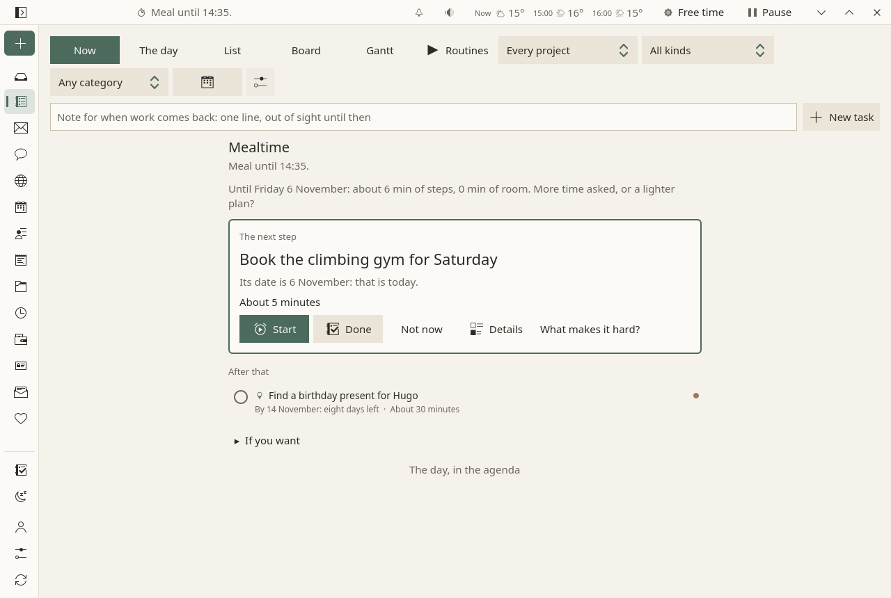
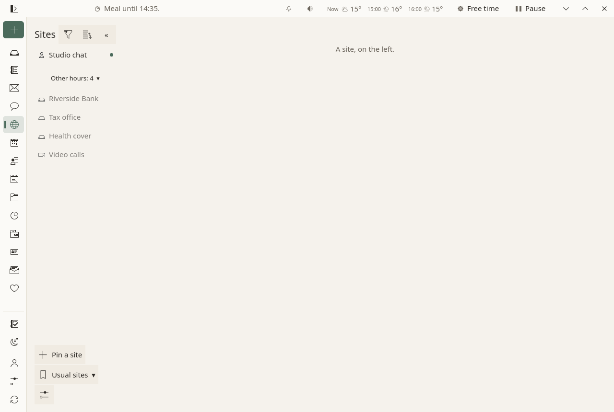
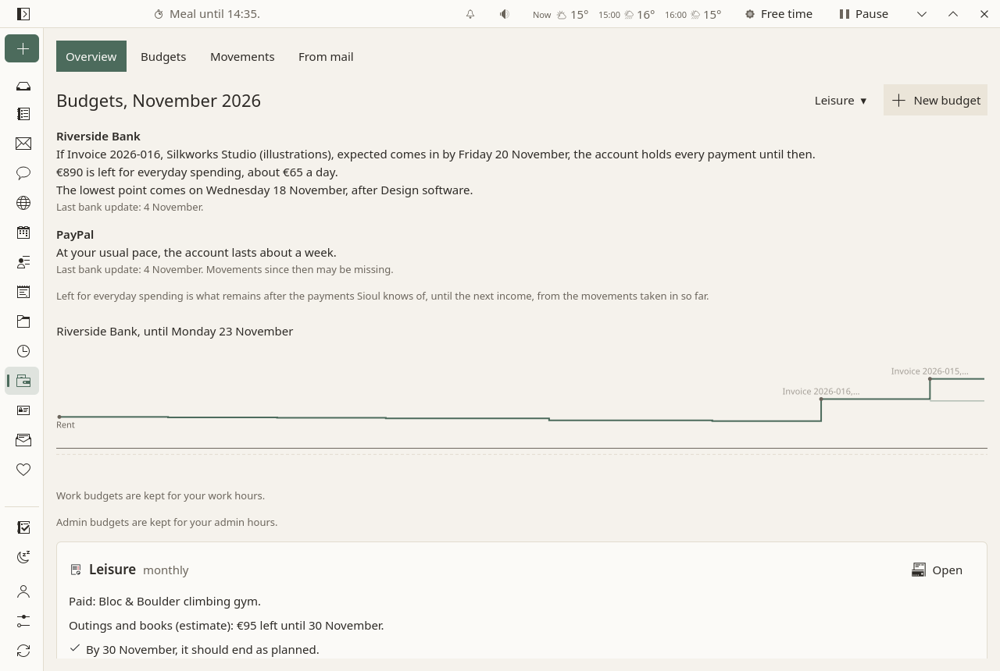
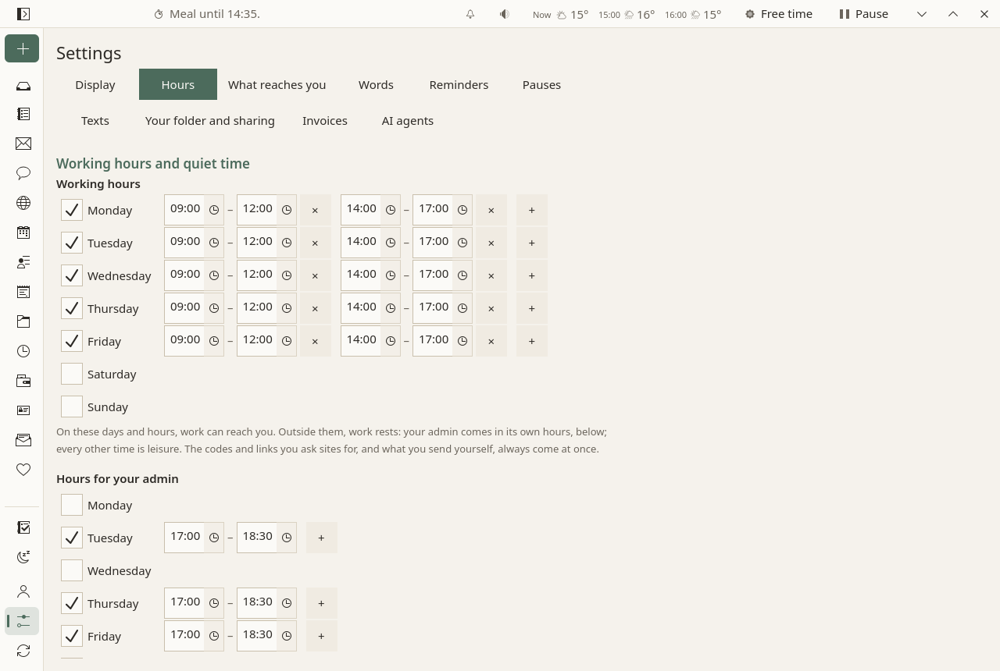

# Sioul

*Sioul* [siwl] is Breton for calm, peaceful, silent.

**Most software expects people to adapt to it. Sioul adapts the demands of the world to the person.**

Modern admin assumes someone always available and always at full strength. Sioul starts instead from what you can give today, your attention, your energy, your health and your rest, and fits work, institutions and money around it.

[Try Sioul, version 0.0.7](guide/install.md): Linux, Windows, macOS and Android. It is young and changes often; the rest of this page says what it is for.

A letter from the tax office, the task it asks for, the appointment, the document, the person who sent it and the payment all belong to one matter. You do not have to keep their relationships in your head: Sioul keeps them.

**Sioul is a personal administrative environment.** It gathers what modern life scatters across mailboxes, websites, calendars, task lists, folders and banks, and brings forward only what belongs in your attention now. It runs on your own devices.

**It is not a productivity app.** It does not try to make you do more, answer faster or keep up with everything: it tries to make admin ask less of you. It is designed as [an act of care](#an-act-of-care).

**It is made for the people who need it most, from research rather than taste.** Sioul is designed for the people for whom admin costs most, whose energy or thinking is limited or changes from day to day: neurodivergent people, including autistic people and people with ADHD; people affected by PTSD or the effects of trauma; people living with anxiety, depression or burnout; with ME/CFS (chronic fatigue syndrome), long COVID or another illness that limits energy or thinking; with an eating disorder; and everyone who knows admin anxiety, the dread that a letter, a form or a call from an office can bring: ADHD makes admin harder to start and to keep track of, PTSD can turn an office's demands into a reminder of harm, and the two often come together. Its design is trauma-informed: safety, predictability and choice come first, nothing surprises or blames you, and everything can be undone. Its design decisions are grounded in published research: for each one, the notes say what the studies found, how strong their evidence is, and what that evidence led Sioul to build or to refuse ([what the research says](dev/research.md)).

## You decide what gets through

The world does not get direct access to your attention. Mail, calls, messages from other apps, the websites you keep, reminders and doses all pass through the same rules, and you set them. Each kind of time in your day has rules of its own: work, your admin, leisure, meals, sleep, and the free time or the pause you take at the press of a button.

Some things come at once: the code you just asked a website for, a dose, a call from someone you chose. Some wait for their time: a client's mail waits for your working hours, the tax office's for your admin hours, and nobody's work reaches your evening. Mail keeps every address in one list, each address in view in the hours it is for. Some are shown where you look, on the Porch or on your phone's home screen, without a notification. Some never reach you, such as the senders you blocked.

**Being shown is not being interrupted.** What waits on the Porch asks nothing of you until you look; only what you allowed may interrupt you.

Most software lets each app decide when it may interrupt you. Sioul turns that around: you set the rules once, and they hold for your mail, calls, messages, sites and reminders. [What reaches you, and when](guide/notifications.md)

<figure markdown="span">
  [{ loading=lazy }](assets/screens/porch.png "Open the picture at full size")
  <figcaption>The Porch: what came in waits for the hours you chose; the codes you just asked for come at once.</figcaption>
</figure>

### Your devices follow your boundaries

Your attention does not belong to each device separately. Your computer and your phone are two ways into the same rules: what you set on one travels to the others, sealed, through a folder your own sync app carries. When your working hours end, work waits on all of them.

Do-not-disturb is one switch for every device: turned on at your computer, it holds on your phone, usually within minutes, and the other way round. A pause and Free time travel the same way. Each device then silences its own system, as far as that system lets an application do it.

Calls follow the same rules. On an Android phone, Sioul screens them: a call from someone who may not reach you now is declined plainly and goes to your voicemail, and the Porch tells you later who called. A call you missed from someone you know can become a task, "Call back", which closes itself once you have spoken. Sioul never answers a call and never listens. When you expect a call from a number you may not know, a click on any of your devices, your computer included, lets such numbers ring for an hour. [Do not disturb on every device](guide/notifications.md#do-not-disturb-on-every-device) · [Calls](guide/calls.md)

### A filter that learns what can wait

Most spam filters keep an inbox tidy. Sioul's protects your attention: it decides what can wait. It learns from your own mail, on your computer: from your junk folders, and from every message you mark as spam or not spam, on any of your devices. Sioul sends your mail to no filtering service.

It judges strangers' mail only, never that of someone you know, a code you asked for or a project's mail. It does not pretend to be sure either: what looks like spam, or might be, waits in a folded queue on the Porch, without a count or a notification, until you have time to look. You choose what it does with each verdict; until you do, it moves nothing. [Spam, and your own filter](guide/porch.md#spam-and-your-own-filter)

### Your letters back in your mail, sealed {#your-letters-back-in-your-mail}

Ordinary mail is not reliably encrypted end to end: servers encrypt it between them only when both agree, and it waits, readable, in every mailbox it reaches. So banks, insurers and public offices each built a "secure mailbox" behind its own login and code. Your own mailbox gets, at most, a note that something is waiting, and each office is one more place to remember, one more password, one more code: work that weighs most when memory, planning or energy are short, as they can be with ADHD, depression, burnout or PTSD. Nor did these portals keep the stores behind them safe: since 2020, breaches at France Travail, at two third-party payers of health insurance and at France Titres exposed the data of tens of millions of people.

Sioul does not encrypt mail for its own sake. OpenPGP, a key that stays on your security key (on a computer, and on a phone held against it or plugged in), a password manager and second factors are there so that letters can come back to mail, sealed for you alone: no office then needs one store of everyone's messages, and on your side everything is in one window. That depends on the office: Sioul can receive and send encrypted mail, but cannot make an office write it. Until offices do, Sioul gathers their portals in one place too. [Why, with the sources](guide/privacy-security.md#why-sioul-encrypts-mail)

## The other way round

| Most software | Sioul |
|---|---|
| Your obligations fill the day; your needs fit around them. | Your needs shape the day; the work fits around them. |
| Every app decides when it may interrupt you. | You decide what may reach you, and when; the rest waits for its time. |
| Each kind of thing has its own program, and you keep the links. | Each piece is tied to the others, and Sioul keeps the links. |
| A missed date becomes overdue work. | The plan starts again from today. Nothing becomes a debt. |

**These are not four interface choices. They are the four rules from which the rest of Sioul follows.** Mail, calls, the agenda, tasks, health, budgets and the phone are not separate modules side by side: they are the same four rules, each time applied to one kind of thing. They belong together because each one makes demands on the same limited attention: yours.

## Day to day

### Your needs first, then the work

You set your meals, your rest and your sleep first. They are kept free in the plan, and so is the time to get ready, get there and come back around each event. Each day, you can say how it is: clear, haze or fog; a hazy or foggy day holds less. At its end, you can say whether it was too much, about right or too empty, and from that the plan learns how much a day holds for you; it never guesses your state from what you do. The work goes in the hours you have given it, as one next step, with the reason it comes now. Nothing is ever overdue: a date in the plan is not a debt.

### A porch between the world and your attention

Nothing new walks straight in: arriving is not entering. Mail, the news from the "secure mailboxes" of banks and offices, chats, your phone's calls and texts, paper letters read from their scans, a payment your account may not hold, two events that need you at once: each waits on the Porch, sorted, for its time. The question is not what has arrived, but what belongs in your attention now. Each message is checked first, genuine or forged. The codes you just asked a website for come at once.

### Nothing to be afraid of getting wrong

No unread counts, no badges, no red, no streaks; new mail makes no sound, and nothing moves under your eyes. Anything moved, deleted or sent can be undone for ten seconds. Forged mail is set aside, with the reason. Nothing is sent, deleted or paid without you, not even by an AI agent. The words get the same care: a reminder says what it is, without calling you ill or praising you; stopping early is said as the ordinary thing it is; no forced cheer, no talking down.

## The software keeps the links

Most software splits one matter across a mail program, a calendar, a task list, a folder and a bank's website, and leaves you to remember how the pieces relate. Yet you never think "now I use my mail program"; you think "now I deal with this client". Sioul is built the second way.

**One appointment, the whole undertaking.** You scan a letter from the hospital. Sioul reads it on your computer and finds the appointment: one click puts it in your agenda, another adds the task that prepares it, where you write its steps (find the papers, write the questions) and what to bring. The bus there and back belong to the appointment, so Sioul knows when you must leave and when you are home again: it keeps that time free, lays the steps before you leave, and moves the buses when the appointment moves. The appointment opens its letter, its steps and its rides, and each of them opens it. The bill that follows, read from its own letter, is matched with the payment on your account.

Money works the same way: the Budgets page counts each account from one income to the next, and each payment keeps the mail, the invoice or the letter that told of it beside your bank's line. A matter you follow for months, a tax return, a lease, a client's work, can be a project: its mail comes to it by itself, and it lays its tasks, events, notes and people on one line of time.

## Your people

Admin is done for others too: a child, a parent you help, a partner. Sioul is made for people who carry it for others, or alone, or both: parents alone with their children, people who are autistic, have ADHD or both, the self-employed.

- **A page for each of your people**, in Contacts: their papers and where each stands, their agendas, their letters, the budgets and sites you keep for them. A child's identity card, the dentist, the school's letter and the pocket money, in one place.
- **The other parent's part, without a score**: each of a child's events says who takes it; **Who does what** never counts who did more.
- **The hand-over**: at 16 and at 18, one line says what passes to the child, with what Sioul keeps about them ready to give them.
- **Work money kept apart**: work budgets show in your working hours, and a share of each payment can be set aside for the declaration.
- **The whole outing counted**: the time to get ready, to get there and to come back.

Each of your people stays on your own devices, never written into a contact card, closed to AI agents until you open them; and Sioul watches nobody. [Why it works this way](guide/contacts.md#why-it-works-this-way) · [What the research says](dev/research.md#who-the-findings-are-about)

## Working for yourself

Freelancers, consultants, the self-employed: the work you sell and the admin it brings live in the same window, from the client's first mail to the paid invoice.

- **A project per client**, whose mail comes to it by itself: by the client's domain or addresses, by words in a subject or in an attachment's name.
- **Time counted while you work**, by the focus timer, or for a meeting or a call in a few keys: `1h30`. The same record teaches the plan [how long things take](guide/time.md#how-long-things-take).
- **What is left to bill**, for each project, in hours and in money, always in view.
- **The invoice in one click**: a line per task at the project's rate, numbers that never skip or repeat, most of the mentions French law asks for (you add "EI" after your name), a PDF; then the money expected in your budget until it is paid.
- **A spreadsheet for your accountant**, and the same time and invoices on your desktop and your laptop, sealed end to end.

No time tracker, timesheet or invoicing service beside it, and no subscription: your clients and your invoices stay in your own files. [Working for clients](guide/clients.md)

<figure markdown="span">
  [{ loading=lazy }](assets/screens/projects.png "Open the picture at full size")
  <figcaption>A client's project: its tasks, its time, its mail and its invoices, on one line of time.</figcaption>
</figure>

## When capacity changes

Sioul was designed first for the people named at the top of this page; the same needs come with irregular eating, with caring for someone, with a bad stretch of life.

Admin anxiety is not laziness: putting off a letter protects your mood for now (Sirois & Pychyl 2013). And administrative burden weighs most on the people with the fewest resources left, executive function and health among them (Christensen et al. 2020): people reporting ADHD, anxiety or chronic pain find tax and student-aid rules more burdensome, and those with ADHD or pain lose the aid more often (Bell et al. 2023). Sioul works from what a day can hold, which changes, not from a diagnosis: it needs none, and guesses nothing about your state. You say what you can do, and it plans around that.

People with a disability or a long-term health condition work for themselves more often than others (U.S. Bureau of Labor Statistics 2026), and studies link ADHD to self-employment (Verheul et al. 2016); some say they left jobs that would not adapt to them (Adams et al. 2019). Working for yourself brings the admin an employer would otherwise do, of exactly the hard kind: quotes and invoices, taxes, contributions, clients, the bank. So Sioul carries a small business too ([above](#working-for-yourself)).

## In the window

-   :lucide-inbox:{ .lg .middle } __The Porch__

    ---

    New mail from every address, checked and sorted into lanes; calls, texts, letters, money and the sites you keep, each in its section; the codes you asked for, at once.

    [The Porch](guide/porch.md)

-   :lucide-list-checks:{ .lg .middle } __One next step__

    ---

    The one step to take now, and why; the day laid out around your meals and appointments. Starting is helped, and stopping counts.

    [Tasks](guide/tasks.md)

-   :lucide-sunrise:{ .lg .middle } __Hours set in advance__

    ---

    Work, your own admin, leisure, meals and sleep, Free time and Pause. Each address, site, budget and task belongs to one or several; the rest waits, out of sight. While you sleep, only what you let through disturbs, such as your doses.

    [Hours](guide/hours.md)

-   :lucide-heart-pulse:{ .lg .middle } __Meals, rest, medicines__

    ---

    Meals, naps and the night kept free in your plan, and moved for one day in a tap. Each dose reminded once; when Sioul cannot know whether it was taken, it says so. Nothing about food: no portions, no numbers, no "missed".

    [Health](guide/health.md)

-   :lucide-folder-open:{ .lg .middle } __Everything tied together__

    ---

    Mail from every address in one list, your phone's texts and calls, agenda, contacts and your people, notes, projects, time and invoices, budgets and bank accounts, papers, paper letters read and filed, medicines, and the websites you have to check.

    [The window](guide/first-steps.md#the-window)

-   :lucide-house:{ .lg .middle } __Yours__

    ---

    Plain files and your own accounts. What your devices share goes sealed end to end, through a folder your own sync app carries. No server of ours.

    [Sharing between your devices](guide/sharing.md)

<figure markdown="span">
  [{ loading=lazy }](assets/screens/tasks-now.png "Open the picture at full size")
  <figcaption>Tasks: one next step, and why.</figcaption>
</figure>

<figure markdown="span">
  [{ loading=lazy }](assets/screens/sites.png "Open the picture at full size")
  <figcaption>Sites: secure mailboxes and chats, logged in once.</figcaption>
</figure>

<figure markdown="span">
  [{ loading=lazy }](assets/screens/budgets.png "Open the picture at full size")
  <figcaption>Budgets: on track or not, said in words.</figcaption>
</figure>

<figure markdown="span">
  [{ loading=lazy }](assets/screens/settings-hours.png "Open the picture at full size")
  <figcaption>Hours: work, your admin.</figcaption>
</figure>

Your Google calendars, contacts and tasks can come too. If you sign in with your Google account, Sioul reads and writes them, only to show them beside the rest of your admin and to save the changes you make there, and keeps a copy on your device. Nothing goes to the developer. What it reads, where it keeps it, and how to take the access back: [privacy policy](privacy.md#google-calendars-contacts-and-tasks).

## Built on research, and on refusals

Each rule in Sioul comes from a chain: what studies observed, why, the rule it gives, what Sioul does, and what it refuses. Six of them:

- **Capacity changes, and only you know when.** Autistic burnout eases when expectations are lowered (Raymaker et al. 2020); adults with ADHD liked a "brain weather" view, and disliked tools that watch them (Chen, Meng & Nie 2026). So you say how the day is, and nothing is guessed.
- **Fewer, predictable looks at mail.** Checking mail three times a day lowered stress in a randomised trial; batched notifications helped attention and mood, while none at all made people more anxious (Kushlev & Dunn 2015; Fitz et al. 2019). So mail waits for the hours you chose, and Sioul says when they come.
- **Starting is the hard part.** Autistic inertia, a difficulty acting on intentions, eases with outside scaffolding (Buckle et al. 2021); with ADHD, help belongs at the point of performance (Barkley 2012). So Sioul picks one small next step, and says why.
- **Evenings are for recovery.** Detaching from work after hours goes with less exhaustion, and merely expecting work mail in the evening does harm (Wendsche & Lohmann-Haislah 2017; Becker et al. 2021). So work rests outside your working hours.
- **Progress, never streaks.** Broken streaks lower later engagement, more so when people blame themselves (Silverman & Barasch 2023). So Sioul shows what got done, and never counts what did not.
- **Safety, trust and choice first.** Trauma-informed computing asks software for safety, trust, collaboration and the person's own choice (Chen et al. 2022). So nothing in Sioul surprises you, every reason is shown, everything can be undone, and nothing is deleted or sent without you.

Sioul also refuses what other software does, each time with the evidence: streaks, trophies and points; counts of what is "overdue"; repeated reminders; scores, charts and calendars of mood, symptoms or energy; guessing your capacity or your mood from your behaviour or from a watch; a schedule that moves things without asking; an AI or a service that sends, books or pays on its own.

All the findings, with their sources and the rule each one gives: [what the research says](dev/research.md). Each study in detail, how strong its evidence is, and what was built, left for later or refused: [the research notes](dev/research/README.md). Not known yet: whether Sioul itself lightens admin. That is still to be measured, with the people who use it.

## An act of care

Sioul is the working counterpart of a book by the same author, *Design and Engineering, in Spite of Open-Source* ([free, in PDF and EPUB](https://editions.aurelienpierre.com/en/concevoir/)). Its conclusion uses "a word engineering never utters: to design is to care". It also describes what happens to the people least equipped for it: "First, everyone is conscripted to the computer, for tasks that got done fine without it; then the least equipped are technically set up to fail; then they are made to carry the blame." Everyday admin is where this happens most, and where Sioul applies the book's method. One test decides everything added to it: does it take work off the person, rather than move it somewhere else?

The same reasoning decides how Sioul is built. Your data stays on your devices, in plain files and open formats, and in your own accounts. Your notes are a folder of Markdown files that Obsidian and Nextcloud Notes read as their own ([Notes](guide/notes.md#the-same-folder-as-obsidian-and-nextcloud-notes)). What travels between your devices goes sealed, through a folder your own sync app carries. There is no server of ours, and nothing reaches the developer. The code is free software, under the GPL. A tool meant to lift the weight of administrative machinery cannot, without contradicting itself, tie you to a service you cannot leave: as the book puts it, "a tool serves its user, or it betrays them".

## Where it stands

Sioul is young (version 0.0.7) and changes often; it is used every day. Packages for Windows, macOS (Apple silicon and Intel), Linux (AppImage and Flatpak) and Android (64-bit phones, Android 9 and later) are on [the releases page](https://github.com/aurelienpierre/sioul/releases/latest) ([Install](guide/install.md)): built and tested by GitHub, used daily on Linux and on an Android phone, little tried elsewhere yet.

It is made by one person, in the open: no support is promised. Questions and reports are welcome in [GitHub issues](https://github.com/aurelienpierre/sioul/issues).

## Where to start

1. [Install Sioul](guide/install.md).
2. [Take the first steps](guide/first-steps.md): add your mail, your calendars and contacts, your Google account, the websites you check.
3. [Set your hours](guide/hours.md), so that work, admin and rest each have their time.
4. [See what reaches you, and when](guide/notifications.md), said in sentences, and change what does not suit you.
5. Then read about [the Porch](guide/porch.md), where new mail waits.

## For technical readers

- **Security by default, with nothing to set up**: no server of ours, no telemetry, no update check; encrypted connections only (TLS through rustls, with no clear-text option); Sioul's folders closed to the computer's other accounts ([Privacy and security](guide/privacy-security.md)). Nothing goes to an outside AI service unless you turn it on: the AI shield of one public address, or an agent you connect yourself ([AI agents](guide/ai-agent.md)).
- **Every message checked on arrival**: SPF, DKIM, DMARC, ARC and reverse DNS, by Sioul itself. Forged mail is set aside with the reason, and a sender that nothing authenticates counts as a stranger, whatever address it shows. Names borrowed from brands and public services are caught, even when written with look-alike letters ([How a sender is checked](guide/mail.md#how-a-sender-is-checked)).
- **A spam filter of your own**: a fastText classifier trained on your computer from your own mail (the headers and the start of each text, never attachments), first when you ask, then again by itself once a week while that computer is plugged in and idle; only its compact table travels to your phone, sealed ([Your own spam filter](guide/settings.md#your-own-spam-filter)).
- **Attachments scanned before they open**, by your system's antivirus: ClamAV on Linux and macOS, Microsoft Defender (through AMSI) on Windows. Programs never open from a mail, and on Windows and macOS the files you open or save carry the system's mark that they came from the Internet.
- **HTML mail made safe**: nothing remote loads, ever, and nothing runs; links show their address before they open.
- **Hard authentication**, so that letters can come back to mail, sealed, and logins stop living in your memory:
    - your OpenPGP key on a security key (any OpenPGP card: a YubiKey, a Nitrokey…): the card itself signs and decrypts, so your private key never enters your device; its PIN never written or logged. On a computer, and on a phone held against it (NFC) or plugged into its USB-C port, tested there against a stand-in card so far;
    - on computers, FIDO2 and WebAuthn security keys, and the passkeys kept on them, in the sites you keep, with the PIN asked in Sioul's own dialog;
    - Bitwarden, read by Sioul's own client and never written; on a computer, unlocked with a security key as the second step, or alone as a passkey.
- **OpenPGP**: Sequoia, signing and encrypting as you send, with Autocrypt (keys taken from verified mail only) and the Web Key Directory.
- **Sharing between your devices**, a phone included: each device keeps its own data; a folder that any sync app carries (Nextcloud, Dropbox, Syncthing, Google Drive, OneDrive…) passes changes between them, each device writing only its own file, sealed end to end (XChaCha20-Poly1305, the key made from your passphrase by Argon2id and kept in each device's keyring). Notes and papers travel file by file; earlier versions are kept on each device. No server of ours. [How it works, and what it protects](guide/sharing.md).
- **AI agents**, only if you connect one: `sioul mcp` serves an agent what Sioul keeps on this device, through the Model Context Protocol. It never sends or pays, and deletes nothing but an event or a task you asked it to, with Undo in the window; one-time codes and bank, card and social security numbers are masked, your health and each person you did not open kept from it; each call is logged by the addresses of what was given, never its words ([Using an AI agent](guide/ai-agent.md)).
- **Open standards and plain files**: IMAP, SMTP, CalDAV and CardDAV, tasks linked as RFC 9253 says, Maildir, TOML, and notes in Markdown, fully compatible with Obsidian vaults (wikilinks, embeds, tags, front matter, aliases) and with Nextcloud Notes (`.txt` or `.md`, categories as folders). What works with what, feature by feature, and how far each was tested: [Works with](guide/compatibility.md).
- **Free software**, under the GPL-3.0-or-later licence, written in Rust, with a Qt 6 window.

For developers: [the design notes, the architecture, and how to build and test](dev/index.md).

